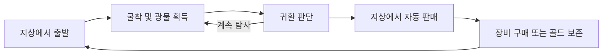
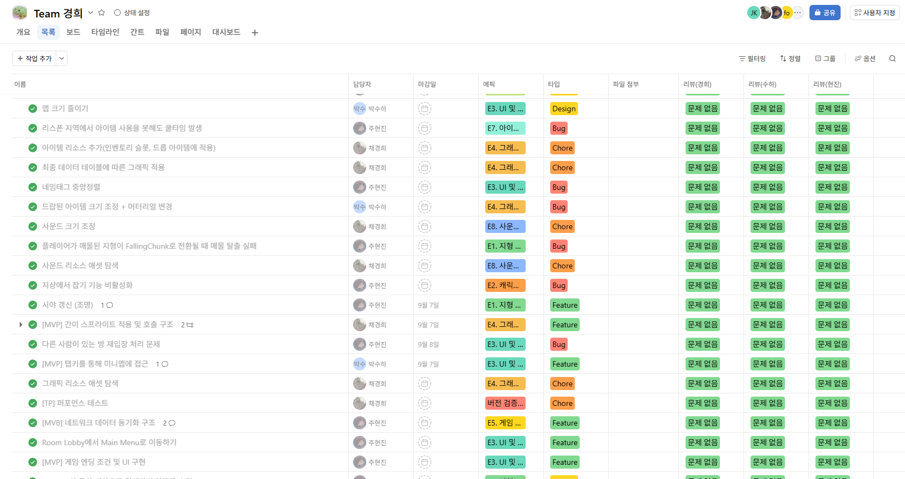
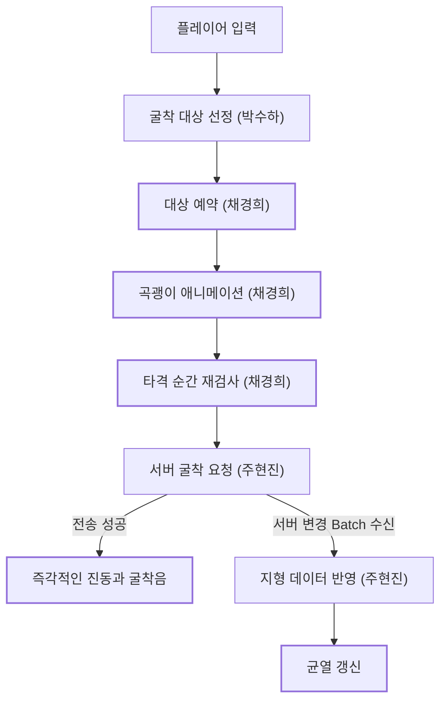
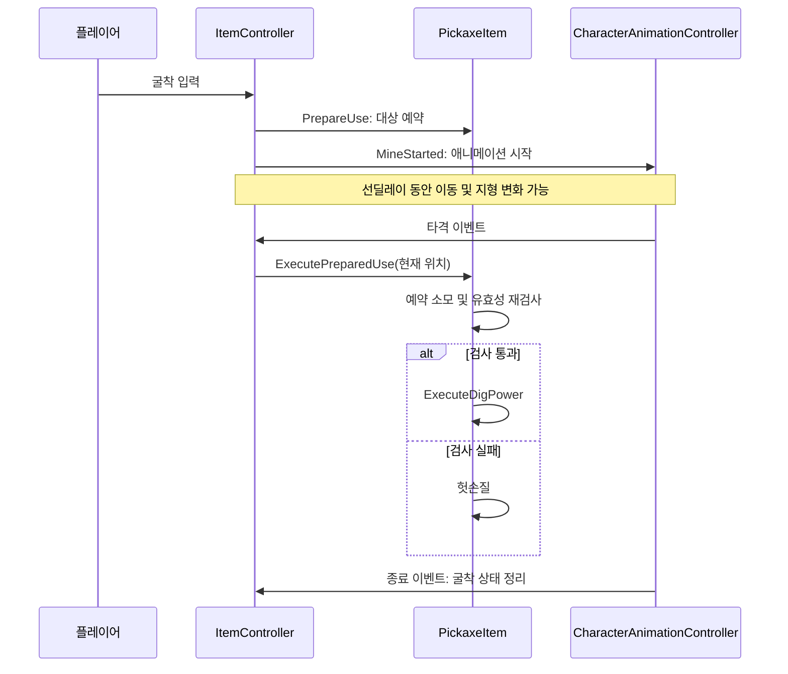
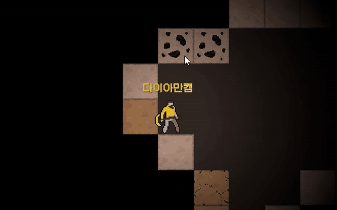
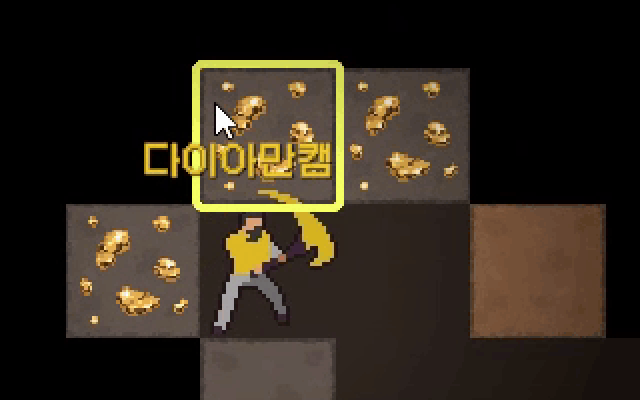
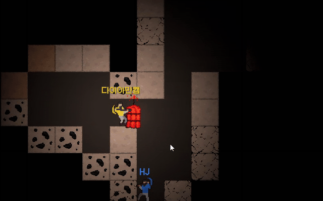

# Folk Sack

> 최대 4명이 하나의 광산을 파 내려가며 광물을 모으고, 지상에서 판매해 얻은 골드로 경쟁하는 2D 멀티플레이 채굴 게임입니다. 프로젝트 발표에서 참가 5팀의 투표로 '가장 좋은 경험을 준 게임' 부문에 선정되었습니다.


| 항목 | 내용 |
|---|---|
| 장르 | 2D 사이드뷰 경쟁형 멀티플레이 채굴 (2~4인 개인전) |
| 기간 | 2026.08.14 ~ 09.18 (약 1개월) |
| 인원 | 3인 (채경희, 주현진, 박수하) |
| 내 역할 | 팀장, 기획 및 일정 관리, 굴착 판정 직접 구현, 애니메이션과 굴착 피드백 설계 및 AI 협업, 그래픽과 UI 제작, QA |
| 개발 환경 | Unity 6000.3.15f1, C#, URP, DOTween, Cinemachine, Input System, Asana |
| 상태 | 기간 내 멀티플레이 빌드 완성 |
| 링크 | [GitHub](https://github.com/ashadeveloperr/3rd-TeamProject-KH), [시연 영상](https://youtu.be/e2lY36N8coE) |

## 1. 게임 소개

> 더 깊이 파 내려갈 것인가, 지금 지상으로 돌아갈 것인가

2D 액션 플랫포머에서 플레이어가 지형을 파괴하고, 그 결과로 무너진 지형이 다른 플레이어의 행동에도 영향을 준다면 어떨까 하는 생각에서 출발한 게임입니다. 단순히 광물을 많이 찾는 것뿐 아니라, 붕괴에 휘말리지 않고 광물을 가지고 돌아올 수 있는 갱도를 만드는 일도 중요하도록 기획했습니다.

Folk Sack에서는 광산을 깊이 파 내려갈수록 값비싼 광물을 얻을 수 있습니다. 하지만 가방이 무거워질수록 이동이 어려워지고, 지형을 잘못 파면 머리 위의 흙이 무너집니다. 힘들게 모은 광물도 지상으로 돌아오기 전에 죽으면 다른 플레이어에게 빼앗길 수 있습니다. 한 번 더 곡괭이질을 할 것인지, 지금까지 얻은 광물을 가지고 돌아갈 것인지를 탐사 중에 계속 고민하게 만들고 싶었습니다.

### 1.1 광물의 획득과 판매, 장비 구매



광물은 지상에 도착하면 자동으로 판매됩니다. 플레이어는 번 돈으로 곡괭이 등 장비를 강화해 이후 탐사를 수월하게 할 수 있습니다. 다만 골드 자체가 승리 조건이므로 장비를 사는 만큼 현재 승리에서는 멀어집니다. 목표 골드에 가장 먼저 도달하면 즉시 승리하고, 제한 시간이 끝나면 가장 많은 골드를 모은 플레이어가 승리합니다.

모든 플레이어가 같은 광산을 공유하기 때문에 다른 사람이 파 놓은 갱도를 이용할 수도 있고, 다이너마이트와 지뢰를 이용해 상대의 탐사를 방해할 수도 있습니다. 사망하면 보유 아이템 전부와 골드 절반을 떨어뜨리며, 이를 다른 플레이어가 주울 수 있습니다. 따라서 한 플레이어의 굴착과 전투는 그 사람의 수익뿐 아니라 다른 플레이어가 이용할 수 있는 지형과 자원에도 영향을 줍니다.

<!-- 보완 주석 01: 실제 플레이 규칙을 보여주는 심도별 광물 가치와 무게에 따른 이동 변화, 사망 시 드롭 및 지상 판매 장면이 있다면 추가. 수치는 원본 기획서 또는 구현 기준 확인 후 작성. -->

저는 팀장으로서 초기 기획과 개발 범위를 정하고 일정 관리 및 검증을 담당했습니다. 클라이언트에서는 플레이어가 가장 많이 반복하는 굴착의 실행 판정을 직접 구현했으며, 캐릭터 애니메이션과 굴착 피드백을 설계하고 AI와 협업하여 구현했습니다. 그래픽과 UI 제작, 사운드 검증도 담당했습니다.

## 2. 기획 및 팀 운영

> 한 달이라는 개발 기간 안에서 지형과 플레이어의 상호작용을 구현하기

### 2.1 개발 범위 설정

세 사람이 한 달 동안 개발해야 했기 때문에 초기 기획 단계부터 기능의 수보다 한 판의 게임이 성립하는지를 우선 고려했습니다. 첫 회의를 위해 제가 작성한 기획안에서는 최대 네 명이 같은 광산에서 광물을 캐고, 지상에서 판매하여 승리하는 구조를 만들고 그 안에 지형과의 상호작용 및 간접적인 경쟁 요소를 추가하고자 했습니다.

초기에는 지형 붕괴와 별개로 폭우, 물, 용암 등의 자연재해도 구상했습니다. 그러나 물과 용암이 플레이어가 파낸 지형을 따라 흐르고 차오르게 하려면 유체의 흐름을 모사하는 규칙뿐 아니라 여러 클라이언트에 같은 결과를 전달하는 방식도 필요합니다. 이를 한 달 안에 구현하고 검증하기에는 부담이 크다고 판단했습니다. 따라서 자연재해를 제외하고 굴착에 의해 지형이 붕괴하는 현상에 집중하기로 했습니다.

경쟁 수단은 처음 기획한 목록을 그대로 구현하기보다 실제 플레이에서 쓰임새가 있었던 다이너마이트와 지뢰를 남겼습니다. 다이너마이트는 지형을 빠르게 파괴할 때도, 다른 플레이어의 탐사를 방해할 때도 사용할 수 있었고, 지뢰는 상대가 지나갈 것으로 예상되는 경로에 설치하여 견제할 수 있었습니다. 물, 독가스, 몬스터 등은 구현 범위에서 제외했습니다.

| 주요 기획 변경 | 변경 이유 |
|---|---|
| 드릴과 굴착 게이지 → 곡괭이와 균열 | 굴착을 기다리는 행동보다 타격하고 반응을 확인하는 행동으로 만들기 위해 |
| 이동 방향으로 굴착 → 마우스로 조준 | 이동과 굴착 방향을 분리해 조작의 자유도와 속도감을 살리기 위해 |
| 사망 시 일부 자원 소멸 → 아이템 전부와 골드 절반 드롭 | 상대를 쓰러뜨린 플레이어에게 보상을 주되 사망한 플레이어에게도 재기의 여지를 남기기 위해 |

사망 시 손실 규칙도 수정했습니다. 기존에는 일부만 떨어지고 나머지가 사라지기 때문에 한 번 죽은 플레이어가 다시 경쟁에 참여하기 어려웠습니다. 상대를 방해한 플레이어에게 획득할 보상을 주면서도 사망한 플레이어가 장비를 마련하고 다시 탐사할 여지를 남기고자 골드의 절반은 보존하도록 했습니다.

<!-- 보완 주석 02: 초기 기획안 및 변경 결정 기록에서 기존 사망 손실 비율, 변경 시점과 플레이테스트 사례를 확인. 드릴에서 곡괭이로 바뀐 계기와 마우스 조준 방식의 채택 시점도 원문 확인 시 보강. -->

### 2.2 역할 분담

| 담당 | 주요 역할 |
|---|---|
| 주현진 | 지형 생성, 내구도, 붕괴, 매몰, 서버 권위형 지형 및 게임 상태 동기화, 시야와 미니맵, 인벤토리 무게, 로비 및 원격 캐릭터 동기화 |
| 박수하 | 캐릭터 이동, 벽 매달리기, 회피, 굴착 대상 선정과 조준 표시, 사용 아이템, 상점, 사망 및 리스폰 처리 |
| 채경희 (본인, 팀장) | 기획과 범위 결정, 일정 및 검증, 굴착 2단계 판정, 캐릭터 애니메이션 연결, 균열과 타일 진동, 그래픽과 UI 및 사운드 QA |

지형과 네트워크, 캐릭터 및 아이템이라는 두 영역을 팀원들이 맡고, 저는 각 기능이 기획한 게임 규칙대로 연결되도록 조율하면서 굴착과 그래픽을 개발했습니다. 처음에는 제가 담당 영역 사이의 빈틈을 메웠지만 작업이 늘어나면서 일부 업무를 팀원에게 나누었고, 이후 특정 팀원에게 업무가 집중되는 것을 확인해 다시 분담했습니다.

<!-- 보완 주석 03: 업무 재배분 전후의 구체적인 작업 카드, 담당자 변경 이유 및 시점을 Asana 기록에서 확인. 팀원별 기여 범위를 추가하거나 변경할 때는 실제 구현 이력과 대조. -->


캐릭터는 CraftPix의 무료 스프라이트를 수정했고, 자원, 아이템, 광물과 균열 이미지는 직접 도트로 제작했습니다. HUD와 상점, 결과창, 메인 및 로비 UI도 직접 디자인해 적용했습니다. 팀원들이 개발한 기능을 화면에서 일관된 방식으로 보여 주는 일 역시 제 담당이었습니다.

### 2.3 일정 관리와 검증 기준



8월 28일까지 Technical Prototype을 완성하고, 이후 상점과 인벤토리, 무게, 엔딩 등을 추가하는 일정으로 잡았습니다. Asana에서 버전별 목표를 기능 단위로 나누고, 작업의 내용과 담당자 및 완료 조건을 기록할 수 있는 카드 템플릿을 마련했습니다. 구현한 팀원 혼자서 완료를 판단하지 않도록 카드에 팀원별 리뷰 칸을 두었습니다. 멀티플레이 검증 환경이 아직 마련되지 않은 기간에는 각자 확인할 수 있는 기능과 검증 역할도 정했습니다.

기능이 일반적인 상황에서 작동하는지 확인하는 것 외에도 반복 사용이나 예외 상황에서 문제가 생기는지 검증했습니다. 같은 위치를 반복 굴착하거나, 연쇄 붕괴가 일어나고, 플레이어가 매몰된 후 지속 피해를 받다가 탈출하는 경우 등 12가지 상황을 직접 확인했습니다. 넓은 테스트 지형에서 프레임이 크게 떨어지는 문제도 발견해 팀에 공유했습니다. 붕괴와 매몰 및 지형 성능에 관련된 구현과 수정은 지형 담당 팀원이 맡았습니다.

<!-- 보완 주석 04: 검증한 12개 상황의 전체 목록, 기대 결과와 관찰 결과 및 해당 이슈, 넓은 맵의 크기와 FPS 측정 환경이 있다면 표 또는 이미지로 보강. 성능 개선 수치는 실측 근거 없이 추가하지 않음. -->

## 3. 굴착 판정과 캐릭터 제어

> 곡괭이가 땅에 닿는 순간 지형이 반응하도록 만들기

드릴을 이용해 일정 시간 동안 지형을 파는 방식에서 곡괭이로 지형을 타격하는 방식으로 바꾸면서, 지형의 내구도가 감소하는 시점도 캐릭터가 곡괭이를 휘두르는 동작과 일치해야 했습니다. 그런데 여러 플레이어가 지형을 공유하는 게임에서 곡괭이질은 단순히 애니메이션의 특정 프레임에 내구도를 감소시키는 것만으로 구현할 수 있는 행동이 아니었습니다. 대상 선정과 캐릭터 상태, 지형 데이터 및 서버 판정이 모두 연결되기 때문입니다.



저는 굴착 대상 예약과 타격 실행을 직접 설계하고 구현했습니다. 애니메이션의 전이 조건과 굴착 피드백의 동작 규칙도 직접 정했고, 연결 코드와 시각 효과의 구현에는 AI를 활용했습니다. 팀원이 구현한 지형 데이터와 서버 판정 경로에 제 작업을 연결했습니다.

### 3.1 굴착 대상을 예약하고 타격 순간에 다시 검사하기


처음에는 마우스를 클릭하는 순간 굴착할 칸을 고르고 내구도를 감소시켰습니다. 하지만 곡괭이를 들어 올린 뒤 내리찍는 애니메이션을 적용하고 보니 아직 곡괭이가 땅에 닿지도 않았는데 타일이 부서지는 문제가 발생했습니다.

이를 해결하기 위해 실행 시점을 타격 프레임으로 옮기는 것은 어렵지 않았습니다. 문제는 클릭한 시점과 타격하는 시점 사이에 굴착 대상의 유효성이 달라질 수 있다는 것이었습니다. 플레이어가 이동해 타일이 사거리 밖으로 벗어나거나, 다른 플레이어가 그 타일을 먼저 파괴하거나, 위쪽 지형이 무너질 수도 있습니다. 반대로 타격할 때 다시 마우스 방향으로 대상을 선정하면 처음 조준한 타일과 실제로 부서지는 타일이 달라질 수 있습니다.

저는 한 번의 곡괭이질로 처음 조준한 타일만을 타격할 수 있도록 굴착을 예약과 실행 두 단계로 나누었습니다. 클릭할 때 `PrepareUse`에서 대상 타일과 지형 관리자를 저장하고, 타격 프레임에서 `ExecutePreparedUse`가 현재 플레이어 위치를 기준으로 예약된 대상을 다시 검사합니다. 타일이 없어졌거나 조건을 만족하지 않으면 다른 타일을 대신 파지 않고 헛손질로 끝내도록 했습니다.



대상 선정은 팀원이 구현한 `TryGetTargetCell`을 사용합니다. 마우스 방향에서 처음 만나는 지형과 사거리를 확인하며, 조준 표시에도 같은 규칙을 사용합니다.

`PickaxeItem.cs`: `ExecutePreparedUse`

```csharp
public void ExecutePreparedUse(Vector3 currentOwnerPos)
{
    if (!hasPendingDig ||
        pendingTerrainManager == null)
    {
        return;
    }

    // 이번 Swing의 타격 기회는 여기서 소비
    hasPendingDig = false;

    if (!IsPreparedTargetStillValid(currentOwnerPos))
    {
        pendingTerrainManager = null;
        return;
    }

    ExecuteDigPower(
        pendingTerrainManager,
        pendingTargetCell,
        Def.PickaxeData.Value.DigPower);

    pendingTerrainManager = null;
}
```

예약을 먼저 소모하고 나서 유효성을 검사하는 순서에도 의미가 있습니다. 유효성 검사에 실패했더라도 이미 곡괭이를 한 번 휘두른 것이므로 이번 타격의 기회는 끝난 것으로 처리해야 합니다. `hasPendingDig`를 먼저 해제하면 타격 이벤트가 중복 호출되거나 동일한 예약에 대해 다시 실행이 요청되더라도 내구도가 여러 번 감소하지 않습니다.

서버 판정이 연결되면서 박수하 팀원이 재검사 기준을 서버와 일치하도록 수정했습니다. 최초 구현과 최종 코드는 다음과 같은 차이가 있습니다.

| 구분 | 최초 구현 | 최종 서버 연동 코드 |
|---|---|---|
| 실행 시점 | 곡괭이가 닿는 프레임 | 동일 |
| 거리 검사 | 타일 경계의 가장 가까운 점까지 | 타일 중심까지 |
| 타일 유효성 | 실행 전 지형 존재 여부 확인 | 실행 경로에서 채굴 가능 여부 확인, 온라인에서는 서버가 최종 판정 |
| 타격 기회 | 예약을 먼저 소모하고 실행 | 동일 |

서버에 맞춰 거리 검사 기준이 변경된 후에도 한 번 예약한 타일을 타격 시점에 다시 검사하고 예약은 한 번만 소모한다는 구조는 유지되었습니다. 이 구조가 성립하려면 타격 이벤트가 중복될 때뿐 아니라 타격이나 종료 이벤트 자체가 오지 않는 경우도 처리할 필요가 있었습니다.

<!-- 보완 주석 05: 예약 후 대상 소멸, 사거리 이탈, 다른 플레이어 선행 굴착 및 Animation Event 중복/누락의 테스트 기록이 있다면 재현 절차와 결과를 추가. 최초 및 최종 코드의 검증 항목은 링크된 커밋 기준으로 재확인. -->

### 3.2 굴착 동작이 중간에 끊기는 경우 처리하기



타격 시점을 애니메이션에 맞추면서 굴착의 진행 상태도 애니메이션에 영향을 받게 되었습니다. `Mine.anim`은 0.5초 길이이며, 곡괭이가 닿는 0.333초에 `AnimationEvent_MineImpact`, 마지막 0.5초에 `AnimationEvent_MineFinished`를 호출합니다. 앞의 이벤트가 예약된 굴착을 실행하고 뒤의 이벤트가 상태를 정리합니다. 좌클릭을 유지하면 한 동작이 끝날 때마다 다음 굴착을 시작합니다.

하지만 캐릭터가 이동하거나 벽에 매달리는 순간 굴착 애니메이션이 중간에 끊긴다면 마지막 프레임의 상태 정리 이벤트가 호출되지 않을 수 있습니다. 또한 벽에 매달린 채로 굴착을 허용하면 공중에서 벽이나 천장을 파고 올라갈 수 있는데, 이는 지형이 무너질 가능성을 고려하면서 갱도를 만들어 내려가도록 유도했던 기획과 맞지 않았습니다. 동작을 끝까지 재생하는 것이 필요한 상황과 즉시 중단해야 하는 상황을 구분해야 했습니다.

그래서 이동과 벽 매달리기를 서로 다른 전이로 처리하기로 했습니다.

| 전이 | 선택 | 결과와 대가 |
|---|---|---|
| 굴착 → 이동, 점프, 낙하 | Exit Time으로 굴착 동작을 끝까지 재생 | 타격과 종료 이벤트가 보장되지만 이동 애니메이션 전환은 늦어짐 |
| 굴착 → 벽 매달리기 | 즉시 전이하고 코드에서 예약과 상태를 취소 | 매달린 채 굴착할 수 없으며 진행 중인 동작이 중단될 수 있음 |

Animator에 이동, 점프, 낙하, 매달리기, 굴착, 사망 상태를 설정하고, `CharacterAnimationController`에서 이동 속도와 착지 여부, 매달리기 등의 상태를 Animator 파라미터로 전달하도록 했습니다. 캐릭터 상태 전이 규칙은 제가 정했고 연결 코드의 작성에는 AI 도움을 받았습니다.

애니메이션만 제어해서는 충분하지 않으므로 `ItemController`에서도 매달린 동안 굴착을 새로 시작하지 못하게 하고, 진행 중인 예약을 취소하도록 했습니다. 타격 이벤트가 호출되더라도 매달린 상태라면 실행하지 않습니다. 굴착 중에는 시각적 방향을 유지하여 곡괭이가 처음 조준한 방향에서 반대로 뒤집히지 않게 했습니다.

## 4. 멀티플레이 굴착 피드백

> 곡괭이의 타격은 즉시 보여주고, 내구도는 서버 판정에 따라 표시하기

굴착을 실행하는 시점을 애니메이션과 맞추고 나면 이제 타격 결과를 플레이어에게 전달해야 합니다. 온라인에서는 팀원이 구현한 서버가 타일의 내구도와 파괴 여부를 결정합니다. 서버의 응답을 받은 뒤에 모든 효과를 재생하면 곡괭이가 닿은 순간에는 아무런 반응이 없을 수 있고, 반대로 요청을 보내자마자 내구도를 감소시키면 실제 서버 판정과 다른 지형을 보여줄 수 있습니다.

따라서 굴착 피드백을 타격 행위 자체에 대한 반응과 지형의 손상 상태에 대한 표시로 구분했습니다. 요청 전송에 성공하면 타일을 흔들고 소리를 재생하되, 내구도의 변화는 서버가 확정한 상태를 바탕으로 균열로 나타내도록 했습니다.

### 4.1 서버 요청과 결과 표시

`PickaxeItem`은 타격 판정을 통과하면 `RoomClient.RequestExcavation`을 통해 굴착 대상 좌표와 곡괭이 ID를 서버에 보냅니다.

`PickaxeItem.cs`: 서버 요청과 타격 피드백 연결부

```csharp
RoomClient roomClient = RoomClient.Instance;
if (roomClient != null && roomClient.IsAuthoritativeTerrainMode)
{
    // 로컬 지형 변경은 서버의 terrain_batch를 받은 경우에만 적용한다.
    if (roomClient.RequestExcavation(cell, Def.ID))
        manager.PlayTileHit(cell);
    return;
}
```

서버 요청 경로는 주현진 팀원이 구현했습니다. 저는 전송에 성공한 경우 `PlayTileHit`을 호출하도록 연결했습니다. 여기서 전송에 성공했다는 것은 서버가 굴착을 승인했다는 뜻이 아닙니다. 타격 진동과 소리는 로컬 플레이어의 입력에 대한 반응이며, 그 시점에는 내구도를 변경하지 않습니다. 서버에서 요청을 거절하면 타일이 흔들렸더라도 균열은 갱신되지 않을 수 있습니다. 타격 진동은 로컬 곡괭이의 요청에만 연결했습니다.

서버가 보낸 지형 변경 Batch는 Revision 순서에 따라 적용됩니다. 굴착뿐 아니라 붕괴와 폭발에 의한 지형 변경도 같은 경로를 거치므로, 균열은 개별 곡괭이질의 성공 여부를 따로 기억하기보다 팀원이 구현한 지형 데이터 적용 경로에 연결해 변경된 내구도로부터 계산하도록 했습니다.

<!-- 보완 주석 06: 서버 거절, 응답 지연 및 여러 클라이언트의 동시 타격에서 실제로 어떤 피드백이 나타났는지 기록이나 비교 영상이 있다면 추가. 현재 문서는 구현 구조와 가능한 불일치만 설명하며 지연시간 실측이나 네트워크 성능은 주장하지 않음. -->

### 4.2 타일을 복제하지 않고 청크 메시의 꼭짓점 움직이기


곡괭이로 타격한 부분이 흔들리면 플레이어는 어느 타일에 굴착을 시도했는지 확인할 수 있습니다. 처음에는 기존 지형 렌더링을 수정하지 않기 위해 타격한 타일과 같은 스프라이트를 위에 복제하고 DOTween으로 흔드는 방식을 사용했습니다. 그러나 직접 플레이해 보니 원본 타일은 그대로 남아 있어 복제본이 움직일 때 타일의 가장자리가 겹쳐 보였습니다. 타일에 박힌 광물 또한 따라 움직이지 않아 하나의 타일이 흔들린다는 느낌을 주지 못했습니다.

타일을 실제로 움직이는 것처럼 표현하되 지형의 판정에는 영향을 주지 않는 방법이 필요했습니다. 팀원이 구현한 청크 메시 구조를 이용해 화면을 그리는 꼭짓점만 이동시키고, 타일 안의 광물과 균열도 같은 이동량을 참조하도록 규칙을 정했습니다. 이 방식으로 AI와 함께 구현을 수정하고 직접 플레이하며 타일이 겹치거나 광물이 따로 움직이는 문제가 해결되었는지 확인했습니다.

지형은 32×32 타일 단위의 청크 메시로 그려집니다. 각 타일에 해당하는 네 개의 꼭짓점을 찾을 수 있도록 청크별 vertex 배열과 타일별 시작 인덱스를 캐싱했습니다. 진동은 타일의 논리 좌표를 바꾸지 않고 화면에만 사용할 이동량을 갱신합니다.

`TerrainGridWorld.cs`: `TrySetCellVisualOffset` 발췌

```csharp
Vector2Int chunk = ToChunkCoord(coord);
if (chunkVertexCaches.TryGetValue(chunk, out ChunkVertexCache cache) &&
    cache.CellVertices.TryGetValue(coord, out int vertex))
{
    WriteCellVertices(cache.Vertices, vertex,
        coord - chunk * RenderChunkSize, offset);
    visualDirtyChunks.Add(chunk);
}
resourceViewManager?.RefreshPosition(this, coord);
crackOverlayManager?.RefreshPosition(this, coord);
```

`WriteCellVertices`는 타일의 원래 위치와 이동량을 바탕으로 꼭짓점 네 개를 다시 씁니다. 변화가 있는 청크만 `visualDirtyChunks`에 등록해 `LateUpdate`에서 vertex 배열을 메시로 전달합니다. 실제 지형 변경에 사용하는 `dirtyChunks`와는 별도의 경로입니다. 따라서 흔들리는 동안 Collider를 다시 만들거나 내구도, Revision, 스냅샷을 바꾸지 않습니다.

광물과 균열은 같은 이동량을 읽어 위치를 갱신하므로 타일과 함께 흔들립니다. 실제 지형 변경으로 메시를 다시 만드는 경우에도 저장된 이동량을 적용하여 표시 요소가 서로 어긋나지 않도록 했습니다.

또한 진동 효과를 곡괭이 하나에 연결해 두면 서로 다른 타일을 연달아 칠 때 앞서 타격한 타일의 진동이 끊기는 문제가 있었습니다. 타일을 기준으로 효과의 생명주기를 관리하도록 `TerrainTileHitEffect`에서 좌표를 키로 하는 `Dictionary<Vector2Int, Tween>`을 사용했습니다. 서로 다른 타일의 진동은 독립적으로 재생하고, 같은 타일을 다시 타격하면 이전 Tween을 종료한 뒤 이동량을 초기화하고 새 효과를 시작합니다. Tween이 종료되거나 중단되면 이동량을 0으로 복원합니다.

<!-- 보완 주석 07: 최초 복제본 방식과 메시 변형 방식의 비교 영상, 타일 진동의 지속 시간과 진폭, 변경 전후 Profiler 측정 자료가 있다면 추가. 메시 갱신 비용이 얼마나 감소했는지는 정량 자료 없이 단정하지 않음. -->

### 4.3 내구도를 숫자 대신 타일의 균열로 보여주기



타격 요청을 보냈다는 반응만으로는 다음 곡괭이질에 타일이 부서질지 알 수 없습니다. 지형이 무너질 수 있는 광산에서는 어느 칸이 얼마나 손상되었는지 아는 것도 안전한 갱도를 만드는 데 필요한 정보입니다.

초기 기획에서는 굴착 게이지를 구상했지만, 여러 타일의 손상 정도를 동시에 확인할 수 있도록 타일 표면에 균열을 표시하는 방식으로 바꾸었습니다. 내구도를 숫자로 표시하면 정확한 값을 알 수 있지만 타일로 가득한 화면은 그만큼 복잡해집니다. 지형 스프라이트를 손상 단계마다 교체하는 방식도 고려할 수 있었으나 지형 종류마다 별도의 이미지를 제작해야 했습니다. 저는 공용 균열 이미지 네 장을 제작하고 손상된 타일에만 덧씌우는 방식을 설계했습니다.

`TerrainCrackOverlayManager`는 누적 손상률이 20%, 40%, 60%, 80% 중 도달한 가장 높은 단계에 해당하는 이미지를 선택합니다. 최대 내구도는 기존 지형 초기화 로직인 `TryGetMaxDurability`를 재사용합니다.

`TerrainCrackOverlayManager.cs`: `GetDamageStage`

```csharp
public static int GetDamageStage(int current, int maximum)
{
    if (maximum <= 0 || current <= 0 || current >= maximum) return 0;
    long damage = (long)maximum - current;
    for (int i = DamageThresholds.Length - 1; i >= 0; i--)
        if (damage * 100 >= (long)maximum * DamageThresholds[i])
            return DamageThresholds[i];
    return 0;
}
```

손상이 없거나 이미 파괴된 타일에는 표시하지 않습니다. 비율 비교에 정수 곱셈을 사용하고 `long`으로 계산해 곱셈 과정의 오버플로를 방지합니다.

맵 전체에 균열 오브젝트를 미리 만들어 두지 않고, 표시할 손상 단계에 도달한 타일에만 `SpriteRenderer`를 할당합니다. 좌표를 키로 View를 관리하며 단계가 바뀌면 이미지만 교체합니다. 타일이 파괴되거나 손상이 사라지면 View를 풀에 반환해 재사용합니다. 네 장의 균열 이미지는 최초 로딩 때 캐싱합니다.

온라인에서 균열의 기준은 타격 횟수가 아닌 실제 타일의 내구도입니다. `TerrainGridWorld.ApplyAuthoritativeBatch`가 서버 Batch를 성공적으로 반영한 뒤 변경된 타일마다 `RefreshCellFeedback`을 호출하고, 이 경로에서 내구도를 읽어 균열을 갱신합니다. 맵과 스냅샷을 불러오는 경로 및 로컬 지형 변경에도 상태 갱신을 연결했습니다. 따라서 곡괭이로 직접 타격하지 않았더라도 지형의 내구도가 변경되면 현재 상태를 표시할 수 있습니다.

<!-- 보완 주석 08: 균열 4단계의 이미지 시트 및 최대 내구도가 다른 타일의 손상 비교, 파괴·스냅샷 재수신·Tween 중단 시 정리 확인 자료가 있다면 보강. 수치 경계는 코드 기준 유지. -->

### 4.4 직접 듣고 발견한 효과음의 거리 감쇠 문제


광산에서는 화면에 보이지 않는 다른 플레이어의 곡괭이질이나 폭발도 소리로 알아챌 수 있습니다. 하지만 실제 플레이를 해 보니 곡괭이 소리와 폭발음이 발생한 위치와 무관하게 같은 크기로 들렸습니다. 효과음 재생 구조인 `GameSound`의 구현은 AI에 맡겼고, 저는 리소스를 선정하고 실제 들리는 결과를 확인했습니다. 원인을 확인하니 `AudioSource`가 2D 소리로만 설정되어 있었습니다. 소리가 발생한 위치를 넘겨 `spatialBlend = 1`로 재생하고 거리 2~18에 선형 감쇠를 적용하도록 수정했습니다. 위치와 관계없이 들려야 하는 배경음악과 종료 경고음은 기존 2D 재생을 유지했습니다.

그런데 이를 수정한 뒤에도 다른 플레이어가 가까이 왔을 때 발소리가 제대로 커지지 않았습니다. 2D 게임에서 소리의 거리 감쇠를 적용할 때 화면상의 거리를 기준으로 삼기 위해 소리의 z좌표를 리스너와 같은 평면으로 맞추고 있었습니다. 그러나 씬에는 비활성화된 리스너와 Main Camera의 활성 리스너가 함께 있었고, 비활성 리스너를 기준으로 삼으면 거리 계산이 어긋날 수 있었습니다. AI와 코드를 검토한 뒤 `AudioListener.isActiveAndEnabled`를 검사하여 실제 동작 중인 리스너만 사용하도록 수정했습니다.

수정 후 직접 플레이하며 발소리가 거리에 따라 커지고 작아지는 것을 확인했습니다. [시연 영상 1:38부터](https://youtu.be/e2lY36N8coE?t=98) 굴착음과 폭발음을 들을 수 있습니다.

## 5. 팀 작업의 통합

> 개별 기능을 완성하는 것과 한 판의 게임을 완성하는 것

### 5.1 개발 과정에서 늘어난 작업


8월 24일 보드를 기준으로 처음 계획했던 34개 작업 중 30개를 완료했습니다. 초기 작업의 대부분을 완료한 셈이었지만, 같은 시점까지 새롭게 등록된 작업은 50개였습니다. 이 중 UI와 게임 진행에 11개, 자원 및 아이템 획득 루프에 11개, 지형 시스템에 10개가 추가되었습니다. 처음에는 개별 기능의 구현을 중심으로 일정을 잡았지만, 각 기능을 연결해 실제로 플레이 가능한 빌드를 만들기 위해 해야 할 일을 충분히 예상하지 못했습니다.

개발하면서 새로 필요한 기능뿐 아니라 서로 다른 담당 영역을 연결하기 위한 작업이 늘어났습니다. 제가 그래픽과 UI를 제작하는 동안 다른 팀원이 그 UI에 연결할 기능을 구현하고 있었기 때문에, 서로 다른 작업인데도 같은 Unity 씬 파일을 수정하는 일이 생겼습니다.

<!-- 보완 주석 09: Asana 원본 집계 기준과 추가 작업 50개 중 완료/미완료 수를 확인. 30/34는 초기 계획 작업 완료 현황으로 전체 프로젝트 완료율이 아님. -->

### 5.2 서로 다른 작업이 같은 씬 파일에서 충돌하는 문제

개발이 진행되면서 팀원들이 수정하는 영역은 점점 가까워졌습니다. 특히 제가 HUD와 상점의 그래픽을 수정하는 동안 다른 팀원이 상점 기능을 같은 씬에서 작업해 병합 충돌이 반복되었습니다.

Unity 씬은 오브젝트의 계층과 컴포넌트 값 및 참조를 같은 파일에 직렬화하기 때문에 각자가 맡은 기능이 달라도 동일한 씬에서 작업하면 병합 충돌이 발생할 수 있습니다. HUD와 상점을 별도 프리팹으로 분리해 UI 디자인과 기능 구현의 작업 대상을 나누고, 씬에는 해당 프리팹을 배치하는 방식으로 수정했습니다.

9월 7일 상점 UI 프리팹 분리와 HUD 그래픽 프리팹 작업 이후에는 각자 담당한 영역을 별도 프리팹에서 수정할 수 있었습니다.

<!-- 보완 주석 10: 충돌이 발생한 씬 파일과 프리팹 분리 전후 계층 구조, 실제 병합 충돌 사례가 있다면 추가. 충돌 횟수 감소에 대한 정량 기록은 미확인. -->

### 5.3 멀티플레이 통합이 늦어지면서 줄어든 검증 기간

그러나 작업 파일을 나누는 것보다 중요한 문제는 여러 사람이 함께 플레이할 수 있는 버전을 언제 마련하느냐는 것이었습니다. 8월 28일까지 완성하고자 했던 Technical Prototype은 클라이언트의 개별 기능을 각자 확인하는 수준에 머물렀습니다. 저는 개별 기능의 완료 조건을 정하고 검증을 진행했지만, 여러 클라이언트에서 같은 게임을 실행했을 때에도 의도대로 동작하는지를 일찍 확인할 수 있는 환경을 마련하지 못했습니다.

| 시점 | 개발 및 통합 과정 |
|---|---|
| 8/28 | Technical Prototype 목표일. 개별 클라이언트 기능 검증 중심 |
| 9/1~9/3 | 서버 권위형 지형과 인벤토리 동기화 구현 및 클라이언트 통합 |
| 9/7~9/9 | 굴착 피드백, UI 및 사운드 작업과 여러 기능의 병합 집중 |
| 9/16 | 멀티플레이 연쇄 붕괴 동기화 안정화 수정 |
| 9/18 | 프로젝트 마감 |

통합 단계에서 클라이언트마다 지형이 다르게 보이는 문제가 나타났습니다. 지형 및 네트워크 담당 팀원은 마감 이틀 전까지 서버 확정 전 부유 지형의 중복 검사와 붕괴 ID별 소유권 처리 등 연쇄 붕괴 동기화 문제를 수정했습니다.

마감 이틀 전까지 동기화 문제를 수정했다는 것은 기능을 추가할 수 있는 기간뿐 아니라 완성된 게임을 플레이하고 기획을 수정할 수 있는 기간도 그만큼 줄었다는 뜻입니다. 팀장으로서 일정과 검증 기준을 마련했음에도 실제 플레이 경험을 평가하고 개선할 시간을 충분히 확보하지 못했습니다.

<!-- 보완 주석 11: 최초 멀티플레이 빌드 및 실제 2~4인 테스트 시점, 재현 조건과 동기화 수정 기록이 있다면 보강. 팀원이 구현한 서버와 붕괴 알고리즘의 세부는 본인의 구현 성과로 서술하지 않음. -->

## 6. 개발 결과와 회고

### 6.1 지상으로 돌아가야 하는 이유는 있었지만, 돌아오는 과정은 재미있지 않았다



기간 안에 세 사람의 작업을 통합한 멀티플레이 빌드를 완성했고, 프로젝트 발표에서 참가 5팀의 투표로 ‘가장 좋은 경험을 준 게임’ 부문에 선정되었습니다. 발표 후 수집한 피드백 16건에서는 채굴에 집중하거나 다른 플레이어를 방해하는 등 플레이 방식의 선택지가 다양하다는 점(3건), 일관된 아트와 시각적 완성도(2건), 무너지는 지형 등이 좋은 평가를 받았습니다.

반면 처음부터 핵심 재미로 삼았던 귀환 시점에 대한 판단은 의도한 만큼 재미로 이어지지 않았습니다. 무게 제한이 있기 때문에 광물을 한없이 모을 수 없고, 깊이 들어갈수록 사망했을 때 잃는 것도 커지므로 플레이어는 결국 지상으로 돌아가야 합니다. 하지만 깊이 내려갈수록 이미 파 놓은 길을 다시 올라오는 시간이 손해처럼 느껴진다는 의견과 빠른 귀환 수단을 바라는 의견이 있었습니다(3건). 무거운 가방을 가진 상대를 직접 노릴 수단이 부족하다는 의견도 나왔습니다.

지상으로 돌아갈 이유를 만드는 것과 돌아오는 과정 자체를 재미있게 만드는 것은 달랐습니다. 귀환의 위험과 비용이 선택의 긴장감이 되도록 기획했으나, 실제로는 이동의 번거로움이 더 크게 느껴질 수 있다는 점을 충분히 고려하지 못했습니다. 플레이테스트에서 이를 확인했을 때에는 전체 플레이 루프를 바꿀 만한 시간이 남아 있지 않았습니다.

<!-- 보완 주석 12: 발표 피드백 16건 원문과 분류 근거를 확인. 귀환 관련 의견 3건이 빠른 귀환 수단 및 이동 시간 불만을 합산한 것인지 확인. 발표 투표 결과 자료도 확보 시 연결. -->

### 6.2 구현 범위뿐 아니라 통합과 검증의 시점도 결정해야 했다

자연재해를 제외하고 지형 붕괴에 집중한 것은 적절한 결정이었다고 생각합니다. 붕괴 하나만으로도 낙하 중인 지형 내부로 플레이어가 들어가거나 매몰에서 빠져나오지 못하는 문제, 클라이언트마다 지형이 다르게 보이는 문제를 마감 직전까지 검증하고 수정해야 했기 때문입니다. 그러나 개발 범위를 좁히고 팀원들의 작업을 분담한 것만으로는 충분하지 않았습니다.

다음 팀 프로젝트에서는 공통 지형과 최소한의 서버 연결부터 마련하고, 굴착과 같은 기본 행동을 여러 플레이어가 동시에 수행할 수 있는 작은 빌드를 먼저 만들고자 합니다. 그 뒤 기능을 하나씩 추가하며 개별 기능의 완료 조건과 별도로 통합 빌드의 검증 조건을 두고, 플레이테스트 결과에 따라 기획을 수정할 시간을 확보하겠습니다.

### 6.3 AI가 구현한 기능의 결과를 판단하기

이 프로젝트에서는 굴착의 예약 및 실행 판정을 직접 설계하고 구현했으며, 애니메이션 연결 코드와 타일 진동 및 균열 오버레이, 효과음 재생 구조에는 AI를 활용했습니다. 특히 타일 복제본을 흔드는 방식은 구현만 보면 간단한 방법이었지만 실제 화면에서는 원본과 복제본의 가장자리가 겹치고 광물이 움직이지 않았습니다. 효과음의 거리 감쇠도 코드를 읽는 것보다 실제 플레이에서 소리를 듣는 과정에서 문제를 발견했습니다.

따라서 AI에 작업을 맡길 때는 기능이 작동하는지만 확인하는 것이 아니라, 제가 의도했던 플레이 경험을 실제로 전달하는지 확인해야 한다고 생각합니다. 어떤 효과를 어떻게 보여줄지를 결정하고, 구현 결과를 직접 플레이하며 수정할 기준을 마련하는 일은 개발자의 역할이었습니다.

곡괭이가 닿는 순간 타일이 반응하고, 여러 플레이어가 같은 광산을 파 내려가는 게임을 완성했습니다. 하지만 한 번의 굴착을 자연스럽게 만드는 것과 광산에 들어가 광물을 캐고 다시 지상으로 돌아오는 한 판 전체를 재미있게 만드는 것은 다른 문제였습니다. 각 기능에 대한 검증뿐 아니라 그 기능들이 함께 작동하면서 만들어 내는 경험을 더 이른 시점부터 확인하고 싶습니다.

---

## 관련 개발 기록

- [프로젝트 저장소 (기준 커밋 51db6ae)](https://github.com/ashadeveloperr/3rd-TeamProject-KH/tree/51db6ae13a5a81ac06ded103412d624389f9dfad)
- [최초 굴착 예약 및 실행 판정 코드](https://github.com/ashadeveloperr/3rd-TeamProject-KH/blob/fbb0af41f6/Assets/02.%20Scripts/Item/PickaxeItem.cs), [최종 곡괭이 코드](https://github.com/ashadeveloperr/3rd-TeamProject-KH/blob/51db6ae13a5a81ac06ded103412d624389f9dfad/Assets/02.%20Scripts/Item/PickaxeItem.cs#L244-L312)
- [굴착 피드백 및 균열 오버레이 구현 커밋](https://github.com/ashadeveloperr/3rd-TeamProject-KH/commit/4555c0af49), [피드백 구조 및 회귀 검사 기록](https://github.com/ashadeveloperr/3rd-TeamProject-KH/blob/51db6ae13a5a81ac06ded103412d624389f9dfad/DiggingFeedbackDOTween.md)
- [상점 UI 프리팹 분리](https://github.com/ashadeveloperr/3rd-TeamProject-KH/commit/71c9af350c0248936c938c3c20e567f3dcb595f5), [연쇄 붕괴 동기화 안정화](https://github.com/ashadeveloperr/3rd-TeamProject-KH/commit/dc02ff61968ec50d08d26791f3e709260dcef031)
