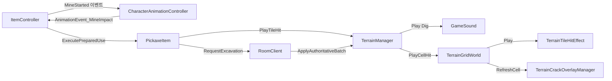

# Folk Sack — 팀장으로 참여한 2D 멀티플레이 굴착 게임의 굴착 피드백과 사운드 품질 관리

> 최대 4명이 하나의 광산을 파 내려가 광물을 모으고, 지상에서 팔아 번 골드로 겨루는 2D 사이드뷰 경쟁형 멀티플레이 채굴 게임에서, 타일의 남은 내구도를 숫자 없이 전달하는 굴착 피드백과 팀 운영을 맡은 프로젝트

개발 형태: 3인 팀 프로젝트 · 팀장

| 항목 | 내용 |
|---|---|
| 장르 | 2D 사이드뷰 경쟁형 멀티플레이 채굴 (개인전 2~4인) |
| 기간 | 2026.08.14 Asana 보드 생성 · 2026.08.18 ~ 09.18 커밋 기록(약 1개월) |
| 인원 | 3인 팀 (README 기준) |
| 내 역할 | 팀장(일정·진척 관리, 검증·리뷰) · 굴착 2단계 판정 · 균열 오버레이와 타일 진동 설계·조정 · 캐릭터 애니메이션 연동 · HUD·UI 그래픽 · 사운드 QA |
| 개발 환경 | Unity 6000.3.15f1 · C# · URP · DOTween · Cinemachine · Input System · Asana |
| 링크 | GitHub(비공개 저장소) · 시연 영상 준비 중 |

- 문서 구성: 1장 개요·팀·역할 → 2~5장 내가 맡은 기능 A~D(굴착 2단계 판정·균열 오버레이·타일 진동·사운드 QA) → 6장 팀장으로서의 협업 이슈 → 7장 결과와 회고
## 1. 프로젝트 개요

### 1.1 만든 것

- 최대 4명이 하나의 광산을 파고 내려가 광물을 모으는 2D 사이드뷰 경쟁형 멀티플레이 채굴 게임
- **코어 루프** : 지상 거래소 출발 → 굴착 → 자원 획득 → 귀환 판단 → 지상 진입 시 자동 판매 → 장비 구매
- **승리 조건** : 제한 시간 안에 가장 많은 골드를 모은 플레이어 승리 (공동 1등은 3명까지, 4명 모두 동점이면 무승부)
- **핵심 재미(귀환 시점 판단)** : 깊이 내려갈수록 비싼 광물이 나오지만, 판매 전에 죽으면 가진 아이템과 골드를 떨어뜨림
- 지형 붕괴·낙하 지형·매몰과 다이너마이트·지뢰 같은 폭발물이 위험 요소
- 지형 변경은 서버가 확정한 결과(`ApplyAuthoritativeBatch`)를 받아 적용하는 서버 판정 방식

### 1.2 목표

- 타일마다 내구도가 달라 곡괭이질만으로는 언제 부서질지 알 수 없는 문제 → 붕괴·매몰이 있는 게임에서 꼭 필요한 정보를 화면을 어지럽히지 않고 전달
- 내가 원하는 칸에 굴착이 들어갔는지는 기다리지 않고 바로 알 수 있게, 내구도처럼 중요한 정보는 서버가 확정한 결과로만 보여 주기
- 곡괭이 애니메이션의 휘두르는 시간 동안 상황이 바뀌어도 잘못된 굴착이 일어나지 않게 하기
- 팀장으로서 세 명의 작업이 기간 안에 하나의 플레이 가능한 빌드로 합쳐지도록 일정·검증 관리
### 1.3 팀 구성과 역할

- 3인 팀의 팀장

| 내가 맡은 일 | 작업 방식 | 근거 |
|---|---|---|
| 굴착 2단계 판정 (대상 지정 → 타격 프레임에서 실행) | 직접 구현. 대상 칸을 고르는 규칙은 팀원 작성 | 커밋 `a8e2931` |
| 균열 오버레이 · 타일 진동 | 직접 설계 → AI 에이전트 구현 → 원하는 느낌이 될 때까지 직접 조정 | 커밋 `8d8a69c` · `4555c0a` |
| 캐릭터 애니메이션 · 애니메이션 이벤트 연동 | 직접 | 커밋 `24484c7` · `a8e2931` · `cbe4a6b` |
| HUD·상점·결과창·메인·로비 UI 그래픽 | 직접 | Asana "그래픽 리소스 가공 및 정리", 커밋 `909b528` |
| 사운드 | AI에 구현을 맡기고, 직접 플레이하며 QA·버그 판정 | 커밋 `23d6f53` · `7fee899` |
| 팀 운영 | 백로그·카드 템플릿·리뷰 칸 운영, 검증·퍼포먼스 테스트 담당 | Asana 보드 |

- 이 문서에서 다루지 않는 팀원 작업: 지형 데이터·메시 렌더링(`TerrainGridWorld`, 칸별 진동 이동량 처리만 `4555c0a`에서 함께 추가), 굴착 대상 칸 선정 규칙, 서버·네트워크, 상점 UI 기능, 이동 끼임 수정

### 1.4 내 파트의 구조



- 굴착 요청(`PickaxeItem`)에서 갈라지는 두 길: 요청 즉시 `PlayTileHit`로 가는 진동·소리, 서버 결과(`ApplyAuthoritativeBatch`)를 거쳐야만 갱신되는 균열

## 2. 기능 A — 굴착 2단계 판정

### 2.1 개요

클릭 순간 대상 칸을 지정하고, 곡괭이가 닿는 애니메이션 프레임에서 굴착 명령을 다시 검사한 뒤 실행하는 2단계 굴착

### 2.2 시스템 구조

- `ItemController`: 클릭 시 `PickaxeItem.PrepareUse`로 대상 칸을 예약하고 `MineStarted` 이벤트로 애니메이션 시작을 알림
- `CharacterAnimationController`: 굴착 애니메이션 재생, 곡괭이가 닿는 프레임의 애니메이션 이벤트를 `ItemController`로 전달
- `PickaxeItem.ExecutePreparedUse`: 이번 휘두르기의 타격 기회를 소비하고, 예약한 칸이 아직 유효할 때만 굴착 실행
- 대상 칸 선정 규칙(`TryGetNearestTargetCell`, 마우스 방향에서 가장 가깝고 가로막히지 않은 칸)은 팀원 작성(`b3bade8`·`4747325`)
- 서버로 굴착을 요청하는 경로(`RequestExcavation`)는 팀원 커밋에서 추가

### 2.3 핵심 기능 및 구현

`CharacterAnimationController.cs` 147~161행

```csharp
private void HandleMineStarted(float directionX)
{
    UpdateFacingDirection(directionX);
    animator.SetTrigger(MineHash);
}

public void AnimationEvent_MineFinished()
{
    itemController?.FinishMine();
}

public void AnimationEvent_MineImpact()
{
    itemController?.ExecuteMineImpact();
}
```

- 클릭 시점에는 캐릭터 방향만 돌리고 굴착 애니메이션 트리거를 켬 → 실제 굴착은 아직 일어나지 않음
- 곡괭이가 닿는 프레임에 걸린 애니메이션 이벤트 `AnimationEvent_MineImpact`가 실행 단계를 호출하고, 끝 프레임의 `AnimationEvent_MineFinished`가 굴착 상태를 정리
- 실행 단계(`ExecutePreparedUse`)에서는 예약한 칸에 지형이 남아 있는지, 현재 위치에서 칸까지가 사거리 안인지 다시 확인하고, 조건이 맞지 않으면 그 휘두르기를 헛손질로 처리
### 2.4 고민과 선택

- **클릭 즉시 굴착에서 2단계 판정으로** : 처음에는 클릭하는 순간 대상을 정하고 바로 굴착했지만, 곡괭이 애니메이션을 붙이면서 휘두르는 선딜레이가 생김. 그 사이 플레이어가 달려가 대상 칸에서 한참 멀어지거나, 다른 플레이어나 붕괴로 칸이 사라져도 굴착이 실행되는 문제가 있었음. 대상을 지정하는 단계(클릭)와 굴착을 실행하는 단계(곡괭이가 닿는 애니메이션 프레임)를 나누고, 실행하는 순간에 유효성을 한 번 더 검사하도록 변경
- **실행 시점을 타이머가 아닌 애니메이션 이벤트로** : 타격 순간을 애니메이션 프레임에 묶어, 화면에서 곡괭이가 타일에 닿는 순간과 실제 굴착이 일어나는 순간을 일치시킴
## 3. 기능 B — 균열 오버레이

### 3.1 개요

손상된 타일 위에만 공용 균열 그림 4장을 덧씌워, 남은 내구도를 숫자 없이 20/40/60/80% 단계로 보여 주는 시스템 (직접 설계 → AI 에이전트 구현 → 직접 조정)

### 3.2 시스템 구조

- 손상 단계에 도달한 살아 있는 칸만 `SpriteRenderer`를 가짐 (`Dictionary<Vector2Int, SpriteRenderer>`)
- 단계가 바뀌면 기존 Renderer의 그림만 교체하고, 칸이 회복·파괴되면 `Stack` 풀에 반환해 재사용
- 균열 그림 4장은 처음 한 번만 `Resources`에서 읽어 캐싱
- 균열 그림 4장과 광맥 오버레이 그림은 코드보다 먼저 직접 추가(`858306e`, 9/2)
- 최대 내구도는 팀원의 지형 코드에 있던 맵 초기화용 계산을 그대로 불러 씀 → 정의 선택 로직을 중복 구현하지 않음

### 3.3 핵심 기능 및 구현

`TerrainCrackOverlayManager.cs` 36~43행

```csharp
public static int GetDamageStage(int current, int maximum)
{
    if (maximum <= 0 || current <= 0 || current >= maximum) return 0;
    long damage = (long)maximum - current;
    for (int i = DamageThresholds.Length - 1; i >= 0; i--)
        if (damage * 100 >= (long)maximum * DamageThresholds[i]) return DamageThresholds[i];
    return 0;
}
```

- 누적 손상률이 넘긴 가장 높은 단계(20/40/60/80)를 반환. 손상 없음·파괴·잘못된 최대값은 0(표시 없음)
- 곱셈을 `long`으로 해 내구도가 큰 타일에서도 넘침이 생기지 않게 함

`TerrainCrackOverlayManager.cs` 52~61 · 73~83행

```csharp
public void RefreshCell(TerrainGridWorld world, Vector2Int coord)
{
    TerrainCell cell = world.Data?.GetCellOrNull(coord);
    int stage = cell != null && world.TryGetMaxDurability(coord, out int maximum)
        ? GetDamageStage(cell.CurrentDurability, maximum) : 0;
    if (stage == 0)
    {
        RemoveView(coord);
        return;
    }
// (중략)
    if (views.TryGetValue(coord, out SpriteRenderer view) == false || view == null)
    {
        view = RentView();
        views[coord] = view;
    }
    view.sprite = sprite;
    Vector3 size = sprite.bounds.size;
    view.transform.localScale = new Vector3(world.CellSize / size.x, world.CellSize / size.y, 1f);
    RefreshPosition(world, coord);
    view.gameObject.SetActive(true);
}
```

- 표시할 단계가 없으면 그 칸의 View를 풀로 돌려보내고 끝냄 → 손상되지 않은 칸은 오버레이 오브젝트를 갖지 않음
- 처음 손상된 칸만 풀에서 View를 빌리고, 그림 크기를 칸 크기에 맞춘 뒤 진동 이동량이 반영된 위치(`RefreshPosition`)에 배치
- `Tools > Terrain Collapse > Validate Visual Feedback` 메뉴의 Editor 회귀 검증(`TerrainVisualFeedbackValidation`)으로 단계 계산·풀 재사용·맵 재로딩 등을 함께 검사
### 3.4 고민과 선택

| 방법 | 장점 | 문제 |
|---|---|---|
| 내구도 숫자 표시 | 정확한 값 | 타일로 가득한 화면이 난잡해짐 |
| 타일 그림 교체 | 타일 자체가 바뀜 | 타일 종류마다 균열 그림 필요, 바뀔 때마다 청크 메시와 월드 외곽 Collider 재생성 |
| **균열 오버레이 (선택)** | 공용 그림 4장, 팀원의 지형 렌더링 무수정 | 오버레이 오브젝트 관리 필요 → 손상된 칸만 · 풀로 해결 |

- **숫자 대신 균열 연출** : 타일마다 내구도가 달라 곡괭이질만으로는 언제 부서질지 알 수 없지만, 붕괴와 매몰이 있는 게임에서 그 정보는 몹시 중요했음. 숫자를 표시하면 타일로 가득한 화면이 난잡해지므로 균열 연출로 대신함
- **스프라이트 교체 대신 오버레이** : 당시 지형은 모든 타일이 스프라이트 한 장을 색으로만 구분해 32×32 단위 메시로 그렸음. 칸 하나의 그림을 바꾸려면 타일 종류마다 균열 그림이 필요했고, 바뀔 때마다 메시와 월드 전체의 외곽 Collider를 다시 만들어야 했음. 그래서 팀원이 만든 지형 렌더링은 그대로 두고, 손상된 칸에만 공용 균열 그림을 덧씌우는 방식을 택함
- **균열은 서버가 확정한 결과로만** : 균열은 타격과 동시에 생기기보다 아주 짧은 시간차를 두고 생기는 편이 더 자연스럽다고 판단. 그 짧은 시간 동안 서버가 내구도를 판정하게 하고, 가장 중요한 피드백 정보인 균열은 서버 결과(`ApplyAuthoritativeBatch`)가 적용된 뒤에만 갱신

## 4. 기능 C — 타일 진동

### 4.1 개요

굴착 요청을 보내는 순간 대상 칸의 지형 자체를 DOTween으로 흔들어, 원하는 칸에 굴착이 들어갔는지 바로 알려 주는 피드백 (직접 설계 → AI 에이전트 구현 → 직접 조정)

### 4.2 시스템 구조

- `TerrainTileHitEffect`가 지형 오브젝트에 붙어 칸별 Tween을 `Dictionary<Vector2Int, Tween>`으로 관리
- 흔들림은 지형 메시에서 해당 칸의 꼭짓점 4개만 옮기는 렌더링 이동량(Offset)으로만 적용, 광물 표시와 균열에도 같은 이동량 적용
- 이동량은 화면 표시 전용 → Collider·지형 데이터·스냅샷은 바꾸지 않아 흔들림이 물리 판정에 영향을 주지 않음
- 요청 전송에 성공하면 로컬에서 바로 진동과 굴착음 재생, 서버 응답에서는 재생하지 않음

### 4.3 핵심 기능 및 구현

`TerrainTileHitEffect.cs` 19~24 · 29~47행

```csharp
public void Play(TerrainGridWorld world, Vector2Int cell)
{
    if (isActiveAndEnabled == false || world == null || world.gameObject != gameObject ||
        world.IsOccupied(cell) == false) return;
    StopCell(cell);
    world.TrySetCellVisualOffset(cell, Vector3.zero);
// (중략)
        float strength = Mathf.Clamp(shakeStrength, 0f, 0.1f) * world.CellSize;
        Tween tween = DOTween.Shake(
                () => Vector3.zero,
                offset => world.TrySetCellVisualOffset(cell, offset),
                Mathf.Max(0.01f, shakeDuration),
                new Vector3(strength, strength, 0f),
                Mathf.Max(1, shakeVibrato),
                Mathf.Clamp(shakeRandomness, 0f, 180f))
            .SetTarget(this)
            .SetUpdate(true)
            .SetAutoKill(true)
            .SetRecyclable(false)
            .SetLink(gameObject, LinkBehaviour.KillOnDisable)
            .OnKill(() =>
            {
                activeShakes.Remove(cell);
                if (world != null) world.TrySetCellVisualOffset(cell, Vector3.zero);
            });
        activeShakes[cell] = tween;
```

- 같은 칸을 다시 치면 이전 Tween을 끝내고 이동량을 0으로 되돌린 뒤 새로 시작 → 흔들림이 누적되지 않음
- `DOTween.Shake`의 값을 오브젝트 위치가 아닌 `TrySetCellVisualOffset`(칸의 렌더링 이동량)으로 넘김
- Tween이 끝나거나 비활성화로 끊겨도 `OnKill`에서 이동량을 0으로 복원
### 4.4 고민과 선택

- **복제본을 흔드는 방식에서 지형 자체를 흔드는 방식으로** : 처음(`8d8a69c`)에는 타격한 타일과 같은 그림을 위에 하나 더 만들어 흔들었음. 원본 타일이 뒤에 그대로 남아 가장자리가 겹쳐 보였고, 타일에 박힌 광물은 따라 흔들리지 않아 한 몸이라는 느낌이 깨짐. 복제본을 없애고 지형 메시에서 해당 칸의 꼭짓점만 옮겨 타일 자체가 흔들리게 바꾸고(`4555c0a`), 광물 표시와 균열에도 같은 이동량을 적용
- **곡괭이 단위에서 칸 단위 관리로** : 효과를 곡괭이에 묶어 두면 한 칸을 치다가 다른 칸을 칠 때 앞 칸의 진동이 끊김. 칸마다 독립적으로 재생하도록 바꿔, 같은 칸을 다시 치면 이전 진동을 정리하고 새로 시작하고 다른 칸의 진동은 그대로 이어지게 함
- **진동은 즉시, 균열은 서버 확정 뒤** : 원하는 칸에 굴착이 들어갔는지는 플레이어가 기다리지 않고 알 수 있도록 요청을 보내는 순간 진동으로 바로 보여 주고, 내구도 정보인 균열(3.4)은 서버 결과로만 그려 두 피드백의 역할을 나눔

## 5. 기능 D — 사운드 품질 관리

### 5.1 개요

효과음 재생 구조처럼 잘 알려진 부분은 AI에 구현을 맡기고, 직접 플레이하며 들리는 문제를 찾아 판정하는 데 집중한 사운드 작업

### 5.2 시스템 구조

- 정적 클래스 `GameSound`와 효과음 종류 `SoundCue`(굴착·붕괴·피격·사망·착지·달리기·폭발·다이너마이트 타이머·포션 9개)
- 다른 코드는 `GameSound.Play(SoundCue.Dig, 위치)`처럼 효과음 종류와 위치만 넘김 (예: `TerrainManager.PlayTileHit`)
- 게임 시작 전에 `Resources/Sounds`에서 효과음과 변형 파일을 읽어 두고, 씬이 바뀌면 씬에 맞는 배경음악 재생
- 효과음은 2~18 범위의 선형 거리 감쇠를 쓰는 3D 소리, 배경음악은 거리와 무관한 2D 소리

### 5.3 핵심 기능 및 구현

`GameSound.cs` 98~101 · 222~231행

```csharp
GameObject voice = new GameObject("Sound_" + Names[index]);
voice.transform.position = ResolveEffectPosition(worldPosition);
AudioSource source = voice.AddComponent<AudioSource>();
ConfigureEffectSource(source);
// (중략)
private static void ConfigureEffectSource(AudioSource source)
{
    source.playOnAwake = false;
    source.volume = effectVolume;
    source.spatialBlend = 1f;
    source.rolloffMode = AudioRolloffMode.Linear;
    source.minDistance = EffectMinDistance;
    source.maxDistance = EffectMaxDistance;
    source.dopplerLevel = 0f;
}
```

- 효과음마다 위치를 가진 `AudioSource`를 만들어 거리 감쇠를 적용 → 폭발음이 거리와 관계없이 어디서나 같은 크기로 들리던 문제 해결(`23d6f53`)
- 2D 게임이지만 소리 크기는 리스너와의 3D 거리로 계산되므로, `ResolveEffectPosition`에서 효과음 위치의 z값을 리스너와 같은 평면에 맞춤
### 5.4 고민과 선택

- **구현은 AI에, 들리는 품질은 직접** : 효과음 재생 구조처럼 잘 알려진 부분은 AI에 구현을 맡기고, 결과물을 직접 플레이하며 들리는 문제를 찾는 데 집중함. 거리감·음량 같은 문제는 코드만 봐서는 드러나지 않아 직접 들어 보며 잡을 수밖에 없었고, 원인을 코드에서 찾지 못한 경우는 AI에게 검토를 맡겨 확인함
- **폭발음과 타이머에 거리 감쇠** : 곡괭이·다이너마이트·지뢰 폭발음과 타이머가 거리와 관계없이 같은 크기로 들려, 위치 기반 거리 감쇠를 적용(`23d6f53`)

### 5.5 트러블슈팅 — 발소리가 거리에 맞게 커지지 않던 문제

- **문제** : 다른 플레이어가 가까이 다가와도 발소리가 거리 감쇠 설정대로 자연스럽게 커지지 않음
- **원인** : 효과음 위치의 z값을 리스너 평면에 맞추는 보정이 씬에서 처음 찾은 `AudioListener`를 기준으로 삼았음. 카메라 씬에는 비활성 상태인 Cinemachine 쪽 리스너와 실제로 소리를 듣는 Main Camera 리스너가 함께 있어, 꺼져 있는 리스너가 기준으로 잡히면 거리 계산이 어긋남
- **해결** : 켜져 있고 실제로 동작 중인 리스너만 골라 기준으로 쓰도록 변경. 찾은 리스너는 저장해 두고 다시 쓰며, 동작 중인 리스너가 없으면 경고를 한 번만 남김
- **결과** : 수정한 뒤 직접 플레이하며 들어 보고, 발소리가 거리에 따라 자연스럽게 커지고 작아지는 것을 확인
- 흐름 : 직접 들어서 발견 → AI로 원인 확인 → 수정 → 직접 듣고 확인

`GameSound.cs` 198~220행

```csharp
private static AudioListener GetActiveListener()
{
    if (activeListener != null && activeListener.isActiveAndEnabled)
        return activeListener;

    activeListener = null;
    AudioListener[] listeners = Object.FindObjectsByType<AudioListener>(
        FindObjectsInactive.Exclude,
        FindObjectsSortMode.None);
    foreach (AudioListener listener in listeners)
    {
        // FindObjectsByType는 활성 GameObject의 비활성 Behaviour도 반환할 수 있다.
        // 카메라 씬에는 비활성 Cinemachine Listener와 실제 Main Camera Listener가
        // 함께 있으므로 enabled까지 확인해야 거리 기준 평면이 안정적이다.
        if (listener != null && listener.isActiveAndEnabled)
        {
            activeListener = listener;
            break;
        }
    }

    return activeListener;
}
```

- 저장해 둔 리스너가 아직 켜져 있으면 다시 찾지 않고 바로 씀
- 활성 GameObject의 꺼진 컴포넌트도 검색 결과에 포함될 수 있어 `isActiveAndEnabled`까지 확인

## 6. 협업 — 팀장으로서의 판단과 통합 이슈

### 6.1 팀원의 강점에 맞춘 역할 배치

- **한 문제를 깊이 파고드는 팀원** : 문제 해결 능력이 매우 뛰어났지만 한 기능을 깊이 파고드는 경향이 있어, 진행 상황을 계속 확인하다가 충분한 상태가 되면 다음 작업으로 옮기도록 배치
- **일이 한 사람에게 몰리는 문제** : 처음에는 빈틈을 모두 직접 메우려 했지만 오래가기 어렵다고 판단해 여유 있는 팀원에게 일을 나눔. 그러자 이번에는 열심히 하는 팀원에게 일이 몰려, 고마움을 직접 전하고 진행 상황을 보며 다른 팀원에게도 일을 나눔

### 6.2 서버 작업을 넘기고 진척 관리에 집중한 판단

- **상황** : 일정이 촉박한 가운데, 다른 팀원들이 좋아하는 작업을 할 수 있도록 익숙하지 않은 분야는 팀장이 맡아야 한다고 생각했고, 공부하고 싶은 마음도 있어 서버 네트워크 연결 작업을 붙잡고 있었음
- **문제** : 거기에 매달리는 동안 팀원들에게 다음 할 일을 지시하고 프로젝트 전체를 확인하는 일에 소홀해짐
- **선택** : 서버는 클라이언트 프로그래밍에 강점을 보이던 팀원에게 맡기고, 진척 관리에 집중
- **결과** : 다음 업무를 기다리던 팀원들에게 빠르게 일을 배정하고, 전체 진척을 더 정교하게 관리

### 6.3 통합기 씬 충돌과 프리팹 분리

- **문제** : 프로젝트 종반에 HUD 그래픽(본인)과 상점 UI 기능(팀원)을 같은 씬에서 작업하면서 병합할 때마다 충돌이 반복됨
- **원인** : Unity 씬 파일은 여러 사람이 동시에 고치면 충돌을 풀기 어려움
- **해결** : HUD와 상점 UI를 씬에서 꺼내 각각 별도 프리팹으로 분리 (9/7 `0a016d0` HUD, `35187d1`·`71c9af3` 상점 UI)
- **결과** : 같은 씬을 건드리지 않고 각자 맡은 프리팹만 수정
### 6.4 백로그와 검증 운영

- Asana 보드에 이용 가이드와 카드 템플릿(완료 조건 포함)을 두고, 카드마다 리뷰 칸을 두어 검증
- 버전별 일정과 검증 역할을 구분하고, 멀티플레이 검증 환경이 갖춰질 때까지의 작업 분담 규칙을 정함
- 검증 담당으로서 넓은 테스트 지형에서 프레임이 크게 떨어지는 성능 문제를 확인하고 팀에 공유. 해결(지형을 덩어리 단위 메시로 묶어 그리는 구조)은 팀원 담당
- 반복·예외 상황 검증(동일 위치 반복 굴착, 연쇄 붕괴, 매몰 → 지속 피해 → 탈출 루프 등 12개 대상) 담당
## 7. 구현 결과 및 기술적 회고

### 7.1 주요 구현 결과

- 기간 안에 3인 팀의 작업을 합친 플레이 가능한 빌드 완성
- 동료 평가에서 '가장 좋은 경험을 준 게임'으로 선정
- 클릭 → 애니메이션 타격 프레임 → 재검사로 이어지는 2단계 굴착 판정
- 즉시 반응하는 칸 단위 진동과 서버 확정 결과만 그리는 균열 오버레이로 역할을 나눈 굴착 피드백
- 직접 플레이 QA로 거리 감쇠·리스너 선택 문제를 찾아 고친 사운드
### 7.2 개발 과정에서 얻은 판단

- **하고 싶은 일과 프로젝트가 필요로 하는 일의 구분** : 팀장으로서 해야 한다고 생각하거나 하고 싶은 일과, 프로젝트를 위해 정말 해야 하는 일은 다를 수 있다는 것을 서버 작업 인계(6.2)에서 확인
- **보이는 것과 판정되는 것의 분리** : 진동 이동량을 렌더링에만 쓰고 Collider·데이터는 건드리지 않아, 피드백을 바꿔도 게임 판정이 흔들리지 않게 하는 구조의 중요성 확인
- **AI 구현물의 검증 책임** : 구현을 AI에 맡긴 부분도 들리는 품질은 직접 플레이로만 판정할 수 있었고, 그 판정과 원인 확인이 내 몫이라는 것을 확인

### 7.3 기술적 한계 및 향후 개선

- **측정값 부족** : 성능 문제와 사운드 모두 체감과 직접 플레이로 판단했고 수치 기록이 없음. 다음에는 Unity Profiler 수치를 변경 전후로 기록할 계획 (SAIL OR SUNK의 "정량적 검증 부족"과 같은 교훈이 반복됨)
- **진동과 균열의 시간차** : 진동은 요청 즉시, 균열은 서버 응답 뒤에 나오므로 네트워크가 느리면 시간차가 길어지고, 서버가 굴착을 거절하면 진동만 나고 균열은 생기지 않을 수 있음. 실제로 겪지는 않았지만 한계로 인지
- **Editor 회귀 검증의 범위** : 균열·진동 회귀 검증은 batchmode로 실행해 실제 화면의 시각적 품질, 두 클라이언트와 서버를 연결한 통합 플레이는 확인하지 못함
