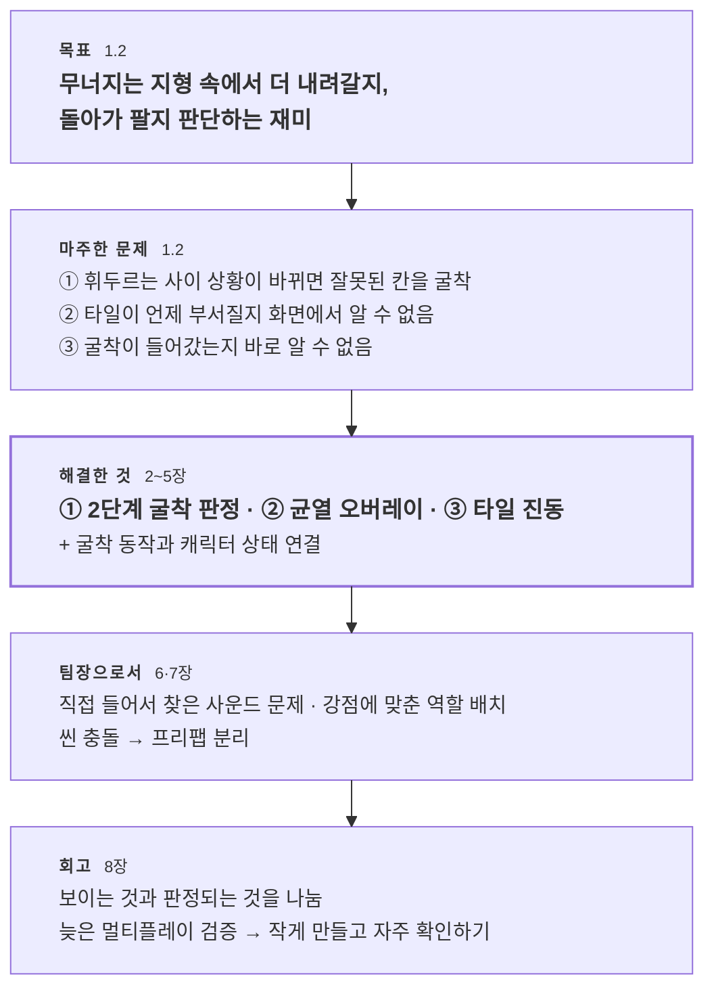
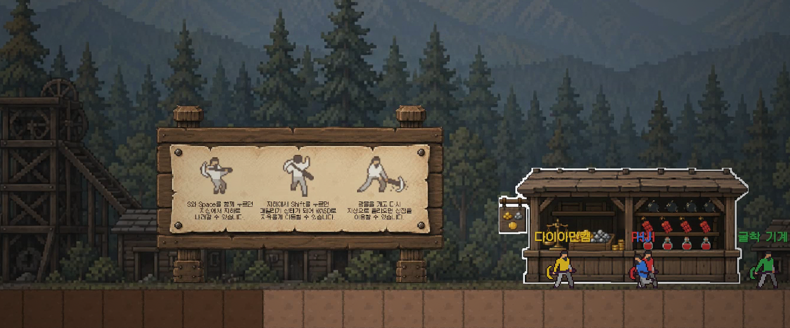
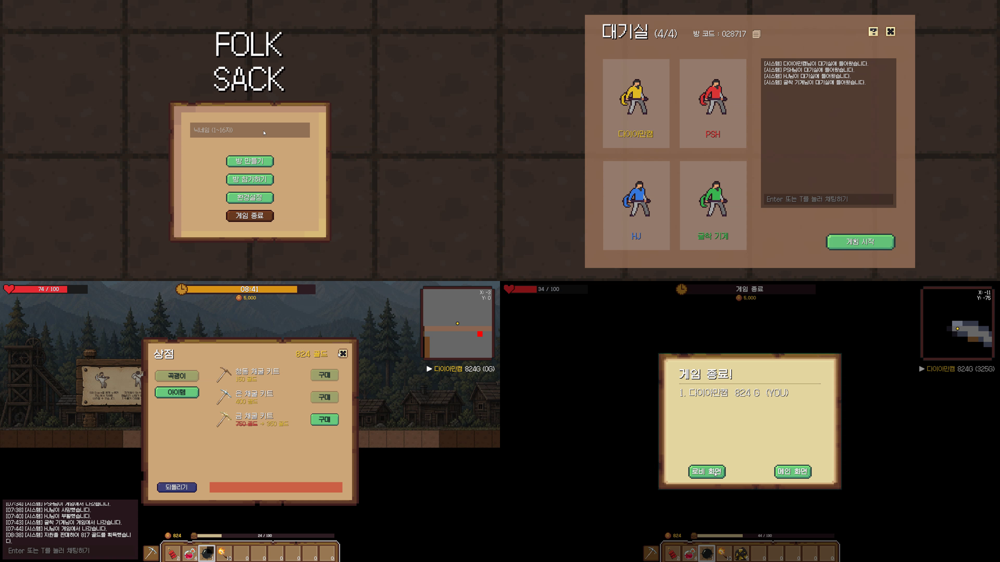
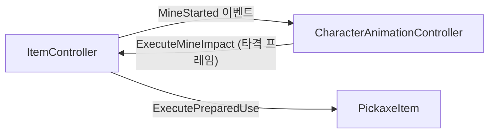
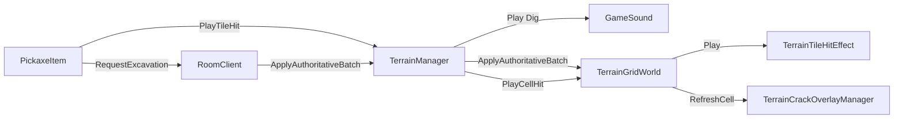
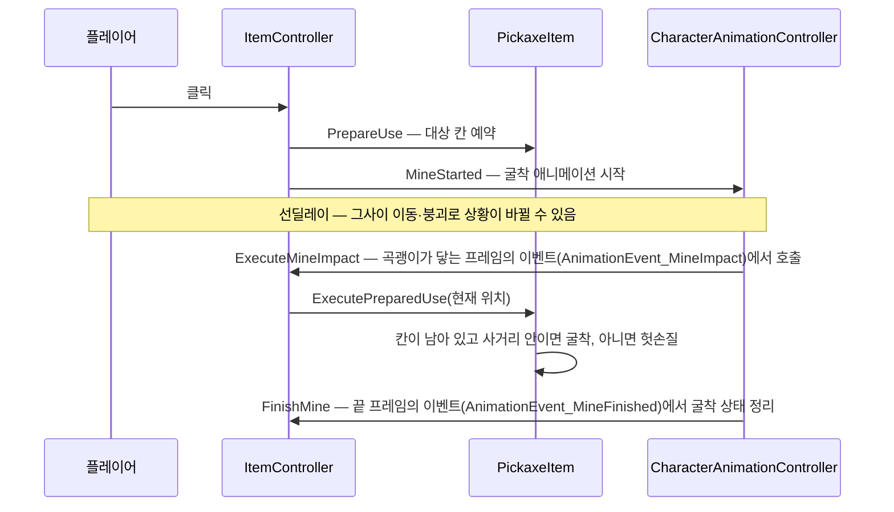
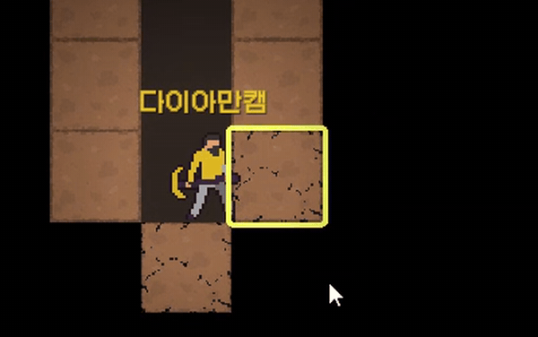
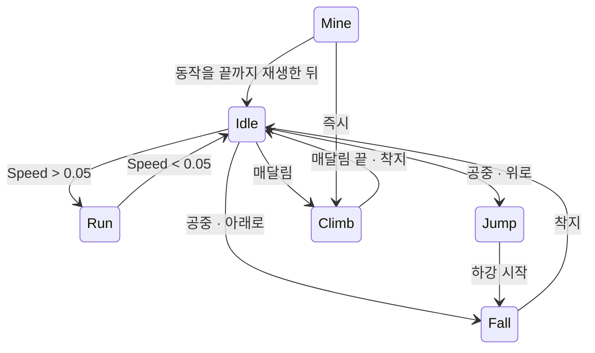
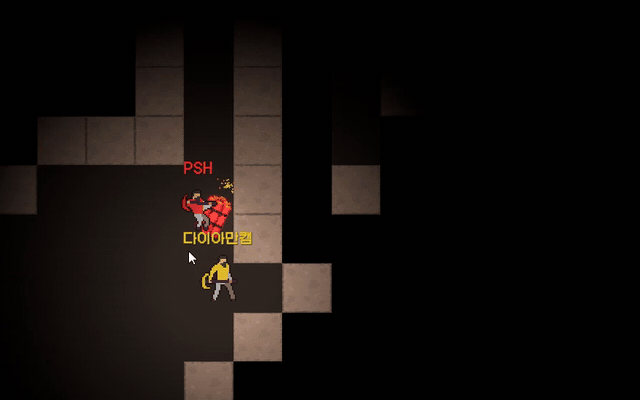

# Folk Sack — 굴착 판정과 피드백을 구현하고 팀을 이끈 2D 멀티플레이 채굴 게임

> 최대 4명이 한 광산을 파 내려가 캔 광물을 팔아 번 골드로 겨루는 2D 사이드뷰 멀티플레이 채굴 게임. 팀 프로젝트 발표에서 참가 5팀 투표로 '가장 좋은 경험을 준 게임' 부문 선정

개발 형태: 3인 팀 프로젝트 · 팀장

| 항목 | 내용 |
|---|---|
| 장르 | 2D 사이드뷰 경쟁형 멀티플레이 채굴 (개인전 2~4인) |
| 기간 | 2026.08.14 ~ 09.18 (약 1개월) |
| 인원 | 3인 |
| 내 역할 | 프로그래밍(굴착 2단계 판정·캐릭터 애니메이션 연동·균열 오버레이·타일 진동) · 팀장(기획·일정 관리·검증) · 그래픽·UI · 사운드 QA |
| 개발 환경 | Unity 6000.3.15f1 · C# · URP · DOTween · Cinemachine · Input System · Asana |
| 링크 | [GitHub](https://github.com/ashadeveloperr/3rd-TeamProject-KH) · [시연 영상](https://youtu.be/e2lY36N8coE) |

**이 문서의 흐름** — 같은 번호끼리 문제와 해결이 짝을 이룸



## 1. 프로젝트 개요

### 1.1 만든 것



- 최대 4명이 하나의 광산을 파고 내려가 광물을 모으는 2D 사이드뷰 경쟁형 멀티플레이 채굴 게임
- **코어 루프** : 지상 거래소 출발 → 굴착 → 자원 획득 → 귀환 판단 → 지상 진입 시 자동 판매 → 장비 구매
- **승리 조건** : 목표 골드에 가장 먼저 도달한 플레이어가 즉시 승리. 도달한 플레이어 없이 제한 시간이 끝나면 가장 많은 골드를 모은 플레이어 승리(동점이면 모두 승리)
- **핵심 재미(귀환 시점 판단)** : 깊이 내려갈수록 비싼 광물이 나오지만, 판매 전에 죽으면 가진 아이템 전부와 골드 절반을 떨어뜨림
- 지형 붕괴·낙하 지형·매몰과 다이너마이트·지뢰 같은 폭발물이 위험 요소
- 지형 변경은 서버가 확정한 결과만 받아 적용하는 서버 판정 방식

### 1.2 목표

- **개발 의도** : 2D 액션 플랫포머에서 '지형이 상호작용을 통해 무너지면서 플레이 경험에 영향을 준다면 어떨까?'라는 구상에서 출발. 초기 기획안에서는 자연재해와 지형 붕괴가 별개의 아이디어였지만, 기간 안에 끝내기 위해 지형 붕괴에 플레이 경험을 집중시킴(8.2)
- **기획 방향** : 붕괴에 휘말리지 않으려면 갱도를 설계하며 굴착해야 하는 게임. 이 의도에 맞지 않는 플레이(허공에서 벽·천장 뚫기)는 규칙으로 막음(5.4)
- **목표한 경험** : 무너지는 지형 속에서 더 내려가 비싼 광물을 캘지, 잃기 전에 돌아가 팔지 귀환 시점을 판단하는 재미(1.1 핵심 재미)

- 타일마다 내구도가 달라 곡괭이질만으로는 언제 부서질지 알 수 없는 문제 → 붕괴·매몰이 있는 게임에서 꼭 필요한 정보를 화면을 어지럽히지 않고 전달
- 플레이어가 원하는 칸에 굴착이 들어갔는지는 기다리지 않고 바로 알 수 있게 하고, 내구도처럼 중요한 정보는 서버가 확정한 결과로만 표시
- 곡괭이를 휘두르는 동안 상황이 바뀌었을 때 생기는 잘못된 굴착 방지
- 팀장으로서 세 명의 작업이 기간 안에 하나의 플레이 가능한 빌드로 합쳐지도록 일정·검증 관리

### 1.3 팀 구성과 역할

- 3인 팀의 팀장

| 내가 맡은 일 | 작업 방식 | 근거 |
|---|---|---|
| 굴착 2단계 판정 (선/후 딜레이 설계 → 대상 지정 → 타격 프레임에서 실행) | 직접 설계·구현. 대상 칸을 고르는 규칙은 팀원 작성 | Asana "[MVP] 굴착 시 선/후 딜레이 추가", 커밋 `a8e2931` |
| 캐릭터 애니메이션 세팅 · 상태·액션 이벤트 연동 | 상태 규칙은 직접 정하고, 연결 코드는 AI 도움을 받아 구현 | 커밋 `24484c7` · `a8e2931` · `cbe4a6b` |
| 균열 오버레이 · 타일 진동 | 직접 설계 → AI 구현 → 원하는 느낌이 될 때까지 직접 조정 | 커밋 `8d8a69c` · `4555c0a` |
| 기획 (아이디어 브레인스토밍 · 코어 게임 초기 기획안) | 직접 | Asana "기획 아이디어 브레인스토밍" · "코어 게임 초기 기획안" · "[프로젝트] 초기 기획안"(첫 회의용 기획안 문서) |
| 그래픽 (캐릭터·아이템·배경 스프라이트, HUD·상점·결과창·메인·로비 UI) | 캐릭터는 craftpix.net 무료 스프라이트 시트를 바탕으로 수정, 자원·아이템·광물·균열 오버레이는 직접 도트 작업. 플레이어별 색상 변경은 팀원 | Asana "그래픽 리소스 가공 및 정리", 커밋 `145006c` · `a242577` · `417c684` · `909b528` |
| 사운드 | 리소스는 직접 선정, 구현은 AI에 맡기고 직접 플레이하며 QA·버그 판정 | 커밋 `e09ea2c` · `23d6f53` · `7fee899` |
| 팀 운영 | 백로그·카드 템플릿·리뷰 칸 운영, 검증·성능 테스트 담당 | Asana 보드 |

- 이 문서에서 다루지 않는 팀원 작업: 지형 데이터·메시 렌더링(`TerrainGridWorld` — 진동 이동량·균열 갱신을 잇는 부분만 본인이 `4555c0a`에서 추가), 굴착 대상 칸 선정 규칙, 서버·네트워크, 상점 UI 기능, 이동 끼임 수정




### 1.4 내 파트의 구조

**① 클릭 → 타격 프레임 → 실행 (2장)**



**② 굴착 요청 → 진동·소리 / 서버 결과 → 균열 (3·4장)**



- 굴착 요청(`PickaxeItem`)에서 갈라지는 두 길: 요청 즉시 `PlayTileHit`로 가는 진동·소리, 서버 결과(`ApplyAuthoritativeBatch`)를 거쳐야만 갱신되는 균열

## 2. 굴착 2단계 판정: 휘두르는 사이 사거리를 벗어난 칸은 굴착하지 않는다

### 2.1 지정과 실행을 나눈 굴착

클릭하는 순간 대상 칸을 지정하고, 곡괭이가 닿는 애니메이션 프레임에서 굴착 명령을 다시 검사한 뒤 실행하는 2단계 굴착

### 2.2 클래스 역할과 호출 순서

- `ItemController`: 클릭 시 `PickaxeItem.PrepareUse`로 대상 칸을 예약하고 `MineStarted` 이벤트로 애니메이션 시작을 알림
- `CharacterAnimationController`: 굴착 애니메이션 재생, 곡괭이가 닿는 프레임의 애니메이션 이벤트를 `ItemController`로 전달
- `PickaxeItem.ExecutePreparedUse`: 이번 휘두르기의 타격 기회를 소비하고, 예약한 칸이 아직 유효할 때만 굴착 실행
- 대상 칸 선정 규칙(`TryGetNearestTargetCell`, 마우스 방향에서 가장 가깝고 가로막히지 않은 칸)은 팀원 작성(처음 작성 `c4993d9`, 이후 수정 `2ce78cd`·`4747325`·`b435691`)
- 서버로 굴착을 요청하는 경로(`RequestExcavation`)는 팀원 커밋에서 추가



### 2.3 타격 프레임의 애니메이션 이벤트와 재검사

`CharacterAnimationController.cs` 147~161행

```csharp
private void HandleMineStarted(float directionX)
{
    UpdateFacingDirection(directionX);
    animator.SetTrigger(MineHash);
}

public void AnimationEvent_MineFinished()
{
    itemController?.FinishMine();
}

public void AnimationEvent_MineImpact()
{
    itemController?.ExecuteMineImpact();
}
```

- 클릭 시점에는 캐릭터 방향만 돌리고 굴착 애니메이션 트리거를 켬 → 실제 굴착은 아직 일어나지 않음
- 곡괭이가 닿는 프레임에 걸린 애니메이션 이벤트 `AnimationEvent_MineImpact`가 실행 단계를 호출하고, 끝 프레임의 `AnimationEvent_MineFinished`가 굴착 상태를 정리

`PickaxeItem.cs` 224~279행 (`a8e2931` 당시 본인 작성 — 재검사 기준은 이후 팀원이 바꿈, 아래)

```csharp
public void ExecutePreparedUse(Vector3 currentOwnerPos)
{
    if (!hasPendingDig ||
        pendingTerrainManager == null)
    {
        return;
    }

    // 이번 Swing의 타격 기회는 여기서 소비
    hasPendingDig = false;

    if (!IsPreparedTargetStillValid(currentOwnerPos))
    {
        pendingTerrainManager = null;
        return;
    }

    ExecuteDigPower(
        pendingTerrainManager,
        pendingTargetCell,
        Def.PickaxeData.Value.DigPower);

    pendingTerrainManager = null;
}

private bool IsPreparedTargetStillValid(Vector3 currentOwnerPos)
{
// (중략)
    if (!pendingTerrainManager.HasTerrain(pendingTargetCell))
        return false;
// (중략)
    Bounds targetBounds = new Bounds(
        targetWorldPos,
        new Vector3(cellSize, cellSize, 0f));

    Vector3 closestPoint =
        targetBounds.ClosestPoint(currentOwnerPos);

    float distance =
        Vector2.Distance(currentOwnerPos, closestPoint);

    return distance <= Def.PickaxeData.Value.Range;
}
```

- 검사보다 먼저 `hasPendingDig`를 꺼서, 대상이 무효여도 한 번 휘두르면 판정은 한 번만 일어남
- 사거리는 클릭할 때가 아니라 곡괭이가 닿는 순간의 위치(`currentOwnerPos`)에서, 칸 경계의 가장 가까운 점(`Bounds.ClosestPoint`)까지 잼
- 실행 단계(`ExecutePreparedUse`)에서는 예약한 칸에 지형이 남아 있는지, 현재 위치에서 칸까지가 사거리 안인지 다시 확인하고, 조건이 맞지 않으면 그 휘두르기를 헛손질로 처리
- 이후 팀원과 의논해 재검사 기준을 서버 판정과 맞춤: 지형 확인은 서버 요청 단계로 넘기고, 실행 순간에는 칸 중심과 플레이어 사이 거리만 검사 (2단계 구조는 그대로 유지, 팀원 커밋 `bce15c5`·`b435691`)


### 2.4 클릭 즉시 굴착 대신 2단계 판정

**클릭 즉시 굴착에서 2단계 판정으로**

곡괭이 애니메이션을 붙이자, 클릭하는 순간 굴착하는 방식에서는 곡괭이가 닿기도 전에 칸이 먼저 깨져 동작과 결과가 어긋났음. 굴착 실행을 곡괭이가 닿는 프레임으로 미루자, 이번에는 휘두르는 선딜레이 동안 플레이어가 달려가 대상 칸이 사거리를 벗어나거나, 다른 플레이어나 붕괴로 칸이 사라져도 굴착이 실행되는 문제가 생김

| | 대안 A. 클릭 즉시 굴착 (초기 구현) | 대안 B. 지정·실행 2단계 판정 |
|---|---|---|
| 방식 | 클릭하는 순간 대상을 정하고 바로 굴착 | 클릭으로 대상을 지정하고(`PrepareUse`), 곡괭이가 닿는 애니메이션 프레임에 실행(`ExecutePreparedUse`)하며 유효성을 한 번 더 검사 |
| 장점 | 대상 지정과 굴착이 한 번에 끝나 예약 상태를 둘 필요가 없음 | 칸이 깨지는 시점이 곡괭이가 닿는 프레임과 맞고, 미룬 사이 사거리를 벗어나거나 사라진 칸은 재검사로 굴착하지 않음 |
| 단점 | 곡괭이가 닿기 전, 클릭하는 순간 칸이 깨져 보이는 동작과 결과가 어긋남 | 예약한 대상을 따로 관리해야 하고, 실행 순간 대상이 무효면 그 휘두르기는 헛스윙으로 끝남 |

- **최종 선택: 대안 B** : 대상을 지정하는 단계(클릭)와 굴착을 실행하는 단계(곡괭이가 닿는 애니메이션 프레임)를 나누고, 실행하는 순간에 유효성을 한 번 더 검사하도록 변경(이후 지형 확인은 서버 판정으로 옮김, 2.3)
- **결과** : 휘두르는 사이 사거리를 벗어난 칸은 굴착되지 않고 헛손질로 끝나며, 한 번 휘두르면 판정도 한 번만 일어남. 칸이 깨지는 시점이 클릭이 아니라 곡괭이가 닿는 프레임으로 옮겨져 동작과 결과가 맞음(2.3 `dig_timing.gif`)

**그 밖의 선택**

- **타격 프레임에 애니메이션 이벤트 연결** : 캐릭터 굴착 동작의 프레임을 분석해 곡괭이가 타일에 닿는 프레임을 찾고, 그 프레임에 애니메이션 이벤트를 걸어 자연스러운 동작과 실제 굴착이 일어나는 시점을 맞춤

## 3. 균열 오버레이: 숫자 없이 손상 정도를 보여 준다

### 3.1 손상 단계를 보여 주는 균열 그림

손상된 타일 위에만 공용 균열 그림 4장을 덧씌워, 누적 손상을 숫자 없이 20/40/60/80% 단계로 보여 주는 시스템 (직접 설계 → AI 구현 → 직접 조정)

### 3.2 손상된 칸에만 두는 균열 View

- 손상 단계에 도달한 살아 있는 칸만 균열 View(`SpriteRenderer`)를 가짐 (`Dictionary<Vector2Int, SpriteRenderer>`)
- 단계가 바뀌면 기존 View의 그림만 교체하고, 칸이 회복·파괴되면 `Stack` 풀에 반환해 재사용
- 균열 그림 4장은 처음 한 번만 `Resources`에서 읽어 캐싱
- 균열 그림 4장과 광맥 오버레이 그림은 코드보다 먼저 직접 추가(`858306e`, 9/2)
- 최대 내구도는 팀원의 지형 코드에 있던 맵 초기화용 계산을 그대로 불러 씀 → 정의 선택 로직을 중복 구현하지 않음

### 3.3 손상 단계 계산과 View 재사용

`TerrainCrackOverlayManager.cs` 36~43행

```csharp
public static int GetDamageStage(int current, int maximum)
{
    if (maximum <= 0 || current <= 0 || current >= maximum) return 0;
    long damage = (long)maximum - current;
    for (int i = DamageThresholds.Length - 1; i >= 0; i--)
        if (damage * 100 >= (long)maximum * DamageThresholds[i]) return DamageThresholds[i];
    return 0;
}
```

- 누적 손상률이 넘긴 가장 높은 단계(20/40/60/80)를 반환. 손상 없음·파괴·잘못된 최댓값은 0(표시 없음)
- 곱셈을 `long`으로 해 내구도가 큰 타일에서도 넘침이 생기지 않게 함

`TerrainCrackOverlayManager.cs` 52~61 · 73~83행

```csharp
public void RefreshCell(TerrainGridWorld world, Vector2Int coord)
{
    TerrainCell cell = world.Data?.GetCellOrNull(coord);
    int stage = cell != null && world.TryGetMaxDurability(coord, out int maximum)
        ? GetDamageStage(cell.CurrentDurability, maximum) : 0;
    if (stage == 0)
    {
        RemoveView(coord);
        return;
    }
// (중략)
    if (views.TryGetValue(coord, out SpriteRenderer view) == false || view == null)
    {
        view = RentView();
        views[coord] = view;
    }
    view.sprite = sprite;
    Vector3 size = sprite.bounds.size;
    view.transform.localScale = new Vector3(world.CellSize / size.x, world.CellSize / size.y, 1f);
    RefreshPosition(world, coord);
    view.gameObject.SetActive(true);
}
```

- 표시할 단계가 없으면 그 칸의 View를 풀로 돌려보내고 끝냄 → 손상되지 않은 칸은 균열 View를 갖지 않음
- 처음 손상된 칸만 풀에서 View를 빌리고, 그림 크기를 칸 크기에 맞춘 뒤 진동 이동량이 반영된 위치(`RefreshPosition`)에 배치
- `Tools > Terrain Collapse > Validate Visual Feedback (Play Mode)` 메뉴의 Editor 회귀 검증(`TerrainVisualFeedbackValidation`)으로 단계 계산·풀 재사용·맵 재로딩 등을 함께 검사


### 3.4 숫자·그림 교체 대신 오버레이

| 방법 | 장점 | 문제 |
|---|---|---|
| 내구도 숫자 표시 | 정확한 값 | 타일로 가득한 화면이 난잡해짐 |
| 타일 그림 교체 | 타일 자체가 바뀜 | 타일 종류마다 균열 그림 필요, 바뀔 때마다 청크 메시와 월드 외곽 Collider 재생성 |
| **균열 오버레이 (선택)** | 공용 그림 4장, 팀원의 지형 렌더링 무수정 | 균열 View 관리 필요 → 손상된 칸에만 두고 풀로 재사용해 해결 |

- **숫자 대신 균열 연출** : 타일마다 내구도가 달라 곡괭이질만으로는 언제 부서질지 알 수 없었고, 붕괴와 매몰이 있는 게임에서 그 정보는 꼭 필요했음. 숫자를 표시하면 타일로 가득한 화면이 난잡해지므로 균열 연출로 대신함
- **스프라이트 교체 대신 오버레이** : 당시 지형은 모든 타일이 스프라이트 한 장을 색으로만 구분해 32×32 단위 메시로 그렸음. 칸 하나의 그림을 바꾸려면 타일 종류마다 균열 그림이 필요했고, 바뀔 때마다 메시와 월드 전체의 외곽 Collider를 다시 만들어야 했음. 그래서 팀원이 만든 지형 렌더링은 그대로 두고, 손상된 칸에만 공용 균열 그림을 덧씌우는 방식을 택함
- **균열은 서버가 확정한 결과로만** : 내구도는 서버가 판정하는 구조라, 가장 중요한 피드백 정보인 균열은 서버 결과(`ApplyAuthoritativeBatch`)가 적용된 뒤에만 갱신함. 클라이언트가 균열을 먼저 그렸다가 서버 결과가 다르면 되돌리는 예측은 처리할 경우가 많아져 하지 않았고, 타격 순간의 즉시 피드백은 요청과 함께 흔들리는 타일 진동(4장)이 맡게 함. 이 시간차는 한계로 남음(8.3)

## 4. 타일 진동: 친 칸이 바로 흔들려 굴착이 들어갔음을 알린다

### 4.1 요청 즉시 흔들리는 타일

굴착 요청을 보내는 순간 대상 칸의 지형 자체를 DOTween으로 흔들어, 원하는 칸에 굴착이 들어갔는지 바로 알려 주는 피드백 (직접 설계 → AI 구현 → 직접 조정)

### 4.2 화면에만 적용하는 이동량

- `TerrainTileHitEffect`가 지형 오브젝트에 붙어 칸별 Tween을 `Dictionary<Vector2Int, Tween>`으로 관리
- 흔들림은 지형 메시에서 해당 칸의 꼭짓점 4개만 옮기는 렌더링 이동량(Offset)으로만 적용, 광물 표시와 균열에도 같은 이동량 적용
- 이동량은 화면 표시 전용 → Collider·지형 데이터·스냅샷은 바꾸지 않아 흔들림이 물리 판정에 영향을 주지 않음
- 요청 전송에 성공하면 로컬에서 바로 진동과 굴착음 재생, 서버 응답에서는 재생하지 않음

### 4.3 칸 단위 Tween과 이동량 복원

`TerrainTileHitEffect.cs` 19~24 · 29~47행

```csharp
public void Play(TerrainGridWorld world, Vector2Int cell)
{
    if (isActiveAndEnabled == false || world == null || world.gameObject != gameObject ||
        world.IsOccupied(cell) == false) return;
    StopCell(cell);
    world.TrySetCellVisualOffset(cell, Vector3.zero);
// (중략)
        float strength = Mathf.Clamp(shakeStrength, 0f, 0.1f) * world.CellSize;
        Tween tween = DOTween.Shake(
                () => Vector3.zero,
                offset => world.TrySetCellVisualOffset(cell, offset),
                Mathf.Max(0.01f, shakeDuration),
                new Vector3(strength, strength, 0f),
                Mathf.Max(1, shakeVibrato),
                Mathf.Clamp(shakeRandomness, 0f, 180f))
            .SetTarget(this)
            .SetUpdate(true)
            .SetAutoKill(true)
            .SetRecyclable(false)
            .SetLink(gameObject, LinkBehaviour.KillOnDisable)
            .OnKill(() =>
            {
                activeShakes.Remove(cell);
                if (world != null) world.TrySetCellVisualOffset(cell, Vector3.zero);
            });
        activeShakes[cell] = tween;
```

- 같은 칸을 다시 치면 이전 Tween을 끝내고 이동량을 0으로 되돌린 뒤 새로 시작 → 흔들림이 누적되지 않음
- `DOTween.Shake`의 값을 오브젝트 위치가 아닌 `TrySetCellVisualOffset`(칸의 렌더링 이동량)으로 넘김
- Tween이 끝나거나 비활성화로 끊겨도 `OnKill`에서 이동량을 0으로 복원



### 4.4 복제본 대신 지형 자체를 흔들기

**복제본을 흔드는 방식에서 지형 자체를 흔드는 방식으로**

처음(`8d8a69c`)에는 타격한 타일과 같은 그림을 위에 하나 더 만들어 흔들었으나, 원본 타일이 뒤에 그대로 남아 가장자리가 겹쳐 보였고 타일에 박힌 광물은 따라 흔들리지 않아 한 몸이라는 느낌이 깨짐

| | 대안 A. 복제본 흔들기 (`8d8a69c`) | 대안 B. 지형 메시의 꼭짓점 이동 (`4555c0a`) |
|---|---|---|
| 방식 | 타격한 타일과 같은 그림을 위에 하나 더 만들어 흔듦 | 지형 메시에서 해당 칸의 꼭짓점만 옮기고, 광물 표시와 균열에도 같은 이동량 적용 |
| 장점 | 팀원이 만든 지형 메시 코드(`TerrainGridWorld`)를 건드리지 않고 별도 오브젝트로 구현 | 타일 자체가 흔들리고 광물·균열도 함께 움직여 한 몸으로 보임 |
| 단점 | 원본 타일이 뒤에 남아 가장자리가 겹쳐 보임 · 광물이 따라 흔들리지 않음 | 팀원의 지형 메시 코드에 칸별 꼭짓점 캐시와 이동량 관리를 추가해야 함 |

- **최종 선택: 대안 B** : 복제본을 없애고 지형 메시에서 해당 칸의 꼭짓점만 옮겨 타일 자체가 흔들리게 바꾸고(`4555c0a`), 광물 표시와 균열에도 같은 이동량을 적용

**그 밖의 선택**

- **곡괭이 단위에서 칸 단위 관리로** : 효과를 곡괭이에 묶어 두면 한 칸을 치다가 다른 칸을 칠 때 앞 칸의 진동이 끊김. 칸마다 독립적으로 재생하도록 바꿔, 같은 칸을 다시 치면 이전 진동을 정리하고 새로 시작하며, 다른 칸의 진동은 그대로 이어지게 함
- **진동은 즉시, 균열은 서버 확정 뒤** : 원하는 칸에 굴착이 들어갔는지는 플레이어가 기다리지 않고 알 수 있도록 요청을 보내는 순간 진동으로 바로 보여 주고, 내구도 정보인 균열(3.4)은 서버 결과로만 그려 두 피드백의 역할을 나눔

## 5. 굴착 동작과 캐릭터 상태 연결: 동작을 끊을지 말지를 경로마다 정한다

### 5.1 상태에 맞춰 움직이는 캐릭터

캐릭터 스프라이트와 애니메이션을 세팅하고, 이동·점프·낙하·벽 매달리기·굴착·사망 상태를 Animator에 연결. 굴착 동작이 다른 상태에 의해 끊기는 경로마다, 끝까지 재생할지 즉시 끊고 코드로 정리할지를 정함

- 그래픽: 캐릭터를 포함한 그래픽은 직접 제작하거나 수정을 통해 실제 움직임 및 피드백과 일치하도록 디테일을 조정
- 플레이어별 색상 변경(`68a5066`)과 벽 잡기 이동(`58b20d2`)은 팀원 작업. 본인은 그 위에서 애니메이션 연결과 굴착 규칙을 맡음
- 상태 규칙은 직접 정하고, 연결 코드는 AI의 도움을 받아 구현


### 5.2 Animator 상태 7개와 굴착 이벤트

- `CharacterAnimationController`: 매 프레임 플레이어 상태(속도·착지·매달림·사망)를 Animator 파라미터로 옮기고, 매몰 여부는 그림의 정렬 순서에 반영. 그림은 `Visual` 자식에 두고 부모에서 플레이어 컨트롤러를 찾음
- `Char.controller`: 상태 7개(Idle·Run·Jump·Fall·Climb·Mine·Dead)
- `Mine.anim`(0.5초): 0.333초 `AnimationEvent_MineImpact`(굴착 실행, 2장) · 0.5초 `AnimationEvent_MineFinished`(굴착 중 상태 정리)
- `ItemController`: 굴착 중 여부(`isMining`)를 가짐. 좌클릭을 누르고 있으면 한 동작이 끝날 때마다 다음 굴착을 시작



- 그림은 주요 전이만. Run·Jump·Fall도 Idle과 같은 조건으로 서로 이어짐
- 굴착(Mine)은 어느 상태에서든 들어감(Any State). 조건: `Mine` 트리거 · 매달리지 않음 · 죽지 않음

### 5.3 굴착 중 방향 고정과 매달릴 때의 정리

`CharacterAnimationController.cs` 111~128행

```csharp
if (itemController == null ||
    !itemController.IsMining)
{
    UpdateFacingDirection(velocity.x);
}

UpdateSortingOrder();

bool isClimbing = playerController.IsClimbing;

animator.SetBool(
    ClimbingHash,
    isClimbing);

if (isClimbing)
{
    animator.ResetTrigger(MineHash);
}
```

- 굴착 중에는 이동해도 바라보는 방향을 바꾸지 않음 → 클릭할 때 정한 칸(2장) 쪽으로 곡괭이가 계속 향함
- 매몰되면 정렬 순서를 2 → -1로 낮춰 캐릭터를 지형 뒤에 그림(`UpdateSortingOrder`)
- 매달리면 남아 있던 굴착 트리거를 지워, 매달리기가 끝나자마자 굴착 동작이 튀어나오지 않게 함
- 매달려 움직일 때만 Climb 동작을 재생하고, 멈춰 매달려 있으면 동작도 멈춤(`ClimbAnimSpeed`)
- `ItemController`(팀원과 함께 쓴 파일이라 코드는 싣지 않음, 본인 커밋 `cbe4a6b`): 매달리는 순간 진행 중이던 굴착을 취소하고 대상 칸 표시를 지움. 매달린 중에는 새 굴착을 시작하지 않고, 타격 이벤트가 어떤 이유로 와도 매달려 있으면 굴착하지 않음

### 5.4 끝까지 재생할 것인가, 즉시 끊을 것인가

**굴착 동작을 끊는 경로마다 다르게**

굴착 중 상태는 동작 끝 프레임의 `AnimationEvent_MineFinished`가 정리함. 동작이 중간에 끊기면 이 이벤트가 오지 않음

| | 이동·점프·낙하로 넘어갈 때 | 벽에 매달릴 때 |
|---|---|---|
| 선택 | 끝까지 재생(Exit Time) | 즉시 끊고 코드가 직접 정리 |
| 이유 | 끊기면 타격·정리 이벤트가 실행되지 않음. 그와 별개로 굴착 동작이 중간에 끊기면 보기에도 어색했음 | 공중에서 굴착과 매달리기를 순간적으로 번갈아 하면 허공에 뜬 채 벽이나 천장을 뚫고 올라갈 수 있었음. '붕괴에 휘말리지 않으려면 갱도를 설계하며 굴착해야 한다'는 제작 의도와 맞지 않았음 |
| 대가 | 굴착 중 이동을 시작해도 동작이 끝날 때까지 이동 동작으로 바뀌지 않음 | 매달리면 휘두르던 굴착은 헛손질로 끝남 |

- **최종 선택** : 이동으로 넘어가는 경로는 끝까지 재생해 판정과 보이는 품질을 지키고, 매달리는 경로는 즉시 끊어 기획 의도를 지킴. 동작을 끊는 경로에서는 이벤트 대신 코드가 직접 굴착 상태를 정리하도록 함(`a8e2931` · `cbe4a6b`)

**그 밖의 선택**

- **굴착 중 방향 고정** : 대상 칸은 클릭할 때 정하므로(2장), 휘두르는 도중 반대로 걸어도 곡괭이는 정한 칸 쪽을 향하게 함

## 6. 사운드 QA — 직접 들어서 찾은 문제

- 효과음 재생 구조(정적 클래스 `GameSound`, 효과음 9종 `SoundCue`)는 AI에 구현을 맡기고, 직접 플레이하며 들리는 문제를 찾아 판정한 사례 두 가지(작업 방식은 아래 "AI와 일한 방식")

### 6.1 폭발음이 거리와 관계없이 같은 크기로 들리던 문제

- **문제** : 곡괭이 소리, 다이너마이트·지뢰 폭발음과 타이머가 거리와 관계없이 같은 크기로 들림
- **원인** : 효과음을 재생할 때 소리가 난 위치를 받지 않고, `AudioSource`를 거리와 무관한 2D 소리(`spatialBlend = 0`)로만 만들었음
- **해결** : 효과음마다 위치를 가진 `AudioSource`를 만들어 2~18 범위의 선형 거리 감쇠를 적용(`e09ea2c`). 배경음악과 종료 카운트다운 경고음(`23d6f53`)은 거리와 무관한 2D 소리로 둠
- 2D 게임이지만 소리 크기는 리스너와의 3D 거리로 계산되므로, 효과음 위치의 z값을 리스너와 같은 평면에 맞춤 → 이 보정이 아래 6.2 문제의 출발점
- **결과** : 폭발음·곡괭이 소리가 소리 난 곳에서 멀어질수록 작게 들리고, 18보다 멀면 들리지 않음(아래 `dodge.gif`)



- 실제 효과음은 [시연 영상 1:38부터](https://youtu.be/e2lY36N8coE?t=98) 들을 수 있음(개발 중 디버그 화면으로 녹화한 구간)

### 6.2 발소리가 거리에 맞게 커지지 않던 문제

- **문제** : 다른 플레이어가 가까이 다가와도 발소리가 거리 감쇠 설정대로 자연스럽게 커지지 않음
- **원인** : 효과음 위치의 z값을 리스너 평면에 맞추는 보정이 씬에서 처음 찾은 `AudioListener`를 기준으로 삼았음. 카메라 씬에는 비활성 상태인 Cinemachine 쪽 리스너와 실제로 소리를 듣는 Main Camera 리스너가 함께 있어, 꺼져 있는 리스너가 기준으로 잡히면 거리 계산이 어긋남
- **해결** : 켜져 있고 실제로 동작 중인 리스너만 골라 기준으로 쓰도록 변경. 찾은 리스너는 저장해 두고 다시 쓰며, 동작 중인 리스너가 없으면 경고를 한 번만 남김
- **결과** : 수정한 뒤 직접 플레이하며 들어 보고, 발소리가 거리에 따라 자연스럽게 커지고 작아지는 것을 확인

`GameSound.cs` 198~220행

```csharp
private static AudioListener GetActiveListener()
{
    if (activeListener != null && activeListener.isActiveAndEnabled)
        return activeListener;

    activeListener = null;
    AudioListener[] listeners = Object.FindObjectsByType<AudioListener>(
        FindObjectsInactive.Exclude,
        FindObjectsSortMode.None);
    foreach (AudioListener listener in listeners)
    {
        // FindObjectsByType는 활성 GameObject의 비활성 Behaviour도 반환할 수 있다.
        // 카메라 씬에는 비활성 Cinemachine Listener와 실제 Main Camera Listener가
        // 함께 있으므로 enabled까지 확인해야 거리 기준 평면이 안정적이다.
        if (listener != null && listener.isActiveAndEnabled)
        {
            activeListener = listener;
            break;
        }
    }

    return activeListener;
}
```

- 저장해 둔 리스너가 아직 켜져 있으면 다시 찾지 않고 바로 씀
- 활성 GameObject의 꺼진 컴포넌트도 검색 결과에 포함될 수 있어 `isActiveAndEnabled`까지 확인

## 7. 협업 — 팀장으로서의 판단과 통합 이슈

### 7.1 팀원의 강점에 맞춘 역할 배치

- **맡은 문제에 대한 집중력이 높은 팀원** : 한 기능을 끝까지 파고들어 완성도를 높이는 강점이 있음. 그 집중력을 살리되, 진행 상황을 함께 확인하며 기능이 충분히 완성된 시점에 다음 작업으로 넘어가도록 일정을 조율
- **업무량 균형 맞추기** : 처음에는 빈틈을 직접 메우려 했지만 오래가기 어렵다고 판단해 여유 있는 팀원과 일을 나눔. 이후 적극적으로 일을 맡아 주던 팀원에게 일이 몰리는 것을 보고, 진행 상황에 맞춰 다른 팀원에게도 나눠 균형을 맞춤

### 7.2 서버 작업을 넘기고 진척 관리에 집중한 판단

- **상황** : 일정이 촉박한 가운데, 다른 팀원들이 원하는 작업을 할 수 있도록 익숙하지 않은 분야는 팀장이 맡아야 한다고 판단함. 학습 목적도 있어 서버 네트워크 연결 작업을 직접 진행함
- **문제** : 서버 작업에 시간을 쓰는 동안 팀원들에게 다음 할 일을 지시하고 프로젝트 전체를 확인하는 일에 소홀해짐
- **선택** : 서버는 멀티플레이 동기화에 강점을 보이던 팀원에게 맡기고, 진척 관리에 집중
- **결과** : 다음 업무를 기다리던 팀원들에게 바로 일을 배정할 수 있게 됨

### 7.3 통합 단계의 씬 충돌과 프리팹 분리

- **문제** : 프로젝트 중반 이후 HUD 그래픽(본인)과 상점 UI 기능(팀원)을 같은 씬에서 작업하면서 병합할 때마다 충돌이 반복됨. 9/7~9/9는 팀 전체 커밋이 가장 많았던 시기로(하루 최대 49회, 9/8 저장소 커밋 기록 기준) 아래 프리팹 분리도 이 시기에 진행
- **원인** : Unity 씬 파일은 여러 사람이 동시에 고치면 충돌을 풀기 어려움
- **해결** : HUD와 상점 UI를 씬에서 꺼내 각각 별도 프리팹으로 분리 (9/7 `0a016d0` HUD, `35187d1`·`71c9af3` 상점 UI)
- **결과** : 같은 씬을 건드리지 않고 각자 맡은 프리팹만 수정

### 7.4 백로그와 검증 운영

- Asana 보드에 이용 가이드와 카드 템플릿(완료 조건 포함)을 마련하고, 카드마다 리뷰 칸을 두어 검증
- 버전별 일정과 검증 역할을 구분하고, 멀티플레이 검증 환경이 갖춰질 때까지의 작업 분담 규칙을 정함
- 검증 담당으로서 넓은 테스트 지형에서 프레임이 크게 떨어지는 성능 문제를 확인하고 팀에 공유. 해결(지형을 청크 단위 메시로 묶어 그리는 구조)은 팀원 담당
- 반복·예외 상황 검증(동일 위치 반복 굴착, 연쇄 붕괴, 매몰 → 지속 피해 → 탈출 루프 등 12개 대상) 담당
- **계획 대비 실제** (Asana 기록 기준) : 시작 시점(8/24) 보드에 잡아 둔 작업 34개 중 30개(88%)를 완료. 진행하면서 작업 50개가 새로 생겼고, 주로 UI·게임 진행(2개 → 13개)과 자원·아이템 획득 루프(0개 → 11개)에서 늘어남
- **단계별 일정** : 처음 계획한 프로토타입(`[TP]`) 작업에 8/28 목표일을 두고, 이후 상점·인벤토리·무게·엔딩 같은 MVP 단계 작업 17개(`[MVP]`·`[MVB]`)를 보드에 추가. 늘어난 50개 중 나머지는 대부분 통합 중 발견한 버그 수정·다듬기·발표 준비

| 항목 (Asana 기록 기준) | 계획 (8/24 보드) | 실제 |
|---|---|---|
| 처음 계획한 작업 | 34개 | 30개 완료 (88%) |
| 진행 중 새로 생긴 작업 | — | 50개 |
| UI·게임 진행 작업 | 2개 | 13개 |
| 자원·아이템 획득 루프 작업 | 0개 | 11개 |
| MVP 단계 작업 (`[MVP]`·`[MVB]`) | — | 17개 추가 |


## AI와 일한 방식

| 맡긴 것 | 직접 판단한 것 | 확인한 방법 |
|---|---|---|
| 균열 오버레이·타일 진동의 구현 | 무엇을 어떻게 보여 줄지 설계, 원하는 느낌이 될 때까지 조정 | 직접 플레이하며 조정(3·4장) |
| 캐릭터 상태 → 애니메이션 연결 코드의 구현 도움 | 상태 규칙, 굴착 동작을 끝까지 재생할지·즉시 끊을지 | 직접 플레이하며 확인(5장) |
| 효과음 재생 구조(`GameSound`)의 구현, 코드에서 찾지 못한 원인의 검토 | 사운드 리소스 선정, 들리는 문제를 찾아 버그인지 판정 | 직접 들어서 발견 → AI로 원인 확인 → 수정 → 직접 듣고 확인(6장) |

- 효과음 재생 구조는 잘 알려진 부분이라 AI에 맡김. 거리감·음량 같은 문제는 코드만 봐서는 드러나지 않고 직접 들어 봐야 알 수 있었음
- 잘 된 것: 발소리가 거리에 맞게 커지지 않던 문제(6.2)는 직접 들어서 찾았고, 원인(꺼져 있는 리스너가 기준으로 잡힘)은 AI 검토로 확인함
- 바꾼 것: 타일 진동의 첫 구현(복제본 흔들기, `8d8a69c`)은 직접 플레이해 보고 가장자리 겹침과 광물이 따라 흔들리지 않는 문제를 찾아, 지형 자체를 흔드는 방식으로 바꿈(4.4)
- 굴착 2단계 판정(2장)은 직접 구현

## 8. 구현 결과 및 기술적 회고

### 8.1 주요 구현 결과

- 기간 안에 3인 팀의 작업을 합친 플레이 가능한 빌드 완성
- 클릭 → 애니메이션 타격 프레임 → 재검사로 이어지는 2단계 굴착 판정
- 즉시 반응하는 칸 단위 진동과 서버 확정 결과만 그리는 균열 오버레이로 역할을 나눈 굴착 피드백
- 끊기는 경로마다 끝까지 재생할지·즉시 끊을지를 정한 굴착 동작과 캐릭터 상태 연결
- 직접 플레이 QA로 거리 감쇠·리스너 선택 문제를 찾아 고친 사운드
- 팀 프로젝트 발표에서 참가 5팀 투표로 '가장 좋은 경험을 준 게임' 부문 선정. 발표 뒤 받은 피드백 16건에서 좋았던 점으로 꼽힌 것은 플레이 선택지의 다양성(다른 플레이어를 방해할지, 채굴에 집중할지, 3건), 시각적 완성도와 일관된 아트(2건), 무너지는 지형이었음
- **목표한 경험 돌아보기** : 무게 시스템 때문에 광물을 한없이 모을 수 없고, 많이 모을수록 죽었을 때 떨어뜨리는 것도 많아져 지상으로 돌아올 수밖에 없게 함. 귀환을 강제해 여러 플레이어가 광산과 지상을 오가게 만든 점은 좋았지만, 그 오르내림을 플레이의 재미로 끌어내기보다 번거로움만 늘린 것 같아 아쉬움. 피드백에서도 깊이 내려갈수록 올라오는 시간이 손해처럼 느껴진다는 의견과 빠른 귀환 수단을 바라는 의견이 3건 있었음
- 플레이테스트에서는 무게를 가득 채운 상대 플레이어를 직접 노릴 수단이 부족하다는 의견이 많았음(곡괭이로 직접 치고 싶다, 다이너마이트가 터지기까지 너무 오래 걸린다)

### 8.2 개발 과정에서 얻은 판단

- **단계를 차례로 밟기보다 작게 만들고 자주 확인하기** : 8/28까지의 Technical Prototype(`[TP]`)은 클라이언트 기능을 각자 확인하는 수준이었고, 기능 완성도를 먼저 갖추느라 여럿이 함께 플레이하는 멀티플레이 검증은 계획보다 뒤로 밀림. 그 결과 클라이언트마다 지형이 다르게 보이는 동기화 문제가 통합 단계에서야 드러났고, 수정이 마감(9/18) 이틀 전인 9/16(`dc02ff6`)까지 이어짐. 발표 플레이테스트의 피드백 16건(8.1)도 빠른 귀환 수단·상대를 노릴 수단처럼 방향을 바꿀 만한 의견이었지만 반영할 시간이 없었음 → 기획·구현·아트·검증·다듬기를 차례로 완성해 나가기보다, 작은 플레이 가능한 버전을 빨리 만들어 테스트하고 그 결과로 방향을 고쳐 나가는 반복적인 방식이 게임 제작에 더 맞는다는 것을 체감
- **범위를 좁힌 판단** : 초기 기획안(Asana "[프로젝트] 초기 기획안", 본인 작성)에서 자연재해(용암·물·폭우)와 지형 붕괴는 별개의 아이디어였음. 콘텐츠 범위가 넓고 구현 난이도가 높아 기한 안에 끝내기 어렵다고 보고, 지형 붕괴라는 핵심 메커니즘에 플레이 경험을 집중시킴. 붕괴 하나만으로도 낙하 지형 안으로 플레이어가 들어가는 문제, 매몰 탈출이 되지 않는 문제, 서버와 클라이언트의 지형 판정 불일치가 마감 직전까지 이어진 것을 보면(팀원이 해결, 본인은 검증 — `47a71db`·`75d8dd1`·`887aa02`·`dc02ff6`), 범위를 좁히지 않았다면 기간 안에 끝내지 못했을 것
- **하고 싶은 일과 프로젝트가 필요로 하는 일의 구분** : 팀장으로서 해야 한다고 생각하거나 하고 싶은 일과, 프로젝트를 위해 실제로 필요한 일은 다를 수 있다는 것을 서버 작업 인계(7.2)에서 확인
- **보이는 것과 판정되는 것의 분리** : 굴착은 곡괭이가 닿는 것이 보이는 프레임에 판정을 맞추고(2장), 균열은 서버 판정이 끝난 뒤에만 그리며(3장), 진동은 렌더링 이동량으로만 흔들어 Collider·데이터는 건드리지 않음(4장). 피드백을 바꾸거나 더해도 게임 판정이 흔들리지 않게 하는 구조의 중요성 확인
- **AI 구현물의 검증 책임** : 구현을 AI에 맡긴 부분도 들리는 품질은 직접 플레이로만 판정할 수 있었고, 그 판정과 원인 확인이 내 몫이라는 것을 확인

### 8.3 기술적 한계 및 향후 개선

- **측정값 부족** : 성능 문제와 사운드 모두 체감과 직접 플레이로 판단했고 수치 기록이 없음 → 개선 방향: 변경 전후의 Unity Profiler 수치 기록
- **늦은 멀티플레이 검증** : 기능을 클라이언트에서 먼저 완성한 뒤 함께 플레이해 확인해, 동기화 문제를 늦게 발견함 → 개선 방향: 최소한의 플레이가 가능한 멀티플레이 환경을 먼저 만들고, 기능을 붙일 때마다 여럿이 함께 플레이해 확인
- **진동과 균열의 시간차** : 진동은 요청 즉시, 균열은 서버 응답 뒤에 나오므로 네트워크가 느리면 시간차가 길어짐. 서버가 굴착을 거절하면 진동만 나고 균열은 생기지 않을 수 있음. 실제로 겪지는 않았지만 한계로 인지
- **Editor 회귀 검증의 범위** : Play Mode 회귀 검증을 batchmode(화면 없음)로 실행해 시각적 품질은 확인하지 못함. 또한 서버 결과를 직접 적용하는 테스트라 두 클라이언트·서버 통합 플레이도 검증 범위 밖이었음
