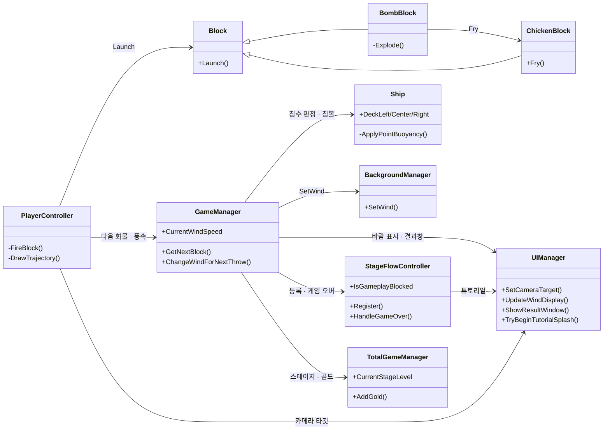
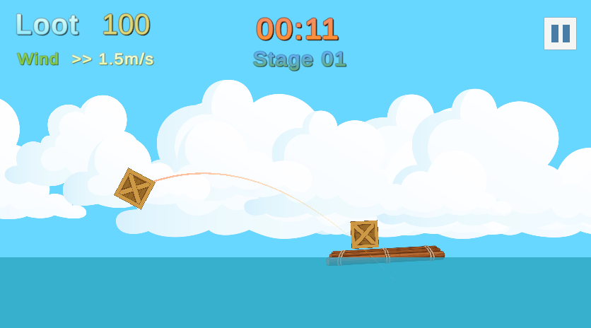
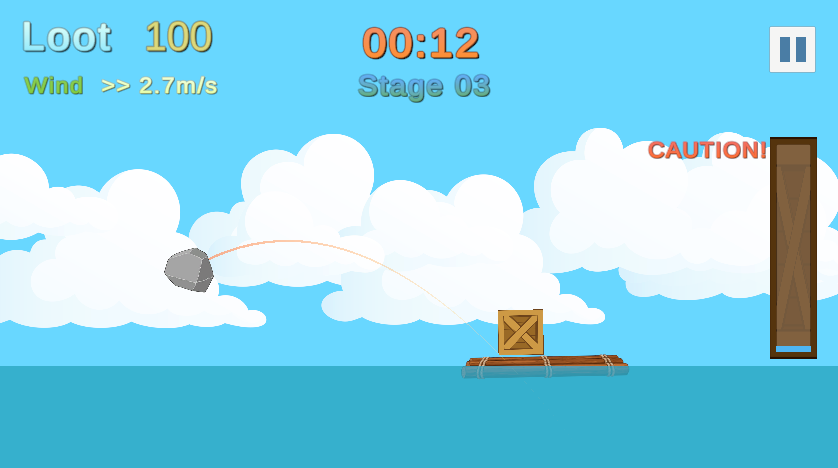

# SAIL OR SUNK — 2D 물리 기반 화물 적재 게임의 시스템 설계와 구현

> 물 위에 뜬 배가 기울거나 가라앉지 않도록 균형을 잡으며 화물을 던져 쌓고, 제한 시간 안에 점수를 모으는 2D 물리 게임

개발 형태: 1인 개발 · 2주 프로토타입

| 항목 | 내용 |
|---|---|
| 장르 | 2D 물리 기반 화물 적재 · 스테이지형 |
| 기간 | 2026.06.24 ~ 07.07 기능 개발(약 2주) · 07.09~10 AI를 활용한 리팩토링·스테이지 흐름 정리 · 07.17~18 업데이트 기획서 작성 |
| 인원 | 1인 개발 (제공된 예제 코드 일부를 바탕으로 응용) |
| 개발 환경 | Unity 6000.3.15f1 · C# · Rigidbody2D · Input System · uGUI |
| 링크 | GitHub(비공개 저장소) · 시연 영상 준비 중 |

- 문서 구성: 2장 공통 기반 → 3~6장 기능 A~D(투척·부력·특수 화물·카메라와 UI) → 7장 결과와 회고

## 1. 프로젝트 개요

### 1.1 만든 것

- 제한 시간 안에 화물을 선박에 투척해 최대한 많이 적재하는 2D 물리 기반 게임
- 화물의 무게와 위치에 따른 선박의 출렁임과 기울어짐, 침수 및 침몰
- 업그레이드와 난이도 상승으로 이어지는 무한 스테이지 게임 루프
- 레퍼런스: 수박 게임·테트리스·앵그리버드 — 이 게임들의 메커니즘을 답습하는 대신 '던져서 쌓고 균형을 잡는다'는 새로운 메커니즘을 채택

### 1.2 목표

- 개발 의도: 첫 프로젝트로서 규모를 늘리기보다 초기 기획을 최대한 완성도 있게 다듬는 것. 코어 게임 루프와 필수 요소부터 구현하고 버그가 생기지 않게 만드는 데 집중
- 수면, 충격, 바람, 무게 등의 요소에 반응하는 선박과 화물의 자연스러운 움직임 구현
- 탄도 및 무게 균형 예측, 바람 같은 환경 요소를 포함한 플레이어의 물리적 계산 유도
- 핵심 시스템인 물리 시뮬레이션과 게임 규칙, 인터페이스의 통합으로 게임 루프 구성
- 동적 UI와 카메라 워크를 통해 시각적 피드백을 제공함으로써 의도된 플레이어 반응 및 경험 유도

### 1.3 개발 환경 및 전체 구조

- Unity 6 · C# · Rigidbody2D · Input System · uGUI
- 주요 클래스와 시스템 간 의존 관계
- 드래그로 입력 → 릴리즈로 투척 → 화물 충돌 → 선체 반응 → 점수 계산 및 침수 → 정산



- 입력(`PlayerController`)에서 시작한 흐름이 `GameManager`를 거쳐 선박·배경·UI로 퍼지고, 플레이 가능 여부는 `StageFlowController` 한 곳에서 판단하는 구조

## 2. 공통 기반 — 게임 루프 및 상태 관리

### 2.1 게임 상태와 매니저 구조

- 스테이지마다 초기화되는 데이터와 씬 전환 후에도 유지되는 전체 진행 데이터의 생애 주기 구분
  - DontDestroyOnLoad 클래스인 `TotalGameManager`로 씬 전환 시 필요한 데이터 유지
- `SingletonBase<T>`를 이용한 재사용성이 높은 CRTP 패턴 매니저 클래스
- `StageFlowController`로 스테이지 진행 흐름(시작 → 튜토리얼 → 플레이 → 일시정지 → 게임 오버 연출 → 결과)을 하나의 `StageState`로 관리
  - 게임 시간(`Time.timeScale`)을 멈추고 다시 흐르게 하는 시점을 이 클래스에 모음. 분리 전에는 일시정지·튜토리얼에서 `UIManager`가 직접 바꿨음
  - 게임 시간이 멈춘 동안 튜토리얼 안내 UI는 실제 시간(`Time.unscaledDeltaTime`)으로 움직여, 게임 시간과 UI 시간을 나눔
  - `PlayerController`·`GameManager`·`UIManager`는 `IsGameplayBlocked`로 플레이 중인지만 확인해 입력과 진행을 차단

`StageFlowController.cs` 15~16 · 57~78행

```csharp
public StageState CurrentState { get; private set; } = StageState.Boot;
public bool IsGameplayBlocked => CurrentState != StageState.Playing;
// (중략)
public bool TryPause()
{
    if (CurrentState != StageState.Playing)
    {
        return false;
    }

    CurrentState = StageState.Paused;
    Time.timeScale = 0.0f;
    return true;
}

public void ResumePause()
{
    if (CurrentState != StageState.Paused)
    {
        return;
    }

    CurrentState = StageState.Playing;
    Time.timeScale = 1.0f;
}
```

- `IsGameplayBlocked`는 `Playing`이 아닌 모든 상태에서 true → 확인하는 쪽은 상태 종류를 몰라도 이 값 하나로 판단
- `TryPause`는 플레이 중일 때만 성공 → 튜토리얼·결과 연출 중에는 일시정지가 걸리지 않음

### 2.2 점수·정산·업그레이드 시스템

- 첫 충돌 시 점수를 얻고 물에 빠지면 점수가 차감되는 단순한 점수 환산 방법
- 침몰·시간 종료에 따른 스테이지 결과 처리
- 유지비·보험·업그레이드와 파산 판정

## 3. 기능 A — 화물 투척 및 환경 시스템

### 3.1 개요



질량 기반 투척, 탄도 예측, 바람의 물리적 영향을 하나의 발사 시스템으로 구성

### 3.2 시스템 구조

- `PlayerController`는 입력, `Block`은 물리를 처리하도록 역할 및 책임 분리
- `GameManager`에서 풍속과 풍향을 갱신하고, `PlayerController`가 발사할 때 그 값을 `Block`에 전달해 실제 벡터를 바꿈

### 3.3 핵심 기능 및 구현

- 드래그 거리와 질량으로 보정된 발사 운동량
- 발사 순간 Rigidbody2D 속성을 Kinematic에서 Dynamic으로 전환
- 중력과 바람을 반영한 포물선 궤적과 실제 발사 운동 벡터
- 구름
  - 오브젝트 풀로 생애 주기 관리
  - `BackgroundManager`에서 현재 풍향과 풍속에 영향을 받아 움직이게 함

`PlayerController.cs` 136~162행

```csharp
private void FireBlock()
{
    isDragging = false;
    trajectoryLine.enabled = false;

    if (currentBlock == null) return;

    Vector2 currentMousePos = GetMouseWorldPosition();
    Vector2 dragVector = dragStartPos - currentMousePos;

    if (dragVector.x < 10)
    {
        dragVector.x = 10;
    }

    Vector2 shootForce = dragVector * forceMultiplier;

    if (shootForce.magnitude > maxForce)
    {
        shootForce = shootForce.normalized * maxForce;
    }

    currentBlock.Launch(shootForce, GameManager.Instance.CurrentWindSpeed);
    UIManager.Instance.SetCameraTarget(currentBlock.transform, UIManager.Instance.BlockOffset, 18f);
    StartCoroutine(SpawnDelayCoroutine(currentBlock));
    currentBlock = null;
}
```

- 드래그 벡터의 x가 10보다 작으면 10으로 보정하고, 질량 기반 계수(`forceMultiplier`)를 곱한 뒤 `maxForce`로 상한을 둠
- 현재 풍속과 함께 `Block.Launch`에 넘기고, 발사 직후 카메라 타깃을 화물로 바꿈

`GameManager.cs` 184~192행

```csharp
public void ChangeWindForNextThrow()
{
    CurrentMaxWindSpeed = GetCurrentMaxWindSpeed();
    float maxDelta = CurrentMaxWindSpeed * windChangeRatio;
    float delta = Random.Range(-maxDelta, maxDelta);
    CurrentWindSpeed += delta;
    CurrentWindSpeed = Mathf.Clamp(CurrentWindSpeed, -CurrentMaxWindSpeed, CurrentMaxWindSpeed);
    ApplyWindState();
}
```

- 한 번 던질 때마다 풍속 변화량을 현재 최대 풍속의 `windChangeRatio`(10%) 이내로 제한하고, 최대 풍속 안으로 클램프

### 3.4 고민과 선택

- **랜덤 요소를 통한 게임 플레이 단순화 방지** : 화물의 종류가 바뀌어도 환경과 조건이 매번 같으면, 어느 화물을 어떻게 던지는 것이 좋은지에 대한 경험이 단순해질 수 있었음. 이에 투척할 때마다 화물의 크기와 질량이 정해진 범위 안에서 무작위로 바뀌고 풍향과 풍속의 영향도 받도록 함 → 플레이어가 매번 탄도를 다시 계산하도록 설계
- **구름을 시각적 피드백 요소로 활용** : 초기에 구름은 단지 배경 요소였지만, 풍향·풍속을 수치로만 표시하는 대신 구름의 이동 방향과 속도로 표현하게 되면서 플레이어가 직관적으로 바람을 감지할 수 있는 피드백 요소로 재설계
- **무작위 바람과 점진적 변화 방식의 선택** : 초반부터 바람이 급격히 강해지거나 방향이 바뀌면 플레이어가 조준 경험을 분석·축적하기 어렵고, 바람의 흐름에 따라 움직이는 구름도 부자연스럽게 느껴질 수 있음. 이에 스테이지가 올라갈 때마다 최대 풍속을 늘리되, 한 스테이지 안에서는 투척할 때마다 풍속의 무작위 변화량을 최대 풍속의 10% 이내로 제한

## 4. 기능 B — 선박 부력 및 침수 시스템

### 4.1 개요

화물의 질량과 적재 위치에 따라 선체가 기울고 침수되는 물리 모델

### 4.2 시스템 구조

- Rigidbody2D 기반 선체와 가상 수면 구현
- 좌우 2개 부력 적용 지점 : 부력으로 물 위에 떠 있는 선박의 움직임 구현
- 갑판 3개 침수 판정 지점 : 침수 게이지와 게임 오버 판정으로 연결
- 평소에는 선체가 수면 위로 올라간 높이에 따라 중력 스케일(`rb.gravityScale`)을 0.1~0.5 사이에서 조절하고, 침몰 시에는 중력 스케일을 점진적으로 증가시켜 부력을 압도함으로써 서서히 가라앉는 선박의 움직임 구현

### 4.3 핵심 기능 및 구현

- 좌우 부력 적용 지점마다 수심에 비례한 부력을 가해, 더 깊이 잠긴 쪽이 더 큰 힘을 받으면서 생기는 회전력으로 선박의 복원력 구현
- 선체가 가상의 수면 높이에 머무르도록 선체의 질량에 적합한 중력과 부력 값을 찾아 균형을 맞춤
- 갑판의 침수 여부에 따른 침수도의 상승과 하강으로 플레이어에게 게임 오버 위험을 직관적으로 전달

`Ship.cs` 49~78행

```csharp
private void UpdateGravityBasedOnDepth()
{
    if (GameManager.Instance.IsGameOver) return;

    float shipFlying = transform.position.y;

    if (shipFlying > 0)
    {
        float t = Mathf.Clamp01(shipFlying / 2.5f);
        rb.gravityScale = Mathf.Lerp(0.1f, 0.5f, t);
    }
    else
    {
        rb.gravityScale = 0.1f;
    }
}

private void ApplyPointBuoyancy(Transform buoyancyPoint)
{
    float depth = waterLevel - buoyancyPoint.position.y;

    if (depth > 0)
    {
        float buoyancyForce = depth * baseBuoyancy;
        Vector2 velocityAtPoint = rb.GetPointVelocity(buoyancyPoint.position);
        float dampingForce = velocityAtPoint.y * -waterResist;
        float totalVerticalForce = Mathf.Max(0, buoyancyForce + dampingForce);
        rb.AddForceAtPosition(Vector2.up * totalVerticalForce, buoyancyPoint.position);
    }
}
```

- 부력 지점마다 수심(`depth`)에 비례한 부력에 그 지점의 세로 속도로 감쇠를 더해 `AddForceAtPosition`으로 가함 → 좌우 깊이 차이가 회전력이 되어 복원 움직임이 생김
- 선체가 수면 위(y > 0)로 올라가면 높이에 따라 중력 스케일을 0.1~0.5로 보간해 튀어 오르지 않게 함

### 4.4 고민과 선택

- **초기 회전 중심 모델에서 수심 기반 부력으로 변경한 이유** : 초기에는 선박의 y 위치를 고정하고, 침몰 없이 기울어지는 선박에 최대한 많은 화물을 쌓는 것을 게임 목표로 정했음. 그러나 실패 조건을 직관적으로 정하기 어렵고 물 위에 뜬 선박의 움직임도 부자연스러워, 이 제약을 없애고 침몰을 스테이지 실패의 직접적인 조건으로 바꿈
- **단일 부력 지점에서 좌우 2지점 구조로 변경** : 선체를 하나의 객체로 보고 단일 부력 지점을 적용하자 선체가 걷잡을 수 없이 회전해 기울어지거나 뒤집어지는 문제가 발생. 2D 환경에서 물 위에 뜬 선박의 자연스러운 움직임을 구현하려면 수직 방향의 흔들림도 중요하지만, 선체가 z축으로 회전과 역회전을 반복하며 균형을 잡는 복원 움직임이 반드시 필요하다는 것을 확인. 이에 선체의 좌우에 부력 적용 지점을 나눠 배치해 이를 구현함
- **상황에 따라 선체에 유동적인 `rb.gravityScale` 값 적용** : 선체의 y 월드 좌표에 따라 중력 스케일 값을 0.1~0.5 사이에서 조절해, 부력으로 인해 선체가 하늘로 날아오르는 현상을 막음. 동시에 중력으로 인해 선체가 그대로 침몰하는 것도 방지해, 선박이 수면에서 넘실거리며 떠 있는 움직임을 구현함. 현실에서 중력이 상황에 따라 변한다는 것은 직관적으로 납득하기 어렵지만, 게임 내에서 실제와 유사한 움직임을 구현하기 위해 가장 단순한 해결 방식을 채택
- **선박 업그레이드로 인한 선체의 크기와 형태, 질량 변화에 대응** : 업그레이드 시 변화하는 선체의 크기와 형태는 플레이어에게 시각적 성취감을 주는 디자인 요소이면서, 더 많은 화물을 싣게 해 실제 플레이로 이어지는 시스템 요소이기도 했음. 선체의 질량인 `rb.mass` 역시 화물이 충돌했을 때 선체의 움직임에 영향을 주므로 업그레이드에 따라 증가하도록 설정함. 다만 이러한 크기와 형태, 질량의 변화는 부력 적용 지점과 선체의 운동 안정성을 함께 고려해야 하는 문제였음. 이에 업그레이드 단계별 선박을 개별 프리팹으로 구성하고, 각 선체의 형태에 맞게 부력 적용 지점과 침수 판정 지점을 조정함. 또한 선박별 질량을 설정하고 기본 부력을 현재 선체 질량에 비례해 계산하도록 하여, 선체의 크기와 형태가 달라져도 수면 위에서 자연스럽게 출렁이고 충격에 반응하며 자세를 회복하는 움직임을 유지하도록 구현

## 5. 기능 C — 특수 화물 상호작용 시스템

### 5.1 개요

공통 화물 `Block`의 기능과 역할을 유지하면서 폭탄의 폭발과 닭 화물의 상태 변화가 실제로 다른 화물 및 선박의 움직임, 획득 점수에 영향을 주도록 구현

### 5.2 시스템 구조

- `BombBlock`과 `ChickenBlock`을 `Block`의 상속 클래스로 분리하여 `Block`의 기능을 유지한 채로 폭발 및 상태 변화 등 독립적인 기능 추가
- `BombBlock`의 폭발 범위 내에서 `ChickenBlock`을 탐색해 `Fry()`를 호출하고, 닭 화물의 상태 변화 및 점수 추가 처리

### 5.3 핵심 기능 및 구현

- Coroutine을 이용한 폭탄의 첫 충돌 이후 대기 → 경고 → 폭발 시퀀스
- `Physics2D.OverlapCircleAll()`을 이용한 폭발 범위 탐색
- 폭발 지점과의 거리에 따른 충격량 및 회전력 적용
- 폭발에 노출된 닭 화물의 스프라이트·물리 머티리얼 교체와 보너스 점수 처리

`BombBlock.cs` 207~232행

```csharp
Collider2D[] targets = Physics2D.OverlapCircleAll(transform.position, explosionRadius, explosionTargetMask);

foreach (Collider2D target in targets)
{
    if (target == null) continue;
    if (target.transform == transform) continue;

    Rigidbody2D targetRigidbody = target.attachedRigidbody;

    if (targetRigidbody != null)
    {
        Vector2 direction = targetRigidbody.worldCenterOfMass - (Vector2)transform.position;
        float distance = Mathf.Max(direction.magnitude, 0.1f);
        float forceRatio = Mathf.Clamp01(1.0f - distance / explosionRadius);
        forceRatio = Mathf.Max(forceRatio, minimumForceRatio);
        Vector2 forceDirection = direction.normalized;
        targetRigidbody.AddForce(forceDirection * explosionForce * forceRatio, ForceMode2D.Impulse);
        targetRigidbody.AddTorque(Random.Range(-explosionTorque, explosionTorque) * forceRatio, ForceMode2D.Impulse);
    }

    ChickenBlock chickenBlock = target.GetComponentInParent<ChickenBlock>();
    if (chickenBlock != null)
    {
        chickenBlock.Fry(friedChickenBonusScore);
    }
}
```

- 폭발 범위의 Collider마다 거리에 따라 충격량을 줄이되 `minimumForceRatio` 이상은 보장하고, 무작위 회전력을 더함
- 대상에 `ChickenBlock`이 있으면 `Fry`를 호출하고, 같은 닭 화물이 두 번 처리되는 것은 `ChickenBlock`의 `isFried`로 막음

### 5.4 고민과 선택

- **공통 화물의 동작을 유지하면서 특수 기능 확장** : 일반 화물에 폭발이나 상태 변화 등의 기능을 추가하면 기존 `Block`의 조건문과 관리해야 할 상태가 늘어나 책임이 지나치게 큰 클래스(갓 클래스)가 될 위험이 있었음. 이에 발사, 물리적 움직임, 충돌과 점수 처리 등 모든 화물이 공유하는 기능은 `Block`에서 관리하고, 폭탄의 폭발 시퀀스와 치킨의 상태 변화는 각각의 상속 클래스에서 처리하도록 구성함. 이를 통해 기존 화물의 동작을 재사용하면서 새로운 상호작용을 추가할 수 있도록 구현
- **폭탄의 위험을 보상으로 연결하는 게임플레이 설계** : 폭탄이 기존 적재물을 무너뜨리고 선박의 침몰 위험을 높이기만 한다면 플레이어에게 일방적인 페널티로 작용할 수 있었음. 이에 폭탄의 폭발 범위에 닭 화물이 포함되면 치킨으로 만들어 추가 점수를 획득하도록 설계함. 이를 통해 위험한 폭탄을 단순한 페널티 요소로 받아들이는 대신, 어디에 배치하는 것이 최선일지 판단하는 요소를 추가함. 다만 페널티와 보너스가 항상 의도대로만 작동하지는 않도록, 폭발까지 무작위 대기 시간을 두어 폭발 시점의 불확실성도 함께 부여함

## 6. 기능 D — 카메라 및 UI 피드백 시스템

### 6.1 개요

화물의 조준, 비행, 적재와 침수 상태, 게임 종료에 따라 카메라 시점과 UI의 노출 여부를 전환하여 플레이어가 현재 상황과 위험 요소를 직관적으로 파악하도록 구현

### 6.2 시스템 구조

- `PlayerController`에서 플레이 단계에 맞는 카메라 타깃을 지정하고, `UIManager`에서 위치, 줌, 화면 전환 처리
- `GameManager`의 침수도와 게임 진행 상태를 참조하여 인게임 UI와 결과 화면의 표시 상태 제어
- 위치와 기능에 따라 분할된 UI 패널마다 `RectTransform`의 포지션을 조정하는 방식으로 등장·퇴장 시점과 연출 관리

### 6.3 핵심 기능 및 구현



- `Block`의 조준, 비행, 적재 상태에 따른 카메라 타깃과 줌 변경 및 `Lerp()`를 이용한 부드러운 시점 전환
- 시간, 점수, 바람 등 상시 표시 정보와 침수 상태일 때의 침수 게이지 등 조건부 정보의 구분 표시
- `RectTransform.anchoredPosition`과 `Lerp()`를 이용한 인게임 UI, 침수 게이지, 결과 화면의 슬라이드 전환 연출
- Canvas 크기에 따라 UI의 화면 밖 대기 위치를 계산하고, Canvas Scaler와 앵커를 이용해 화면 비율이 바뀌어도 대응할 수 있도록 설계
- 일시정지 및 최초 스테이지 튜토리얼 UI를 표시·해제하고, 시간 정지·재개는 `StageFlowController`에 맡김

`UIManager.cs` 348~380행

```csharp
public void SetCameraTarget(Transform newTarget, Vector3 offset, float size)
{
    if (newTarget != null)
    {
        currentTarget = newTarget;
        currentOffset = offset;
        currentCamZoomTarget = size;
    }
}

private void CameraWork()
{
    if (cam == null)
    {
        return;
    }

    if (currentTarget == null)
    {
        if (ship == null)
        {
            return;
        }

        SetCameraTarget(ship.transform, shipPosOffset, currentCamZoom);
    }

    Vector3 lerpPos = Vector3.Lerp(cam.transform.position, currentTarget.position + currentOffset, 1.8f * Time.deltaTime);
    lerpPos.z = cam.transform.position.z;
    cam.orthographicSize = Mathf.Lerp(currentCamZoom, currentCamZoomTarget, 2.5f * Time.deltaTime);
    currentCamZoom = cam.orthographicSize;
    cam.transform.position = lerpPos;
}
```

- `SetCameraTarget`은 타깃·오프셋·줌 목표만 바꾸고, `CameraWork`가 매 프레임 위치와 `orthographicSize`를 `Lerp`로 따라감
- 따라갈 타깃이 없으면 선박으로 시점을 되돌림

### 6.4 고민과 선택

- **고정 카메라에서 플레이 상태에 따른 시점 전환으로 변경** : 초기에는 고정된 카메라를 사용했으나, 화물을 조준하는 순간과 발사된 화물의 비행 과정, 선박에 적재된 결과를 확인하는 순간에 플레이어가 집중해야 할 대상이 서로 달랐음. 이에 플레이어가 필요로 하는 정보를 더 효과적으로 제공하기 위해 조준 중에는 화물과 예상 궤적을 보여주고, 발사 후에는 비행하는 화물을 확대해 추적하며, 충돌 이후에는 선박으로 시점을 복귀시키도록 변경함. 시점이 갑자기 이동하는 대신 위치와 줌을 보간하여 자연스럽게 연결되도록 구현
- **게임 정보의 중요도에 따른 UI 표시 방식 구분** : 점수나 남은 시간처럼 계속 확인해야 하는 정보와 달리, 침수 게이지는 선박이 안전한 상태에서는 지속적으로 확인할 필요가 없는 정보였음. 모든 UI를 상시 표시하면 불필요한 정보가 화면을 차지할 수 있으므로, 침수가 진행될 때만 게이지가 화면 오른쪽에서 등장하도록 연출함. 위험이 발생했다는 사실 자체를 UI의 등장으로 전달하여 플레이어가 선박의 상태 변화와 위험을 즉시 인식할 수 있도록 설계
- **화면 비율 변경에 따른 UI 배치 문제 해결** : 초기에는 고정된 좌표를 기준으로 UI를 배치하여 창 크기와 비율이 달라지면 화면 밖에 있어야 할 패널이 노출되거나 버튼과 텍스트 배치가 어긋나는 문제가 있었음. 이를 해결하기 위해 Canvas Scaler와 UI별 앵커를 조정하고, 화면 밖 대기 위치를 고정 좌표 대신 Canvas의 너비와 높이를 기준으로 계산하도록 변경함. 이를 통해 서로 다른 화면 비율에서도 UI의 등장 및 퇴장 방향과 화면 배치를 유지하도록 대응
- **UI 조작과 화물 투척 입력이 충돌하는 문제 해결** : 일시정지 버튼을 클릭했을 때 `PlayerController`에서도 같은 마우스 입력을 받아, 게임을 재개했을 때 화물이 발사되는 문제가 발생함. 기존의 일시정지 상태만 확인하는 방식 대신 `EventSystem.current.IsPointerOverGameObject()`로 마우스가 UI 위에 있는지 검사하여, 일시정지와 같은 UI 클릭이 화물 드래그의 시작 입력으로 처리되지 않도록 수정함

## 7. 구현 결과 및 기술적 회고

### 7.1 주요 구현 결과

- 화물 투척부터 선박의 물리적 반응 및 움직임, 침수 및 침몰 판정, 스테이지 정산과 업그레이드까지 연결된 게임 루프 구현
- 화물의 질량과 크기, 풍향과 풍속의 변화, 선박의 형태와 질량 차이가 실제 게임 플레이에 영향을 주는 물리적 상호작용 체계 구현
- 폭탄과 치킨의 특수 상호작용, 조준·비행·침수 상황에 따른 카메라 및 UI 피드백을 통해 플레이어의 판단과 행동에 영향을 주는 게임 시스템 구성

### 7.2 개발 과정에서 얻은 기술적 판단

- **물리적 정확성과 게임플레이 경험의 구분** : 실제 수면의 유체역학을 정밀하게 재현하기보다, 선박이 화물의 충격과 적재 위치에 반응하고 자연스럽게 균형을 회복하는 움직임을 만드는 데 집중. 부력 적용 위치와 감쇠력, 중력 계수를 조정하면서 2D 환경에서 물리 수치의 정밀도와 플레이어가 자연스럽게 느끼는 움직임의 설득력이 반드시 일치하지는 않는다는 점을 확인
- **물리적 상호작용과 플레이어 피드백의 연결** : 실제로 물리적 변화가 발생하는 것이나 경고 문구를 띄우는 것만으로는 플레이어가 행동의 결과와 위험의 원인 사이의 연결 고리를 직관적으로 인지하기 어렵다고 판단. 바람의 영향을 조준 궤적과 구름으로 표현하고, 선박의 침수 위험을 조건부 UI로 전달하는 등 게임의 내부 상태를 플레이어가 인지하고 판단할 수 있는 정보로 전환하는 과정의 중요성 확인
- **기능 구현과 검증의 차이** : 개별 기능이 작동하는 것과 여러 시스템이 연동된 상황에서도 의도대로 작동하는 것은 별개의 문제임을 확인. 특히 물리 파라미터의 조정 결과나 UI 동작을 검증할 때 기준 조건과 변경 전후의 결과를 체계적으로 기록해 검증 데이터를 확보하는 것이 중요함

### 7.3 기술적 한계 및 향후 개선

- **탄도 예측과 실제 발사 조건의 일치** : 조준 궤적 계산과 실제 발사에서 수평 드래그값의 최소 보정 기준이 달라 특정 조건에서 예측과 실제 움직임이 불일치할 수 있음. 발사력 계산과 보정 로직을 공통화해, 예측 궤적과 실제 발사가 같은 보정 기준을 쓰도록 맞춰야 함
- **침수 및 배수 계산의 시간 단위 정비** : 침수도 증가량에는 `Time.deltaTime`을 적용하지만, 침수 중 펌프 배수량에는 적용하지 않는 등 계산 기준이 일관되지 않은 부분이 존재. 프레임 변화에 따른 영향을 줄이도록 시간 단위와 계산 방식을 통일함으로써 개선할 수 있음
- **폭발 충격의 중복 적용** : 현재는 폭발 범위 내의 Collider마다 충격을 가하는 방식이라, 하나의 `Rigidbody2D`에 여러 Collider가 연결된 경우 같은 물리 객체에 충격이 중복 적용될 수 있음. 폭발 대상 탐색 결과를 `HashSet<Rigidbody2D>`로 관리하여 이미 처리한 물리 객체에는 추가 충격을 적용하지 않도록 개선할 수 있음
- **매니저 간 직접 의존성 및 역할 집중** : `GameManager`와 `UIManager`가 여러 시스템의 상태와 표현을 직접 제어하고 있어 기능 확장 시 관리 및 책임 범위가 지나치게 넓어질 수 있음. 데이터 관리, 게임 규칙, 시각적 표현의 책임을 보다 명확히 분리할 필요가 있음
- **물리 시스템 파라미터 조정의 정량적 검증 부족** : 부력, 수중 저항, 중력 보정 등의 값을 관찰 가능한 움직임에 맞춰 조정했으나, 선체별 반응이나 변경 전후의 차이를 비교할 수 있는 정량적 테스트 자료는 부족함. 비교 테스트 조건과 측정 기준을 마련해 조정 결과의 설득력을 높여야 함

### 7.4 구현 근거 및 검증 자료

- 최종 구현 자료 : 주요 시스템의 클래스 관계와 데이터 흐름, 실제 코드 및 선박·화물 프리팹 설정
- 개발 과정의 근거 : 구현 방식이 변경된 주요 Git 커밋과 변경 전후 코드, diff 기록 비교
- 시각적 검증 자료 : 화물 투척, 선체 반응, 폭발 상호작용, 카메라 및 UI 동작을 보여주는 인게임 화면과 시연 자료

