# SAIL OR SUNK — 2D 물리 기반 화물 적재 게임의 시스템 설계와 구현

> 물 위에 뜬 배가 기울거나 가라앉지 않도록 균형을 잡으며 화물을 던져 쌓고 제한 시간 안에 점수를 모으는 2D 물리 게임

| 항목 | 내용 |
|---|---|
| 장르 | 2D 물리 기반 화물 적재 · 스테이지형 |
| 기간 | 2026.06.24 ~ 07.07 기능 개발(약 2주) · 07.09 ~ 11.21 리팩터링·업데이트 기획서·코드 점검 (일정별 작업은 2장) |
| 인원 | 1인 개발 |
| 내 역할 | 투척·부력·침수·특수 화물·카메라·UI·상점 직접 구현 (제공된 예제 코드의 블록 생성·낙하·합치기 뼈대에서 출발) |
| 개발 환경 | Unity 6000.3.15f1 · C# · Rigidbody2D · Input System · uGUI |
| 링크 | [GitHub](https://github.com/ashadeveloperr/3rd-2D-Project-ashadeveloperr) · [시연 영상](https://youtu.be/AV36aMm42vk) |

## 1. 프로젝트 개요

### 1.1 컨셉

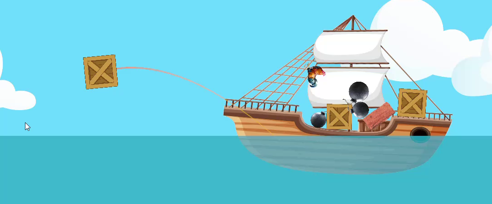

SAIL OR SUNK는 제한 시간 안에 화물을 배에 던져 최대한 많이 싣는 2D 물리 게임입니다. 화물의 무게와 실린 위치에 따라 배가 출렁이고 기울며, 갑판이 물에 잠기면 침수가 시작되어 끝내 가라앉습니다. 스테이지를 넘길 때마다 번 돈으로 배와 장비를 업그레이드하고, 난이도가 오르는 다음 스테이지로 끝없이 이어집니다.

**코어 루프**

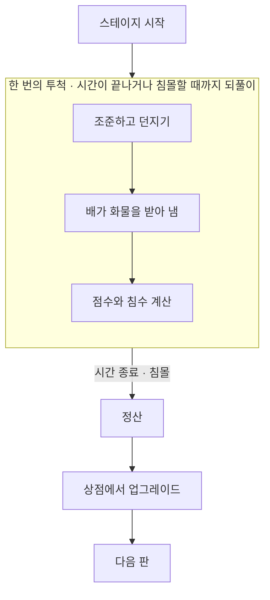

상자로 묶은 한 번의 투척은 제한 시간이 끝나거나 배가 가라앉을 때까지 되풀이됩니다. 한 판이 끝나면 실은 화물의 값으로 정산하고 번 골드로 배와 장비를 업그레이드합니다. 남는 돈이 있으면 다음 스테이지로 넘어가고 없으면 같은 스테이지에 다시 도전합니다. 침몰하면 배와 장비와 스테이지가 처음으로 돌아가고, 골드가 바닥나면 파산으로 게임이 끝납니다(5장).

목표한 경험은 **물 위에서 출렁이는 배의 균형을 지키며 바람과 무게를 계산해 화물을 던져 쌓는 것**입니다. 플레이어는 던질 때마다 바람을 읽어 탄도를 예측하고 어디에 실어야 배가 덜 기울지 판단해야 합니다. 레퍼런스는 수박 게임·테트리스·앵그리버드였지만, 이 게임들의 메커니즘을 답습하지 않고 '던져서 쌓고 균형을 잡는다'는 새로운 메커니즘을 택했습니다.

개발 의도는 배로 정한 기획(3장)을 규모를 늘리기보다 최대한 완성도 있게 다듬는 것이었습니다. 그래서 코어 루프와 필수 요소부터 구현하고 버그가 생기지 않게 만드는 데 집중했습니다.

## 2. AI 협업 개발

### 2.1 개발자와 AI의 역할

기획부터 구현까지 혼자 맡은 1인 프로젝트입니다. 6월 24일부터 7월 7일까지 약 2주 동안 강의에서 제공된 예제 코드를 바탕으로 게임의 주요 기능을 직접 구현했습니다. AI는 이후 리팩터링을 시도하거나 기존 코드의 문제를 찾아 수정하고, 미완성 기능을 정리하는 과정에서 활용했습니다.

| 구분 | 내용 |
|---|---|
| 제공된 예제 코드에서 가져온 것 | 블록 생성·낙하·합치기 뼈대 · 강의 유틸리티 |
| 직접 만든 것 (06.24~07.07) | 투척과 예상 궤적 · 바람과 구름 · 배의 부력과 침수 · 폭탄·닭 화물 · 카메라와 UI · 상점 |
| AI와 함께 한 것 (07.09~11.21) | 리팩터링 시도 · 스테이지 흐름 정리와 복구 · 코드 점검 · 미완성 분량 제거 |

직접 구현한 기능과 개발 이후 AI와 함께 변경한 부분을 구분하여 설명하겠습니다.

### 2.2 리팩터링을 맡겼다가 변경안을 채택하지 않은 이유

기능 개발에 집중하다 보니 클래스가 늘어나고 서로 다른 기능이 여러 곳에 분산되었습니다. 7월 9일에는 유지보수성을 높이기 위해 AI에 클래스 통폐합을 포함한 리팩터링을 맡겼습니다. 그러나 결과를 확인해 보니 익숙했던 클래스들이 뒤섞이고 기존 메서드가 어디로 옮겨졌는지 파악하기 어려웠습니다. 코드의 구조를 바꾸는 것이 오히려 이후 제가 직접 수정하는 데 부담이 될 수 있다고 판단해 통폐합 결과는 커밋하지 않았습니다.

대신 기존 클래스의 책임을 유지하면서 다음과 같이 두 차례에 걸쳐 코드를 정리했습니다.

| 작업 | 변경 내용 |
|---|---|
| 1차 정리 | 접근 제한자 및 직렬화 필요 여부 검토, 함수와 변수의 명명 규칙 수정, 미사용 네임스페이스와 유틸리티 제거, region 및 header 정리 |
| 2차 정리 | 불필요한 protected 및 public을 private으로 변경, FormerlySerializedAs 13곳 제거(7곳 유지), 불필요한 초기화 제거 |

7월 9일의 두 리팩터링 커밋에는 새로 만든 스크립트나 통합한 클래스가 없습니다. 삭제한 스크립트는 사용하지 않던 강의 유틸리티 8개와 Unity 템플릿 튜토리얼 2개뿐입니다. 유지보수성을 개선한다는 목표는 같더라도 개발자가 변경 후의 구조를 이해하고 수정할 수 있는지가 중요하다고 판단했습니다.

### 2.3 미완성 기능을 정리하고 필요한 게임 진행 규칙을 복구하기

7월 10일에는 다이얼로그 시스템을 추가하는 과정에서 AI가 게임 시간과 진행 상태를 `StageFlowController`로 모았습니다. 하지만 다이얼로그 기능을 완성하지 못했고, 이후 게임 오버 상태에서 대사를 기다리느라 결과 화면이 제때 나타나지 않는 문제가 발생했습니다.

11월 16일에 다이얼로그 작업을 되돌렸지만 튜토리얼 대기와 일시정지, 입력 차단, 게임 오버 연출 및 결과 화면의 순서를 관리하는 기능까지 함께 사라졌습니다. 대사 단계는 제외하되 기존 게임에 필요한 상태 처리는 유지해야 한다고 판단하여 AI와 함께 복구했습니다. 침몰 연출이 끝날 때까지 기다리지 않고 결과 화면을 바로 띄우도록 수정한 뒤 직접 플레이하여 확인했습니다. 복구한 스테이지 상태 구조는 5.1절에서 다룹니다.

당시 5스테이지를 클리어하면 엔드리스 모드를 해금하는 스토리 모드의 구분도 함께 되살아났습니다. 그러나 메뉴 버튼은 모드 선택에 연결되지 않았고 기본값인 스토리 모드에서는 침몰해도 스테이지가 처음으로 돌아가지 않았습니다. 11월 21일에는 AI와 함께 모드 구분과 남은 다이얼로그 기록, 사용하지 않는 스테이지 상태를 제거하고 침몰하면 배와 장비, 스테이지를 처음으로 되돌리는 원래 규칙을 복구했습니다. 컴파일 오류가 없는지 확인한 뒤 직접 플레이했습니다.

### 2.4 코드 점검에서 발견한 세 가지 문제

기능 개발이 끝난 뒤 기술문서를 작성하면서 AI와 함께 기존 코드를 다시 검토했습니다. 조준할 때 보여주는 궤적과 실제 발사의 기준이 다르거나, 물리 스텝의 길이에 따라 침수 중 배수량이 달라지는 등 개별 기능을 구현할 때에는 미처 확인하지 못했던 문제가 있었습니다. 11월 17일에 원인을 확인하고 세 가지 문제를 수정했습니다.

| 문제 | 원인 | 해결 | 결과 |
|---|---|---|---|
| 짧게 당기거나 뒤로 당기면 조준 궤적과 실제로 날아가는 방향이 다름 | 같은 드래그 보정을 두 곳에 따로 써서 궤적(`OnDragging`)은 x < 0 → 0, 발사(`FireBlock`)는 x < 10 → 10으로 기준이 달랐음 | 보정·계수·상한을 `CalculateLaunchForce` 하나로 모으고 궤적과 발사가 함께 씀. 최소값은 실제 발사 기준(10)을 상수 `MinLaunchDragX`로 | 보이는 궤적이 곧 실제 발사 힘. 기준을 바꿀 곳도 한 곳 |
| 침수 중 펌프 배수량만 시간 단위가 없음 | 침수도 증가는 `Time.deltaTime`을 곱한 초당 값인데 배수는 `pumpPower / 100`을 물리 스텝마다 그대로 뺌 → 고정 스텝 길이(지금 0.02초)가 바뀌면 배수 속도도 바뀜 | `pumpPower * FloodingPumpRatio * Time.deltaTime`으로 바꿈. 비율 0.5는 0.02초 스텝에서 예전 식과 같은 값 | 지금 밸런스는 그대로, 증가·배수 모두 초당 값으로 통일 |
| 폭발 충격이 한 물체에 여러 번 들어갈 수 있음 | `OverlapCircleAll`은 Collider 단위로 돌려줘서 Collider가 여러 개인 `Rigidbody2D`에는 그 수만큼 충격이 더해짐 | `HashSet<Rigidbody2D>`에 처음 넣을 때만 충격을 줌 | Collider 수와 관계없이 물체마다 충격 한 번 |

Unity 6000.3.15f1에서 컴파일 오류가 없는 것을 확인했고 고친 뒤 직접 플레이로 검증했습니다. 짧게 당길 때 궤적이 예전보다 길게 보이는 것은 실제 발사 힘과 같아졌기 때문입니다.

## 3. 기획

이 게임은 처음부터 배가 아니었습니다.

### 3.1 탑에서 배로

첫 컨셉 기획서(6/13 작성)는 주어진 블록으로 탑을 최대한 높이 쌓는 게임이었습니다. 점수도 가장 높이 쌓은 블록의 높이에 보너스를 더하는 방식이었습니다.

저장소를 만들기 전에 Unity에서 빠르게 시뮬레이션해 보았습니다. 그 결과 안정된 지반에 블록을 쌓기만 하는 것보다 흔들리는 선체의 균형까지 고려하게 하는 편이 더 재미있다는 것을 확인했습니다. 무엇보다 탑은 패배 조건을 정하기 어려웠습니다. 탑을 무너뜨리는 요소나 무너지지 않게 조심하게 만드는 불안 요소를 플레이어에게 납득시키기도 어려웠습니다.

배는 달랐습니다. 배가 뒤집히거나 가라앉기만 해도 그동안 쌓은 것이 모두 물거품이 됩니다. 기획으로도 감각으로도 더 다채로운 경험을 줄 수 있다고 판단해 소재를 배로 정했고 6/24부터 개발을 시작했습니다. 소재가 바뀌면서 점수도 쌓은 높이 대신 배에 실은 화물의 값으로 바뀌었습니다(5.2). 배로 바꾼 뒤에도 실패 조건을 다듬는 일은 이어졌습니다. 처음에는 가라앉지 않던 배를 결국 침몰하게 만든 것도 그 과정입니다(4.3.1).

### 3.2 떨어뜨리기 대신 던지기

컨셉 기획서는 블록을 고정된 높이에서 돌려 맞춘 뒤 떨어뜨리는 투하 방식이었습니다. 투하와 투척에는 각각 장단점이 있었습니다.

| | 투하 (컨셉 기획서) | **투척 (선택)** |
|---|---|---|
| 방식 | 고정된 높이에서 블록을 돌려 맞춘 뒤 떨어뜨림 | 드래그로 힘과 방향을 정하고 예상 궤적을 보며 던짐 |
| 장점 | 조작이 훨씬 직관적임 | 탄성·무게 같은 물리 요소를 살릴 수 있음 · 화물이 배나 다른 화물에 튕겨 물에 빠지는 일이 많아 컨트롤에 디테일과 재미가 생김 |
| 단점 | 탄성·무게를 투척만큼 살리지 못함 · 처음 떨어뜨리는 블록이 가장 크게 반응하고 쌓일수록 높이에 따른 위험이 줄어 한 스테이지가 점점 지루해짐 | 조작이 투하만큼 직관적이지 않음 |

결정을 가른 것은 긴장이 끝까지 이어지는가였습니다. 투하는 뒤로 갈수록 긴장이 줄지만 투척은 던질 때마다 한 번 한 번의 컨트롤이 결과를 바꿉니다. 그래서 궤적을 보며 던지는 투척을 택했습니다(4.1). 바람(풍향·풍속)은 컨셉 기획서의 방해 요소를 그대로 이어받은 것입니다(4.2).

### 3.3 끝없는 스테이지와 난이도

스테이지는 끝을 두지 않고 무한히 이어지게 했습니다. 끝없는 스테이지에서 밸런스를 잡기 위해 난이도를 **바람·화물의 다양성·유지비**로 조절하고자 했습니다. 지금 게임에는 이 세 가지가 다음처럼 들어가 있습니다.

- **바람**: 스테이지가 올라갈 때마다 최대 풍속이 커집니다(4.2).
- **화물**: 화물의 크기와 질량이 정해진 범위 안에서 무작위로 바뀌어 던질 때마다 어디에 실을지 다시 판단해야 합니다(4.2).
- **유지비**: 장비와 배가 좋아질수록 유지비도 늘어 다음 스테이지에서 더 많이 실어야 흑자가 남습니다(5.3).

컨셉 기획서에는 마찰이 낮은 기름칠 블록이나 호두 블록처럼 마찰·탄성이 다른 블록도 있었습니다. 이 블록들은 개발 기간 안에 넣지 못해 뺐습니다.

### 3.4 알려 주지 않은 규칙: 닭과 치킨

폭탄 화물과 폭발에 휘말린 닭이 치킨이 되어 보너스 점수를 받는 규칙은 컨셉 기획서부터 있던 요소입니다. 기획서에서 정한 화물 구조도 그대로 구현으로 옮겼습니다. 모든 화물의 공통 동작은 한 곳에 두고 다른 화물과 상호작용하는 화물만 따로 기능을 더하는 구조입니다(4.4.1).

닭이 치킨이 되는 규칙은 기획서 단계부터 **'의도된 정보 미제공'**으로 설계해 게임 안에서 알려 주지 않습니다. 시범 플레이에서 이 규칙을 발견한 테스터는 상상도 못 했다며 즐거워했고 이런 것이 또 있지 않을까 기대하게 되었다고 했습니다. 이 일로 모든 정보를 알려 주는 것만큼이나 알려 주지 않는 발견형 콘텐츠도 플레이를 이어 가게 하는 힘이 있다는 것을 확인했습니다.

## 4. 한 번의 투척: 던진 화물이 배에 실리기까지

제가 직접 만든 기능 중 상점을 뺀 나머지는 모두 코어 루프의 한 번의 투척 안에 있습니다. 구현 목표는 네 가지였고, 코어 루프의 단계와 짝지으면 다음과 같습니다.

| 구현 목표 | 코어 루프의 단계 | 다루는 곳 |
|---|---|---|
| 예상 궤적과 바람 표시를 보고 탄도와 무게 균형을 계산하며 던지게 하기 | 조준하고 던지기 | 4.1 · 4.2 |
| 수면·충격·바람·무게에 반응해 출렁이다 균형을 되찾는 배와 화물 | 배가 화물을 받아 냄 | 4.3 |
| 지금 봐야 할 대상을 따라가는 카메라와 위험할 때만 나타나는 UI | 한 번의 투척 전체 | 4.5 |
| 적재·입수·침몰 같은 물리 결과를 점수·정산·스테이지 진행으로 잇는 게임 루프 | 점수와 침수 계산 → 정산 → 상점 | 5장 |

이 장의 결정들은 두 가지 판단으로 모입니다. 물리는 정확한 재현보다 플레이어가 자연스럽다고 느끼는 움직임에 맞췄고, 바람과 침수처럼 눈에 보이지 않는 상태는 궤적·구름·게이지로 보이게 했습니다(6.2).

아래 표는 한 번의 투척이 지나가는 단계와 단계마다 맡은 클래스이고, 클래스 사이의 관계는 표 아래 두 그림에 나눠 그렸습니다.

| 단계 | 하는 일 | 주요 클래스 |
|---|---|---|
| 조준과 발사 (4.1) | 드래그로 힘과 방향을 정하고 예상 궤적을 그린 뒤 화물을 발사함 | `PlayerController` · `Block` |
| 바람 (4.2) | 던질 때마다 풍속을 조금씩 바꾸고 날아가는 화물에 바람 힘을 가함 | `GameManager` · `Block` · `BackgroundManager` |
| 배가 받아 내기 (4.3) | 좌우 두 지점에 부력을 가하고 갑판이 잠기면 침수를 계산함 | `Ship` · `GameManager` |
| 특수 화물 (4.4) | 폭탄이 터지면 주변 화물을 밀어내고 닭을 치킨으로 바꿈 | `BombBlock` · `ChickenBlock` |
| 화면 (4.5) | 지금 봐야 할 대상을 카메라가 따라가고 위험할 때만 침수 게이지를 띄움 | `PlayerController` · `UIManager` |

**① 입력 → 화물**

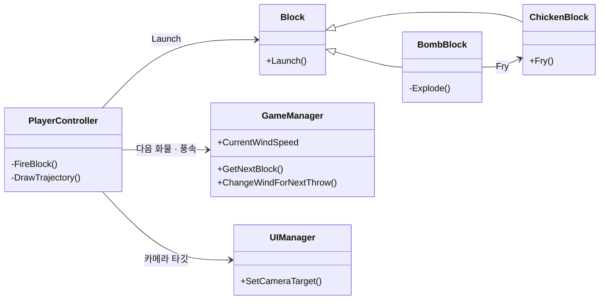

**② 게임 진행 → 선박·배경·UI**

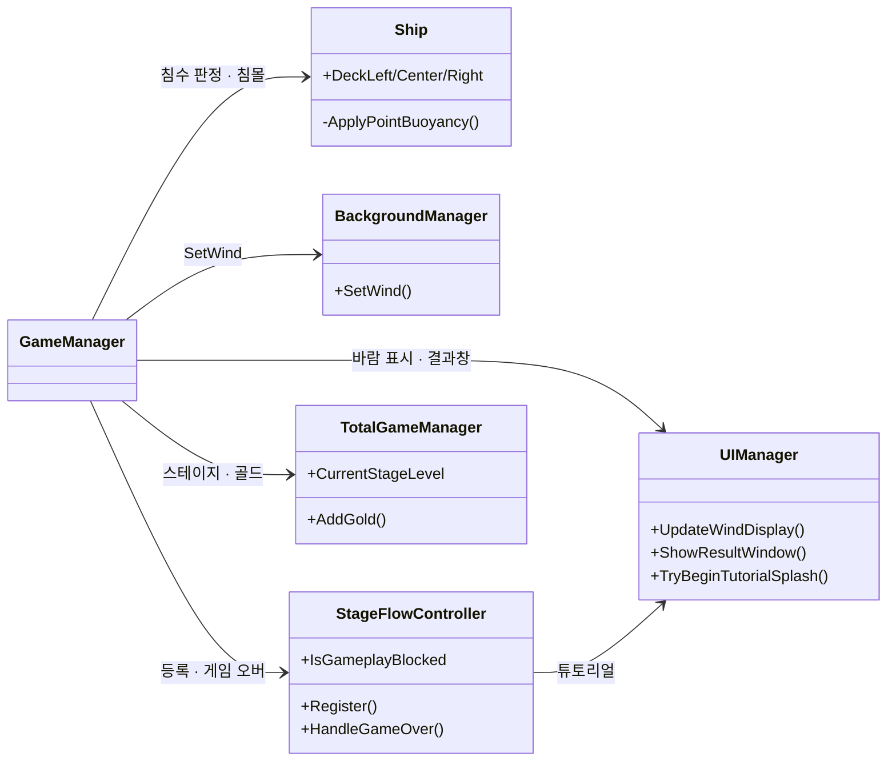

입력(`PlayerController`)에서 시작한 흐름은 `GameManager`를 거쳐 선박·배경·UI로 퍼집니다. 게임 오버 여부는 `GameManager`가 들고 있어 각 클래스가 함께 확인합니다. ②의 `StageFlowController`(한 판의 진행 상태)와 `TotalGameManager`(스테이지를 넘어 유지되는 골드)는 5장에서 다룹니다.

### 4.1 조준과 발사: 무게가 달라도 같은 드래그면 같은 궤적으로 날아간다

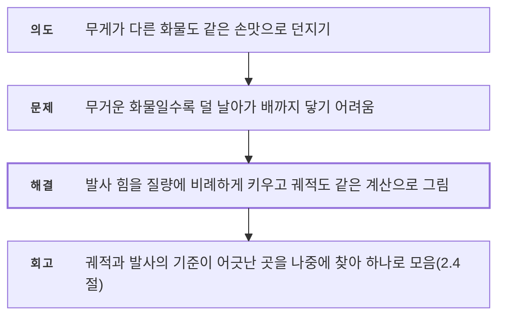

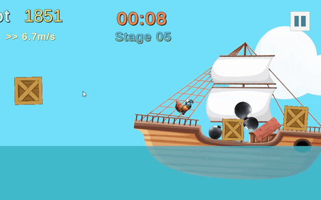

입력은 `PlayerController`가, 물리는 `Block`이 처리하도록 역할을 나눴습니다. 플레이어가 드래그하는 동안 `PlayerController`가 예상 궤적을 그리고 손을 떼면 발사 힘을 계산해 `Block`에 넘깁니다. 발사 순간 `Block`은 Rigidbody2D를 Kinematic에서 Dynamic으로 바꿉니다. 이 부분은 제공된 예제 코드의 방식을 그대로 따랐습니다.

**발사 힘은 질량에 비례하게 보정했습니다.**

무거운 화물이 덜 날아가면 정말 무거운 화물은 배까지 날리기도 어려워집니다. 그래서 같은 드래그면 무게와 관계없이 같은 궤적으로 날아가게 했습니다. 무게는 날아갈 때보다 부딪히고 실린 뒤에 영향을 줍니다.

`PlayerController.cs` 130~165행

```csharp
private void FireBlock()
{
    isDragging = false;
    trajectoryLine.enabled = false;

    if (currentBlock == null) return;

    Vector2 currentMousePos = GetMouseWorldPosition();
    Vector2 dragVector = dragStartPos - currentMousePos;

    Vector2 shootForce = CalculateLaunchForce(dragVector);

    currentBlock.Launch(shootForce, GameManager.Instance.CurrentWindSpeed);
    UIManager.Instance.SetCameraTarget(currentBlock.transform, UIManager.Instance.BlockOffset, 18f);
    StartCoroutine(SpawnDelayCoroutine(currentBlock));
    currentBlock = null;
}

private Vector2 CalculateLaunchForce(Vector2 dragVector)
{
    if (dragVector.x < MinLaunchDragX)
    {
        dragVector.x = MinLaunchDragX;
    }

    Vector2 launchForce = dragVector * forceMultiplier;

    if (launchForce.magnitude > maxForce)
    {
        launchForce = launchForce.normalized * maxForce;
    }

    return launchForce;
}
```

- 드래그 벡터의 x가 `MinLaunchDragX`(10)보다 작으면 10으로 올립니다. 여기에 질량 비례 계수(`forceMultiplier` = 질량/1.5)를 곱하고 `maxForce`로 상한을 둡니다. 충격량에서 질량이 상쇄되므로 초기 속도는 드래그로만 정해집니다.
- 조준 궤적(`OnDragging`)도 같은 `CalculateLaunchForce`로 계산해 궤적과 실제 발사가 같은 보정 기준을 씁니다. 처음에는 두 곳의 기준이 달랐는데 코드 점검에서 찾아 하나로 모았습니다(2.4절).
- 발사할 때 현재 풍속을 함께 `Block.Launch`에 넘기고(4.2) 카메라 타깃을 화물로 바꿉니다(4.5.1).
- `SpawnDelayCoroutine`은 던진 화물이 처음 닿거나 물에 빠질 때까지 기다립니다. 그다음 카메라를 선박으로 돌리고 바람을 바꾼 뒤(4.2) 다음 화물을 만듭니다.

플레이어가 보는 예상 궤적은 이 발사 힘과 바람을 그대로 써서 그립니다.

`PlayerController.cs` 224~240행

```csharp
private void DrawTrajectory(Vector2 startPos, Vector2 velocity)
{
    Vector3[] points = new Vector3[trajectoryPointCount];
    Vector2 gravity = Physics2D.gravity;
    float windPower = currentBlock != null ? currentBlock.WindPower : 0.0f;
    Vector2 windAcceleration = Vector2.right * GameManager.Instance.CurrentWindSpeed * windPower;

    for (int i = 0; i < trajectoryPointCount; i++)
    {
        float time = i * timeStepPerPoint;
        Vector2 totalAcceleration = gravity + windAcceleration;
        Vector2 pointPos = startPos + (velocity * time) + (0.5f * totalAcceleration * (time * time));
        points[i] = new Vector3(pointPos.x, pointPos.y, 0f);
    }

    trajectoryLine.SetPositions(points);
}
```

- 초기 속도(`velocity` = 발사 충격량 ÷ 질량)와 중력·바람 가속도를 등가속도 운동 식 `p = p₀ + v·t + ½·a·t²`에 넣어 일정한 시간 간격으로 점을 찍고 `LineRenderer`로 잇습니다.
- 실제로 날아갈 때는 `Block`이 첫 충돌이나 입수 전까지 매 물리 스텝 `풍속 × windPower × 질량`의 바람 힘을 가합니다. 이것을 가속도로 바꾸면 질량이 상쇄되어 `풍속 × windPower`가 되므로 궤적의 `windAcceleration`과 같은 값입니다.

### 4.2 바람: 조금씩 바뀌는 바람을 구름으로 보여 준다

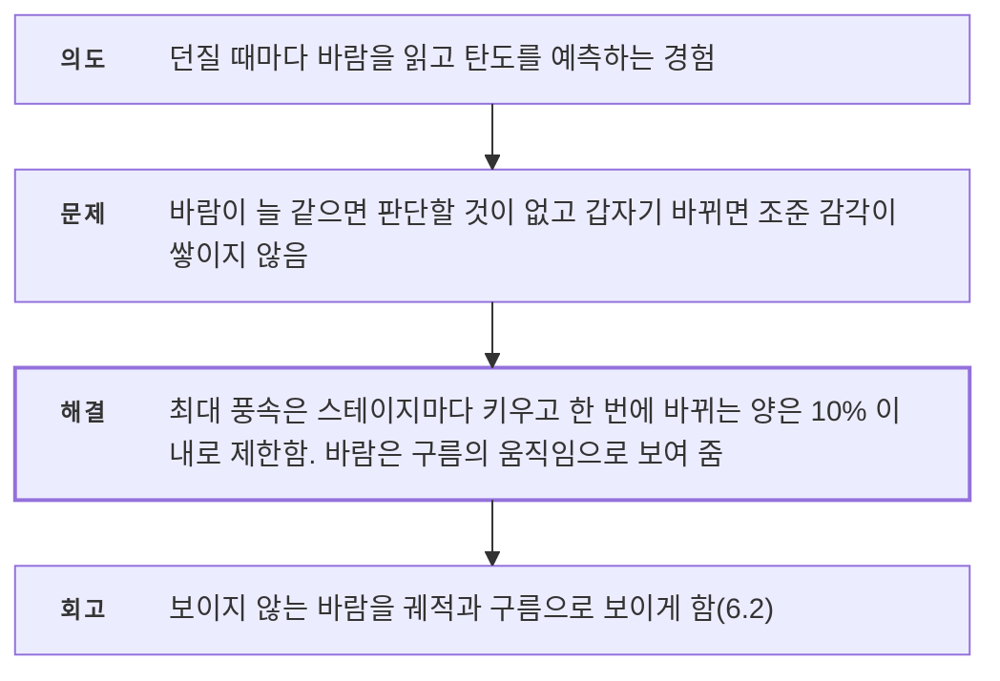


궤적을 보며 던지게 했으니 던질 때마다 판단을 바꾸게 할 요소가 필요했습니다. 그 역할을 바람이 맡습니다. 화물의 종류만 바뀌고 환경이 매번 같으면 어느 화물을 어떻게 던져야 하는지에 대한 경험이 단순해질 수 있었습니다. 그렇다고 초반부터 바람이 갑자기 강해지거나 방향이 바뀌면 플레이어가 조준 감각을 쌓기 어렵습니다. 바람을 따라 움직이는 구름도 부자연스러워집니다.

| | 대안 A. 제한 없는 무작위 바람 | **대안 B. 스테이지별 최대 풍속 + 투척당 10% 이내 변화 (선택)** |
|---|---|---|
| 방식 | 던질 때마다 풍향·풍속이 크게 바뀔 수 있음 | 스테이지가 오를 때마다 최대 풍속을 늘리고 한 번 던질 때 바뀌는 양은 최대 풍속의 10% 이내로 제한 |
| 장점 | 매번 극적으로 바뀌는 환경이 더 큰 긴장감을 줌 | 환경이 지나치게 변덕스럽지 않아 조준 감각을 익히고 쌓을 수 있음 · 구름이 바람을 따라 자연스럽게 움직임 |
| 단점 | 조준 감각을 쌓기 어려움 · 구름 움직임이 부자연스러움 | 한 스테이지 안에서는 바람이 거의 그대로라 조준에 익숙해지면 바람으로 인한 긴장감이 줄어듦 |

대안 B를 택하고 두 가지를 더했습니다.

- **던질 때마다 조건을 조금씩 바꿨습니다.** 풍속이 조금씩 바뀌어 매번 탄도를 다시 읽게 했습니다. 화물의 크기와 질량도 정해진 범위 안에서 무작위로 바뀌어 어디에 실을지(부딪힘·쌓임·선체 기울기)를 다시 판단하게 했습니다.
- **구름을 바람의 피드백으로 바꿨습니다.** 처음에 구름은 배경일 뿐이었습니다. 풍향·풍속을 수치로만 보여 주지 않고 구름의 이동 방향과 속도로도 나타내 플레이어가 바람을 직관적으로 느끼게 했습니다.

구름은 오브젝트 풀로 재사용하고 `BackgroundManager`가 현재 풍향과 풍속에 맞춰 움직입니다. 바람은 한 번 던질 때마다 아래 코드로 바뀝니다.

`GameManager.cs` 188~196행

```csharp
public void ChangeWindForNextThrow()
{
    CurrentMaxWindSpeed = GetCurrentMaxWindSpeed();
    float maxDelta = CurrentMaxWindSpeed * windChangeRatio;
    float delta = Random.Range(-maxDelta, maxDelta);
    CurrentWindSpeed += delta;
    CurrentWindSpeed = Mathf.Clamp(CurrentWindSpeed, -CurrentMaxWindSpeed, CurrentMaxWindSpeed);
    ApplyWindState();
}
```

- `GetCurrentMaxWindSpeed`는 지금 스테이지 번호에 스테이지당 최대 풍속을 곱합니다. 스테이지가 오를수록 최대 풍속이 커집니다.
- 한 번 던질 때 바뀌는 풍속은 현재 최대 풍속의 `windChangeRatio`(10%) 이내이고 최대 풍속을 넘지 않게 클램프합니다.
- `ApplyWindState`는 바뀐 풍속을 구름(`BackgroundManager.SetWind`)과 바람 UI에 반영합니다.

### 4.3 배가 받아 내기: 더 깊이 잠긴 쪽이 더 큰 부력을 받아 균형을 되찾는다

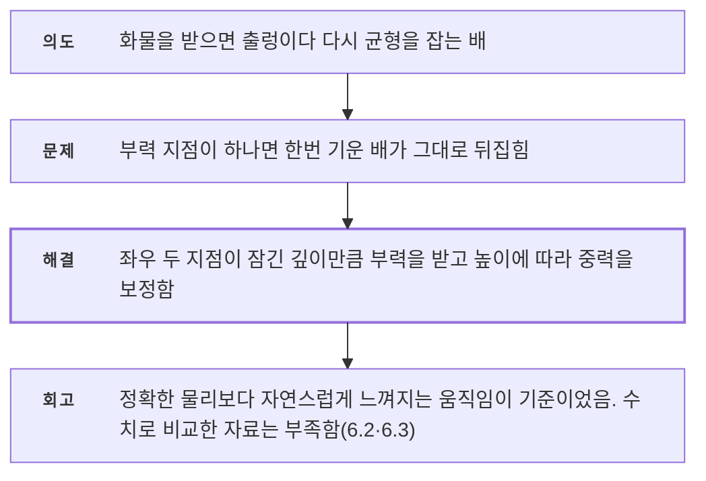

던진 화물이 배에 닿으면 이제 배가 그 무게를 받아 내야 합니다. 이 게임의 실패 조건은 배가 가라앉는 것이므로 배가 물 위에서 어떻게 움직이는지가 게임의 중심이었습니다. 배가 균형을 되찾는 방식(4.3.1)과 업그레이드로 배가 바뀌어도 같은 움직임을 지키는 방법(4.3.2)을 차례로 설명합니다.

#### 4.3.1 균형을 되찾는 좌우 두 부력 지점

2D에서 물에 뜬 배가 자연스럽게 움직이려면 위아래로 흔들리는 것만으로는 부족했습니다. 선체가 z축으로 회전과 역회전을 반복하며 균형을 되찾는 복원 움직임이 꼭 필요했습니다. 그러나 처음 시험한 단일 부력 지점으로는 한번 균형이 무너지면 선체가 걷잡을 수 없이 회전해 기울거나 뒤집히는 일이 잦았습니다.


| | 대안 A. 단일 부력 지점 | **대안 B. 좌우 2개 부력 지점 (선택)** |
|---|---|---|
| 방식 | 선체 전체를 하나로 보고 한 지점에 부력을 가함 | 선체 좌우에 부력 지점을 두고 각 지점이 잠긴 깊이에 비례해 부력을 받음 |
| 장점 | 지점이 하나라 계산과 조정이 단순함 | 더 깊이 잠긴 쪽이 더 큰 부력을 받아 회전과 역회전을 반복하며 균형을 되찾음 |
| 단점 | 한번 균형이 무너지면 선체가 걷잡을 수 없이 회전해 기울거나 뒤집히는 일이 잦음 | 선체의 크기·형태가 바뀌면 좌우 부력 지점을 다시 맞춰야 함 (업그레이드 단계별 프리팹마다 조정, 4.3.2) |

대안 B를 택하자 화물이 한쪽에 실려 선체가 기울어도 더 깊이 잠긴 쪽이 더 큰 부력을 받아 다시 균형을 잡았습니다. 배가 뒤집히는 대신 갑판이 물에 잠겨 침수 게이지가 차는 것이 실패로 이어지는 흐름이 되었습니다.

이 방식은 06.24 하루 동안 세 단계를 거쳐 다듬었습니다.

1. 저장소에 올리기 전에 단일 부력 지점을 시험했습니다.
2. 좌우 두 지점으로 바꿨습니다. 처음에는 수면 없이 고정된 기본 부력을 주고 기운 각도에 비례해 기운 쪽 힘을 키우는 복원 방식이었습니다.
3. 수면 높이를 두고 잠긴 깊이에 비례한 부력과 감쇠로 바꿨습니다(지금 방식). 이어서 기본 부력을 배 질량에 비례하게 해 무거운 배도 같은 높이에 뜨게 했습니다(4.3.2).

**침몰을 스테이지 실패 조건으로 삼은 이유**도 여기에 있습니다. 처음에는 배의 높이를 고정하고 침몰 없이 기울기만 하는 배에 화물을 최대한 많이 쌓는 것을 목표로 삼았습니다. 그러나 실패 조건을 직관적으로 정하기 어렵고 물에 뜬 배의 움직임도 부자연스러웠습니다. 그래서 이 제약을 없애고 침몰을 스테이지 실패의 직접적인 조건으로 바꿨습니다.

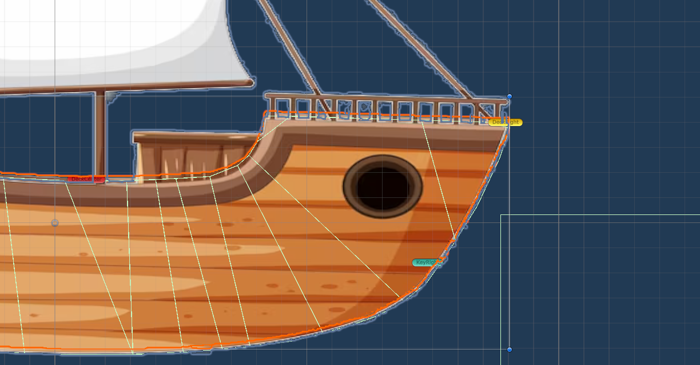

선체는 Rigidbody2D로 만들고 가상의 수면을 두었습니다. 좌우 두 부력 지점이 물에 뜬 움직임을 만들고 갑판의 침수 판정 지점 세 개가 침수 게이지와 게임 오버 판정으로 이어집니다. 중력 스케일(`rb.gravityScale`)은 상황에 따라 바꿉니다. 평소에는 수면 위로 올라간 높이에 따라 0.1~0.5로 두고 침몰할 때는 점점 키워 부력을 이기고 서서히 가라앉게 합니다.

`Ship.cs` 49~78행

```csharp
private void UpdateGravityBasedOnDepth()
{
    if (GameManager.Instance.IsGameOver) return;

    float shipFlying = transform.position.y;

    if (shipFlying > 0)
    {
        float t = Mathf.Clamp01(shipFlying / 2.5f);
        rb.gravityScale = Mathf.Lerp(0.1f, 0.5f, t);
    }
    else
    {
        rb.gravityScale = 0.1f;
    }
}

private void ApplyPointBuoyancy(Transform buoyancyPoint)
{
    float depth = waterLevel - buoyancyPoint.position.y;

    if (depth > 0)
    {
        float buoyancyForce = depth * baseBuoyancy;
        Vector2 velocityAtPoint = rb.GetPointVelocity(buoyancyPoint.position);
        float dampingForce = velocityAtPoint.y * -waterResist;
        float totalVerticalForce = Mathf.Max(0, buoyancyForce + dampingForce);
        rb.AddForceAtPosition(Vector2.up * totalVerticalForce, buoyancyPoint.position);
    }
}
```

- 부력 지점마다 잠긴 깊이(`depth`)에 비례한 부력과 그 지점의 세로 속도에 따른 감쇠를 더해 `AddForceAtPosition`으로 가합니다. 좌우 깊이의 차이가 회전력이 되어 복원 움직임이 생깁니다.
- **높이에 따라 `rb.gravityScale`을 바꿉니다.** 부력에 밀려 선체가 하늘로 솟구치는 것과 중력에 눌려 그대로 가라앉는 것을 모두 막아 배가 수면에서 넘실거리며 떠 있게 했습니다. 현실에서 중력이 상황에 따라 바뀐다는 것은 납득하기 어렵습니다. 하지만 게임 안에서 실제와 비슷한 움직임을 만드는 가장 단순한 방법이어서 이 방식을 택했습니다.

#### 4.3.2 업그레이드로 배가 바뀌어도 같은 움직임

배는 업그레이드할수록 크기와 형태가 바뀝니다(단계는 5.3). 커지는 선체는 플레이어에게 시각적인 성취감을 주는 디자인 요소이자 더 많은 화물을 싣게 하는 시스템 요소였습니다. 선체 질량(`rb.mass`)도 화물이 부딪혔을 때의 반응에 영향을 주므로 업그레이드에 따라 늘렸습니다.

다만 크기·형태·질량이 바뀌면 부력 지점과 선체의 안정성도 함께 맞춰야 했습니다. 그래서 단계별 배를 각각의 프리팹으로 만들고 선체 형태에 맞게 부력 지점과 침수 판정 지점을 조정했습니다. 기본 부력은 선체 질량에 비례해 계산했습니다(4.3.1의 세 번째 단계). 덕분에 어느 선체든 수면에서 자연스럽게 출렁이고 충격에 반응하며 자세를 되찾습니다.

### 4.4 특수 화물: 폭탄이 닭을 치킨으로 바꿔 위험이 보상도 된다

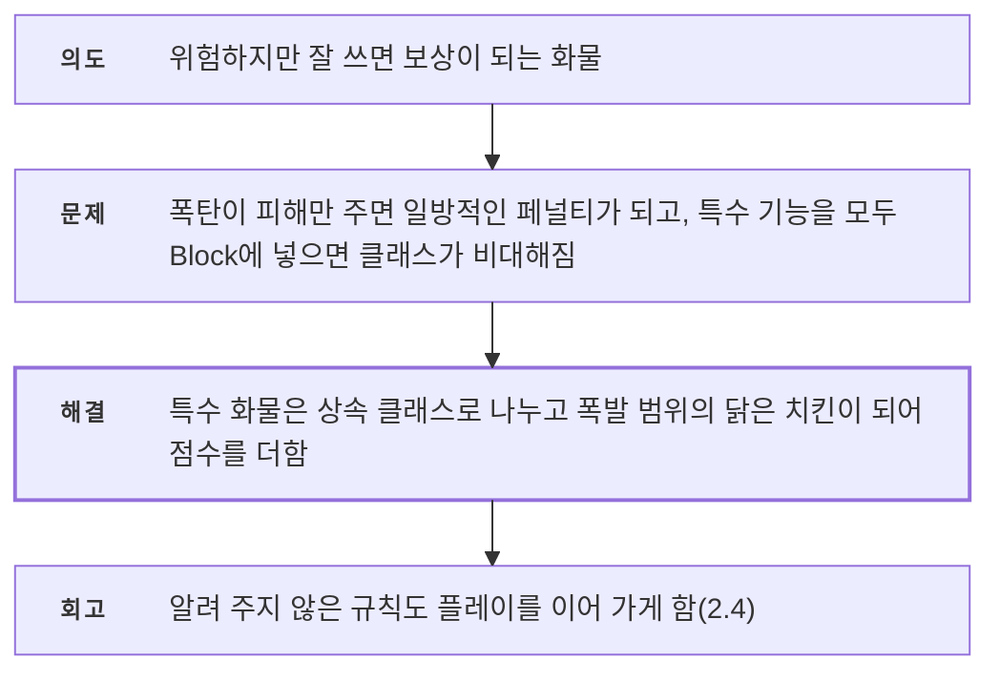

배에 실리는 화물에는 평범한 상자 말고도 폭탄과 닭이 있습니다. 기획(3.4)에서 정한 이 두 화물은 배 위의 다른 화물과 점수에 직접 영향을 줍니다. 먼저 두 화물을 코드에서 어떻게 나눴는지(4.4.1) 설명하고 폭탄의 위험을 보상으로 바꾼 규칙(4.4.2)을 다룹니다.

#### 4.4.1 상속으로 나눈 화물

일반 화물에 폭발이나 상태 변화 같은 기능을 더하면 `Block`의 조건문과 관리할 상태가 늘어납니다. 그러면 `Block`이 책임이 지나치게 큰 클래스(갓 클래스)가 될 위험이 있었습니다.

| | 대안 A. `Block` 하나에 조건문 추가 | **대안 B. `Block` 상속 클래스로 분리 (선택)** |
|---|---|---|
| 방식 | 화물 종류에 따라 `Block` 안에서 분기 | 공통 기능은 `Block`에 두고 폭탄·치킨의 특수 동작은 `BombBlock`·`ChickenBlock`에 둠 |
| 장점 | 화물 동작이 한 파일에 모여 흐름을 따라가기 쉬움 | 기존 화물의 동작을 재사용하며 새 상호작용을 더할 수 있음 · `Block`에 잡다한 기능이 붙지 않아 관리가 쉬움 |
| 단점 | `Block`의 조건문과 상태가 늘어 갓 클래스가 될 위험 | 한 화물의 동작을 보려면 부모·자식 클래스를 함께 읽어야 함 · 폭탄이 치킨을 직접 참조해 폭탄과 반응하는 화물을 더하면 `BombBlock`도 고쳐야 함 |

발사·물리적 움직임·충돌·점수 처리처럼 모든 화물이 함께 쓰는 기능은 `Block`이 맡습니다. 폭탄의 폭발 순서와 닭의 상태 변화는 각 상속 클래스가 처리합니다. 컨셉 기획서에서 정한 화물 구조(3.4)를 실제 구현으로 옮긴 것입니다.

#### 4.4.2 폭탄의 위험을 보상으로


폭탄이 기존 화물을 무너뜨리고 침몰 위험을 높이기만 한다면 플레이어에게는 일방적인 페널티일 뿐입니다. 그래서 **폭탄의 위험을 보상과 연결했습니다.** 폭발 범위에 닭 화물이 들어가면 치킨이 되어 추가 점수를 얻습니다. 이 규칙은 게임에서 알려 주지 않습니다(3.4). 하지만 발견한 플레이어에게 폭탄은 단순한 페널티가 아니라 어디에 두는 것이 최선일지 판단할 요소가 됩니다.

페널티와 보너스가 늘 의도대로만 작동하지 않도록 폭발까지 무작위 대기 시간도 두었습니다. 대기 시간 범위는 제한 시간(기본 20초, 타이머 업그레이드당 +3초)보다 훨씬 길게 잡아 대부분의 폭탄은 스테이지 안에 터지지 않고 드물게만 터집니다. 언제 터질지 모르는 긴장감을 주는 것이 목적이라 대부분 터지지 않아도 괜찮다고 판단했습니다.

폭탄은 코루틴으로 첫 충돌 이후 무작위 대기 → 경고 → 폭발 순서를 밟습니다. 화물이 거의 멈출 때까지 기다리는 단계(`waitUntilAlmostStopped`)도 코드에 있지만 폭탄 프리팹(`Block_Bomb`)에서는 꺼 두었습니다. 그래서 첫 충돌 직후부터 프리팹에 정한 5~120초 사이에서 무작위로 기다리고 그 전에 스테이지가 끝나면 터지지 않습니다. 폭발에 휘말린 닭은 스프라이트와 물리 머티리얼이 바뀌고 보너스 점수를 받습니다.

`BombBlock.cs` 208~235행

```csharp
Collider2D[] targets = Physics2D.OverlapCircleAll(transform.position, explosionRadius, explosionTargetMask);
HashSet<Rigidbody2D> pushedBodies = new HashSet<Rigidbody2D>();

foreach (Collider2D target in targets)
{
    if (target == null) continue;
    if (target.transform == transform) continue;

    Rigidbody2D targetRigidbody = target.attachedRigidbody;

    if (targetRigidbody != null && pushedBodies.Add(targetRigidbody))
    {
        Vector2 direction = targetRigidbody.worldCenterOfMass - (Vector2)transform.position;
        float distance = Mathf.Max(direction.magnitude, 0.1f);
        float forceRatio = Mathf.Clamp01(1.0f - distance / explosionRadius);
        forceRatio = Mathf.Max(forceRatio, minimumForceRatio);
        Vector2 forceDirection = direction.normalized;
        targetRigidbody.AddForce(forceDirection * explosionForce * forceRatio, ForceMode2D.Impulse);
        targetRigidbody.AddTorque(Random.Range(-explosionTorque, explosionTorque) * forceRatio, ForceMode2D.Impulse);
    }

    ChickenBlock chickenBlock = target.GetComponentInParent<ChickenBlock>();
    if (chickenBlock != null)
    {
        chickenBlock.Fry(friedChickenBonusScore);
    }
}
```

- 폭발 범위의 물체마다 거리가 멀수록 충격량을 줄이되 `minimumForceRatio` 이상은 보장하고 무작위 회전력을 더합니다. 한 물체에 Collider가 여러 개여도 충격은 `HashSet<Rigidbody2D>`로 한 번만 줍니다(2.4절).
- 대상에 `ChickenBlock`이 있으면 `Fry`를 부릅니다. 같은 닭이 두 번 처리되지 않게 `ChickenBlock`의 `isFried`로 막습니다.

### 4.5 화면이 따라가기: 지금 봐야 할 것을 따라 화면이 바뀐다

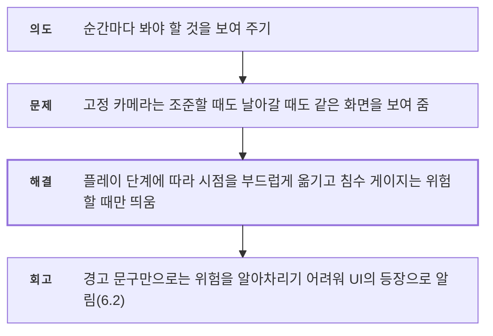

조준하고 던지고 배가 반응하는 동안 플레이어가 봐야 할 것은 계속 바뀝니다. 카메라는 그 대상을 따라가고(4.5.1) UI는 위험할 때만 나타납니다(4.5.2).

#### 4.5.1 카메라 시점 전환


조준할 때와 화물이 날아가는 동안과 배에 실린 결과를 볼 때 플레이어가 집중할 대상은 서로 달랐습니다.

| | 대안 A. 고정 카메라 (초기 구현) | **대안 B. 플레이 단계에 따른 시점 전환 (선택)** |
|---|---|---|
| 방식 | 한 화면을 고정해 보여 줌 | 조준 중에는 화물과 예상 궤적을 보여 주고 발사 후에는 날아가는 화물을 확대해 따라가며 부딪힌 뒤에는 선박으로 돌아옴 |
| 장점 | 선박과 화물이 늘 한 화면에 보이고 구현이 단순함 | 순간마다 플레이어에게 필요한 정보를 보여 줌 |
| 단점 | 집중할 대상이 바뀌어도 같은 화면을 보여 줌 | 화물을 따라가는 동안 선박이 화면에서 벗어날 수 있음 · 플레이어가 보고 싶은 것이 다른 곳에 있어도 시점을 강제함 |

대안 B를 택하고 시점이 갑자기 옮겨 가지 않도록 위치와 줌을 보간해 부드럽게 이었습니다. `PlayerController`가 플레이 단계에 맞는 카메라 타깃을 정하고 `UIManager`가 위치와 줌을 옮깁니다.

`UIManager.cs` 348~380행

```csharp
public void SetCameraTarget(Transform newTarget, Vector3 offset, float size)
{
    if (newTarget != null)
    {
        currentTarget = newTarget;
        currentOffset = offset;
        currentCamZoomTarget = size;
    }
}

private void CameraWork()
{
    if (cam == null)
    {
        return;
    }

    if (currentTarget == null)
    {
        if (ship == null)
        {
            return;
        }

        SetCameraTarget(ship.transform, shipPosOffset, currentCamZoom);
    }

    Vector3 lerpPos = Vector3.Lerp(cam.transform.position, currentTarget.position + currentOffset, 1.8f * Time.deltaTime);
    lerpPos.z = cam.transform.position.z;
    cam.orthographicSize = Mathf.Lerp(currentCamZoom, currentCamZoomTarget, 2.5f * Time.deltaTime);
    currentCamZoom = cam.orthographicSize;
    cam.transform.position = lerpPos;
}
```

- `SetCameraTarget`은 타깃·오프셋·줌 목표만 바꾸고 `CameraWork`가 매 프레임 위치와 `orthographicSize`를 `Lerp`로 따라갑니다.
- 따라갈 타깃이 없으면 선박으로 시점을 되돌립니다.

#### 4.5.2 위험할 때만 나오는 UI

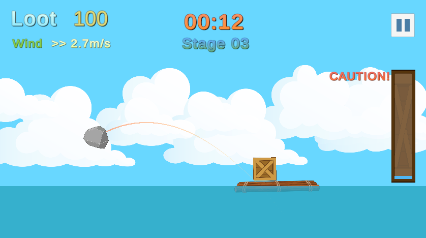

UI도 정보의 중요도에 따라 보이는 방식을 나눴습니다. 점수나 남은 시간은 계속 확인해야 하지만 침수 게이지는 배가 안전할 때는 볼 필요가 없습니다. 모든 UI를 늘 띄우면 필요 없는 정보가 화면을 차지합니다. 그래서 침수가 진행될 때만 게이지가 화면 오른쪽에서 나타나게 했습니다. 위험이 생겼다는 사실을 UI의 등장 자체로 알려 플레이어가 배의 상태 변화를 바로 알아차리게 한 것입니다.

`UIManager`는 `GameManager`의 침수도와 게임 진행 상태를 보고 인게임 UI와 결과 화면을 보이거나 숨깁니다. 나타나고 사라질 때는 `RectTransform.anchoredPosition`을 `Lerp()`로 옮겨 인게임 UI·침수 게이지·결과 화면이 미끄러져 들어오게 했습니다. 일시정지와 첫 스테이지 튜토리얼 UI도 `UIManager`가 띄우고 내리지만 게임 시간을 멈추는 일은 `StageFlowController`가 맡습니다(5.1).

UI를 만들며 두 가지 문제를 고쳤습니다.

- **화면 비율에 따라 UI 배치가 어긋나던 문제** : 처음에는 UI를 고정된 좌표에 두어 창 크기나 비율이 달라지면 화면 밖에 있어야 할 패널이 보이거나 버튼과 글자가 어긋났습니다. Canvas Scaler와 UI별 앵커를 조정하고 화면 밖 대기 위치를 Canvas의 너비와 높이로 계산하게 바꿨습니다. 이제 화면 비율이 달라도 UI가 같은 방향으로 나타나고 사라지며 배치가 유지됩니다.
- **UI 클릭이 화물 투척으로 들어가던 문제** : 일시정지 버튼을 누르면 `PlayerController`도 같은 마우스 입력을 받아 게임을 재개할 때 화물이 발사되었습니다. 일시정지 상태만 확인하던 방식 대신 `EventSystem.current.IsPointerOverGameObject()`로 마우스가 UI 위에 있는지 검사해 UI 클릭이 드래그의 시작으로 처리되지 않게 고쳤습니다. 이제 일시정지 뒤 게임을 재개해도 화물이 발사되지 않습니다. 드래그를 시작하지 않은 채 마우스를 떼면 발사로 보지 않는 검사는 그 전부터 있었습니다.

## 5. 한 판의 시작과 끝

4장의 투척은 한 판 안에서 되풀이되고, 한 판의 결과는 골드와 업그레이드로 다음 판에 이어집니다.

### 5.1 게임 상태: 플레이할 수 있는지를 한 곳에서 판단한다

한 판은 시작 → 튜토리얼 → 플레이 → 일시정지 → 게임 오버 연출 → 결과 순서로 진행됩니다. 그 사이에 입력과 게임 시간을 언제 막고 여는지는 한 곳에서 정합니다.

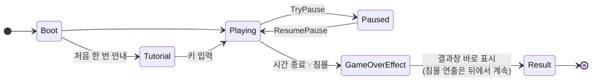

> 입력이 열리는 상태는 `Playing` 하나뿐입니다. 게임 시간은 `Boot`·`Tutorial`·`Paused`에서 멈추고 게임 오버(`GameOverEffect`)부터 다시 흐릅니다. 침몰이면 가라앉는 연출을 결과창 뒤에서 계속 재생하고 결과는 바로 띄웁니다.


스테이지 진행 흐름은 `StageFlowController`가 하나의 `StageState`로 관리합니다. 이 클래스가 만들어지고 지금 모양으로 되살아난 과정은 2.3절에 적었습니다.

- **게임 시간을 멈추고 다시 흐르게 하는 시점을 이 클래스에 모았습니다.** 분리하기 전에는 일시정지·튜토리얼에서 `UIManager`가 `Time.timeScale`을 직접 바꿨습니다. 지금도 `StageFlowController`가 없을 때의 대체 처리와 씬 시작 때의 초기화는 `UIManager`에 남아 있습니다.
- **게임 시간과 UI 시간을 나눴습니다.** 게임 시간이 멈춘 동안에도 튜토리얼 안내 UI는 실제 시간(`Time.unscaledDeltaTime`)으로 움직입니다.
- **입력과 진행은 값 하나로 막습니다.** `PlayerController`·`GameManager`·`UIManager`는 `IsGameplayBlocked`(`StageFlowController.cs` 14행, `CurrentState != StageState.Playing`)만 확인합니다. 이 값은 `Playing`이 아닌 모든 상태에서 true라서 확인하는 쪽은 상태의 종류를 몰라도 됩니다.
- 일시정지(`TryPause`)는 `Playing`일 때만 성공하고 그때 `Time.timeScale`을 0으로 만듭니다. 그래서 튜토리얼이나 결과 연출 중에는 일시정지가 걸리지 않습니다.

### 5.2 정산과 보험


시간이 끝나거나 배가 가라앉으면 한 판이 끝나고 정산이 시작됩니다.

정산의 바탕이 되는 점수는 단순하게 정했습니다. 화물(`Block`)이 처음 무언가에 닿으면 자기 값(`blockValue`)을 더하고 수면 아래 판정 영역(`Underwater`)에 들어가면 같은 값을 뺍니다. 한 화물이 두 번 더하거나 빼지 않도록 `HasFirstContact`·`HasLost`로 한 번만 처리합니다.

데이터는 생애 주기에 따라 둘로 나눴습니다. 스테이지마다 초기화되는 이번 스테이지 수익은 `GameManager`가 들고, 씬이 바뀌어도 유지되는 골드와 장비 레벨은 DontDestroyOnLoad 클래스인 `TotalGameManager`가 듭니다. 수익은 정산할 때만 골드로 옮깁니다. 매니저 클래스들은 강의에서 제공된 유틸리티의 `SingletonBase<T>`(CRTP 제네릭 싱글턴)를 상속해 하나의 인스턴스로 접근합니다.

스테이지는 두 가지 방식으로 끝납니다.

| 끝난 방식 | 정산 | 다음 |
|---|---|---|
| 시간 종료 | 이번 스테이지 수익 − 유지비 | 양수면 성공(다음 스테이지), 0 이하면 같은 스테이지 재도전 |
| 침몰 (침수 게이지 최대) | 이번 스테이지 수익을 0으로 보고 유지비만 빠짐 | 배와 장비 레벨을 모두 처음으로 되돌리고 1스테이지부터 다시 시작 |

보험은 정산이 적자일 때만 적자를 (보험 레벨 + 1)로 나눠 줄이고 줄어든 금액을 결과창에 따로 보여 줍니다.

`GameManager.cs` 435~486행 (결과창 글자를 켜고 쓰는 줄은 뺌)

```csharp
int baseClosing = InStageLootValue - maintenanceCost;
bool clearedStage = isFailed == false && baseClosing > 0;
// (중략: 성공이면 스테이지 +1, 결과창 표시)
int totalClosing;

if (baseClosing < 0 && TotalGameManager.Instance.CurrentLevelInsurance > 0)
{
    int divisor = TotalGameManager.Instance.CurrentLevelInsurance + 1;
    totalClosing = baseClosing / divisor;
    int savedAmount = Mathf.Abs(baseClosing - totalClosing);
}
else
{
    totalClosing = baseClosing;
}

bool canContinue = TotalGameManager.Instance.AddGold(totalClosing);
```

- `InStageLootValue`는 이번 스테이지 수익이고 `isFailed`는 침몰(침수 게이지가 100에 닿음)로 끝났는지입니다.
- 성공 여부(`clearedStage`)는 보험을 적용하기 전 금액으로 판정합니다. 보험은 손해를 줄여 줄 뿐 실패를 성공으로 바꾸지 않습니다.
- 골드에 반영하는 `AddGold`는 파산 여부도 함께 돌려줍니다. 파산이면 결과창을 띄우지 않고 정산을 멈춥니다(5.4).

### 5.3 상점과 유지비


정산이 끝나면 상점에서 번 골드로 장비와 배를 업그레이드합니다. 장비는 세 가지이고 가격은 레벨마다 기본가만큼 오릅니다.

| 장비 | 효과 | 기본가 (레벨마다 오르는 양) | 유지비 |
|---|---|---|---|
| 펌프 | 레벨마다 배수력 +1 (침수 중에는 그 절반) | 300 | 레벨 × 30 |
| 타이머 (상점 이름 Alarm) | 레벨마다 제한 시간 +3초 (기본 20초) | 500 | 레벨 × 50 |
| 보험 | 적자 정산을 (보험 레벨 + 1)로 나눠 줄임 (5.2) | 200 | 레벨 × 20 |

배는 뗏목 → 카누 → 보트 → 화물선 순서로 바뀌고 단계마다 선체 프리팹이 따로 있습니다(4.3.2).

| 선박 | 뗏목 | 카누 | 보트 | 화물선 |
|---|---|---|---|---|
| 유지비 | 0 | 200 | 400 | 600 |

한 스테이지의 유지비는 장비 유지비와 선박 유지비를 더한 값입니다. 상점에서는 지금 유지비와 다음 선박의 유지비를 함께 보여 줍니다.

이렇게 만든 이유는 기획서의 "업그레이드 시스템을 통해 더 어려운 난이도로의 도전이 가능하다"에 맞추기 위해서입니다. 장비와 배가 좋아질수록 유지비도 늘어 다음 스테이지에서는 더 많이 실어야 흑자가 남습니다. 유지비는 3.3에서 정한 끝없는 스테이지의 난이도 손잡이 중 하나입니다.

### 5.4 파산


정산에서 골드가 0 밑으로 내려가면 파산 엔딩 씬(`BankruptcyEnding`)으로 넘어갑니다. 플래그(`IsBankrupt`)로 한 번만 넘어가게 막았습니다. 상점에서는 가진 골드보다 비싼 것을 처음부터 살 수 없게 해서 파산은 스테이지 정산에서만 일어납니다.

## 6. 결과와 회고

### 6.1 주요 구현 결과

- **게임 루프** : 투척 → 선체 반응 → 침수·침몰 판정 → 정산 → 상점 업그레이드가 하나의 루프로 이어집니다. 장비와 배가 좋아질수록 유지비도 늘어 다음 스테이지에서 더 많이 실어야 흑자가 남습니다(5장).
- **물리 상호작용** : 좌우 두 부력 지점 덕분에 배는 뒤집히는 대신 출렁이다 균형을 되찾고 갑판이 잠겨 침수 게이지가 차는 것이 실패로 이어집니다(4.3). 발사 힘을 질량으로 보정해 무게는 날아갈 때가 아니라 부딪히고 실린 뒤에 영향을 줍니다(4.1).
- **피드백** : 바람은 예상 궤적과 구름으로(4.1·4.2), 침수 위험은 잠길 때만 나타나는 게이지로 보여 줍니다(4.5.2). 카메라는 조준·비행·착지에 따라 시점을 바꿉니다(4.5.1). 폭탄 폭발 범위의 닭은 치킨이 되어 위험이 보상도 됩니다(4.4.2).

**목표한 경험 돌아보기**

07.17~18 업데이트 기획서에 정리한 피드백과 문제점을 보면 물과 배와 화물이 상호작용하는 움직임은 좋은 평을 받았습니다. 하지만 1스테이지와 100스테이지의 화면이 같고 던진 화물이 부딪힐 때까지 기다려야 해서 정적으로 느껴졌습니다. 또 '던져 쌓고 균형을 잡는' 새 메커니즘을 왜 해야 하는지 동기 설명이 부족했습니다. 시간 업그레이드가 있는데도 설명이 부족해 없다고 오해받기도 했습니다.

그래서 다음에는 업데이트 기획서에 적은 대로 세 가지를 하려 합니다.

- 모드 분리와 스토리로 플레이 동기 주기
- 다이얼로그·상점 UI로 정보 전달하기
- 물보라·충돌·결과 연출과 소리로 결과를 바로 알리기

### 6.2 개발 과정에서 얻은 판단

**물리적 정확성과 게임플레이 경험은 다릅니다.**

실제 수면의 유체역학을 정밀하게 재현하기보다 배가 화물의 충격과 실린 위치에 반응하고 자연스럽게 균형을 되찾는 움직임을 만드는 데 집중했습니다. 부력 지점의 위치·감쇠력·중력 계수를 조정하면서 물리 수치의 정밀도와 플레이어가 자연스럽게 느끼는 움직임이 반드시 일치하지는 않는다는 것을 확인했습니다. 높이에 따라 중력을 바꾼 것(4.3.1)과 발사 힘을 질량으로 보정한 것(4.1)이 그 예입니다.

**물리적 변화는 플레이어가 볼 수 있어야 의미가 있습니다.**

물리적 변화가 일어나거나 경고 문구를 띄우는 것만으로는 플레이어가 자기 행동의 결과와 위험의 원인을 직관적으로 잇기 어렵다고 판단했습니다. 그래서 바람의 영향은 조준 궤적과 구름으로 보여 주고(4.1·4.2) 침수 위험은 위험할 때만 나타나는 UI로 알렸습니다(4.5.2). 게임의 내부 상태를 플레이어가 보고 판단할 수 있는 정보로 바꾸는 과정이 중요하다는 것을 확인했습니다.

**기능이 작동하는 것과 함께 작동하는 것은 다릅니다.**

개별 기능이 작동하는 것과 여러 시스템이 맞물린 상황에서도 의도대로 작동하는 것은 별개의 문제였습니다. 일시정지 버튼 클릭이 화물 투척 입력으로도 들어간 문제(4.5.2)와 미완성 다이얼로그 때문에 게임 오버가 바로 끝나지 않던 문제(2.3절의 11월 16일 작업)가 그런 경우였습니다.

### 6.3 기술적 한계 및 향후 개선

- **매니저 간 직접 의존성과 역할 집중** : `GameManager`와 `UIManager`가 여러 시스템의 상태와 표현을 직접 제어하고 있어 기능을 늘리면 맡는 범위가 지나치게 넓어질 수 있습니다. 데이터 관리·게임 규칙·시각적 표현의 책임을 더 명확히 나눌 필요가 있습니다.
- **물리 파라미터 조정의 정량적 검증 부족** : 부력·수중 저항·중력 보정 같은 값을 눈에 보이는 움직임에 맞춰 조정했지만 선체별 반응이나 변경 전후의 차이를 비교할 수 있는 정량적 테스트 자료는 부족합니다. 비교 테스트 조건과 측정 기준을 마련해 조정 결과의 설득력을 높여야 합니다.
