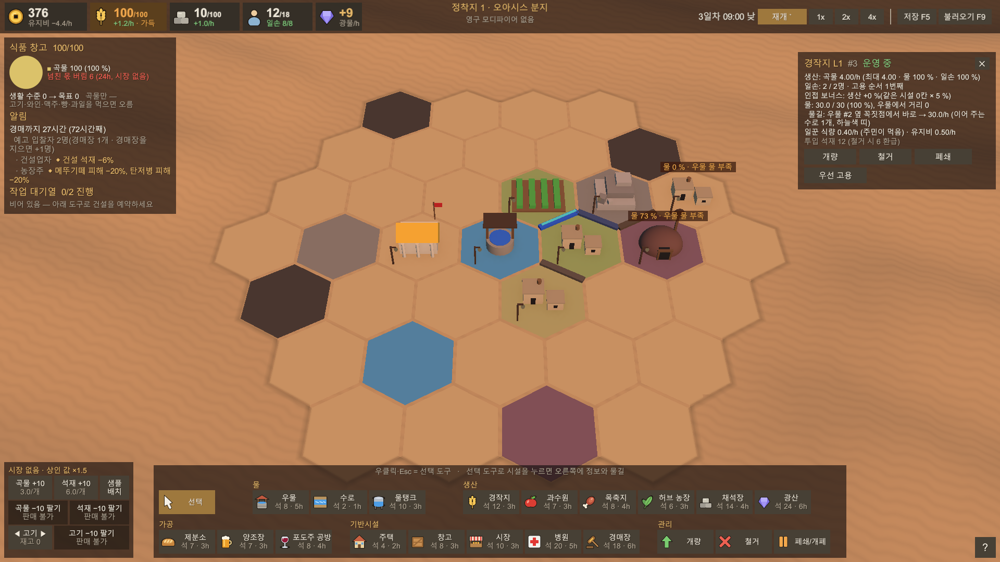
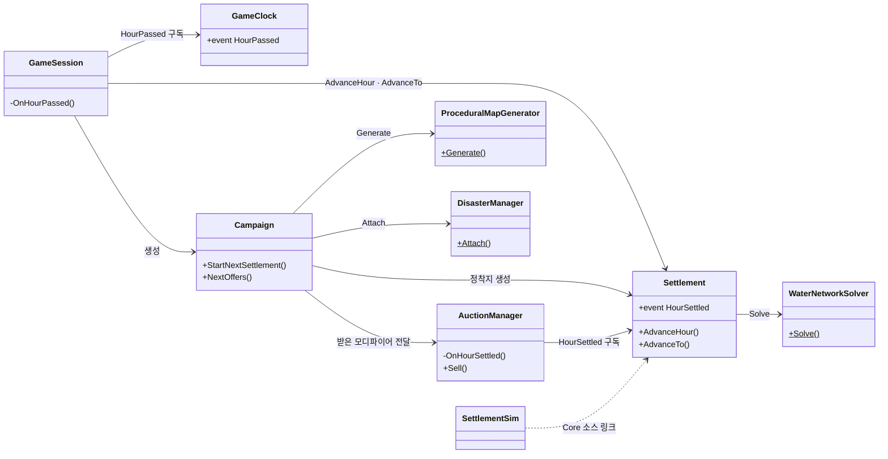
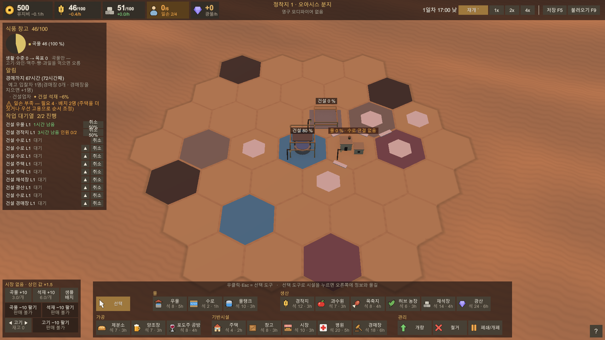
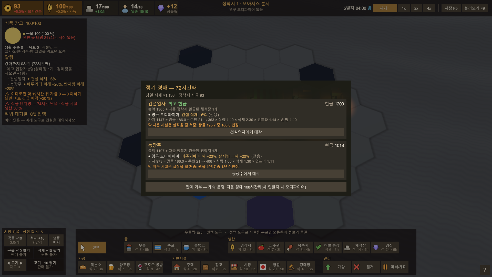
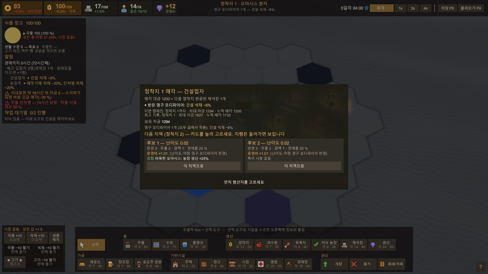
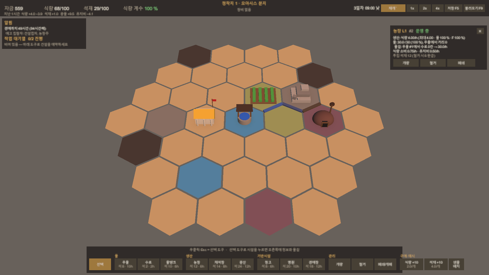

# Desert Flavor — AI 협업 개발에서 기획·검증을 맡은 헥스타일 경영 게임

> 사막의 헥스 맵에 우물과 수로를 놓아 물을 나누고, 정착지를 키워 경매에 팔아 받은 보상으로 점점 어려워지는 다음 정착지로 넘어가는 경영 시뮬레이션

개발 형태: 1인 개발 · AI 협업 · 약 2주 프로토타입(미완성)

| 항목 | 내용 |
|---|---|
| 장르 | 헥스타일 기반 정착지 개발·생산망·경매 경영 시뮬레이션 |
| 기간 | 2026.10.20 ~ 11.04 (커밋 기준, 약 2주) |
| 인원 | 1인 개발 (구현은 AI 에이전트와 협업) |
| 개발 환경 | Unity 6000.3.15f1 · C# · uGUI(코드로 생성) · Newtonsoft Json · Unity Test Framework · .NET 10 콘솔 시뮬레이터 |
| 개발 방식 | AI 주도 구현 + 본인 기획·결정·검증. 커밋 109개(제공 템플릿 첫 커밋 포함) 중 102개에 `Co-Authored-By: Claude` 표시 |
| 상태 | 미완성 — MVP 게임 루프(건설·운영 → 경매 → 매각/보류 → 행선지 선택 → 다음 정착지)까지, 그래픽은 기본 도형 |
| 링크 | [GitHub](https://github.com/ashadeveloperr/desert-flavor) · 시연 영상 준비 중 |

- 문서 구성: 1장 개요·AI 협업 방식·전체 구조 → 2~5장 기능 A~D(분 단위 착공·입찰자 모디파이어·주민과 전염병·검증 체계) → 6장 결과와 회고

## 1. 프로젝트 개요

### 1.1 만든 것



- 반경 3~7의 헥스 타일 맵 위에서 시설을 짓고, 육각형 변을 따라 수로를 놓아 우물의 물을 나누는 정착지 경영 게임
- 물은 우물에서 수로를 따라 흐르고 상류 시설이 먼저 받음 → 물이 모자라면 가동률이 떨어짐
- 주민이 일손이 되고, 주민을 먹이고 물을 대야 시설이 돌아가는 노동력 체계
- 정착지를 경매에 팔고 입찰자가 내미는 영구 모디파이어를 골라 다음 정착지로 넘어가는 캠페인 루프
- 두 번째 정착지부터 보유 자금과 지나온 정착지 수에 따라 난이도가 오르는 절차 생성 맵
- 핵심 루프: 정착지 건설·운영 → 경매 → 매각/보류 → 행선지 선택 → 다음 정착지

### 1.2 목표

- 개발 의도: 주어진 약 2주 안에 경제 시뮬레이션 규모의 게임을 만들면서, 기획과 검증만으로 메커닉과 재미를 어디까지 끌어올릴 수 있는지 확인
- AI 주도 개발을 택한 이유: AI 에이전트의 프로그래밍 성능이 이미 충분하다고 판단해 구현을 맡기고, 본인은 기획과 플레이로 확인하며 수치를 조율하는 일에 집중
- 게임 측면의 목표: 일반적인 경영·건설 시뮬레이션의 후반부(모든 자원 병목이 풀려 긴장감이 사라지는 구간)를 잘라 내고, 공들여 지은 정착지를 경매에서 높은 값으로 보상받은 뒤 점점 어려워지는 다음 정착지에서 플레이마다 다른 방식으로 문제를 풀어나가는 경험
- 이 문서에서 다루는 것: 구현 코드 자체보다 **무엇을 정했고, 어떻게 검증했고, AI의 판단을 언제 뒤집었는지**

### 1.3 AI 협업 방식 — 누가 무엇을 했나

- 구현: Claude Code 에이전트. 본인은 기획서·규칙 결정·플레이테스트·문제 파악과 정의(이슈)·결과 검토 담당
- 결정 기록(`Docs/decision_log_auto.md`): 10/23 지시 "추천하는 대로 자동으로 만들고, 선택할 때마다 왜 그렇게 판단했는지 기록으로 남겨"에서 시작
  - 항목마다 **고른 것 / 이유 / 다른 안 / 바꾸려면**을 남기고, 본인이 고른 것은 `[사용자 결정]`(164개), AI가 고른 것은 `[자동]`(128개)으로 구분 (11/04 기준, 결정 표의 구분 칸으로 센 행 수. 주석이 붙은 표시 포함)
- 작업 단위: GitHub 이슈 46개(45개 닫힘, 비공개 원본 저장소 기준 — 공개 저장소에는 코드와 커밋만 옮김). 이슈 하나씩 "질문 → 구현 → 시뮬레이터·Unity 테스트 → 결정 기록 갱신" 순서
- 검증 수단: 플레이테스트 4차례, EditMode·PlayMode 테스트, 봇이 자동으로 플레이하는 .NET 시뮬레이터
- AI 작업 지침(`CLAUDE.md`)에 유지보수 원칙을 둠: "사용자가 Claude 없이도 코드를 읽고 고칠 수 있는 상태를 유지한다"

### 1.4 개발 환경 및 전체 구조

- 어셈블리 정의로 **Core**(Unity를 참조하지 않는 순수 C# 규칙)와 **Runtime**(화면·입력, 게임 시계에 Unity 시간 공급)을 분리
  - AI가 제안한 구조로, 시뮬레이터가 게임과 같은 규칙으로 봇 플레이를 돌릴 수 있어서 받아들임
- .NET 시뮬레이터(`Tools/SettlementSim`)가 Core 폴더의 소스(시계를 맡은 Timing 제외)를 그대로 링크해 봇 플레이를 돌림
- 조정할 수치는 설정 JSON(`Assets/Data/Config/`) 또는 인스펙터에만 두고, 코드·문서에는 키 이름만 적음



- 봐야 할 것: 게임 규칙은 모두 Core(`Settlement`·`Campaign`·`AuctionManager` 등)에 있고, Unity 쪽(`GameSession`)과 시뮬레이터(`SettlementSim`)가 **같은 Core를 서로 다른 시계로 돌리는** 구조

## 2. 기능 A — 건설 착공 시각과 경제 틱

### 2.1 개요

경제는 정각마다 한 시간씩 정산하지만, 건설 명령은 플레이어가 누른 **그 분**에 착공하고 공사 시간 뒤 **그 분**에 완공하도록 만든 시간 처리

### 2.2 시스템 구조

- `GameClock`: 실제 시간을 게임 시간으로 바꾸고 정각마다 `HourPassed` 발생
- `Settlement.AdvanceHour()`: 지난 한 시간의 물·생산·소비·유지비를 정산하는 경제 틱
- `Settlement.AdvanceTo(시각)`: 정각 사이에도 분 단위로 따라가며, 완공 시각이 된 공사를 정각을 기다리지 않고 끝냄
- `GameSession`이 매 프레임 시계의 분을 정착지에 전달 → 시뮬레이터·테스트는 시계 없이 정각에 명령

### 2.3 핵심 기능 및 구현

`GameSession.cs` 132~146행

```csharp
private void OnHourPassed(GameTimeStamp _)
{
    if (AcceptsWorldInput) Settlement.AdvanceHour();
}

/// <summary>
/// 정착지가 게임 시계의 분을 따라가게 한다: 명령 시각을 시계에서 읽고(TimeSource), 매 프레임 그 분까지 진행해
/// 완공 시각이 된 공사를 정각을 기다리지 않고 끝낸다(결정 JQ4). 경매·상점 중에는 시간이 흐르지 않으므로 건너뛴다.
/// </summary>
private void SyncSettlementClock()
{
    if (Settlement == null) return;
    Settlement.TimeSource ??= () => Clock.ElapsedHours;
    if (AcceptsWorldInput) Settlement.AdvanceTo(Clock.ElapsedHours);
}
```

- 정각 정산(`AdvanceHour`)과 분 단위 진행(`AdvanceTo`)을 두 갈래로 나눔 → 경제 계산 단위(1시간)는 그대로 두고 공사 시각만 분으로 정밀해짐
- 경매가 열려 있으면(`AcceptsWorldInput`이 false) 둘 다 멈춤

`Settlement.Tick.cs` 19~28 · 141~146행

```csharp
public HourRecord AdvanceHour()
{
    long h = CurrentHour;
    Disasters?.BeginHour(h); // 재해 예고·시작·끝
    CompleteJobsUntil(h + 1); // 이 시간 안(정각 포함)에 완공 시각이 든 공사. 게임에서는 대개 그 분에 이미 완공됨(결정 JQ4)
    LastLabor = AssignLabor(); // 이번 시간 공사 인원(공사가 시설보다 먼저 받는다, 결정 LB1~)
    SlowJobs(h);             // 모래폭풍·공사 인원 부족이면 남은 공사의 완공 시각을 늦춘다
    if (!Rules.StartJobsOnCommand) StartJobs(h + 1, h); // 원본 v0.8: 정각 착공은 생산 전에
    LastLabor = AssignLabor(); // 완공·착공을 반영한 이번 시간 배치(우물 방출·생산이 쓴다)
    WaterAllocation water = SolveWater();
    // (중략)
    Disasters?.EndHour(h); // 전염병 새 환자·회복(주민 떠남·돌아옴을 반영한 뒤)
    CurrentHour = h + 1;
    Minute = 0;
    // 이번 정산으로 석재가 찼으면 이 정각에 바로 착공한다(결정 JQ4). 다음 정산까지 한 시간 더 기다리지 않는다.
    if (Rules.StartJobsOnCommand) StartJobs(Now, h);
    HourSettled?.Invoke(record);
```

- 틱 순서: 재해 → 완공 → 인원 배치 → 공사 지연 → 물 → 생산(중략) → 전염병 → 착공 → 경매 판정(`HourSettled`)
- 이번 정산에서 생산된 석재로 대기 공사를 그 정각에 바로 착공(결정 JQ5) → "석재가 다 찬 것이 보이는데 한 시간을 기다리는" 문제 제거
- `StartJobsOnCommand`가 꺼지면 원본 v0.8 규칙(정각 착공) → 예전 밸런스 회귀 비교용 스위치



### 2.4 고민과 선택

- **같은 문제가 세 번 나온 뒤 AI의 '비추천'을 뒤집음**
  - 문제 : 건설이 시간 단위로 처리되어 1시 1분에 짓든 1시 59분에 짓든 2시 정각에 착공됨. 플레이어가 언제 명령했는지가 결과에 반영되지 않아 재미·직관성·합리성을 떨어뜨린다고 판단
  - 2차 플레이테스트 : AI가 "분 단위 진행은 경제 틱·저장(명령 기록 재실행)을 바꿔야 해서 비추천"이라며 타협안(진행 중인 시간을 첫 1시간으로 셈, JQ2)을 냈고, 구현 비용이 크다는 판단을 따라 받아들임
  - 3·4차 플레이테스트 : 같은 문제가 다시 나옴
  - 판단 : 비용 때문에 타협할 수 없는 핵심 플레이 경험이라고 보고, 4차에서 "12:30 → 17:30처럼 정확히"를 기준으로 분 단위로 바꿈(JQ4)
- **테스트는 통과했지만 화면이 의도와 달랐던 경우** : 3차 "여전히 정각에만 건설이 시작됨"의 원인은 규칙이 아니라 화면 진행률 계산이 예전 '정각 착공'을 가정한 것이었음(규칙 테스트는 통과한 상태). 플레이해 보고 코드를 읽어야 찾을 수 있는 문제였음
- **생산까지 분 단위로 나누지는 않음** : 경제 정산은 여전히 정각마다 한 시간씩. 완공한 시설은 완공 시각이 든 시간의 생산부터 냄. 그 시간 생산을 분 비율로 나누는 안은 더 정확하지만 물·일손·숙성까지 바뀌어 고르지 않음

12:30에 5시간짜리 건설을 명령했을 때

| 단계 | 착공 | 완공 | 실제 공사 시간 | 결정 |
|---|---|---|---|---|
| 처음(다음 정각 착공) | 13:00 | 18:00 | 5.5시간 | — |
| 2차 플레이테스트 뒤 타협안 | 12:30(지난 30분을 첫 1시간으로 셈) | 17:00 | 4.5시간, 진행률이 처음부터 차 있음 | JQ2 |
| **4차 플레이테스트 뒤(채택)** | **12:30** | **17:30** | **5시간** | **JQ4** |

- **결과** : 숙련 봇 캠페인에서 바꾸기 전과 후의 정착지 순이익이 거의 같음(D = 보유 자금과 지나온 정착지 수로 정해지는 정착지 난이도. D0~1 +1370 → +1379, D3~4 +291 → +285). 봇은 정각에만 명령하므로 정각 명령의 결과가 거의 그대로라는 것만 확인했고, 분 단위 착공 자체의 영향은 이 측정으로 확인하지 못함

## 3. 기능 B — 경매와 입찰자 영구 모디파이어

### 3.1 개요

정착지를 판 보상을 상점의 장비 구매가 아니라, 경매에 온 입찰자마다 무작위로 내미는 **영구 모디파이어 중 하나를 고르는** 방식으로 바꾼 보상 구조

### 3.2 시스템 구조

- `AuctionManager`: 정착지 시작 후 72시간이 지나면 첫 정기 경매, 입찰자 수 = 1 + 운영 중인 경매장 수(최대 7)
- 예고 때 입찰자마다 모디파이어 하나를 뽑아 둠 → 경매 카드·예고 알림·행선지 창에 표시
- `Campaign`: 팔린 입찰자의 모디파이어를 캠페인 목록에 쌓고, 다음 정착지 규칙에 곱해서 적용
- 자금 0 이하일 때: 광산이 있으면 긴급 매각, 없으면 파산

### 3.3 핵심 기능 및 구현

`AuctionManager.cs` 297~313행

```csharp
private BidderModifierDefinition RollModifier(BidderModifierSettings mods, string bidderId)
{
    List<BidderModifierDefinition> available = mods.Definitions
        .Where(d => (_ownedCounts.TryGetValue(d.Id, out int n) ? n : 0) < mods.MaxStacksOf(d)).ToList();
    List<BidderModifierDefinition> own = available.Where(d => d.Pool == bidderId).ToList();
    List<BidderModifierDefinition> general = available.Where(d => d.Pool == BidderModifierSettings.GeneralPool).ToList();
    bool exclusive = _rng.NextDouble() < mods.ExclusiveChance;
    List<BidderModifierDefinition> pool = exclusive && own.Count > 0 || general.Count == 0 ? own : general;
    if (pool.Count == 0) return null;
    double r = _rng.NextDouble() * pool.Sum(d => d.Weight);
    foreach (BidderModifierDefinition d in pool)
    {
        r -= d.Weight;
        if (r < 0) return d;
    }
    return pool[pool.Count - 1];
}
```

- 캠페인에서 이미 최대 중첩 수만큼 받은 모디파이어는 후보에서 뺌(결정 BM4)
- 설정 확률(지금 0.7)로 그 입찰자 전용 목록, 아니면 범용 목록에서 비중대로 하나 → 한쪽 목록이 비면 다른 목록, 둘 다 비면 모디파이어 없이 입찰
- 난수는 시드로 만들어 같은 캠페인·같은 명령이면 같은 결과(저장 파일 재실행과 시뮬레이터 비교의 전제)

`Campaign.cs` 119~124 · 250~256행

```csharp
SettlementRules rules = SettlementRules.FromConfig(_config);
EconomyEffects owned = ModifierEffects;
rules.StartingCash = Cash * owned.StartingCashMultiplier;
rules.StarterFood += _pendingFoodBonus;
rules.ApplyEffects(owned);
foreach (RegionModifierDefinition m in CurrentModifiers) rules.ApplyEffects(m.Effects);
// (중략)
private void OnSold(SaleResult sale)
{
    Cash = sale.SettlementCash + sale.Bid.Cash;
    _pendingFoodBonus = sale.Bid.NextSettlementFoodBonus;
    _pendingFreeBuilds.Clear();
    foreach (KeyValuePair<string, int> kv in sale.Bid.NextSettlementFreeBuilds) _pendingFreeBuilds[kv.Key] = kv.Value;
    if (sale.Bid.Modifier != null) _modifiers.Add(sale.Bid.Modifier); // 영구 모디파이어(결정 BM1)
```

- 팔면 그 입찰자의 모디파이어를 목록에 더하고, 다음 정착지를 만들 때 받은 모디파이어 전체(`ModifierEffects`, 곱으로 합침)와 지역 모디파이어를 규칙에 차례로 적용
- 121행의 `Cash * owned.StartingCashMultiplier`: 5장에서 시뮬레이터가 찾은 '시작 자금 폭주'의 원인이 된 줄





### 3.4 고민과 선택

- **상점 구매에서 입찰자 선택으로**
  - 문제 : 정착지를 판 돈으로 장비를 사는 방식에서는 건설 슬롯·우물 방출량·광물 생산량 같은 장비가 정답처럼 굳었고, 경매도 가장 비싼 값을 부르는 입찰자에게 팔면 끝이라 단조로웠음
  - 변경 : 로그라이크의 보상 선택 방식을 가져와 입찰자마다 서로 다른 영구 모디파이어를 하나씩 제시하게 함
  - 효과 : 높은 입찰가와 원하는 모디파이어 사이에서 선택이 생김. 경매장을 더 지을수록 고를 수 있는 입찰자도 늘어남
- **합연산 대신 곱연산** : 모디파이어가 쌓이며 파산 전까지 점점 어려워지는 난이도를 각자의 방식으로 헤쳐 나가게 하고 싶었음. 합연산이면 "전염병 피해 −100%"처럼 효과가 0이 되거나 음수로 넘어가는 상태가 생겨 곱연산으로 바꿈
- **곱연산에도 남는 문제 → 세기 낮추기와 최대 중첩** : 곱연산에서도 감소형은 여러 번 겹치면 0에 가까워짐(×0.7 세 번 = ×0.34). 재해 피해형은 ×0.7 → ×0.8로 낮추고(세 번 = ×0.51) 3번까지만 겹치게 함. 한도에 닿은 모디파이어는 더 뜨지 않으므로 고르는 폭도 유지됨

| 보상 방식 | 장점 | 문제 |
|---|---|---|
| 장비 상점(바꾸기 전) | 원하는 장비를 골라 Lv3까지 강화 | 정답 장비가 굳음, 경매는 최고가에 팔면 끝 |
| 입찰자 모디파이어 + 합연산 | 경매에서 값과 보상 사이 고민이 생김 | 감소형이 겹치면 −100% 같은 상태 |
| **입찰자 모디파이어 + 곱연산 + 최대 중첩(채택)** | 고민 유지, 0에 수렴하지 않음 | 한 번에 받는 효과가 장비보다 작아 중반에 버티는 힘이 줄어듦(아래) |

- **대가와 판단 근거** : 바꾼 직후 숙련 봇 측정에서는 처음 적자 시점이 D2.6~3.9 → D2.0~2.3으로 당겨짐. 다만 봇은 사람의 플레이를 따라가지 못하므로(5장), "상점보다 낫다"는 판단은 직접 플레이한 감각과 동료 피드백("정착지 완성 → 경매 매각 → 영구 보너스 → 새 정착지" 루프가 재미있다)을 근거로 함
- **정착지를 오래 감상하고 싶다는 피드백** : 후반의 긴장 없는 구간을 잘라 내는 것이 루프 의도라 구조는 유지. 보강한다면 정착지 감상 카메라 뷰나 엔드리스 모드로 건설과 운영을 오래 즐기고 싶은 플레이어에게도 맞추는 방향

## 4. 기능 C — 주택·노동력과 전염병: 추상 수치를 눈에 보이는 원인으로

### 4.1 개요

시설이 식량을 먹고 전염병이 "효율 −%"로만 나타나던 추상적인 규칙을, **주민이 먹고 마시고, 아파서 일을 못 하는** 눈에 보이는 원인과 결과로 바꾼 작업

### 4.2 시스템 구조

- 주택: 수로에서 물을 받고, 정원만큼 주민이 시간당 조금씩 차오름(생활 수준이 높을수록 빨리)
- 일터(우물·농장·채석장·광산 등): 필요 인원 대비 배치된 인원 비율만큼 가동
- 물이나 식량이 모자라면 주민이 떠나고, 충분하면 돌아옴
- 전염병: 걸릴 수 있음 / 아픔 / 면역의 감염·회복 모형. 아픈 주민은 일을 못 하고, 병원 병상에서 더 빨리 회복

### 4.3 핵심 기능 및 구현

`Settlement.Tick.cs` 80~88 · 109~113행

```csharp
// 먹기·마시기(주민이 먼저), 그다음 남은 원료로 가공.
if (Rules.LaborOn) demand = (Residents + Rules.BaseCrew) * FoodPerResident; // 주민·기본 인부가 먹는다
var eaten = new double[GoodsCatalog.All.Length];
double fed = Eat(demand, eaten);
double drinkDemand = Rules.LaborOn ? Residents * Rules.Labor.DrinkPerResidentPerHour : 0;
double drunkTotal = Drink(drinkDemand, eaten);
double deficit = Math.Max(0, demand - fed);
double foodRatio = demand > 0 ? Math.Min(1, fed / demand) : 1; // 식량 충족률(주민 목표 인원)
FoodSatisfaction = foodRatio;
// (중략)
if (Rules.LaborOn)
{
    UpdateLiving(eaten, foodRatio, water); // 생활 수준(향신료 포함, 결정 LS1~·SP1~)
    UpdateResidents(water, foodRatio);     // 물·식량이 모자란 주택에서 주민이 떠나고, 충분하면 돌아온다(생활 수준이 속도를 바꿈)
}
```

- 노동력이 켜지면 식량 수요 = (주민 + 기본 인부) × 1인당 식량 → 시설이 아니라 사람이 먹음
- 식량 충족률이 주민 목표 인원으로 이어져, 부족의 결과가 "주민이 떠남" 하나로 나타남(두 번 벌하지 않음, 결정 LB5)

`EconomyConfig.cs` 468~473행

```csharp
/// <summary>
/// 전염병(결정 EV1~): 주민 사이에 퍼지는 감염·회복 모형(SIR). 걸릴 수 있는 주민 S, 아픈 주민 I, 면역 R(회복했거나 방역 장비).
/// 매시간 새 환자 = <see cref="TransmissionPerHour"/> × S × I ÷ 주민, 회복 = 병원 병상에 든 환자 × <see cref="HospitalRecoveryPerHour"/> + 집의 환자 × <see cref="HomeRecoveryPerHour"/>.
/// 아픈 주민은 일하지 못한다. 회복하면 면역이 되고, 다음 전염병이 오면 면역의 <see cref="ImmunityCarryover"/>만 남는다.
/// </summary>
public sealed class EpidemicSettings
```

- 정해진 곡선 대신 감염자가 많을수록 빨리 퍼지고 회복·면역이 늘면 저절로 수그러드는 모형
- 전파율·집 회복·병원 회복은 모두 설정 값 → 아래 4.4의 후보 비교가 JSON 값만 바꿔 이루어짐

### 4.4 고민과 선택

- **기획서의 확정 결정을 뒤집음** : 처음 기획에서는 인구·노동력을 확정적으로 빼고 시설이 식량과 물을 요구하게 했음. 플레이해 보니 시설이 식량을 먹는다는 규칙이 직관적이지 않아, 기획서의 "인구/노동력 [확정]: 삭제"를 뒤집고 노동력을 모으고 관리하는 체계로 바꿈. 주택도 수로에서 물을 받으므로 어디에 짓는지가 전략이 됨
- **같은 기준을 두 규칙에 더 적용** : 전염병은 "효율 −%"보다 "주민이 아파서 일을 못 한다"가 더 직관적이고 이해하기 쉽다고 판단해 모형을 바꿈. 4차 플레이테스트에서 나온 "포도주 공방은 왜 수로가 없어도 작동하는지"에 대해서는, 어떤 시설은 물을 쓰고 어떤 시설은 안 쓰는 것이 직관적이지도 않고 개연성도 없다고 판단해 가공 시설도 물을 쓰게 함
- **물이라는 비용을 매겼으면 가치도 올림** : 가공 시설에 물이 들면 지을 이유가 줄어들므로, 가공품의 생활 수준·식량 효율·판매가를 함께 올림(시설 하나 더 짓기 측정, 물 넉넉할 때 제분소 +185 → 물만 +190 → 물 + 효용 +464)

| 규칙 | As-Is | To-Be |
|---|---|---|
| 식량·물 소비 | 시설이 식량을 먹음, 부족하면 전역 식량 계수 F가 떨어짐 | 주민이 먹고 마심, 부족하면 그 주택에서 주민이 떠남 |
| 전염병 | 심각도만큼 생산 시설 효율 감소 | 주민이 아파서 일을 못 하고 집·병원에서 회복 후 복귀, 회복하면 면역 |
| 가공 시설 | 수로 없이도 작동 | 목축지와 같은 양의 물을 쓰고, 가공품 효용이 오름 |

- **병원 회복 배율 — 왜 2배인가** : 병원은 전염병에서 **빨리 회복하기 위한** 것이지 **바로 끝내기 위한** 것이 아니었음. 3~4배면 병원 몇 곳만으로 전염병 위협이 사실상 사라짐. 결정 당시 후보 비교에서도 병원 회복이 집의 3~4배인 안(A~E)은 시작 환자가 모두 입원해 정점이 3~5%에 그쳤음

전염병 수치 후보(주민 20명, 지속 / 정점 아픈 비율, 시뮬레이터 `-- epidemic sweep`)

| 후보 | 장비 없음 | 병원 2병상 | 병원 4병상 | D1 맵 손해 |
|---|---|---|---|---|
| A 빠름(병원 회복 = 집의 약 4배) | 76h 41% | 29h 5% | 29h 5% | −198 |
| **F 센 전파 · 병원 2배(채택)** | **71h 47%** | **51h 31%** | **50h 22%** | **−264** |
| G 중간 · 병원 2배 | 97h 44% | 70h 28% | 70h 20% | −245 |
| H 아주 셈 · 병원 3배 | 67h 52% | 37h 24% | 36h 15% | −309 |

병원 회복 배율만 바꾼 재검증(2026-11-11 문서 작성 중, 결정 당시와 같은 회복 식을 현재 설정값으로 다시 계산 · 주민 20명 고정, 일 못 한 사람×시간 / 정점 아픈 비율 / 지속, 병원 없음 = 100%)

| 병원 회복 | 병원 없음 | 1곳 | 2곳 | 4곳 |
|---|---|---|---|---|
| **2배(채택)** | 100% · 47% · 71h | 50% · 25% · 50h | 43% · 22% · 50h | 43% · 22% · 50h |
| 3배 | 100% · 47% · 71h | 20% · 9% · 44h | 20% · 9% · 44h | 20% · 9% · 44h |
| 4배 | 100% · 47% · 71h | 8% · 5% · 31h | 8% · 5% · 31h | 8% · 5% · 31h |

- 위 표에서 3~4배는 병원 1곳만으로 일 못 한 시간이 20%·8%로 줄어 전염병이 사실상 퍼지지 못함. 2배면 병원을 아무리 지어도 피해가 43% 아래로 내려가지 않아, 병원이 "회복을 빠르게" 하는 역할에 머묾
- **대가** : 가공 시설이 물을 쓰게 된 뒤, 봇이 가공 시설을 지으면서 우물·수로를 늘리지 않아 광산 물을 빼앗기는 경우가 생김. 새 체계를 짧은 기간에 한꺼번에 넣으면서 사람 기준 밸런스 테스트를 하지 못함(6.3)

## 5. 기능 D — 검증 체계: 시뮬레이터·테스트·유지보수성 검토

### 5.1 개요

AI가 짠 코드와 수치를 직접 다 플레이해 보지 않고도 확인하기 위해 둔 세 가지 장치 — 봇 시뮬레이터, 자동 테스트, 유지보수성 검토

### 5.2 시스템 구조

- 시뮬레이터(`Tools/SettlementSim`): Core 소스를 그대로 링크한 .NET 콘솔. 기준 봇·숙련 봇이 캠페인을 자동으로 돌리고 D 구간별 순이익·처음 적자·파산을 출력
- 원본 v0.8 회귀값: 노동력 등 나중에 추가된 규칙을 끈 상태에서 기획 단계 경제 계산과 같은 값이 나오는지 고정
- `-- savecheck`: 저장 파일의 명령 기록을 다시 실행해 같은 결과가 나오는지 확인
- Unity 테스트: EditMode(Core 규칙)·PlayMode(화면·진행률). 11/03 기준 EditMode 221 · PlayMode 10 통과

### 5.3 핵심 기능 및 구현

- 유지보수성 검토를 요청해 이슈 12개(원본 저장소 #19~#30)를 받아 처리. 대부분은 게임 동작을 바꾸지 않는 정리였고, #19는 공사 중 인프라 보너스 계산이 운영 중 계산과 어긋나던 버그(물탱크·시장 누락, 우물·경매장 중복) 수정

| 검토 이슈 | As-Is | To-Be |
|---|---|---|
| 설정 JSON 키 검증(#20, CF1) | 키 이름에 오타가 나면 오류 없이 기본값(0·null)으로 바뀜 | 클래스에 없는 키는 경로와 함께 불러오기 오류, `_`로 시작하는 설명 키만 허용 |
| 생산 공식(#22, PR1) | 같은 공식이 네 곳, 생산 시설 목록이 두 곳 → 화면 예상치와 실제가 어긋날 수 있음 | `SettlementRules` 한 곳에 모으고 정산·화면·경매 가치가 함께 씀 |
| 예전 화면(#25) | 새 uGUI와 예전 IMGUI 화면이 함께 있음 | 예전 화면 삭제, 정식 UI 한 벌 |
| 시뮬레이터 측정 모드(#30, SM1) | 예전 규칙을 전제한 측정 모드가 남아 있음 | 전제가 바뀐 모드는 삭제, 결정이 끝난 모드는 머리 주석에 '결정 완료' |

- 확인 방법: 정리할 때마다 시뮬레이터 출력 전체가 바꾸기 전과 같은지, 테스트(EditMode 178~181 · PlayMode 10)가 통과하는지 확인
- 순서: 이 정리를 마친 바로 뒤(같은 10/30)에 노동력(#31)과 전염병(#33) 규칙을 추가

### 5.4 고민과 선택

- **구현을 맡겨도 코드는 읽어야 함** : AI의 실수를 통제하려면 의도와 다르게 동작하는 곳을 직접 찾아야 했고, 어느 부분이 어떻게 만들어졌는지 알아야 문제에 빠르게 대처할 수 있었음. 또 노동력·전염병 같은 새 규칙을 넣기 전에 정돈된 상태를 만들고 싶어 유지보수성 검토를 먼저 함
- **시뮬레이터를 만든 이유** : 봇이 자동으로 플레이해 QA 부담을 줄이고, 사람이 다 해 볼 수 없는 다양한 플레이 패턴을 파악하려 함
  - 사람의 플레이 경향이나 선호도가 반영되지 않은, 수치만으로 판단할 수 있는 객관적인 데이터가 필요했음
- **시뮬레이터가 찾은 것 — 시작 자금 폭주** : 반복 플레이에서만 드러나는 문제를 찾음. 범용 모디파이어 "시작 자금 ×1.05"가 보유 자금 전체에 곱해져(3.3의 `Campaign.cs` 121행), 최대 중첩 5면 정착지를 하나 거칠 때마다 +28%씩 쌓임. 끝까지 간 캠페인은 정착지마다 손해를 보면서도 자금이 11만~26만까지 불어남

시작 자금 모디파이어 후보(숙련 봇 캠페인 20개, 시뮬레이터 `-- bottleneck`)

| 후보 | 파산 | 끝까지 간 캠페인 끝 자금(중앙 / 최대) | 비고 |
|---|---|---|---|
| A ×1.05 중첩 5(바꾸기 전) | 13/20 | 118,566 / 264,088 | 복리로 무한히 버팀 |
| **B ×1.05 중첩 1(채택)** | **19/20** | **651 / 651** | 설정 값 하나만 바꿈 |
| C ×1.02 중첩 5 | 19/20 | 771 / 771 | |
| E 고정 +500 × 받은 개수 | 5/20 | 466 / 11,472 | 새 효과 속성(코드) 필요, 자금 0 근처에서 연명 |

- 채택 이유: 한 번만 받으면 가진 자금의 5%라, 자금이 줄면 보너스도 같이 줄어 무한히 버티게 하지 않음. 고정 보너스 안은 코드가 늘고 연명 캠페인을 만듦
- **시뮬레이터의 한계** : 봇은 사람의 플레이를 따라가지 못했음. 숙련 봇조차 물탱크나 시장을 짓지 않았고, 사람(2차 플레이테스트에서 D8에 자산 1만 이상)보다 훨씬 적게 벌었음. 또 플레이테스트로 규칙이 바뀔 때마다 이전 측정의 전제가 무너짐 — 10/23 시뮬레이터로 강화 수치를 맞춘 장비 체계는 11/03에 체계 자체가 폐지됨. 결국 시뮬레이터로 맞춘 수치는 나중에 거의 다시 바꿔야 했음
- **그래서 역할을 다시 나눔** : 수치 조정에는 부족했지만, 리팩터링 전후 출력이 한 글자까지 같은지 보는 회귀 비교군과 사람이 생각하지 못한 누적(시작 자금 폭주)을 찾는 데는 제 역할을 함 → 사람이 직접 플레이해 수치의 기준을 잡고, 시뮬레이터는 그 값을 검증하는 비교군과 예상하지 못한 충돌 지점을 찾는 도구로 쓰는 것이 맞다고 판단함

## 6. 구현 결과 및 회고

### 6.1 주요 구현 결과

- 건설·운영 → 경매 → 매각/보류 → 행선지 선택 → 다음 정착지(절차 생성 맵)로 이어지는 MVP 캠페인 루프
- 수로 물 배분, 주택·노동력, 생활 수준, 재해 4종(전염병 포함), 입찰자 영구 모디파이어, 저장·불러오기(명령 기록 재실행)
- 2주 동안 커밋 108개(제공 템플릿 첫 커밋 제외), GitHub 이슈 46개 중 45개 처리(비공개 원본 저장소), 결정 기록 67개 묶음(결정 표 [사용자 결정] 164개 · [자동] 128개), 플레이테스트 4차례
- 자동 검증: EditMode 221 · PlayMode 10 테스트 통과, 시뮬레이터 v0.8 회귀값·저장 재실행 확인(11/03 기준)
- 동료 피드백의 좋은 점: 플레이 루프(완성 → 매각 → 영구 보너스 → 새 정착지)가 재미있음, 짜임새 있는 시뮬레이션, 복잡한 시스템을 알아 가는 재미

### 6.2 플레이테스트로 고친 것 — 자원 정보의 위계

- **정보 제공과 정보 전달은 다름** : 처음 UI는 AI가 Anno·Frostpunk·Cities: Skylines의 익숙한 배치를 참고해 정함(`[자동]`). 정보를 빠짐없이 보여 주는 데는 좋았지만, 가장 중요한 자금·식량·석재가 작은 글자 한 줄이라 플레이 중에는 거의 보이지 않았음
- 판단: 자금·식량·석재는 당장 없으면 바로 문제가 생기는 요소라 다른 정보와 다른 위계로 구분해야 함 → Frostpunk의 UI를 참고하고, 아이콘이 어렵다면 이모지라도 쓰도록 지시

| 항목 | As-Is | To-Be |
|---|---|---|
| 핵심 자원 | 위쪽 띠의 작은 글자 한 줄 | 아이콘 + 24px 굵은 숫자 카드, 주의는 갈색 · 위험은 붉게 깜빡임 |
| 시설 머리 위 글자 | IMGUI라 결과창 위로 '일손 2/4'가 올라옴 | uGUI 캔버스로 옮겨 결과창 아래에 그려짐 |
| 아이콘 | 없음 | 코드로 그린 64×64 스프라이트(기본 글꼴이 컬러 이모지를 못 그려서) |

- 결과: 그래픽과 정보 구분으로 초기보다 나아졌으나, 동료 플레이 기록에 "두 번째 경매 때까지 자금이 줄어드는 것을 몰랐다"는 응답이 있어 자금 감소 전달은 아직 부족함




### 6.3 기술적 한계 및 향후 개선

- **새 체계를 한꺼번에 넣음** : AI 덕분에 개발 속도가 빨라 기획서에서 확정한 결정까지 뒤집을 수 있었지만, 변경 시점이 늦었음. 상위 재화·노동력·생활 수준을 짧은 기간에 함께 도입하면서 밸런스 테스트를 하지 못했고, 완성된 플레이 경험을 만들지 못함
- **튜토리얼과 안내 부족** : 동료들에게 플레이를 부탁해 보니 대부분 무엇을 어떻게 해야 할지 몰랐음. 동료 피드백에서도 튜토리얼 부재, 한꺼번에 열리는 시설, 텍스트에 의존하는 정보 전달(마우스 오버 글이 많음, 수로 연결 상태를 알기 어려움)이 공통으로 지적됨
- **개선 — 단계적 해금** : 우물·주택·수로처럼 기반이 되는 시설을 먼저 열고, 곡물을 쓰는 목축지·제분소는 경작지를 지은 뒤에 열리게 하는 방향(아직 구현 전) → 시설 사이의 관계를 순서대로 익히고, 해금 순서가 튜토리얼 역할도 하게 하는 것이 목표
- **측정 봇의 한계** : 봇이 주택·우물을 먼저 챙기지 않아 사람보다 훨씬 비관적인 결과를 냄(무료 주택을 없앤 뒤 5회 중 2회 두 번째 정착지 파산). 봇 결과로는 지금 밸런스가 사람에게 맞는지 판단할 수 없음
- **그래픽** : 시설은 기본 도형, UI는 코드로 만든 uGUI

### 6.4 회고 — AI 주도 개발의 한계

- **AI의 판단과 플레이 경험의 우선순위** : 분 단위 착공(2장, 구현 비용을 이유로 한 AI의 '비추천')과 자원 위계(6.2) 모두, AI는 무엇을 만들고 보여 줄지는 잘 채웠지만 플레이 경험에서 무엇이 더 중요한지는 플레이를 해 본 사람이 정해야 했음
- **개발 흐름에서 빠지게 됨** : 직접 개발하지 않다 보니 플레이 피드백보다는 기존의 기획을 준수하고 있는지를 더 중시하게 됨. 그래서 플레이테스트를 4차례 했지만, 기획을 뒤집는 결정은 같은 문제가 되풀이된 뒤에야 내림(2.4·6.3). AI 개발은 만드는 속도가 빠른 만큼, 직접 플레이하고 피드백을 반영하는 과정을 빠르게 하는 것이 좋다는 교훈을 얻음

