# Desert Flavor — AI 협업 개발에서 기획·검증을 맡은 헥스타일 경영 게임

> 사막의 헥스 맵에 우물과 수로를 놓아 물을 나누고, 정착지를 키워 경매에 팔아 받은 보상으로 점점 어려워지는 다음 정착지로 넘어가는 경영 시뮬레이션

개발 형태: 1인 개발 · AI 협업 · 약 2주 프로토타입(미완성)

| 항목 | 내용 |
|---|---|
| 장르 | 헥스타일 기반 정착지 개발·생산망·경매 경영 시뮬레이션 |
| 기간 | 2026.10.20 ~ 11.04 (약 2주) · 11.17 그래픽 개선 |
| 인원 | 1인 개발 |
| 내 역할 | 기획·규칙 결정·플레이테스트·검증 (구현은 AI 에이전트와 협업) |
| 개발 환경 | Unity 6000.3.15f1 · C# · uGUI(코드로 생성) · Newtonsoft Json · Unity Test Framework · .NET 10 콘솔 시뮬레이터 |
| 개발 방식 | AI 주도 구현 + 본인 기획·결정·검증. 커밋 111개(제공 템플릿 첫 커밋 포함) 중 104개에 `Co-Authored-By: Claude` 표시 |
| 상태 | 미완성 — MVP 게임 루프(건설·운영 → 경매 → 매각/보류 → 행선지 선택 → 다음 정착지)까지, 시설은 텍스처 3D 모델, UI는 코드로 만든 uGUI |
| 링크 | [GitHub](https://github.com/ashadeveloperr/desert-flavor) · [시연 영상](https://youtu.be/yixx2zTn9uQ) |

- 문서 구성: 1장 개요·AI 협업 방식·전체 구조 → 2~6장 기능 다섯 가지(절차 맵 생성·분 단위 착공·입찰자 모디파이어·주민과 전염병·검증 체계) → 7장 결과와 회고

## 1. 프로젝트 개요

### 1.1 만든 것


- 반경 3~7의 헥스 타일 맵 위에서 시설을 짓고, 육각형 변을 따라 수로를 놓아 우물의 물을 나누는 정착지 경영 게임
- 물은 우물에서 수로를 따라 흐르고 상류 시설이 먼저 받음 → 물이 모자라면 가동률이 떨어짐
- 주민이 일손이 되고, 주민을 먹이고 물을 대야 시설이 돌아가는 노동력 체계
- 정착지를 경매에 팔고 입찰자가 내미는 영구 모디파이어를 골라 다음 정착지로 넘어가는 캠페인 루프
- 두 번째 정착지부터 보유 자금과 지나온 정착지 수에 따라 난이도가 오르는 절차 생성 맵. 이 문서에서는 이 정착지 난이도를 **D**(D0, D1, …)로 씀

**핵심 루프**


### 1.2 목표

- 개발 의도: 주어진 약 2주 안에 경제 시뮬레이션 규모의 게임을 만들면서, 기획과 검증만으로 메커닉과 재미를 어디까지 끌어올릴 수 있는지 확인
- AI 주도 개발을 택한 이유: AI 에이전트의 프로그래밍 성능이 이미 충분하다고 판단해 구현을 맡기고, 본인은 기획과 플레이로 확인하며 수치를 조율하는 일에 집중. 대신 맡긴 코드가 의도대로 도는지는 직접 확인해야 했고, 그 수단으로 봇 시뮬레이터·자동 테스트·유지보수성 검토를 둠(6장)
- 게임 측면의 목표: 일반적인 경영·건설 시뮬레이션의 후반부(모든 자원 병목이 풀려 긴장감이 사라지는 구간)를 잘라 내고, 공들여 지은 정착지를 경매에서 높은 값으로 보상받은 뒤 점점 어려워지는 다음 정착지에서 플레이마다 다른 방식으로 문제를 풀어나가는 경험
- 기획서의 핵심 질문: "무엇에 투자하고 무엇을 포기할 것인가. 정착지를 어디까지 개발하고 언제 매각할 것인가." (초기 컨셉 기획서 → AI와 함께 발전시킨 10/20 통합 기획서 → 구현 중 결정 기록 순으로 다듬음)
- 설계 원칙: 플레이어의 고민을 '따라야 할 최적 행동'이 아니라 **계획과 실제가 어긋났을 때의 상충 선택**으로 설계. 광산만 짓는 전략, 지원시설만 짓는 전략, 경매 직전에 가동하지 않는 시설을 몰아 짓는 전략이 정답이 되지 않도록 물·식량·유지비·부지·경매 시장으로 서로 견제하게 함
- 이 문서에서 다루는 것: 구현 코드 자체보다 **무엇을 정했고, 어떻게 검증했고, AI의 판단을 언제 뒤집었는지**

### 1.3 AI 협업 방식 — 누가 무엇을 했나

- 구현: Claude Code 에이전트. 본인은 기획서·규칙 결정·플레이테스트·문제 파악과 정의(이슈)·결과 검토 담당
- 결정 기록(`Docs/decision_log_auto.md`): 10/23 지시 "추천하는 대로 자동으로 만들고, 선택할 때마다 왜 그렇게 판단했는지 기록으로 남겨"에서 시작
  - 항목마다 **고른 것 / 이유 / 다른 안 / 바꾸려면**을 남기고, 본인이 고른 것은 `[사용자 결정]`(164개), AI가 고른 것은 `[자동]`(128개)으로 구분(11/04 기준)
    - 센 방법: 결정 표의 구분 칸으로 센 행 수. `[사용자 결정(질문 3 추천안)]`처럼 주석이 붙은 표시도 포함함 — 주석 없는 표시만 세면 128 · 128이고, 주석이 붙은 것 가운데 AI의 추천안·초안을 그대로 고른 것이 8개
  - 11/17 그래픽 개선에서 14개를 더 기록: 사용자 요청에서 시작한 것 10개(수치·모양은 AI가 정한 것 포함), `[자동]` 4개
  - 결정마다 주제별 번호가 붙음(예: JQ = 건설 착공 시각, BM = 입찰자 모디파이어, LB = 노동력)
- 작업 단위: GitHub 이슈(비공개 원본 저장소) 하나씩 "질문 → 구현 → 시뮬레이터·Unity 테스트 → 결정 기록 갱신" 순서
- 검증 수단: 플레이테스트 4차례, EditMode·PlayMode 테스트, 봇이 자동으로 플레이하는 .NET 시뮬레이터
- AI 작업 지침(`CLAUDE.md`)에 유지보수 원칙을 둠: "사용자가 Claude 없이도 코드를 읽고 고칠 수 있는 상태를 유지한다"

### 1.4 개발 환경 및 전체 구조

- 어셈블리 정의로 **Core**(Unity를 참조하지 않는 순수 C# 규칙)와 **Runtime**(화면·입력, 게임 시계에 Unity 시간 공급)을 분리
  - AI가 제안한 구조로, 시뮬레이터가 게임과 같은 규칙으로 봇 플레이를 돌릴 수 있어서 받아들임
- .NET 시뮬레이터(`Tools/SettlementSim`)가 Core 폴더의 소스(시계를 맡은 Timing 제외)를 그대로 링크해 봇 플레이를 돌림
- 조정할 수치는 설정 JSON(`Assets/Data/Config/`) 또는 인스펙터에만 두고, 코드·문서에는 키 이름만 적음

**① 같은 Core를 서로 다른 시계로 — 게임과 시뮬레이터**

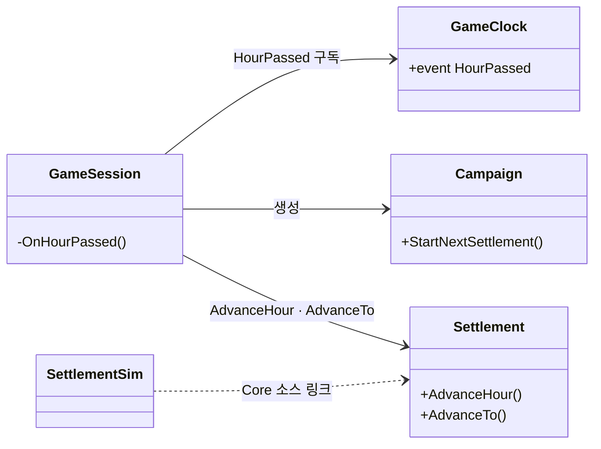

**② 캠페인과 정착지 규칙 (Core)**

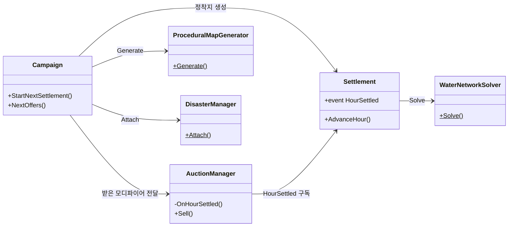

> 게임 규칙은 모두 Core(`Settlement`·`Campaign`·`AuctionManager` 등)에 있고, Unity 쪽(`GameSession`)과 시뮬레이터(`SettlementSim`)가 **같은 Core를 서로 다른 시계로 돌리는** 구조

## 2. 절차 맵 생성: 예시 맵을 그려 AI에게 생성 규칙을 전달했다

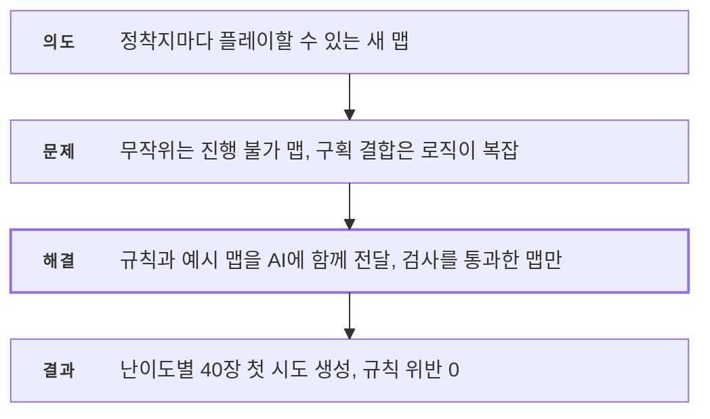

### 2.1 문제

파산할 때까지 점점 어려워지는 다음 정착지를 계속 플레이하는 콘텐츠라, 정착지마다 새 맵이 필요했음

### 2.2 선택

- **검토한 두 방식의 한계**
  - 단순 무작위 배치 : 게임 진행이 불가능한 시드도 생성됨
  - 미리 조립한 구획들을 결합하는 방식 : 안정적이지만, 구획을 결합하는 로직을 설정하기 복잡함
- **선택 — 규칙과 예시 맵을 함께 전달** : 배치 규칙을 직접 정하고, 글로만 넘기지 않고 맵 스케치 편집기로 그린 예시 맵과 함께 전달함. 규칙(글)과 예시 맵(그림)을 함께 주는 멀티모달 방식으로, AI가 더 나은 생성 로직을 구성하게 함
  - 편집기 구현은 AI(10/23 `2335bac`), 예시 맵 `sketch_01`은 직접 그림
- 맵 스케치 편집기: Unity 씬 뷰에서 헥스 타일을 클릭·드래그로 칠함(숫자키 1~5 = 사막·수원·광맥·암반·장애물, Shift = 지우기). 저장 형식이 캠페인 맵과 같은 JSON이라, AI가 예시의 좌표·지형을 그대로 읽어 확인함
- 편집기에는 '생성 맵 미리보기'(난이도 D·시드)를 더해, 예시를 그린 화면에서 생성 결과를 바로 비교

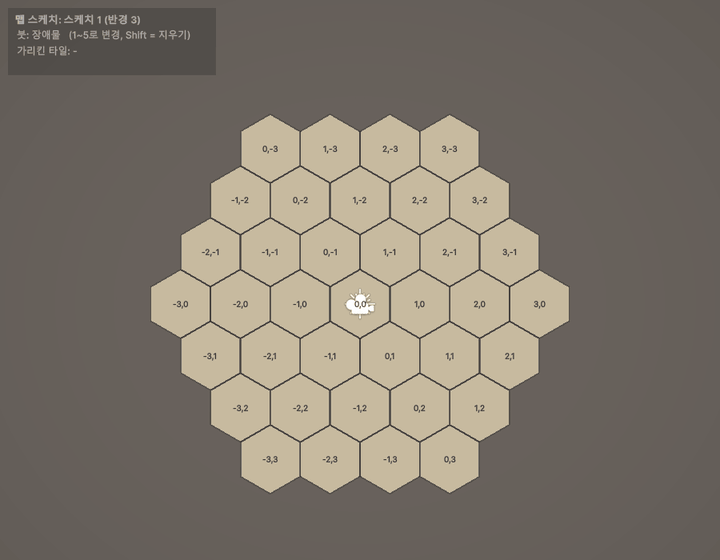


- 함께 전달한 생성 규칙(`Docs/implementation_notes.md` "절차 맵: 생성 규칙(사용자 정의)")
  - ① 장애물: 지형마다 **산맥(선)** 또는 **고원(덩어리)** 중 하나. 다른 장애물 지형과 이어져 맵을 가로막으면 안 됨. 15% 확률로 독립된 한 칸 장애물
  - ② 광맥: 난이도 수치만큼, 90% 확률로 장애물 근처
  - ③ 암반: 90% 확률로 이미 놓인 장애물 칸을 대신
  - ④ 우물(수원): 난이도 수치만큼, 사막 위에 한 칸씩, 반경 2 안에 다른 우물 없음
- ②·④의 "난이도 수치만큼"은 구현에서 맵 37칸당 개수를 난이도 D에 따라 보간하는 식(`DifficultyParams.For`)으로 바뀌어, 난이도가 오를수록 맵은 커지고 우물·광맥은 줄어듦(아래 그림)
- 세부 수치(지형 3~6칸, 산맥/고원 50:50, 산맥 60° 꺾임 25%, 지형끼리 최소 1칸 간격 등)는 AI가 제안한 값을 확인해 확정

- **결과** : 시뮬레이터 프로토타입에서 난이도별 40장이 모두 첫 시도에 생성되었고 규칙 위반은 0


### 2.3 구현

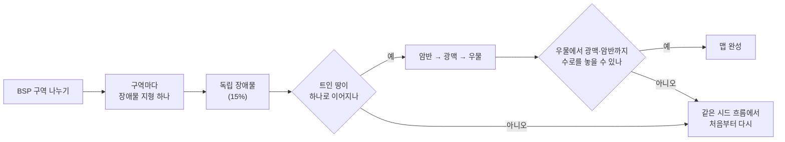

> 규칙을 **만드는 동안 지키게 하는 부분**(구역마다 장애물 지형 하나)과 **만든 뒤 검사로 걸러 내는 부분**(트인 땅 이어짐·수로 경로)이 나뉘어 있음 → 내놓는 맵은 항상 플레이할 수 있음

- 이 규칙을 받아 AI가 구성한 로직(BSP는 AI가 고른 방법): 장애물 지형끼리 이어져 맵을 가로막지 않도록, 맵을 BSP로 구역을 나누고 **구역마다 장애물 지형을 하나만** 키움. 생성한 뒤 트인 땅이 하나로 이어지는지, 우물에서 광맥·암반까지 수로를 놓을 수 있는지 검사하고 실패하면 다시 생성
- 같은 날 AI가 시뮬레이터에서 BSP 생성기 프로토타입을 만들고(`8d1dd7d`) Core로 옮겨 캠페인에 연결(`637e2b3`)

`ProceduralMapGenerator.cs` 98~114행

```csharp
public static GeneratedMap Generate(DifficultyParams p, GeneratorRules rules, int seed)
{
    var rng = new DeterministicRandom(seed);
    for (int attempt = 1; attempt <= rules.MaxAttempts; attempt++)
    {
        GeneratedMap result = TryGenerate(p, rules, rng);
        if (result == null) continue;
        result.Seed = seed;
        result.Attempts = attempt;
        result.Params = p;
        result.Map.Id = string.Format(CultureInfo.InvariantCulture, "gen_d{0:0.00}_s{1}", p.D, seed);
        result.Map.Name = string.Format(CultureInfo.InvariantCulture, "생성 맵 (난이도 {0:0.00}, 시드 {1})", p.D, seed);
        result.Map.Description = p.ToString();
        return result;
    }
    return null;
}
```

- `TryGenerate`가 어느 단계에서든 실패하면 `null` → 같은 난수 흐름으로 다음 시도(최대 `MaxAttempts`번). 몇 번째 시도에 만들어졌는지(`Attempts`)를 결과에 남김
- 난수는 시드로 만들어, 같은 시드면 Unity와 시뮬레이터가 같은 맵을 만듦

`ProceduralMapGenerator.cs` 139~140 · 167~168 · 239~245행

```csharp
bool Allowed(HexCoord c) => leafSet.Contains(c) && !owner.ContainsKey(c) &&
                            Neighbors(c).All(n => !owner.TryGetValue(n, out int o) || o == id);
// (중략)
if (!OpenLandConnected(all, inMap, terrain)) return null;
// (중략)
HexMap hex = map.CreateMap();
var topology = new HexTopology(hex);
int oreDist = CanalPaths.ShortestPathLength(topology, hex, wells, ores);
int rockDist = CanalPaths.ShortestPathLength(topology, hex, wells,
    all.Where(c => terrain[c] == TerrainType.Bedrock).ToList());
if (oreDist < 0 || rockDist < 0) return null;
```

- 장애물 지형은 자기 구역 안에서, 다른 지형과 맞닿지 않는 칸으로만 자람 → 지형끼리 이어져 맵을 가로막는 장벽이 생기지 않음
- 그래도 막히는 경우를 위해 장애물이 아닌 땅이 하나로 이어져 있는지 한 번 더 검사
- 마지막으로 수로 규칙(양쪽이 장애물인 변에는 수로 불가) 아래에서 우물 → 광맥, 우물 → 암반 경로를 찾고, 없으면 그 맵을 버림

## 3. 건설 착공 시각과 경제 틱: 명령한 시각에 바로 착공한다

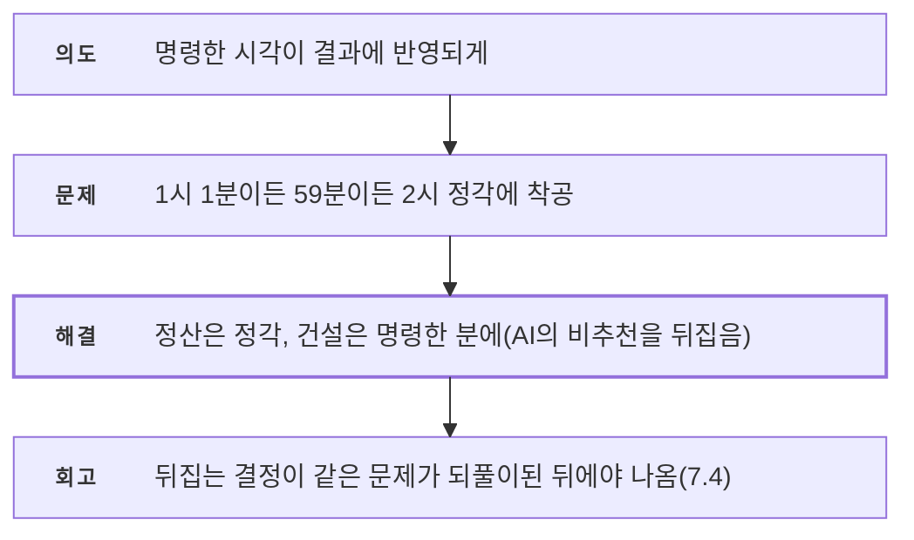

### 3.1 문제

건설이 시간 단위로 처리되어 1시 1분에 짓든 1시 59분에 짓든 2시 정각에 착공됨. 플레이어가 언제 명령했는지가 결과에 반영되지 않아 재미·직관성·합리성을 떨어뜨린다고 판단

### 3.2 선택

12:30에 5시간짜리 건설을 명령했을 때

| 단계 | 착공 | 완공 | 실제 공사 시간 |
|---|---|---|---|
| 처음(다음 정각 착공) | 13:00 | 18:00 | 5.5시간 |
| 2차 플레이테스트 뒤 타협안 | 12:30(지난 30분을 첫 1시간으로 셈) | 17:00 | 4.5시간, 진행률이 처음부터 차 있음 |
| **4차 플레이테스트 뒤(채택)** | **12:30** | **17:30** | **5시간** |

- **AI의 '비추천'을 처음엔 따랐다가 뒤집음**
  - 2차 플레이테스트(10/26) : "명령 후 1시간이 아니라 즉시" → AI가 "분 단위 진행은 경제 틱·저장(명령 기록 재실행)을 바꿔야 해서 비추천"이라며 타협안(명령 순간 착공하되 진행 중인 시간을 첫 1시간으로 셈)을 냈고, 구현 비용이 크다는 판단을 따라 받아들임
  - 3차 플레이테스트(10/27) : "여전히 정각에만 건설이 시작됨" — 규칙은 이미 명령 순간 착공이었고, 원인은 화면 진행률 계산(아래)
  - 4차 플레이테스트(11/03) : 타협안의 부작용이 드러남 — 공사 게이지가 처음부터 10% 이상 차 있고, 대기 공사는 1시간을 그대로 기다렸다 시작함
  - 판단 : 명령한 시각과 실제 공사 시간이 어긋나 보이는 문제가 플레이테스트마다 모양을 바꿔 계속 나와, 비용 때문에 타협할 수 없는 핵심 플레이 경험이라고 보고 "12:30 → 17:30처럼 정확히"를 기준으로 분 단위로 바꿈
- **테스트는 통과했지만 화면이 의도와 달랐던 경우** : 3차 "여전히 정각에만 건설이 시작됨"의 원인은 규칙이 아니라 화면 진행률 계산이 예전 '정각 착공'을 가정한 것이었음(규칙 테스트는 통과한 상태). 플레이해 보고 코드를 읽어야 찾을 수 있는 문제였음
- **생산까지 분 단위로 나누지는 않음** : 경제 정산은 여전히 정각마다 한 시간씩. 완공한 시설은 완공 시각이 든 시간의 생산부터 냄. 그 시간 생산을 분 비율로 나누는 안은 더 정확하지만 물·일손·숙성까지 바뀌어 고르지 않음

- **결과** : 숙련 봇 캠페인에서 바꾸기 전과 후의 정착지 순이익이 거의 같음(D0~1 +1370 → +1379, D3~4 +291 → +285). 봇은 정각에만 명령하므로 정각 명령의 결과가 거의 그대로라는 것만 확인했고, 분 단위 착공 자체의 영향은 이 측정으로 확인하지 못함

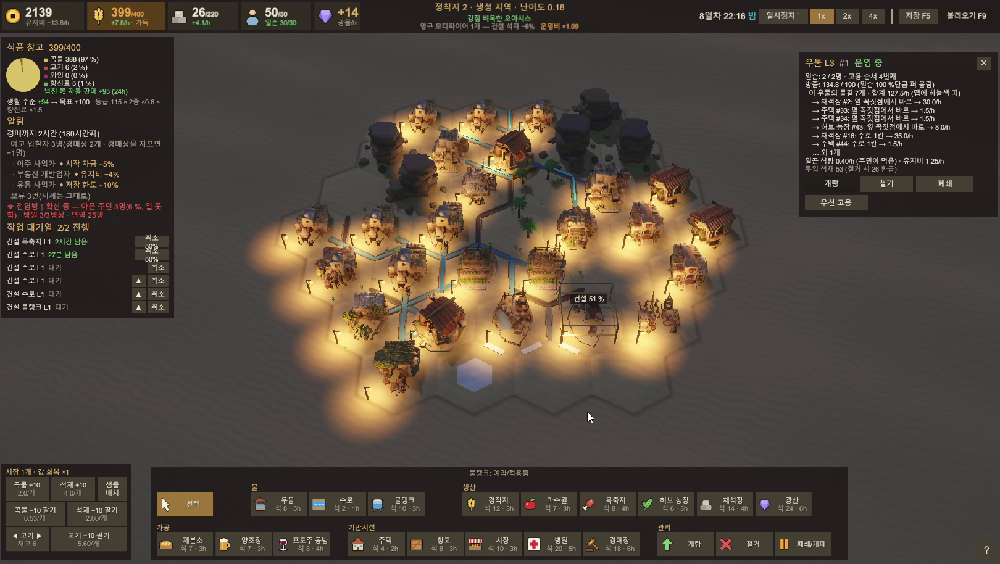

### 3.3 구현

- `GameClock`: 실제 시간을 게임 시간으로 바꾸고 정각마다 `HourPassed` 발생
- `Settlement.TimeSource`: 게임 시계를 읽는 함수. 건설 명령이 들어오면 정착지가 먼저 이 시각까지 따라간 뒤(`AdvanceTo`), 지금 시각(`Now` = 시 + 분 ÷ 60)에 착공

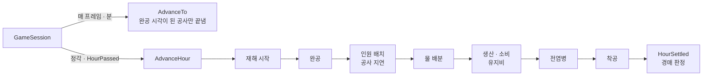

> 분 단위로 따라가는 길(`AdvanceTo`)은 공사 완공만 처리하고, 물·생산·돈은 정각 한 번(`AdvanceHour`)에만 계산됨

`GameSession.cs` 132~146행

```csharp
private void OnHourPassed(GameTimeStamp _)
{
    if (AcceptsWorldInput) Settlement.AdvanceHour();
}

private void SyncSettlementClock()
{
    if (Settlement == null) return;
    Settlement.TimeSource ??= () => Clock.ElapsedHours;
    if (AcceptsWorldInput) Settlement.AdvanceTo(Clock.ElapsedHours);
}
```

- AI가 정각 정산(`AdvanceHour`)과 분 단위 진행(`AdvanceTo`)을 두 갈래로 나눔(본인은 '명령 시각 + 공사 시간에 정확히 완공'이라는 기준을 정함) → 경제 계산 단위(1시간)는 그대로 두고 공사 시각만 분으로 정밀해짐
- 경매가 열려 있으면(`AcceptsWorldInput`이 false) 둘 다 멈춤

`Settlement.cs` 49~56행

```csharp
public int Minute { get; private set; }
public double Now => CurrentHour + Minute / 60.0;
public Func<double> TimeSource { get; set; }
```

- 정착지는 시(`CurrentHour`)와 분(`Minute`)을 따로 들고, 착공·완공 시각은 둘을 합친 `Now`로 셈
- 시계를 정착지 안에 두지 않고 읽는 함수(`TimeSource`)만 받음 → Unity 시계가 없는 시뮬레이터·테스트에서도 같은 Core 규칙이 돎(1.4)

`Settlement.Tick.cs` 19~28 · 141~146행

```csharp
public HourRecord AdvanceHour()
{
    long h = CurrentHour;
    Disasters?.BeginHour(h);
    CompleteJobsUntil(h + 1);
    LastLabor = AssignLabor();
    SlowJobs(h);
    if (!Rules.StartJobsOnCommand) StartJobs(h + 1, h);
    LastLabor = AssignLabor();
    WaterAllocation water = SolveWater();
    // (중략)
    Disasters?.EndHour(h);
    CurrentHour = h + 1;
    Minute = 0;
    if (Rules.StartJobsOnCommand) StartJobs(Now, h);
    HourSettled?.Invoke(record);
```

- 정각 정산은 3.3 그림의 순서대로 한 시간치를 계산. 인원 배치(`AssignLabor`)가 두 번인 것은 공사 인원을 먼저 뽑고, 완공·착공을 반영해 시설 인원을 다시 나누기 때문
- 이번 정산에서 생산된 석재로 대기 공사를 그 정각에 바로 착공(`StartJobs(Now, h)`) → "석재가 다 찬 것이 보이는데 한 시간을 기다리는" 문제 제거
- `StartJobsOnCommand`가 꺼지면 원본 v0.8 규칙(기획 단계 경제 계산표의 정각 착공) → 예전 밸런스와 비교하는 회귀 검사용 스위치(6.3)

## 4. 경매와 입찰자 영구 모디파이어: 최고가와 원하는 보상 사이에서 고른다

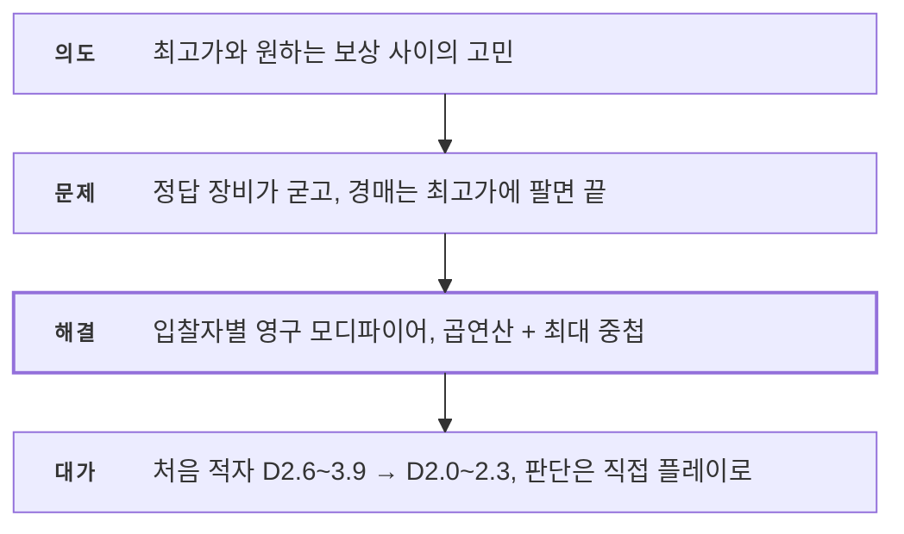

### 4.1 문제

정착지를 판 돈으로 장비를 사는 방식에서는 건설 슬롯·우물 방출량·광물 생산량 같은 장비가 정답처럼 굳었고, 경매도 가장 비싼 값을 부르는 입찰자에게 팔면 끝이라 단조로웠음

### 4.2 선택

| 보상 방식 | 장점 | 문제 |
|---|---|---|
| 장비 상점(바꾸기 전) | 원하는 장비를 골라 Lv3까지 강화 | 정답 장비가 굳음, 경매는 최고가에 팔면 끝 |
| 입찰자 모디파이어 + 합연산 | 경매에서 값과 보상 사이 고민이 생김 | 한도 없이 감소형이 겹치면 −100% 같은 상태 |
| **입찰자 모디파이어 + 곱연산 + 최대 중첩(채택)** | 고민 유지, 0에 수렴하지 않음 | 한 번에 받는 효과가 장비보다 작아 중반에 버티는 힘이 줄어듦(아래) |

- **상점 구매에서 입찰자 선택으로**
  - 변경 : 로그라이크의 보상 선택 방식을 가져와 입찰자마다 서로 다른 영구 모디파이어를 하나씩 제시하게 함
  - 효과 : 높은 입찰가와 원하는 모디파이어 사이에서 선택이 생김. 경매장을 더 지을수록 고를 수 있는 입찰자도 늘어남
- **합연산 대신 곱연산** : 모디파이어가 쌓이며 파산 전까지 점점 어려워지는 난이도를 각자의 방식으로 헤쳐 나가게 하고 싶었음. 처음에는 쌓이는 한도를 두지 않기로 해서(난이도 곡선으로 조절), 합연산이면 감소형이 여러 번 겹쳐 비용이 0이 되거나 음수로 넘어가는 상태가 생길 수 있어 곱연산으로 정함. 인접 보너스·생활 수준·지역 특성 같은 다른 배율도 곱으로 합치므로 계산 방식도 하나로 맞음
- **곱연산에도 남는 문제 → 세기 낮추기와 최대 중첩** : 곱연산에서도 감소형은 여러 번 겹치면 0에 가까워짐(×0.7 세 번 = ×0.34). 재해 피해형은 ×0.7 → ×0.8로 낮추고(세 번 = ×0.51) 3번까지만 겹치게 함. 한도에 닿은 모디파이어는 더 뜨지 않으므로 고르는 폭도 유지됨


- **대가와 판단 근거** : 바꾼 직후 숙련 봇 측정에서는 처음 적자 시점이 D2.6~3.9 → D2.0~2.3으로 당겨짐. 다만 봇은 사람의 플레이를 따라가지 못하므로(6장), "상점보다 낫다"는 판단은 직접 플레이한 감각과 동료 피드백("정착지 완성 → 경매 매각 → 영구 보너스 → 새 정착지" 루프가 재미있다)을 근거로 함
- **정착지를 오래 감상하고 싶다는 피드백** : 후반의 긴장 없는 구간을 잘라 내는 것이 루프 의도라 구조는 유지. 보강한다면 정착지 감상 카메라 뷰나 엔드리스 모드로 건설과 운영을 오래 즐기고 싶은 플레이어에게도 맞추는 방향

### 4.3 구현

- `AuctionManager`: 정착지 시작 후 72시간이 지나면 첫 정기 경매, 입찰자 수 = 1 + 운영 중인 경매장 수(최대 7)
- 예고 때 입찰자마다 모디파이어 하나를 뽑아 둠 → 경매 카드·예고 알림·행선지 창에 표시
- `Campaign`: 팔린 입찰자의 모디파이어를 캠페인 목록에 쌓고, 다음 정착지 규칙에 곱해서 적용
- 자금 0 이하일 때: 광산이 있으면 입찰가 −20%의 긴급 매각 경매, 없으면 바로 파산
  - 파산 카운트다운은 자금이 음수가 된 순간부터 세고, 긴급 매각을 보류해 자금이 음수인 채로 24시간이 지나면 파산(자금이 다시 0 이상이 되면 해제)

`AuctionManager.cs` 297~313행

```csharp
private BidderModifierDefinition RollModifier(BidderModifierSettings mods, string bidderId)
{
    List<BidderModifierDefinition> available = mods.Definitions
        .Where(d => (_ownedCounts.TryGetValue(d.Id, out int n) ? n : 0) < mods.MaxStacksOf(d)).ToList();
    List<BidderModifierDefinition> own = available.Where(d => d.Pool == bidderId).ToList();
    List<BidderModifierDefinition> general = available.Where(d => d.Pool == BidderModifierSettings.GeneralPool).ToList();
    bool exclusive = _rng.NextDouble() < mods.ExclusiveChance;
    List<BidderModifierDefinition> pool = exclusive && own.Count > 0 || general.Count == 0 ? own : general;
    if (pool.Count == 0) return null;
    double r = _rng.NextDouble() * pool.Sum(d => d.Weight);
    foreach (BidderModifierDefinition d in pool)
    {
        r -= d.Weight;
        if (r < 0) return d;
    }
    return pool[pool.Count - 1];
}
```

- 캠페인에서 이미 최대 중첩 수만큼 받은 모디파이어는 후보에서 뺌(4.2)
- 설정 확률(지금 0.7)로 그 입찰자 전용 목록, 아니면 범용 목록에서 비중대로 하나 → 한쪽 목록이 비면 다른 목록, 둘 다 비면 모디파이어 없이 입찰
- 난수는 시드로 만들어, 같은 실행 환경(Unity 또는 시뮬레이터) 안에서는 같은 캠페인·같은 명령이면 같은 결과(저장 파일의 명령 기록을 다시 실행하는 `savecheck`로 확인, 6.3). 경매 난수는 `System.Random`이라 Unity와 시뮬레이터 사이에서도 같은지는 확인하지 않음. 맵 생성만 `DeterministicRandom`(2.3)과 골든 테스트(시뮬레이터가 만든 맵을 문자열로 저장해 두고, Unity에서 같은 시드로 만든 맵이 똑같은지 비교)로 맞춤

`Campaign.cs` 119~124 · 250~256행

```csharp
SettlementRules rules = SettlementRules.FromConfig(_config);
EconomyEffects owned = ModifierEffects;
rules.StartingCash = Cash * owned.StartingCashMultiplier;
rules.StarterFood += _pendingFoodBonus;
rules.ApplyEffects(owned);
foreach (RegionModifierDefinition m in CurrentModifiers) rules.ApplyEffects(m.Effects);
// (중략)
private void OnSold(SaleResult sale)
{
    Cash = sale.SettlementCash + sale.Bid.Cash;
    _pendingFoodBonus = sale.Bid.NextSettlementFoodBonus;
    _pendingFreeBuilds.Clear();
    foreach (KeyValuePair<string, int> kv in sale.Bid.NextSettlementFreeBuilds) _pendingFreeBuilds[kv.Key] = kv.Value;
    if (sale.Bid.Modifier != null) _modifiers.Add(sale.Bid.Modifier);
```

- 팔면 그 입찰자의 모디파이어를 목록에 더하고, 다음 정착지를 만들 때 받은 모디파이어 전체(`ModifierEffects`, 곱으로 합침)와 지역 모디파이어(`CurrentModifiers`, 행선지마다 붙는 특성)를 규칙에 차례로 적용
- 입찰에는 영구 모디파이어 말고도 현금(`Bid.Cash`)과 다음 정착지 한 번만 주는 식량·무료 건설(`_pendingFoodBonus`·`_pendingFreeBuilds`)이 함께 붙음. 다음 자금은 정착지에 남은 돈 + 입찰가
- 121행의 `Cash * owned.StartingCashMultiplier`: 6장에서 시뮬레이터가 찾은 '시작 자금 폭주'의 원인이 된 줄


## 5. 주택·노동력과 전염병: 추상 수치를 눈에 보이는 원인으로 바꿨다

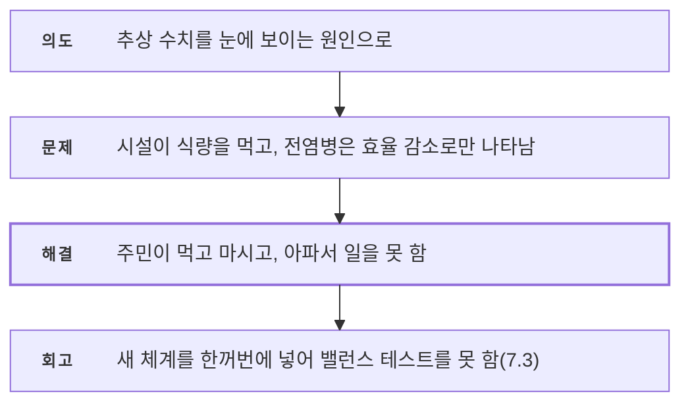

### 5.1 문제

처음 기획에서는 인구·노동력을 확정적으로 빼고 시설이 식량과 물을 요구하게 했음. 플레이해 보니 시설이 식량을 먹는다는 규칙이 직관적이지 않았음

### 5.2 선택

| 규칙 | As-Is | To-Be |
|---|---|---|
| 식량·물 소비 | 시설이 식량을 먹음, 부족하면 전역 식량 계수 F가 떨어짐 | 주민이 먹고 마심, 부족하면 그 주택에서 주민이 떠남 |
| 전염병 | 심각도만큼 생산 시설 효율 감소 | 주민이 아파서 일을 못 하고 집·병원에서 회복 후 복귀, 회복하면 면역 |
| 가공 시설 | 수로 없이도 작동 | 목축지와 같은 양의 물을 쓰고, 가공품 효용이 오름 |

- **기획서의 확정 결정을 뒤집음** : 기획서의 "인구/노동력 [확정]: 삭제"를 뒤집고 노동력을 모으고 관리하는 체계로 바꿈. 주택도 수로에서 물을 받으므로 어디에 짓는지가 전략이 됨
- **같은 기준을 두 규칙에 더 적용** : 전염병은 "효율 −%"보다 "주민이 아파서 일을 못 한다"가 더 직관적이고 이해하기 쉽다고 판단해 모형을 바꿈. 4차 플레이테스트에서 나온 "포도주 공방은 왜 수로가 없어도 작동하는지"에 대해서는, 어떤 시설은 물을 쓰고 어떤 시설은 안 쓰는 것이 직관적이지도 않고 개연성도 없다고 판단해 가공 시설도 물을 쓰게 함
- **물이라는 비용을 매겼으면 가치도 올림** : 가공 시설에 물이 들면 지을 이유가 줄어들므로, 가공품의 생활 수준·식량 효율·판매가를 함께 올림. 물이 빠듯하면 물 비용이 그대로 손해가 되고, 효용을 올려야 다시 지을 만해짐
  - 잰 방법: 시뮬레이터 `-- qa marginal`의 '시설 하나 더 짓기'. 생성 맵 D0.5~3.5에서 제분소를 하나 더 지었을 때, 짓지 않은 같은 맵보다 첫 경매 뒤 최종 자금(매각가 + 남은 재화를 판 현금)이 얼마나 많은지
  - 물이 빠듯할 때 / 넉넉할 때: 바꾸기 전 +116 / +185 → 물만 쓰게 하면 −212 / +190 → 물 + 효용 상향(채택) −93 / +464

- **병원 회복 배율 — 왜 2배인가** : 병원은 전염병에서 **빨리 회복하기 위한** 것이지 **바로 끝내기 위한** 것이 아니었음. 3~4배면 병원 몇 곳만으로 전염병 위협이 사실상 사라짐. 결정 당시 후보 비교에서도 처음 낸 A~E(결정 기록에는 "3~4배"로 적었으나 후보 값으로 계산하면 병원 회복이 집의 약 4~6배)는 병원 2병상만 있어도 시작 환자가 모두 입원해 정점이 3~5%에 그쳤음(아래 표의 A). 그래서 병원 회복을 2~3배로 낮춘 F~H를 더 만들어 비교하고, 병원이 피해를 절반쯤 줄이는 F를 고름

전염병 수치 후보(결정 기록 그대로 · 시뮬레이터 `-- epidemic sweep`, 주민 20명 고정, 지속 / 정점 아픈 비율. D1 맵 손해 = 생성 맵 15장에서 재해 없을 때보다 줄어든 순이익 중앙값)

| 후보 (병원 회복 ÷ 집 회복) | 병원 없음 | 병원 2병상 | 병원 4병상 | D1 맵 손해 |
|---|---|---|---|---|
| A 빠름 (약 4배) | 76h 41% | 29h 5% | 29h 5% | −198 |
| **F 센 전파 · 병원 2배(채택)** | **71h 47%** | **51h 31%** | **50h 22%** | **−264** |
| G 중간 · 병원 2배 | 97h 44% | 70h 28% | 70h 20% | −245 |
| H 아주 셈 · 병원 3배 | 67h 52% | 37h 24% | 36h 15% | −309 |

병원 회복 배율만 바꾼 재검증(2026-11-11 문서 작성 중, 본인의 판단 "3~4배면 병원만으로 전염병이 끝나 버린다"를 확인하려고 AI가 결정 당시와 같은 회복 식을 현재 설정값으로 다시 계산 · 주민 20명 고정, 일 못 한 사람×시간 / 정점 아픈 비율 / 지속, 병원 없음 = 100%)

| 병원 회복 | 병원 없음 | 1곳 | 2곳 | 4곳 |
|---|---|---|---|---|
| **2배(채택)** | 100% · 47% · 71h | 50% · 25% · 50h | 43% · 22% · 50h | 43% · 22% · 50h |
| 3배 | 100% · 47% · 71h | 20% · 9% · 44h | 20% · 9% · 44h | 20% · 9% · 44h |
| 4배 | 100% · 47% · 71h | 8% · 5% · 31h | 8% · 5% · 31h | 8% · 5% · 31h |

- 위 표에서 3~4배는 병원 1곳만으로 일 못 한 시간이 20%·8%로 줄어 전염병이 사실상 퍼지지 못함. 2배면 병원을 아무리 지어도 피해가 43% 아래로 내려가지 않아, 병원이 "회복을 빠르게" 하는 역할에 머묾
- **대가** : 가공 시설이 물을 쓰게 된 뒤, 봇이 가공 시설을 지으면서 우물·수로를 늘리지 않아 광산 물을 빼앗기는 경우가 생김. 새 체계를 짧은 기간에 한꺼번에 넣으면서 사람 기준 밸런스 테스트를 하지 못함(7.3)

### 5.3 구현

- 주택: 수로에서 물을 받고, 정원만큼 주민이 시간당 조금씩 차오름(생활 수준이 높을수록 빨리)
- 생활 수준(−100~100): 주민이 소비하는 식량의 종류가 다양하고 등급이 높을수록 올라감(곡물 0점, 빵·고기 같은 상위 재화일수록 높고, 향신료가 더해 줌). 생활 수준이 높으면 주민이 더 빨리 이주해 오고, 물·식량이 모자랄 때 떠나는 속도는 느려짐. 물·식량이 모자라면 생활 수준 자체도 떨어짐
- 일터(우물·농장·채석장·광산 등): 필요 인원 대비 배치된 인원 비율만큼 가동

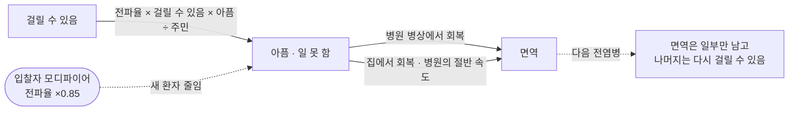

> 정해진 피해 곡선이 아니라 세 무리 사이를 옮겨 가는 사람 수로 계산 → 아픈 사람이 많을수록 빨리 퍼지고, 면역이 늘면 저절로 수그러듦

`Settlement.Tick.cs` 80~88 · 109~113행

```csharp
if (Rules.LaborOn) demand = (Residents + Rules.BaseCrew) * FoodPerResident;
var eaten = new double[GoodsCatalog.All.Length];
double fed = Eat(demand, eaten);
double drinkDemand = Rules.LaborOn ? Residents * Rules.Labor.DrinkPerResidentPerHour : 0;
double drunkTotal = Drink(drinkDemand, eaten);
double deficit = Math.Max(0, demand - fed);
double foodRatio = demand > 0 ? Math.Min(1, fed / demand) : 1;
FoodSatisfaction = foodRatio;
// (중략)
if (Rules.LaborOn)
{
    UpdateLiving(eaten, foodRatio, water);
    UpdateResidents(water, foodRatio);
}
```

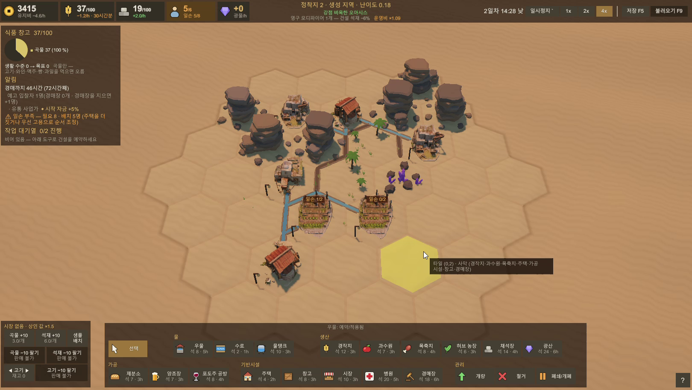

- `Rules.LaborOn`: 노동력 규칙을 켜고 끄는 스위치. 끄면 노동력이 없던 원본 v0.8 경제와 비교할 수 있음(6.3)
- 노동력이 켜지면 식량 수요 = (주민 + 기본 인부) × 1인당 식량 → 시설이 아니라 사람이 먹음. 기본 인부(`BaseCrew`)는 건설 슬롯마다 주어지는 인원으로, 공사만 하고 떠나지 않아 일손이 0이 되어 막히는 것을 막음(식량은 먹고 물은 쓰지 않음)
- 식량 충족률이 주민 목표 인원으로 이어져, 부족의 결과가 "주민이 떠남" 하나로 나타남(두 번 벌하지 않음)

원본 `Disasters.cs` 315~321행 (`DisasterManager.EndHour` — 전염병 중이면 정각 정산 끝에 한 시간만큼 진행)

```csharp
double inHospital = Math.Min(Epidemic.Sick, beds);
double newCases = n > 1e-9 ? Math.Min(Epidemic.Susceptible, p.TransmissionPerHour * Intensity * _settlement.Rules.Effects.EpidemicTransmissionMultiplier * Epidemic.Susceptible * Epidemic.Sick / n) : 0;
double recovered = Math.Min(Epidemic.Sick,
    inHospital * p.HospitalRecoveryPerHour + (Epidemic.Sick - inHospital) * p.HomeRecoveryPerHour);
Epidemic.Sick = Math.Max(0, Epidemic.Sick + newCases - recovered);
// (중략)
Epidemic.Immune = Math.Min(n - Epidemic.Sick, Epidemic.Immune + recovered);
```

- 새 환자 = 전파율 × 걸릴 수 있는 주민 × 아픈 주민 ÷ 전체 주민
- 회복 = 병상에 든 환자 × 병원 회복률 + 나머지 × 집 회복률. 회복한 사람은 면역으로 옮겨 감
- 전파율에 곱하는 `EpidemicTransmissionMultiplier`가 입찰자 모디파이어(전파율 ×0.85, 4장)가 들어오는 자리. 11/03 장비 상점을 없앤 뒤 전염병을 줄이는 수단은 이것과 병원
- 전파율·집 회복·병원 회복은 모두 설정 JSON 값 → 위 5.2의 후보 비교가 코드 수정 없이 값만 바꿔 이루어짐


## 6. 검증 체계: 직접 다 플레이하지 않고도 확인한다

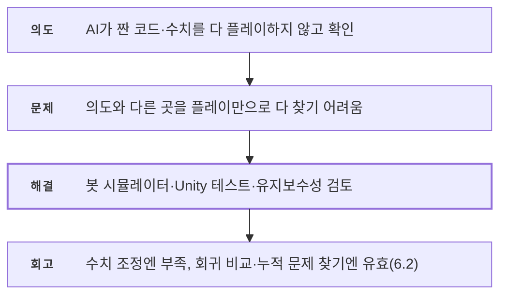

### 6.1 문제

구현을 AI에 맡겨도 코드는 직접 읽어야 했음. AI의 실수를 통제하려면 의도와 다르게 동작하는 곳을 직접 찾아야 했고, 어느 부분이 어떻게 만들어졌는지 알아야 문제에 빠르게 대처할 수 있었음. 하지만 사람이 다 해 볼 수 없는 플레이 패턴까지 플레이만으로 확인하기는 어려웠음

### 6.2 선택

- **시뮬레이터를 만든 이유** : 봇이 자동으로 플레이해 QA 부담을 줄이고, 사람이 다 해 볼 수 없는 다양한 플레이 패턴을 파악하려 함
  - 사람의 플레이 경향이나 선호도가 반영되지 않은, 수치만으로 판단할 수 있는 객관적인 데이터가 필요했음
- **시뮬레이터가 찾은 것 — 시작 자금 폭주** : 반복 플레이에서만 드러나는 문제를 찾음. 범용 모디파이어 "시작 자금 ×1.05"가 보유 자금 전체에 곱해져(4.3의 `Campaign.cs` 121행), 최대 중첩 5면 정착지를 하나 거칠 때마다 +28%씩 쌓임. 끝까지 간 캠페인은 정착지마다 손해를 보면서도 자금이 11만~26만까지 불어남

시작 자금 모디파이어 후보(숙련 봇 캠페인 20개, 시뮬레이터 `-- bottleneck`)

| 후보 | 파산 | 끝까지 간 캠페인 끝 자금(중앙 / 최대) | 비고 |
|---|---|---|---|
| A ×1.05 중첩 5(바꾸기 전) | 13/20 | 118,566 / 264,088 | 복리로 무한히 버팀 |
| **B ×1.05 중첩 1(채택)** | **19/20** | **651 / 651** | 설정 값 하나만 바꿈 |
| C ×1.02 중첩 5 | 19/20 | 771 / 771 | |
| E 고정 +500 × 받은 개수 | 5/20 | 466 / 11,472 | 새 효과 속성(코드) 필요, 자금 0 근처에서 연명 |


- 채택 이유: 한 번만 받으면 가진 자금의 5%라, 자금이 줄면 보너스도 같이 줄어 무한히 버티게 하지 않음. 고정 보너스 안은 코드가 늘고 연명 캠페인을 만듦
- **시뮬레이터의 한계** : 봇은 사람의 플레이를 따라가지 못했음. 숙련 봇조차 물탱크나 시장을 짓지 않았고, 사람(2차 플레이테스트에서 D8에 자산 1만 이상)보다 훨씬 적게 벌었음. 또 플레이테스트로 규칙이 바뀔 때마다 이전 측정의 전제가 무너짐 — 10/23 시뮬레이터로 강화 수치를 맞춘 장비 체계는 11/03에 체계 자체가 폐지됨. 결국 시뮬레이터로 맞춘 수치는 나중에 거의 다시 바꿔야 했음
- **그래서 역할을 다시 나눔** : 수치 조정에는 부족했지만, 리팩터링 전후 출력이 한 글자까지 같은지 보는 회귀 비교군과 사람이 생각하지 못한 누적(시작 자금 폭주)을 찾는 데는 제 역할을 함 → 사람이 직접 플레이해 수치의 기준을 잡고, 시뮬레이터는 그 값을 검증하는 비교군과 예상하지 못한 충돌 지점을 찾는 도구로 쓰는 것이 맞다고 판단함

### 6.3 구현

- 시뮬레이터(`Tools/SettlementSim`): Core 소스를 그대로 링크한 .NET 콘솔. 기준 봇·숙련 봇이 캠페인을 자동으로 돌리고 D 구간별 순이익·처음 적자·파산을 출력
- 원본 v0.8 회귀값: 노동력 등 나중에 추가된 규칙을 끈 상태에서 기획 단계 경제 계산과 같은 값이 나오는지 고정
- `-- savecheck`: 저장 파일의 명령 기록을 다시 실행해 같은 결과가 나오는지 확인
- Unity 테스트: EditMode(Core 규칙)·PlayMode(화면·진행률). 테스트 수는 규칙이 늘며 바뀜 — 10/30 유지보수성 정리 때 EditMode 178~181 · PlayMode 10 → 11/03 EditMode 221 · PlayMode 10 → 11/17 EditMode 221 · PlayMode 15(14개 통과, 수동 실행용 1개 건너뜀), 모두 통과

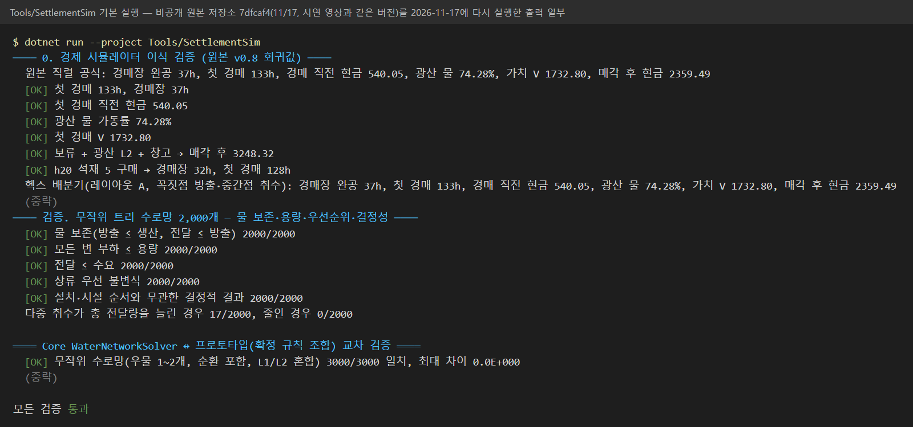


- 유지보수성 검토를 요청해 검토 항목 22개를 받아 이슈 12개로 나눠 처리. 대부분은 게임 동작을 바꾸지 않는 정리였고, 그중 하나는 공사 중 인프라 보너스 계산이 운영 중 계산과 어긋나던 버그(물탱크·시장 누락, 우물·경매장 중복) 수정

| 검토 항목 | As-Is | To-Be |
|---|---|---|
| 설정 JSON 키 검증 | 키 이름에 오타가 나면 오류 없이 기본값(0·null)으로 바뀜 | 클래스에 없는 키는 경로와 함께 불러오기 오류, `_`로 시작하는 설명 키만 허용 |
| 생산 공식 | 같은 공식이 네 곳, 생산 시설 목록이 두 곳 → 화면 예상치와 실제가 어긋날 수 있음 | `SettlementRules` 한 곳에 모으고 정산·화면·경매 가치가 함께 씀 |
| 예전 화면 | 새 uGUI와 예전 IMGUI 화면이 함께 있음 | 예전 화면 삭제, 정식 UI 한 벌 |
| 시뮬레이터 측정 모드 | 예전 규칙을 전제한 측정 모드가 남아 있음 | 전제가 바뀐 모드는 삭제, 결정이 끝난 모드는 머리 주석에 '결정 완료' |

- 확인 방법: 정리할 때마다 시뮬레이터 출력 전체가 바꾸기 전과 같은지, 그때의 Unity 테스트가 모두 통과하는지 확인
- 순서: 노동력·전염병 같은 새 규칙을 넣기 전에 정돈된 상태를 만들려고 이 정리를 먼저 했고, 마친 바로 뒤(같은 10/30)에 두 규칙을 추가
- 11/17 그래픽 개선 뒤 같은 방법으로 다시 확인: 시뮬레이터 출력이 11/04 버전과 한 줄도 다르지 않고 '모든 검증 통과', Unity 테스트도 모두 통과

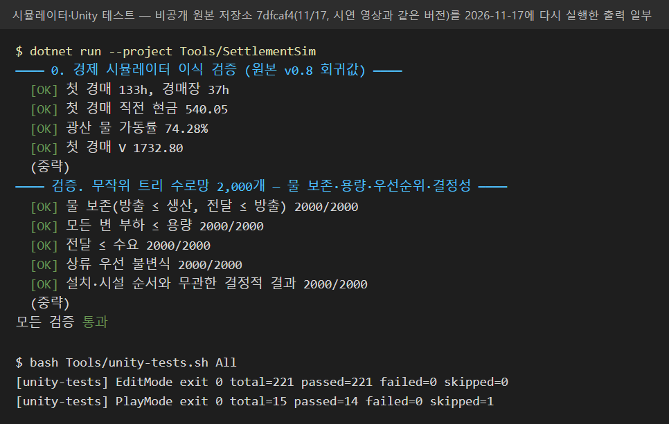

## 7. 구현 결과 및 회고

### 7.1 주요 구현 결과

- 건설·운영 → 경매 → 매각/보류 → 행선지 선택 → 다음 정착지(절차 생성 맵)로 이어지는 MVP 캠페인 루프
- 수로 물 배분, 주택·노동력, 생활 수준, 재해 4종(전염병 포함), 입찰자 영구 모디파이어, 저장·불러오기(명령 기록 재실행)
- 2주 동안 커밋 108개(제공 템플릿 첫 커밋 제외), 결정 기록 67개 묶음(결정 표 [사용자 결정] 164개 · [자동] 128개), 플레이테스트 4차례
- 11/17 그래픽 개선(커밋 2개, 결정 기록 3개 묶음·14개): 시설 16종 텍스처 모델(개량하면 모델이 커지고, 폐쇄하면 채도가 낮아짐), 굴곡 있는 모래 바닥, 샘·광맥·암반·장애물·녹지를 타일 색 대신 모양으로 표시, 물길 바닥·둑·수면이 있는 수로
- 자동 검증: EditMode 221 · PlayMode 15 테스트(14개 통과, 수동 실행용 1개 건너뜀, 11/17 기준), 시뮬레이터 v0.8 회귀값·저장 재실행 확인(11/03 기준)
- 동료 피드백의 좋은 점: 플레이 루프(완성 → 매각 → 영구 보너스 → 새 정착지)가 재미있음, 짜임새 있는 시뮬레이션, 복잡한 시스템을 알아 가는 재미

### 7.2 플레이테스트로 고친 것 — 자원 정보의 위계

- **정보 제공과 정보 전달은 다름** : 처음 UI는 AI가 Anno·Frostpunk·Cities: Skylines의 익숙한 배치를 참고해 정함(`[자동]`). 정보를 빠짐없이 보여 주는 데는 좋았지만, 가장 중요한 자금·식량·석재가 작은 글자 한 줄이라 플레이 중에는 거의 보이지 않았음
- 판단: 자금·식량·석재는 당장 없으면 바로 문제가 생기는 요소라 다른 정보와 다른 위계로 구분해야 함 → Frostpunk의 UI를 참고하고, 아이콘이 어렵다면 이모지라도 쓰도록 지시

| 항목 | As-Is | To-Be |
|---|---|---|
| 핵심 자원 | 위쪽 띠의 작은 글자 한 줄 | 아이콘 + 24px 굵은 숫자 카드, 주의는 갈색 · 위험은 붉게 깜빡임 |
| 시설 머리 위 글자 | IMGUI라 결과창 위로 '일손 2/4'가 올라옴 | uGUI 캔버스로 옮겨 결과창 아래에 그려짐 |
| 아이콘 | 없음 | 코드로 그린 64×64 스프라이트(기본 글꼴이 컬러 이모지를 못 그려서) |

- 결과: 그래픽과 정보 구분으로 초기보다 나아졌으나, 동료 플레이 기록에 "두 번째 경매 때까지 자금이 줄어드는 것을 몰랐다"는 응답이 있어 자금 감소 전달은 아직 부족함


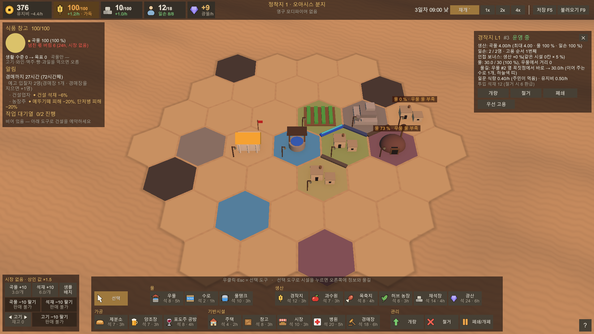

### 7.3 기술적 한계 및 향후 개선

- **새 체계를 한꺼번에 넣음** : AI 덕분에 개발 속도가 빨라 기획서에서 확정한 결정까지 뒤집을 수 있었지만, 변경 시점이 늦었음. 상위 재화·노동력·생활 수준을 짧은 기간에 함께 도입하면서 밸런스 테스트를 하지 못했고, 완성된 플레이 경험을 만들지 못함
- **튜토리얼과 안내 부족** : 동료들에게 플레이를 부탁해 보니 대부분 무엇을 어떻게 해야 할지 몰랐음. 동료 피드백에서도 튜토리얼 부재, 한꺼번에 열리는 시설, 텍스트에 의존하는 정보 전달(마우스 오버 글이 많음, 수로 연결 상태를 알기 어려움)이 공통으로 지적됨
- **개선 — 단계적 해금** : 우물·주택·수로처럼 기반이 되는 시설을 먼저 열고, 곡물을 쓰는 목축지·제분소는 경작지를 지은 뒤에 열리게 하는 방향(아직 구현 전) → 시설 사이의 관계를 순서대로 익히고, 해금 순서가 튜토리얼 역할도 하게 하는 것이 목표
- **측정 봇의 한계** : 봇이 주택·우물을 먼저 챙기지 않아 사람보다 훨씬 비관적인 결과를 냄(무료 주택을 없앤 뒤 5회 중 2회 두 번째 정착지 파산). 봇 결과로는 지금 밸런스가 사람에게 맞는지 판단할 수 없음
- **그래픽** : 11/17에 시설은 텍스처 3D 모델로, 지형·수로는 굴곡과 모양으로 바꿨지만, UI는 여전히 코드로 만든 uGUI

### 7.4 회고 — AI 주도 개발의 한계

- **AI의 판단과 플레이 경험의 우선순위** : 분 단위 착공(3장, 구현 비용을 이유로 한 AI의 '비추천')과 자원 위계(7.2) 모두, AI는 무엇을 만들고 보여 줄지는 잘 채웠지만 플레이 경험에서 무엇이 더 중요한지는 플레이를 해 본 사람이 정해야 했음
- **개발 흐름에서 빠지게 됨** : 직접 개발하지 않다 보니 플레이 피드백보다는 기존의 기획을 준수하고 있는지를 더 중시하게 됨. 그래서 플레이테스트를 4차례 했지만, 기획을 뒤집는 결정은 같은 문제가 되풀이된 뒤에야 내림(3.2·7.3). AI 개발은 만드는 속도가 빠른 만큼, 직접 플레이하고 피드백을 반영하는 과정을 빠르게 하는 것이 좋다는 교훈을 얻음
