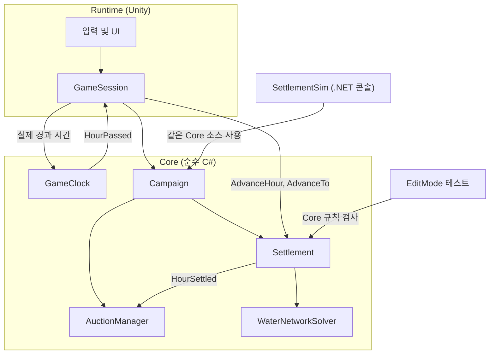
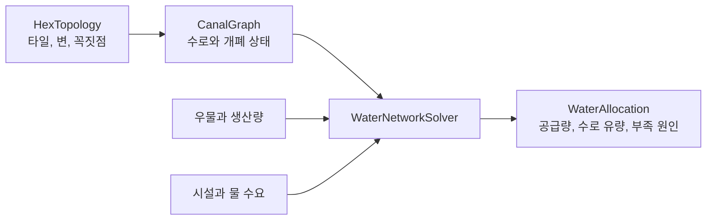
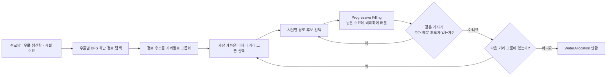
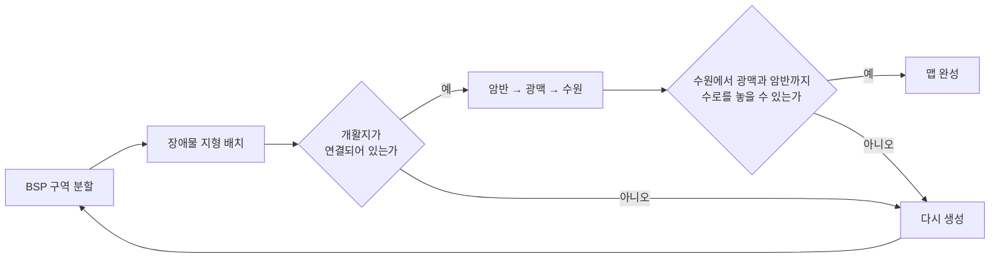
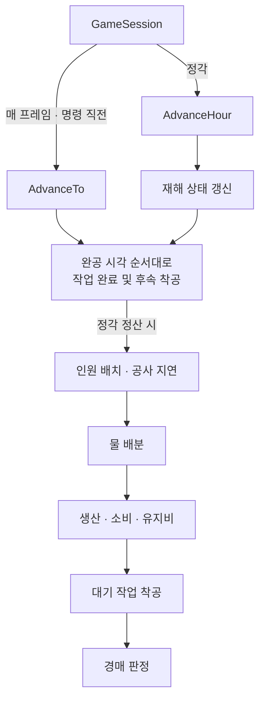
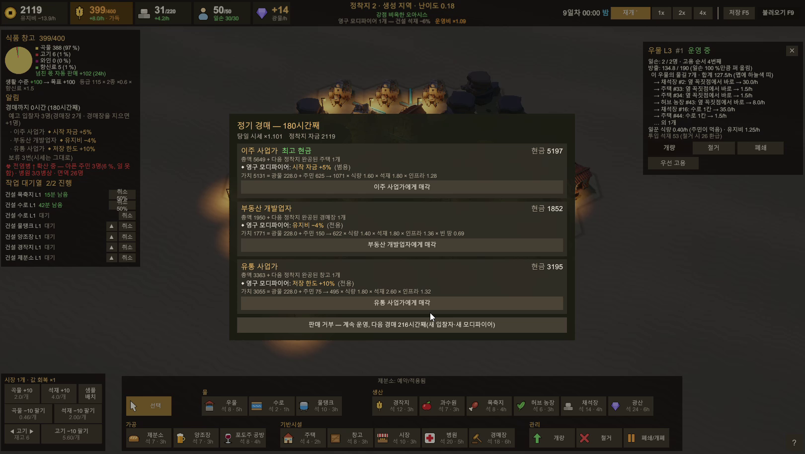

# Desert Flavor

> 한정된 물로 사막의 정착지를 성장시키고, 경매를 통해 얻은 자금과 보상으로 새로운 정착지에 도전하는 건설 경영 게임입니다.


| 항목 | 내용 |
|---|---|
| 장르 | 헥스타일 기반 정착지 건설 및 경영 시뮬레이션 |
| 기간 | 2026.10.20 ~ 11.04 (약 2주), 11.17 그래픽 개선 |
| 인원 | 1인 개발 |
| 내 역할 | 게임 기획 및 규칙 결정, AI 작업 절차 설계, 이슈 관리, 플레이테스트, 구현 결과와 밸런스 검증 |
| 개발 환경 | Unity 6000.3.15f1, C#, uGUI, Newtonsoft Json, Unity Test Framework, .NET 10 |
| 상태 | 정착지 건설, 경매, 다음 정착지로 이어지는 MVP 구현 완료 |
| 링크 | [GitHub](https://github.com/ashadeveloperr/desert-flavor), [시연 영상](https://youtu.be/yixx2zTn9uQ) |

## 1. 게임 소개

>열심히 키운 정착지를 다시 판매하는 구조

건설 경영 게임에서 자원이 부족한 초반에는 시설 하나를 어디에 지을지, 무엇부터 생산할지 고민하게 됩니다. 하지만 정착지가 충분히 성장해 자원 부족이 해소되고 병목이 해결된 후에는 긴장감과 위기감이 사라집니다. 저는 정착지 건설 및 경영 과정에서 겪는 딜레마를 플레이 루프 내내 반복해서 경험할 수 있는 게임을 만들고 싶었습니다.

Desert Flavor에서는 정착지를 계속 운영하거나 완성하는 것이 최종 목표가 아닙니다. 정착지가 커질수록 재화 병목은 해소되지만, 유지비로 인한 자금 부담은 점점 커집니다. 따라서 충분히 성장시킨 정착지를 적절한 시점에 경매에 매각하고, 그 보상으로 더 어려운 다음 정착지 건설에 도전하는 것이 권장됩니다.


### 1.1 우물 건설부터 경매까지, 사막 정착지 경영

플레이어는 사막의 희소 자원을 개발하기 위해 광산 정착지를 건설하는 역할을 갖고 있습니다. 이 과업은 가장 먼저 수원(오아시스)에 우물을 짓고 육각형의 변을 따라 수로를 연결하는 것부터 시작합니다.
물과 초기 식량을 공급해 주택에 주민들이 이주해오게 만들고, 그 주민들은 정착지에 건설된 경작지, 채석장, 광산 등에서 일합니다. 경작지는 주민의 식량을, 채석장은 시설을 지을 석재를 생산하며, 광산의 생산 실적은 정착지의 평가 가치에 영향을 줍니다.


한정된 물은 수로를 따라 우물에서 가까운 시설부터 공급됩니다. 기존 농장에 물을 충분히 보내고 있더라도 새로운 광산을 더 가까운 곳에 지으면 농장에 공급되던 물이 줄어들 수 있습니다. 우물의 물 공급량이 충분해도 한 수로가 보낼 수 있는 물의 양에도 한계가 있습니다. 이러한 요소들은 플레이어로 하여금 시설과 수로의 위치 설계를 고민하게 만듭니다.

광물은 경매에서 정착지의 가치를 높이는 주요 요소이고, 시장에서 남는 재화를 판매하면 운영 자금을 확보할 수 있습니다. 반면 시설을 유지하는 동안에는 유지비가 계속 발생합니다. 시설을 늘려 매각 가치를 높이는 것과 현재의 자금을 보존하는 것 사이에 균형을 잡아야 합니다.


정착지 건설을 시작한지 72시간이 지나면 정착지를 거래하기 위한 첫 경매가 열립니다. 입찰자는 각자의 선호와 가치 비중에 따라 정착지의 현 상태를 평가하고 각기 다른 가격을 책정하고, 영구 보너스를 제시합니다. 매각을 보류하면 36시간 뒤 다시 경매가 열리고, 매각하면 남은 보유 자금과 경매 대금, 영구 보너스를 바탕으로 다음 정착지를 개발합니다. 파산하기 전까지 얼마나 많은 정착지를 거칠 수 있는지 도전하는 구조입니다.

초기의 고정 맵을 지나면 절차적으로 생성한 맵이 제공됩니다. 생성 맵의 난이도는 보유 자금과 지금까지 거친 생성 맵 정착지의 수를 바탕으로 산출하는 난이도 지수(D)에 따라 결정됩니다. 난이도가 높아지면 맵이 넓어지고 수원과 광맥의 밀도가 낮아지며, 유지비 부담과 불리한 지역 특성도 증가합니다. 이를 통해 캠페인이 진행되면서 누적되는 영구 보상에 대응하도록 설계했습니다.

### 1.2 위기 구조


게임 내내 목표 및 과제, 그리고 긴장감을 제공하기 위해 정착지의 운영 단계에 따라 서로 다른 성격의 위기를 겪도록 설계했습니다. 초반에는 물과 식량, 석재 등 자원과 노동력의 부족을 극복해야 합니다. 생산망이 갖춰지는 중반에는 전염병이나 모래폭풍 같은 재해가 발생해 기존 생산망을 위협할 수 있습니다. 후반에는 개발을 계속해 매각 가치를 높이는 것과 유지비가 누적되기 전에 정착지를 매각하는 것 사이에서 이익이 되는 쪽을 판단해야 합니다.

물과 노동력, 생산, 경매, 재해 등이 서로 영향을 주기 때문에 개별 기능만 정상 작동한다고 해서 게임 전체가 의도대로 흘러가지는 않습니다. 약 2주 동안 이 규칙들을 구현하고 반복해서 수정할 수 있도록 AI 에이전트와 작업을 분담하고 검증 환경을 구축했습니다.

## 2. AI 협업 개발

>기획부터 검증까지의 작업 절차

### 2.1 개발자와 AI의 역할

저는 기획서를 작성하고 게임 규칙을 결정했습니다. AI 에이전트는 구현과 세부 설계 시안의 제시를 담당했습니다. 이렇게 역할을 분담한 프로젝트 초기 단계에서 먼저 지속 가능한 개발 체계를 갖추는 것은 몹시 중요한 일이었습니다.

이를 위해 결정 기록에는 채택안, 근거, 대안, 코드 위치, 그리고 제가 결정한 사항과 AI가 결정한 사항을 구분하여 기록하게 함으로써 기획 단계에서 발생한 문제가 어디서 비롯되었는지 추적하는 경로를 만들었고, 세션이 바뀌거나 언제 어느 컴퓨터로 확인해도 기존 규칙과 작업 및 수정중인 범위를 파악할 수 있도록 인계 문서와 코드 가이드를 만들어 작업의 일관성과 흐름을 유지했습니다.

구현 이후에는 직접 플레이해 문제를 찾아내고, 자동 테스트와 시뮬레이션 결과를 바탕으로 변경안을 판단했습니다. AI가 제안한 변경안도 그대로 채택하지 않고, 플레이테스트에서 확인한 문제와 설계 의도를 기준으로 검토했습니다.

### 2.2 Unity를 실행하지 않고도 게임 규칙을 검증하기

다만 결정의 근거를 남기는 것과 실제 결과를 확인하는 것은 별개의 문제였습니다. 여러 시설의 생산량이나 경매 보상을 조정할 때마다 Unity에서 직접 정착지를 건설하고 매각을 반복하는 방식으로는 충분한 비교가 어려웠습니다.

이 문제를 해결하기 위해 AI가 제안한 Core와 Runtime 분리 구조를 채택했습니다. 게임 규칙은 Unity에 의존하지 않는 Core에 두고 화면 표시와 입력은 Runtime에서 처리합니다. 이 구조를 활용하면 별도의 .NET 콘솔 프로젝트인 SettlementSim도 실제 게임과 동일한 경제, 수로, 캠페인 소스 파일을 사용하므로 검증을 위해 규칙을 별도로 구현할 필요가 없습니다.



Core는 asmdef의 noEngineReferences 설정으로 Unity 엔진에 대한 참조를 제한합니다. Unity 실행 환경과 독립적으로 게임 규칙을 실행하고 검증하여 자동화된 QA 체계를 유지하기 위해서입니다. Runtime은 GameSession을 통해 게임 시간을 전달하고, Settlement는 물 배분과 자원의 생산 및 소비를 처리합니다. Campaign은 정착지 간 전환을 담당하며, AuctionManager는 정산 완료 이벤트를 받아 경매 진행 여부를 판단하고 경매 과정을 관리합니다.

시뮬레이터에서는 실시간 시계 대신 봇이 AdvanceHour()와 Sell()을 직접 호출하여 캠페인을 진행합니다. 경제 수치와 맵 생성 설정은 JSON으로 관리하여 코드 수정 없이 실험 조건을 변경할 수 있도록 했습니다.

### 2.3 서로 다른 세 가지 검증 수단


| 검증 수단 | 활용 목적 |
|---|---|
| 플레이테스트 | 게임 규칙과 화면 피드백이 직관적인지, 실제 플레이가 의도한 경험으로 이어지는지 확인 |
| Unity 테스트 | EditMode에서 Core 규칙을, PlayMode에서 Runtime과 UI 동작을 검사 |
| 시뮬레이터 | 기준 봇과 숙련 봇으로 반복 플레이하며 수치 변경 전후의 결과와 장기적인 영향을 비교 |

기획 단계의 경제 모델에서 정해진 조건으로 실행한 결과를 회귀 검사의 기준값으로 삼았습니다. 노동력, 전염병, 모디파이어처럼 나중에 추가된 규칙은 회귀용 설정에서 비활성화하여 기존 결과값과 비교했습니다. 무작위 수로망에서 물 배분 규칙이 지켜지는지도 검사했습니다.

저장은 난수 시드와 플레이어의 명령 기록을 이용해 게임 상태를 재현하는 방식입니다. `savecheck`로 저장 파일의 명령을 다시 실행했을 때 같은 결과가 나오는지 확인했습니다.

밸런스 검증에는 서로 다른 전략 수준에서 게임의 경제와 난이도를 측정하기 위해 기준 봇과 숙련 봇을 나누어 결과를 비교했습니다.

| 행동 | 기준 봇 | 숙련 봇 |
|---|---|---|
| 건설 | 사전에 수립한 건설 계획을 따름 | 운영 상황에 따라 추가 건설 |
| 시설 개량 | 개량하지 않음 | 자원 공급 및 재정 상황에 따라 개량 |
| 재해 대응 | 별도 대응 없음 | 전염병 예고 시 병원 건설 |
| 자원 판매 | 적극적인 판매 없음 | 재고량과 시장 가격에 따라 판매 |
| 경매 | 첫 경매에서 매각 | 예상 수익에 따라 매각 보류 |

각 봇의 판단 규칙을 유지한 채 여러 난수 시드와 경제 수치로 캠페인을 반복 진행하는 몬테카를로 시뮬레이션을 수행했고 이를 통해 난이도별 평균 순이익과 파산율, 자원 공급 병목 등을 비교하여 설계 변경과 밸런스 조정의 근거로 삼았습니다.
후술할 캠페인 병목 검사에서는 매각 후 보유 자금에서 해당 정착지의 시작 자금을 뺀 값을 정착지 순이익으로 사용하며, 파산한 정착지의 손익은 시작 자금 전액 손실로 기록합니다.

단, 숙련 봇 역시 사전에 정의된 판단 규칙에 따라 작동하는 휴리스틱 기반 봇이므로, 실제 숙련 플레이어의 전략을 충실히 흉내내거나 최적의 전략을 탐색한다고 볼 수는 없습니다.

### 2.4 코드와 테스트의 유지보수성

기능이 늘어나거나 변경되면서 같은 계산식과 설정이 여러 곳에 분산되는 문제가 생겼습니다. 노동력과 전염병을 추가하기에 앞서 AI에 유지보수성 검토를 요청해 발견한 22개 항목을 관련 작업 12개 이슈로 나누어 처리했습니다.

| 검토한 문제 | 변경한 방식 |
|---|---|
| JSON 설정 키 오타가 기본값으로 남아 조용히 규칙이 틀어질 수 있음 | 알 수 없는 키는 경로와 함께 불러오기 오류로 처리 |
| 생산 공식이 여러 곳에 있어 실제 정산, 예상 생산량, 경매 가치가 달라질 수 있음 | `SettlementRules`의 공통 계산을 사용 |
| 시뮬레이터가 게임과 다른 JSON 파서를 사용함 | 게임과 동일한 `EconomyConfigLoader`를 사용 |

정리 작업 전후의 시뮬레이터 출력과 Unity 테스트를 비교했습니다. 공사 중 인프라 가치 계산에서 발견한 버그는 별도로 수정했습니다. 이후에도 같은 문제가 반복되지 않도록 공통 공식과 설정의 중복을 금지하고, 테스트 및 관련 문서 갱신을 커밋 전 완료 조건으로 정했습니다.

테스트 자체에도 누락을 감지하는 장치가 필요했습니다. 모디파이어에 새 속성을 추가하거나 저장 명령이 늘어났을 때 기존 테스트가 새 항목을 검사하지 않으면 통과 결과만으로는 결함을 발견하기 어렵습니다. 이에 리플렉션으로 모디파이어의 쓰기 가능한 속성과 저장 명령 종류를 읽어 각 항목의 처리 경로를 검사하는 테스트를 마련했습니다.

검사가 실제 결함을 잡는지도 확인했습니다. 테스트용 사본에서 여러 효과의 배율을 합성하는 `EconomyEffects.Combine`의 탄저병(작물 생산량 저하 재해) 피해 처리와, 저장된 명령을 재실행하는 `SaveGame.Apply`의 석재 판매 분기를 각각 제거했을 때 해당 테스트가 실패한 것이 사례입니다.

## 3. 수로 네트워크와 물 배분 알고리즘

실제 플레이에서 가장 중요한 자원인 물의 배분 규칙을 직관적으로 설정할 필요가 있었습니다. 우물의 생산량과 수로의 용량, 전달 과정에서 발생하는 손실에 따라 시설별 가동률이 달라지므로 단순한 연결 여부가 아니라 각 시설이 공급받을 수 있는 물의 양을 계산하고, 이를 플레이어가 정확히 알 수 있어야 했습니다.

### 3.1 헥스 타일 기반 수로 그래프

헥스 타일 맵에서 시설은 타일 안에 놓이지만 수로는 타일의 테두리, 즉 변을 따라 설치됩니다. 하나의 변은 두 타일이, 하나의 꼭짓점은 최대 세 타일이 공유하므로 이를 타일별로 관리하면 동일한 수로의 연결 상태와 용량을 중복해서 처리해야 하는 문제가 발생합니다.

이를 방지하기 위해 시설의 위치는 `HexCoord`, 수로는 `EdgeId`, 꼭짓점은 `VertexId`로 구분했습니다. `HexTopology`를 통해 인접 타일이 공유하는 변과 꼭짓점을 식별하고, `CanalGraph`에서 설치된 수로와 개폐 상태를 관리합니다.

우물의 물은 수로가 연결된 타일 꼭짓점에서 방출되며, 시설 역시 수로에 연결된 꼭짓점에서 물을 취수합니다. 우물과 시설이 수로가 연결된 꼭짓점을 공유하는 경우에는 수로 구간을 통과하지 않고 바로 물을 공급할 수 있습니다.



`WaterNetworkSolver`는 개방된 수로를 탐색 가능한 그래프로 구성하고, 우물의 생산량과 시설의 수요를 바탕으로 물을 배분합니다. 계산 결과는 `WaterAllocation`에 저장하여 시설의 가동률 계산과 수로의 유량 표시에 사용합니다.

### 3.2 물 배분 알고리즘의 설계와 검증

물은 우물과 가까운 시설에 우선 공급하되, 같은 거리에 있는 시설에는 남은 수요에 비례하여 배분하도록 했습니다. 여기서 거리는 타일 사이의 직선거리가 아니라 개방된 수로를 따라 방출 지점에서 취수 지점까지 이동하는 최단 경로의 길이입니다. 이 규칙을 실제 수로망에 적용하기에 앞서 시뮬레이터에서 방출 및 취수 지점, 경로 선택 방식, 수로 용량의 계산 기준 등을 비교했습니다.

| 검토 대상    | 초기 검토안의 문제                              | 채택한 방식      |
| -------- | --------------------------------------- | ----------- |
| 우물 방출 지점 | 변 중간점에서 방출하면 꼭짓점에서 뻗은 수로에 공급하지 못함       | 꼭짓점 방출      |
| 시설 취수 경로 | 경로가 포화되면 여유 용량이 있는 다른 경로를 활용하지 못함       | 다중 경로 취수    |
| 수로 용량 계산 | 손실 후 유량을 기준으로 하면 실제 진입 유량이 용량을 초과할 수 있음 | 진입 유량 기준 계산 |

**시설 취수 경로**
단일 취수 방식에서는 선택된 경로가 포화되어 우물에 물이 40단위 남아 있는데도 농장의 공급률이 0%였습니다. 다중 취수 방식에서는 동일한 배치에서도 다른 대체 경로를 활용하여 100%까지 공급할 수 있었습니다. 단일 취수 방식은 효율적인 수로 배치를 고민하도록 유도할 수 있지만, 여유 용량이 있는 다른 경로로도 물을 공급받지 못하는 것은 비합리적이라고 판단했습니다. 따라서 한 경로가 포화되더라도 다른 경로를 통해 추가로 취수할 수 있도록 했습니다.

**수요에 비례한 물 배분**
같은 거리에 있는 시설에 순차적으로 물을 공급하면 먼저 처리한 시설에 물이 집중될 수 있습니다. 가령 우물의 생산량이 60이고 두 시설의 수요가 각각 80과 40이라면, 어느 시설을 먼저 처리하느냐에 따라 공급률이 달라집니다.



전달 손실과 수로 용량 제약이 없는 위 배치에서는 두 시설에 각각 40과 20을 공급하면 모두 50%의 공급률을 얻습니다. 이를 위해 Progressive Filling을 적용해 각 시설의 남은 수요에 비례하여 물을 배분하고, 우물의 잔여 생산량이나 수로의 잔여 용량이 허용하는 범위에서 추가 배분을 반복하도록 했습니다.

**수로 용량과 전달 손실**
시설에 같은 양의 물을 공급하더라도 수로가 길수록 우물에서 더 많은 물을 보내야 합니다. 따라서 시설에 도달할 물의 양을 기준으로 우물의 방출량과 각 수로의 진입 유량을 역산했습니다. 이 값을 경로별로 미리 계산해 두고, 배분 과정에서 우물의 잔여 생산량과 수로의 잔여 용량을 확인하는 데 사용했습니다.

**배분 결과의 결정성**
같은 수로 배치에서는 시설을 등록한 순서와 관계없이 동일한 결과가 나와야 합니다. 이를 위해 거리가 가까운 경로부터 처리하고, 같은 거리에서는 병목 용량이 큰 경로를 우선 후보로 선택하도록 했습니다. 이 조건까지 같다면 식별자를 기준으로 경로 선택 순서를 결정했습니다.

최종적으로 물 배분 알고리즘은 다음과 같이 구성했습니다.



**알고리즘 검증**
특정 수로 배치만으로는 발견하기 어려운 예외 상황과 배분 규칙의 위반 여부를 확인하기 위해 두 가지 무작위 검사를 마련했습니다.

| 검사     | 생성 시도 횟수 | 검증 내용                                                               |
| ------ | -------: | ------------------------------------------------------------------- |
| 불변식 검사 |   2,000회 | 무작위 트리형 수로망에서 물의 보존, 수로 용량 및 시설 수요 초과 여부, 상류 우선 배분과 결과의 결정성 검사      |
| 교차 검증  |   3,000회 | 다중 우물, 순환 수로, 서로 다른 용량의 수로가 포함된 수로망에서 프로토타입과 실제 게임의 배분 결과가 일치하는지 검사 |

기존 시뮬레이터의 검증 기록에서는 모든 검증을 통과한 것을 확인할 수 있었습니다.

### 3.3 실제 유량과 직접 취수량의 분리

앞서 설명한 꼭짓점에서의 직접 취수는 수로 구간을 통과하지 않습니다. 이 때문에 시설이 정상적으로 물을 공급받고 있음에도 연결된 수로의 유량은 0으로 표시되는 문제가 발생했습니다.

직접 취수량을 수로 유량에 합산하는 방법을 검토했으나, 이 경우 실제로 수로를 통과하지 않은 물까지 용량 계산에 포함하게 됩니다. 기존 직렬 수로 배치에서는 농장의 직접 취수량 30을 수로 유량에 포함할 경우 첫 수로의 요구 유량이 105가 되어 용량 100을 초과하고, 하류 광산의 공급량까지 감소하게 됩니다.

| 구분 | 일반 취수 | 직접 취수 |
|---|---|---|
| 우물 생산량 사용 | O | O |
| 수로 용량 사용 | O | X |
| 수로 공급 상태 표시에 반영 | O | O |

따라서 `WaterAllocation`에서 실제 진입 유량과 직접 취수량(`DirectIntakeLoads`)을 분리해 관리했습니다. 용량 계산에는 실제 진입 유량만 사용하고, 수로의 색상과 공급 경로를 표시할 때는 직접 취수량도 함께 참조하도록 했습니다.

직접 취수량의 분리가 기존 물 배분 결과에 영향을 주지 않는지도 검증했습니다. 직접 취수량과 공급 경로를 검사하는 테스트를 추가하고, 회귀 테스트를 통해 기존 배분 결과가 유지되는 것을 확인했습니다.

## 4. 절차적 맵 생성 규칙

물의 배분이 필수적인 게임에서 수로를 연결할 수 없는 지형은 게임 진행을 가로막는 장애 요소가 됩니다. 절차적 맵 생성을 통해 지속적으로 새로운 도전을 제공하려면, 개발 난이도가 높은 지형과 개발 자체가 불가능한 지형을 명확히 구별해야 했습니다.

### 4.1 멀티모달 활용: 글과 예시를 함께 전달

단순히 맵 타일을 무작위로 배치하면 지형이 단절되는 맵이 생길 수 있었습니다. 처음에는 미리 만들어 둔 작은 단위의 구획 세트들을 조합하는 방식을 대안으로 떠올렸지만, 구획 간 결합 규칙을 세우기 복잡해질 수 있었습니다.

대신 원하는 지형의 형태와 배치 조건을 규칙으로 정의하고, 이를 만족하는 맵 생성기를 AI와 협업하여 구현하기로 했습니다. 제가 정의한 생성 규칙은 다음과 같습니다.

| 지형     | 생성 규칙                                                                                      |
| ------ | ------------------------------------------------------------------------------------------ |
| 장애물(산) | 산맥처럼 길게 이어지거나 고원처럼 뭉친 형태로 생성. 서로 다른 장애물 군집이 이어져 맵을 가로막지 않도록 하며, 15% 확률로 독립된 한 칸짜리 장애물을 생성. |
| 광맥     | 90% 확률로 장애물 근처에 생성하며, 난이도가 높아질수록 밀도를 낮춤.                                                   |
| 암반     | 90% 확률로 기존 장애물 타일을 대체.                                                                     |
| 수원     | 사막 위에 한 칸씩 배치하며, 반경 2타일 이내에 다른 수원이 존재하지 않도록 함. 난이도가 높아질수록 밀도를 낮춤.                          |

그러나 글만으로는 산맥과 고원의 형태, 장애물 군집 사이의 간격 등 제가 원하는 지형의 모습을 충분히 전달하기 어려웠습니다. 이를 해결하기 위해 Unity 씬 뷰에서 타일을 클릭하거나 드래그하여 지형을 칠할 수 있는 맵 스케치 편집기를 AI와 협업해 만들고, 직접 그린 예시 맵을 AI에게 전달했습니다.


편집기에서 제작한 예시 맵은 실제 게임 맵과 동일한 JSON 형식으로 내보낼 수 있습니다. 기본 지형인 사막을 제외하고 각 타일의 육각 격자 좌표(q, r)와 지형 종류를 기록하므로, AI에게 시각적인 예시뿐 아니라 정확한 타일 배치 데이터도 함께 전달할 수 있었습니다.

맵 스케치 편집기에서 내보낸 데이터(`**sketch_01.json**`):
```JSON
{
  "id": "sketch_01",
  "name": "스케치 1",
  "description": "",
  "radius": 3,
  "terrain": [
    { "q": 0, "r": -3, "type": "Obstacle" },
    { "q": 1, "r": -3, "type": "Obstacle" },
    { "q": 2, "r": -3, "type": "WaterSource" },
    { "q": -1, "r": -2, "type": "Bedrock" },
    { "q": 0, "r": -2, "type": "Obstacle" },
    { "q": 1, "r": -2, "type": "OreVein" },
    { "q": 2, "r": -1, "type": "Obstacle" },
    { "q": -2, "r": 0, "type": "WaterSource" },
    { "q": -1, "r": 1, "type": "Obstacle" },
    { "q": 0, "r": 1, "type": "Obstacle" },
    { "q": 1, "r": 1, "type": "Bedrock" },
    { "q": -2, "r": 2, "type": "Obstacle" },
    { "q": -1, "r": 2, "type": "OreVein" },
    { "q": 0, "r": 2, "type": "Obstacle" },
    { "q": 1, "r": 2, "type": "Obstacle" }
  ],
  "sampleLayout": []
}
```

이후 편집기에 생성 맵 미리보기 기능을 추가했습니다. 난이도와 시드를 지정하여 맵 생성기를 실행하고, 제가 직접 그린 예시 맵과 생성 결과를 동일한 환경에서 비교할 수 있도록 했습니다.

난이도 지수(D)가 높아질수록 맵의 반경과 장애물 밀도가 증가하고 수원과 광맥의 목표 거리가 길어지도록 했습니다. 각 조건에는 상한이나 하한을 두어 맵의 크기와 자원 배치가 무한정 변하지 않도록 했습니다.

아래는 동일한 시드에서 난이도를 달리하여 생성한 맵입니다. 장애물의 형태와 군집 간 분리 여부, 난이도에 따른 맵의 크기와 자원 밀도의 변화를 시각적으로 확인할 수 있습니다.


### 4.2 생성과 유효성 검사를 분리하기

예시 맵을 통해 원하는 지형의 형태와 배치 조건을 구체화했지만, 개별 생성 결과를 눈으로 확인하는 것만으로는 모든 맵의 유효성을 보장할 수 없었습니다. 따라서 맵 생성 과정에 배치 규칙과 별도의 유효성 검사 절차를 두었습니다.

먼저 이진 공간 분할(BSP)로 맵을 여러 구역으로 나누고, 각 구역에 산맥이나 고원을 최대 하나씩 배치합니다. 각 장애물 지형은 자신의 구역 안에서 다른 장애물 지형과 맞닿지 않도록 확장됩니다.



장애물 배치 직후에는 장애물이 아닌 모든 타일이 하나로 연결되어 있는지 검사합니다. 이후 자원과 수원 배치를 완료하면 양쪽 타일이 모두 장애물인 변에는 수로를 설치할 수 없다는 실제 게임의 제약을 적용하여, 수원으로부터 적어도 하나의 광맥과 하나의 암반에 도달할 수 있는지 최종 검증합니다. 이 과정에서 우물과 광맥 사이의 최단 수로 길이도 산출합니다.

`ProceduralMapGenerator.cs`의 수로 접근성 검사:
```csharp
HexMap hex = map.CreateMap();
var topology = new HexTopology(hex);
int oreDist = CanalPaths.ShortestPathLength(topology, hex, wells, ores);
int rockDist = CanalPaths.ShortestPathLength(topology, hex, wells,
    all.Where(c => terrain[c] == TerrainType.Bedrock).ToList());
if (oreDist < 0 || rockDist < 0) return null;
```

유효성 검사에 실패하면 같은 난수 흐름에서 다시 생성합니다. 설정된 최대 시도 횟수인 300회 안에 생성하지 못하면 고정 맵을 사용합니다. 프로토타입에서는 난이도별 40장이 첫 시도에 생성되었고 규칙 위반은 없었습니다. Unity 테스트에서는 지형 배치 규칙뿐 아니라 동일한 시드와 설정의 재현성, 시뮬레이터의 기준 맵과의 일치 여부도 확인합니다.

다만 자원에 물을 공급할 수 있다는 사실이 정착지 경영이 성공한다는 뜻은 아닙니다. 접근 가능성을 보장하는 문제와 실제 난이도 및 밸런스를 맞추는 문제는 구분했습니다.

## 5. 건설 시간: 테스트를 통과했지만 어색한 규칙

게임 내에서 건설은 플레이어가 가장 자주 수행하는 행동입니다. 건설 작업은 대기열에 등록되며, 사용 가능한 건설 슬롯과 필요한 석재가 확보되면 착공합니다. 동시에 진행할 수 있는 작업 수가 제한되므로 착공과 완공 시점은 다음 작업을 시작하는 시점에도 영향을 미칩니다.

만약 5시간이 걸리는 시설을 12:30에 건설하기 시작했다면 특별한 문제가 없는 한 17:30에 완공되어야 합니다. 그러나 처음 구현에서는 건설 작업을 한 시간 단위의 경제 정산과 함께 처리했기 때문에 이러한 기대가 충족되지 않았습니다. 이처럼 표시된 공사 시간과 실제 소요 시간이 일치하지 않는 문제는 플레이의 직관성을 저해했습니다.


### 5.1 구현 비용을 줄이기 위해 선택한 타협안의 문제

처음에는 정각에만 공사가 시작되었습니다. 10월 26일 플레이테스트에서 즉시 착공을 구현하려 했지만, AI는 건설을 분 단위로 처리하면 기존 경제 정산과 저장 방식까지 변경해야 한다는 이유로 타협안을 추천했습니다. 명령 순간 착공하되 진행 중인 시간을 공사의 첫 한 시간으로 계산하는 방식이었습니다.

| 5시간 건물 건설 착공 시점 처리 방식 | 12:30 명령 시 착공 시간 | 완공    | 경과 시간   |
| --------------------- | ---------------- | ----- | ------- |
| 초기 방식: 정각 착공          | 13:00            | 18:00 | 5시간 30분 |
| 타협안: 즉시 착공, 시간 단위 계산  | 12:30            | 17:00 | 4시간 30분 |
| 최종 방식: 분 단위 시간 처리     | 12:30            | 17:30 | 5시간     |

그러나 타협안을 적용한 뒤에도 정각에만 공사가 시작되는 것처럼 보이는 문제가 발생했습니다. 확인 결과 Core에서는 즉시 착공하고 있었지만, 화면의 진행률은 여전히 정각 착공을 가정하여 계산하고 있었습니다. 건설 규칙에 관한 테스트는 통과했지만, 실제 화면에서 나타나는 동작까지 검증하지 못한 것입니다.

화면의 진행률 계산을 수정하자 이번에는 착공 순간부터 진행률 게이지가 일부 차 있는 문제가 발생했습니다. 진행 중인 시간대를 공사의 첫 한 시간으로 계산하는 규칙 때문에, 착공하기도 전에 지나간 시간까지 공사 시간에 포함된 것입니다.
또한 경제 정산에서 착공을 생산보다 먼저 처리하고 있었기 때문에, 석재 부족으로 대기하던 작업은 필요한 석재가 정각에 생산되어도 한 시간 뒤 다음 정각까지 착공하지 못했습니다.

착공 지연을 해결하기 위해 선택한 타협안이 오히려 공사 시간과 진행률의 불일치를 만들어낸 것입니다.

### 5.2 정각 경제 정산과 분 단위 공사 진행을 분리하기

저는 개별적인 예외 처리를 추가하는 대신, 착공 시각부터 표시된 공사 시간만큼 실제 시간이 경과해야 한다는 기준을 다시 확정했습니다.

AI는 이 기준에 따라 시간 처리 구조를 두 경로로 나누었습니다. `AdvanceTo`는 현재 게임 시각까지 건설 작업을 진행시키고, `AdvanceHour`는 정각마다 경제를 정산합니다.



공사의 착공 시각과 완공 시각을 각각 `StartTime`, `EndTime`으로 관리합니다. 건설 슬롯과 석재 등 착공 조건이 충족되면 즉시 착공하고, 공사 시간이 지나면 정각을 기다리지 않고 완공합니다. 완공으로 건설 슬롯이 비거나 경제 정산을 통해 석재가 확보되면 대기 중인 작업도 해당 시각에 착공할 수 있습니다.

`Settlement.Jobs.cs`에서는 완공 시각이 지난 작업을 실제 완공 시각 순서대로 처리합니다.

```csharp
ConstructionJob job = _jobs.Where(j => j.State == JobState.InProgress && j.EndTime <= until + 1e-9)
    .OrderBy(j => j.EndTime).ThenBy(j => j.Id).FirstOrDefault();
if (job == null) return;
CompleteJob(job, job.DeadlineHour);
if (Rules.StartJobsOnCommand) StartJobs(job.EndTime, job.DeadlineHour);
```

다음 대기 작업의 착공 시각 역시 함수를 호출한 시각이 아닌 이전 작업의 실제 완공 시각을 기준으로 계산합니다. 따라서 게임에서 매 프레임 건설을 진행하는 경우와 시뮬레이터에서 정각마다 한꺼번에 처리하는 경우에도 동일한 조건에서는 같은 시각에 공사가 완료됩니다.

다만 생산량까지 분 단위로 나누지는 않았습니다. 예를 들어 17:30에 완공된 시설은 18:00에 이루어지는 17시 정산부터 생산에 참여하며, 생산량에 남은 30분의 비율을 적용하지는 않습니다. 생산을 분 단위로 정산하려면 물 배분과 노동력 등 다른 시간 기반 규칙도 함께 변경해야 했기 때문입니다.

플레이어가 직접 확인할 수 있는 건설 시간의 정확성은 확보하되, 경제 정산의 기존 구조는 유지하는 방식으로 변경 범위를 정했습니다.

기존 테스트에서 놓쳤던 문제를 검증하기 위해 정각이 아닌 시각에 착공한 시설의 완공 시각, 석재 확보 직후 대기 작업의 착공 여부, 저장 및 복원 시 명령 시각의 재현성을 확인하는 테스트를 추가했고 화면의 진행률도 PlayMode 테스트에 포함했습니다.
변경 당시 EditMode 테스트 208개와 PlayMode 테스트 10개를 모두 통과했으며, 기존 경제 시뮬레이터의 회귀 테스트 결과도 유지되었습니다.

## 6. 주민과 노동력 시스템 추가

초기에는 주민들이 각 시설에 고용되어 정착지의 경제를 움직이는 구조를 구상했습니다. 그러나 구현과 경제 규칙의 복잡도를 줄이기 위해 인구와 노동력 시스템을 제외하고, 시설 자체가 식량과 유지비를 소모하는 방식으로 변경했습니다.

### 6.1 기획서에서 확정한 결정을 뒤집은 이유

그러나 직접 플레이해 보니 시설 자체가 식량을 소비하는 규칙은 직관적이지 않았습니다. 식량이 부족하면 모든 생산 시설의 효율이 일괄적으로 감소했기 때문에, 플레이어가 제한된 자원을 어느 시설에 우선적으로 투입할지 결정할 여지도 부족했습니다.

이를 개선하기 위해 기존의 인구와 노동력 삭제 결정을 철회했습니다. 다만 개별 주민의 행동을 시뮬레이션하는 대신 주택별로 거주 인원을 관리하고, 정착지 전체의 노동력을 각 시설에 배분하는 방식으로 구현 범위를 정했습니다.


기본적으로 주택마다 최대 정원에 해당 주택의 물 공급률과 정착지 전체의 식량 충족률 중 낮은 값을 곱해 목표 인원을 계산하고, 주민 수가 점차 그 목표에 접근하도록 했습니다. 이렇게 물과 식량이 풍부할 때에는 주민들이 이주해오고, 부족할 때에는 떠나는 현상을 구현했습니다.

가용 노동력은 다음과 같은 순서로 배치됩니다.

1. 진행 중인 건설 작업
2. 플레이어가 우선 고용을 설정한 시설
3. 물을 충분히 공급받는 시설
4. 물을 일부만 공급받는 시설

같은 공급 조건의 시설은 먼저 완공된 순서로 배치하고, 물이 전혀 공급되지 않는 시설은 우선 고용을 설정하지 않는 한 자동 배치에서 제외합니다.

건설 작업에 인력이 우선 배치되므로 공사를 늘리면 기존 시설의 생산량이 감소할 수 있습니다. 반대로 건설에 필요한 인원이 부족하면 공사가 지연됩니다. 주민이 모두 떠나더라도 정착지를 복구할 수 있도록 건설 슬롯마다 공사 전용 기본 인부를 한 명씩 둡니다.

시설의 생산량은 필요 인원 대비 배치율과 물 공급률 등에 따라 달라집니다. 식량 부족은 주민 이탈과 노동력 감소를 거쳐 생산에 영향을 미치므로, 기존의 식량 부족 배율을 별도로 적용할 필요가 없어졌습니다.

이처럼 주민을 자원의 소비 주체이자 생산에 필요한 노동력으로 설정함으로써, 기존에는 개별적인 수치로 처리하던 자원 소비와 생산량 감소를 하나의 경제적 인과관계로 연결했습니다.

### 6.2 전염병 피해를 주민의 건강과 노동력에 연결하기

재해는 정착지 개발 초반의 자원 병목과 후반의 유지비 부담 사이에 새로운 위기를 만들기 위해 설계한 시스템입니다. 게임 도중 발생하여 작물 생산량 감소(탄저병), 식량 재고 손실 및 작물 생산량 감소(메뚜기떼), 수로 손실 증가 및 건설 지연(모래폭풍) 등의 피해를 일으킵니다. 정착지가 어떤 산업에 특화되어 있는지에 따라 같은 재해라도 피해 양상은 크게 달라집니다.

주민 시스템의 도입은 재해 중에서도 정착지 경제 전반에 강한 영향을 미치는 전염병의 규칙을 바꾸는 계기가 되었습니다. 기존 전염병은 심각도에 따라 생산 시설의 효율을 일괄적으로 감소시키는 방식이었습니다. 대신 감염된 주민을 노동력 배치에서 제외하고, 회복한 주민이 다시 업무에 복귀하도록 하면 피해의 원인과 병원의 역할이 더욱 명확해질 수 있다고 판단했습니다.


이를 위해 감염 가능 주민(S), 환자(I), 회복해 면역을 얻은 주민(R)으로 인구를 구분하는 SIR 모형을 도입했습니다. 정각 정산마다 감염 가능 주민과 환자 수, 전파율, 재해의 강도 등을 이용해 새 환자 수를 계산합니다. 환자는 병원과 자택에서 회복하며, 회복할 때까지 노동을 하지 않습니다.


주민의 건강 상태를 경제와 연결한 뒤에는 같은 규모의 전염병이 발생하더라도 여유 노동력이 얼마나 있는지, 어떤 시설을 우선 고용하는지에 따라 실제 생산 손실이 달라집니다. 기존의 일괄적인 생산량 감소 방식과 달리 정착지의 운영 방식에 따라 동적으로 재해의 피해 규모와 양상이 달라지는 구조입니다.

#### 6.2.1 병원의 회복률과 전염병의 위협 사이의 균형

병원은 전염병의 피해를 줄이는 시설이지 재해를 사실상 무효화하는 시설이 아니어야 했습니다. 병원의 성능이 지나치게 높으면 전염병에 대비하기 위한 다른 전략적 판단이 불필요해질 수 있기 때문입니다.

이를 고려하여 주민 20명을 고정하고 전파율과 회복률 등의 후보를 시뮬레이션해 전염병 지속 시간과 최대 환자 비율을 비교했습니다.

| 후보                       | 시간당 전율   | 자택/병원 회복률       | 병원 없음         | 2병상           | 4병상           |
| ------------------------ | -------- | --------------- | ------------- | ------------- | ------------- |
| 빠른 병원 회복(약 4배)           | 0.30     | 0.08 / 0.30     | 76h / 41%     | 29h / 5%      | 29h / 5%      |
| **강한 전파, 병원 회복 2배 (채택)** | **0.35** | **0.08 / 0.16** | **71h / 47%** | **51h / 31%** | **50h / 22%** |
| 중간 전파, 병원 회복 2배          | 0.25     | 0.06 / 0.12     | 97h / 44%     | 70h / 28%     | 70h / 20%     |
| 매우 강한 전파, 병원 회복 3배       | 0.40     | 0.08 / 0.24     | 67h / 52%     | 37h / 24%     | 36h / 15%     |
> 표의 수치는 전염병 지속 시간과 절정 시점의 환자 비율입니다. 초기 감염률은 5%이며, 마지막 후보만 8%입니다.

병원 회복이 빠른 첫 번째 후보는 2병상만 있어도 최대 환자 비율이 5%에 그쳤습니다. 반면 채택한 두 번째 후보에서는 병상을 확보할수록 피해가 줄어들지만, 상당한 노동력 손실은 남았습니다.

전파율과 회복률 등 여러 변수를 함께 변경한 비교이므로 이 표만으로 병원 회복 배율의 독립적인 효과를 판단할 수는 없지만, 두 번째 후보의 설정 조합이 병원의 투자 가치를 확보하면서도 전염병의 위협을 유지한다는 설계 의도에 가장 부합해 채택했습니다.

## 7. 경매와 캠페인: 후반에도 긴장감을 유지하는 구조

물과 노동력, 건설 시간을 통해 한 정착지 안에서 여러 선택을 만들었습니다. 하지만 캠페인이 진행될수록 보상이 누적되어 모든 문제를 쉽게 해결할 수 있게 된다면, 정착지를 매각하고 다시 시작하도록 한 설계 의도가 사라집니다. 경매 보상의 선택과 누적 효과가 중요한 마지막 과제였습니다.

### 7.1 가장 높은 가격이 항상 정답은 아니다

처음에는 정착지 매각 대금으로 영구 지속되는 장비를 구입하고 정착지 운영에 필요한 각종 기능을 추가하거나 수치를 강화하도록 했습니다. 이 방식에서는 건설 슬롯이나 우물 방출량, 광물 생산량처럼 당장 효율을 올리는 장비가 정답처럼 굳어졌습니다. 경매에서도 가장 비싼 값을 부르는 입찰자를 고르면 그만이었습니다.

이런 문제는 경매가 충분한 딜레마를 제공하지 못했기에, 장비 상점을 없애고 로그라이크의 보상 선택 방식을 경매에 결합했습니다. 변경된 경매 방식에서 산업가는 광산을, 농장주는 농업을 상대적으로 높게 평가하는 등 입찰자마다 다른 평가 비중을 적용하여 정착지의 가격을 책정합니다. 여기에 공용 또는 입찰자 고유의 영구 모디파이어(이후 정착지에도 적용되는 보너스) 하나를 무작위로 제시합니다. 더 많은 경매장을 운영하면 선택할 수 있는 입찰자의 수도 늘어납니다.



이 시스템을 통해 높은 가격으로 매각해 다음 정착지에 필요한 자금을 확보할 것인지, 조금 적은 금액을 받더라도 원하는 장기 보너스를 얻을 것인지 고민하게 만들고자 했습니다.

매각 후에는 다음 행선지를 선택합니다. 절차적으로 생성된 행선지에는 풍부한 광맥이나 마른 대수층과 같은 지역 특성이 부여됩니다. 영구 모디파이어와 달리 지역 특성의 효과는 해당 정착지에만 적용되므로, 지금까지 획득한 보상이 다음 지역의 강점이나 약점과 어떻게 맞물리는지도 고려하게 됩니다.


보상은 캠페인 전체에 누적되므로 계산 방식도 중요했습니다. 감소형 보너스를 단순히 더하면 비용이 0이 될 수 있어 곱연산을 채택했습니다. 곱연산으로도 효과가 지나치게 커질 수 있으므로 최대 중첩 횟수를 제한했습니다. 예를 들어 작물 재해나 모래폭풍의 피해를 줄이는 특정 모디파이어는 ×0.8을 세 번까지만 중첩하도록 하여 해당 보상만으로는 약 51%의 피해가 남도록 했습니다. 최대 중첩 횟수에 도달한 모디파이어는 이후 보상 후보에서 제외합니다.

### 7.2 정착지에서는 적자인데 캠페인 자금은 늘어난다

개발 막바지에는 제가 처음 의도했던 성장, 안정화, 유지비 부담으로 인한 매각의 흐름이 실제로 나타나는지 캠페인 전체를 시뮬레이션하도록 했습니다. 숙련 봇으로 여러 정착지를 연속 운영한 결과, 후반 정착지에서 매각 대금을 포함하고도 1만 이상의 적자를 반복하면서 캠페인 자금은 11만~26만까지 증가하는 사례가 발견되었습니다.

원인은 시작 자금 5% 증가 모디파이어였습니다. 이 효과는 다음 정착지의 고정 기본 자금이 아니라 보유 자금 전체에 적용되었습니다. 최대 다섯 번 중첩되면 다음 정착지에 진입할 때마다 약 1.28배의 자금을 갖게 되는 구조였습니다.

`Campaign.StartNextSettlement`의 시작 자금 계산:
```csharp
rules.StartingCash = Cash * owned.StartingCashMultiplier;
```

모디파이어가 개별 정착지의 운영 수익과는 무관하게 반복적으로 자금을 증폭시키면서, 유지비와 난이도 상승을 상쇄하고 있었습니다. 이를 수정하기 위해 효과의 크기와 최대 중첩을 바꾼 후보를 비교했습니다. 숙련 봇 캠페인 20개를 각각 최대 40개 정착지까지 진행한 기록입니다.

| 후보 | 파산한 캠페인 | 40개 정착지까지 생존한 캠페인의 최종 자금 중앙값 / 최댓값 |
|---|---|---|
| A: ×1.05, 최대 5회 (기존) | 13/20 | 118,566 / 264,088 |
| B: ×1.05, 최대 1회 (채택) | 19/20 | 651 / 651 |
| C: ×1.02, 최대 5회 | 19/20 | 771 / 771 |


저는 5%라는 보너스 자체는 유지하면서 중첩에 따른 증폭을 줄이는 B안을 선택했습니다. `maxStacks` 설정값만 변경하면 적용할 수 있었고, 실험에서는 생존 캠페인의 자금이 크게 줄었습니다. 다만 수정 후 생존한 캠페인은 1개뿐이므로 최종 자금의 중앙값을 전체 난이도의 대표값으로 볼 수는 없습니다. 정착지 전환마다 보유 자금에 5%가 적용되는 구조도 남아 있어 다른 전략에서의 자금 증폭까지 해소했다고 단정할 수는 없습니다.

이 문제는 개별 시설이나 보상 하나를 테스트하는 것만으로는 드러나기 어려웠습니다. 실제 게임과 같은 규칙으로 캠페인을 반복 실행하는 시뮬레이터를 만든 것이 효과를 발휘한 사례였습니다.

## 8. 개발 결과와 회고

약 2주 동안 정착지 건설과 운영부터 경매와 다음 정착지로 이어지는 MVP를 구현했습니다.
이후 진행한 플레이테스트에서는 성장시킨 정착지를 매각하고 다시 도전하는 구조와 복잡한 시스템을 알아 가는 재미가 좋은 점으로 꼽히는가 하면, 반대로 정착지를 오래 감상하고 싶은데 판매를 강제하는 구조가 아쉬웠다는 의견도 있었습니다.

이러한 피드백들은 매각을 중심으로 한 구조와 건설 게임의 성취감을 양립시키고자 했던 초기의 기획 의도를 더 제대로 전달하는 방법론에 대한 고민으로 이어졌습니다.

### 8.1 정보를 보여주는 것과 전달하는 것은 달랐다


초기 UI는 기존 건설 경영 게임들의 익숙한 배치를 참고해 AI와 구성했습니다. 하지만 실제 플레이 중 자금, 식량, 석재처럼 즉시 확인해야 할 자원이 눈에 잘 띄지 않았습니다. 이를 별도의 자원 카드로 구분하고 변화량과 위험 상태가 드러나도록 개선했습니다.


그럼에도 플레이테스트에서는 두 번째 경매까지 자금이 줄고 있다는 사실을 몰랐다는 응답이 나왔습니다. 어떤 시설부터 지어야 하는지, 수로가 제대로 연결되었는지 이해하기 어렵다는 의견도 있었습니다.

AI를 활용해 상위 재화와 병원 등 당초 계획에 없던 콘텐츠를 빠르게 추가했지만, 플레이어가 규칙을 익히는 순서와 변경 후의 밸런스를 충분히 검증하지 못했습니다. 개별 화면의 피드백을 개선하는 것과 게임 전체의 학습 흐름을 설계하는 것은 다른 문제였습니다.

개발을 재개한다면 우물, 수로, 주택 등 기초 시설부터 사용할 수 있게 하고, 원료 생산 시설을 건설한 뒤 가공 시설이 해금되도록 구성할 계획입니다. 별도의 튜토리얼을 만드는 것도 좋지만, 시설 간 관계를 익히는 과정 자체가 튜토리얼이 되도록 하여 자연스럽게 게임 방식을 익히게 하는 방향입니다.

### 8.2 시뮬레이터는 무엇을 검증할 수 있었는가

시뮬레이터는 시작 자금의 복리 효과처럼 예상하지 못한 장기적인 문제를 발견하거나 규칙 변경 전후의 결과를 비교하는 데 효과적이었습니다. 그러나 게임 내에서 시스템을 이용하는 데에는 부족한 점을 드러냈습니다. 일례로 숙련 봇도 물탱크를 이용하는 등 사람이 사용하는 전략을 충분히 재현하지 못한 바 있습니다. 따라서 봇의 측정 결과를 실제 숙련 플레이어가 달성할 수 있는 수익이나 난이도의 한계로 해석할 수는 없었습니다.

또한 정착지의 일별 평가 가치와 보유 자금을 합산하고 시작 자금을 빼서 매각 시점별 잠재 손익을 비교했습니다. 이 측정에서는 D3 미만의 구간에서 일정 기간 개발한 뒤 유지비 부담으로 잠재 손익이 감소하는 흐름이 관찰되었지만, D3 이상부터는 잠재 손익이 가장 높은 날에도 손해가 발생했습니다. 자금 증폭 문제를 수정했다고 해서 모든 난이도에서 의도한 성장과 매각의 구도가 만들어진 것은 아니었습니다. 이는 추가로 조정해야 할 과제입니다.

이후에는 사람의 플레이를 통해 재미와 밸런스의 기준을 잡고, 시뮬레이터는 같은 조건에서 후보를 비교하거나 예상하지 못한 시스템의 상호작용을 발견하는 도구로 활용하는 것이 적절하다고 판단했습니다.

이번 프로젝트에서 얻은 가장 큰 교훈은 구현 속도가 빨라져도 개발자가 검증해야 할 범위는 줄어들지 않는다는 점입니다. 자동 테스트는 규칙의 정확성을, 시뮬레이터는 반복 실행에서 드러나는 상호작용을 확인할 수 있지만, 플레이 경험의 적절성은 직접 플레이하고 피드백을 받아 판단해야 합니다. 다음 프로젝트에서는 구현 가능한 기능의 수를 늘리기보다 플레이테스트에서 확인한 문제를 우선순위로 삼아 개선을 반복하겠습니다.

---

## 관련 개발 기록

- [통합 기획서](https://github.com/ashadeveloperr/desert-flavor/blob/39cb5361d4346acafcf99da6d368fe06c7aae607/Docs/desert_settlement_game_design_checkpoint_2026-10-20.md), [코드 가이드](https://github.com/ashadeveloperr/desert-flavor/blob/39cb5361d4346acafcf99da6d368fe06c7aae607/Docs/code_guide.md), [AI 작업 지침](https://github.com/ashadeveloperr/desert-flavor/blob/39cb5361d4346acafcf99da6d368fe06c7aae607/CLAUDE.md)
- [직접 취수 표시](https://github.com/ashadeveloperr/desert-flavor/blob/39cb5361d4346acafcf99da6d368fe06c7aae607/Docs/decision_log_auto.md#L420-L430), [분 단위 착공](https://github.com/ashadeveloperr/desert-flavor/blob/39cb5361d4346acafcf99da6d368fe06c7aae607/Docs/decision_log_auto.md#L972-L986), [전염병 모형](https://github.com/ashadeveloperr/desert-flavor/blob/39cb5361d4346acafcf99da6d368fe06c7aae607/Docs/decision_log_auto.md#L861-L886), [시작 자금 비교](https://github.com/ashadeveloperr/desert-flavor/blob/39cb5361d4346acafcf99da6d368fe06c7aae607/Docs/decision_log_auto.md#L1117-L1144)
- [테스트 누락 방지 및 결함 삽입 검증](https://github.com/ashadeveloperr/desert-flavor/blob/39cb5361d4346acafcf99da6d368fe06c7aae607/Docs/decision_log_auto.md#L720-L726)
- [유지보수성 검토](https://github.com/ashadeveloperr/desert-flavor/blob/39cb5361d4346acafcf99da6d368fe06c7aae607/Docs/archive/review_2026-10-29_maintainability.md), [최종 검증 및 인계 기록](https://github.com/ashadeveloperr/desert-flavor/blob/39cb5361d4346acafcf99da6d368fe06c7aae607/Docs/handoff.md)
