# Desert Flavor — AI 협업 개발에서 기획·검증을 맡은 헥스타일 경영 게임

> 사막의 헥스 맵에 우물과 수로를 놓아 물을 나누고, 키운 정착지를 경매에 팔아 받은 보상으로 점점 어려워지는 다음 정착지에 도전하는 경영 시뮬레이션입니다.

| 항목 | 내용 |
|---|---|
| 장르 | 헥스타일 기반 정착지 건설·경영 시뮬레이션 |
| 기간 | 2026.10.20 ~ 11.04 (약 2주) · 11.17 그래픽 개선 |
| 인원 | 1인 개발 |
| 내 역할 | 기획·규칙 결정·플레이테스트·검증 (구현은 AI 에이전트와 협업) |
| 개발 환경 | Unity 6000.3.15f1 · C# · uGUI(코드로 생성) · Newtonsoft Json · Unity Test Framework · .NET 10 콘솔 시뮬레이터 |
| 개발 방식 | AI 주도 구현 + 본인 기획·결정·검증 |
| 상태 | 미완성 — MVP 게임 루프(건설·운영 → 경매 → 매각/보류 → 행선지 선택 → 다음 정착지)까지, 시설은 텍스처 3D 모델, UI는 코드로 만든 uGUI |
| 링크 | [GitHub](https://github.com/ashadeveloperr/desert-flavor) · [시연 영상](https://youtu.be/yixx2zTn9uQ) |

## 1. 게임 소개

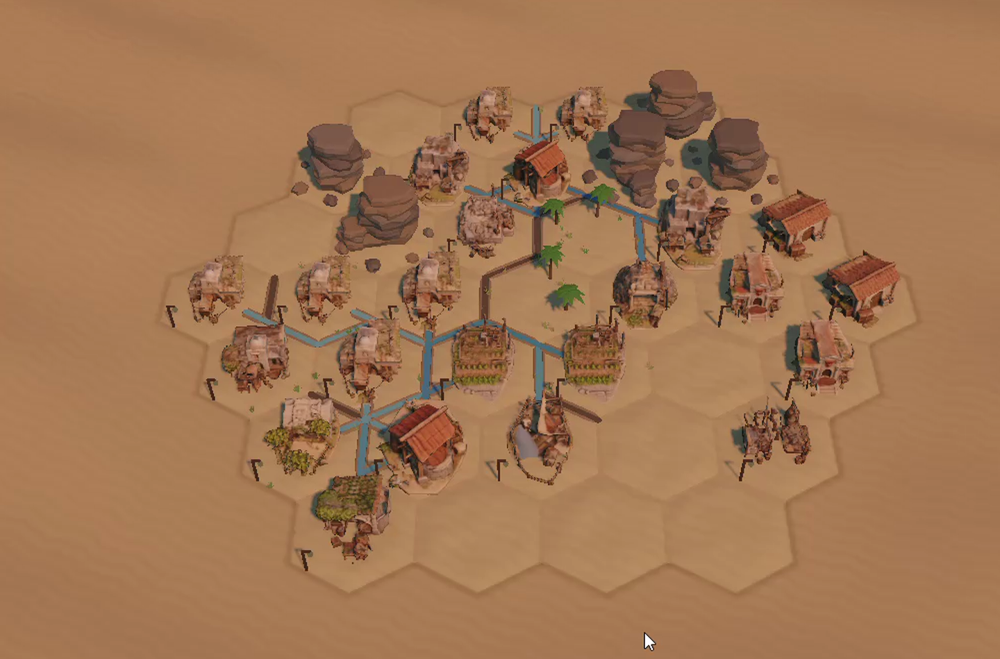

Desert Flavor는 반경 3~7의 배경 헥스 타일 맵 위에서 진행되는, 물이 귀한 사막에서 우물과 수로를 이용해 한정된 물을 필요한 시설에 공급하며 정착지를 성장시켜야 하는 실시간 건설 경영 시뮬레이션입니다. 헥스 타일 맵의 육각형 칸 안에 시설을 짓고, 육각형 외곽선을 따라 수로를 파서 우물로부터 물을 시설로 끌어와 움직입니다. 물은 먼저 닿는 시설에 우선적으로 공급되기 때문에 시설 위치와 수로 방향 설정의 설계가 매우 중요해집니다.

물 이외에 일반적인 건설 경영 시뮬레이션과는 다른 점은 Desert Flavor에는 성장시킨 정착지를 경매에 넘기고 보너스 모디파이어와 자금으로 바꾼 다음 정착지를 처음부터 다시 키우는 순환 구조 설계입니다. 이런 구조를 만든 의도는 일반적인 경영·건설 시뮬레이션에서 자원 병목이 모두 풀려 긴장감이 사라지는 후반부를 잘라 내는 데에 있었습니다. 테스터 평가에서 이 구조가 신선하고, 새로운 도전을 할 수 있어서 좋았다는 의견들로 이 시도의 가능성을 확인할 수 있었습니다.

개발은 AI 에이전트가 구현을 맡고, 저는 기획·규칙 결정·플레이테스트·검증을 맡는 방식으로 진행했습니다.

이 문서에서는 아래 네 기능의 설계 의도와 구현에 관한 문제를 다룹니다.

| 기능 | 부딪힌 문제 | 이렇게 풀었다 |
|---|---|---|
| [절차 맵 생성](#4-절차-맵-생성-예시-맵을-그려-ai에게-생성-규칙을-전달했다) | 단순 무작위 배치는 진행할 수 없는 맵을 만들고, 구획 결합은 결합 로직이 복잡함 | 배치 규칙과 직접 그린 예시 맵을 AI에 함께 전달하고, 검사를 통과한 맵만 씀 |
| [건설 착공](#5-건설-착공-명령한-시각에-바로-착공한다) | 1시 1분에 명령해도 1시 59분에 명령해도 2시 정각에 착공됨 | 정산은 정각에 한 번 하고 건설은 명령한 분에 시작함. AI의 비추천을 뒤집은 결정 |
| [주민](#6-주민-추상-수치를-눈에-보이는-원인으로-바꿨다) | 시설이 식량을 먹고, 전염병은 효율 감소 수치로만 나타남 | 주민이 먹고 마시고 일하며, 아프면 일을 못 함 |
| [경매와 입찰자 모디파이어](#7-경매와-입찰자-모디파이어-최고가와-원하는-보상-사이에서-고른다) | 판 돈으로 장비를 사면 정답 장비가 굳고, 경매는 최고가에 팔면 끝남 | 입찰자마다 다른 영구 모디파이어를 내밀고, 효과는 곱으로 쌓되 최대 중첩을 둠 |

## 2. 플레이 과정

### 2.1 코어 루프


캠페인은 첫 정착지에서 시작합니다. 새 정착지는 일시정지 상태로 열리며, 시간이 흐르기 전에 맵을 먼저 살펴볼 수 있습니다. 두 번째 정착지부터는 규칙에 따라 맵을 절차 생성합니다.

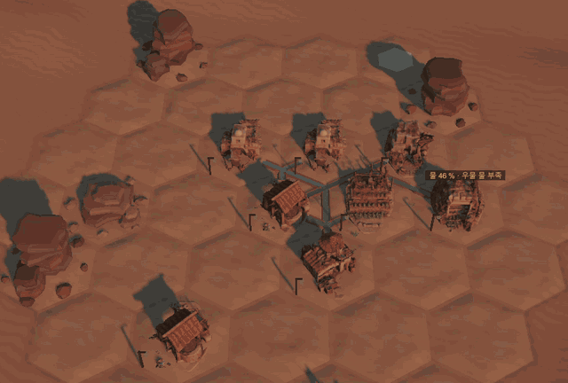

플레이어는 아래 UI에서 우물을 선택해 수원, 즉 샘이 위치한 타일에 배치하여 물을 퍼내면서 정착지 건설을 시작합니다. 우물에서 시설까지 육각형 변을 따라 수로를 설치하면 시설들이 작동하기 시작합니다. 주택은 가장 중요한 시설 중 하나로, 이곳에 이주해 들어온 주민들은 식량을 소비하는 대신 식량을 생산하는 농장, 건설 자재를 생산하는 채석장, 정착지의 가치 평가에 가장 중요한 광산 등에서 일하게 됩니다. 즉, 시설을 유지하기 위해서는 물과 주민이 필요하고, 주민을 유지하기 위해서는 식량이 필요하며, 식량과 물을 공급하기 위해서는 시설을 유지해야 하는 경제 사이클이 형성되는 것입니다.

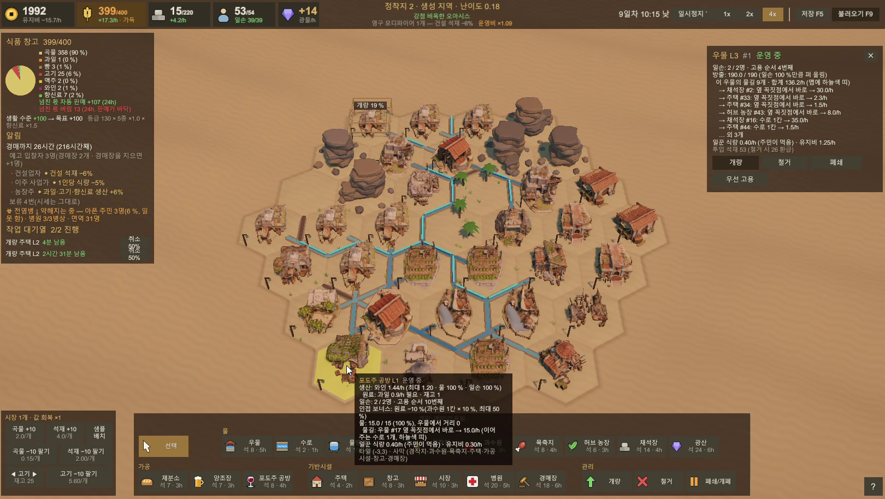

정착지에 도착한 후 72시간이 지나면 첫 정기 경매가 열리며, 참여한 입찰자들은 저마다 다른 보너스 및 모디파이어, 그리고 서로 다른 가치 평가 기준에 따라 계약금을 제시합니다. 플레이어는 그 중 한 명을 골라 자신이 건설한 정착지를 판매할 수 있습니다. 정착지를 팔면 더 어려운 다음 정착지로 넘어가게 되며, 정착지를 더 비싸게 판매하기 위해 경매를 거절하면 36시간 뒤에 경매가 다시 열립니다. 자금이 0 이하가 되면 긴급 매각 경매가 열리고(광산이 없으면 바로 파산), 이를 보류한 채 24시간이 지나면 파산합니다. 이론상 무한히 다음 정착지로 넘어갈 수 있지만 난이도가 계속 오르기 때문에 언젠가는 파산하도록 설계되었습니다.

### 2.2 핵심 질문과 설계 원칙

> 정착지를 어느 순서대로 개발하고, 언제 매각할 것인가?

이 게임의 기획은 사막이라는 배경에서 물, 식량, 시간, 공간 등의 자원이 모두 제한적인 상황을 전제로 출발했고, 이것을 규칙 → 상호작용 → 경험 순으로 풀었습니다. 게임 내의 핵심 자원인 물을 예시로 들면, "우물과 수로로 가깝게 이어진 시설부터 물을 공급받는다"라는 게임 규칙은 "새 광산 쪽으로 수로를 늘렸더니 농장에 가던 물이 줄었다"는 상황을 만들고, 이는 플레이어에게 "농장 일부를 포기할지, 우물과 수로에 더 투자할지"를 고민하게 만드는 경험을 제공합니다. 이런 흐름 기반의 경험 설계는 시설 건설부터 경매까지 게임 전반에 걸쳐 적용됩니다.

그러나 자원의 희소함을 극복해야 할 요소로 설정하면서도, 단순히 자원을 최적화하는 전략보다는 선택과 대가를 플레이어의 주된 고민으로 만들고자 하는 설계 원칙을 끝까지 유지하고자 했습니다. 광산만 짓는 전략, 지원시설만 짓는 전략, 경매 직전에 가동하지 않는 시설을 몰아 짓는 전략 등의 우회법은 자원의 상호 의존적 구조와 예기치 못한 재난 등으로 특정 자원 생산을 차단하여 제한하되, 정착지를 어느 쪽으로 특화시켜 개발할지는 플레이어의 자유에 맡깁니다. 정착지 가치를 "광업 기본 가치 × 식량·석재·기반시설 배율"로 산정하고 입찰자마다 이 배율에 서로 다른 가치 평가 비중을 적용한 것도 같은 이유입니다.

## 3. 코드 구조

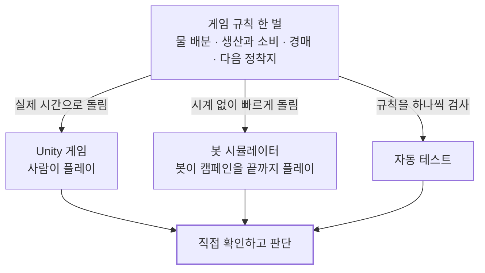

시뮬레이션 구현 검증을 위한 AI 테스트 검증 구조를 구축하기 위해 게임 규칙은 한 곳에 모으고, Unity 게임과 봇 시뮬레이터와 자동 테스트가 그 규칙을 그대로 가져다 쓰게 나눴습니다. 봇이 게임과 같은 규칙으로 캠페인을 끝까지 여러 번 플레이하게 하려는 구조입니다. 이에 대해서는 10.3 단락에서 더 자세히 다루겠습니다.

### 3.1 같은 Core를 Unity와 시뮬레이터가 함께 이용 : 어셈블리와 호출 관계

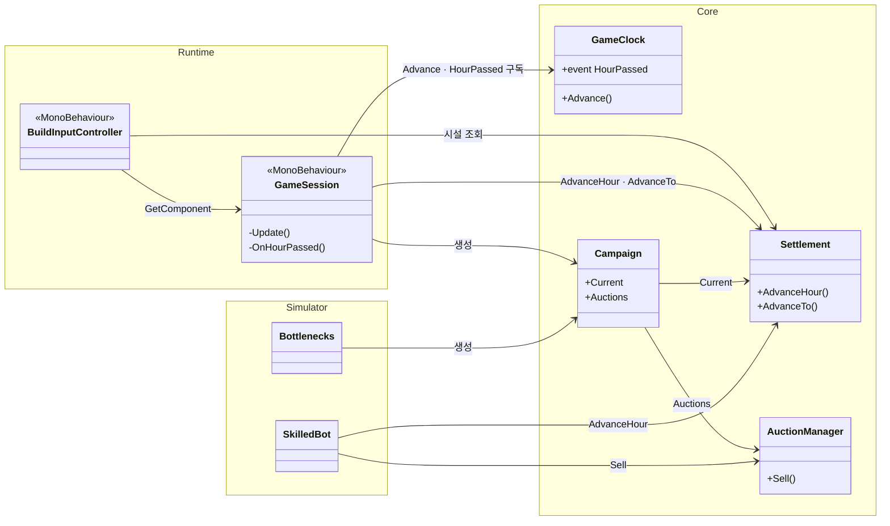

코드는 어셈블리 정의(asmdef)로 세 덩어리로 나뉩니다.

| 어셈블리 | 들어 있는 것 | 참조하는 것 | Unity 엔진 참조 |
|---|---|---|---|
| `DesertSettlement.Core` | 헥스 좌표·수로·물 배분·설정·경제(`Settlement`)·경매(`AuctionManager`)·캠페인(`Campaign`)·게임 시계(`GameClock`) | 없음(Newtonsoft.Json만) | 막음(`noEngineReferences: true`) |
| `DesertSettlement.Runtime` | 진입점(`GameSession`)·입력(`BuildInputController`)·화면(View·UI) | Core · Input System · Cinemachine · UGUI | 씀 |
| `SettlementSim` (.NET 10 콘솔, Unity 밖) | 봇(`SkilledBot` 등)과 측정 모드(`Bottlenecks` 등) | Core 폴더의 소스 파일을 그대로 링크(Timing 폴더 제외) | 없음 |

**Core는 Unity를 모릅니다.**  
Core 어셈블리는 `noEngineReferences: true`로 Unity 엔진 참조가 막혀 있고, 그 안의 `Settlement`·`Campaign`·`AuctionManager`·`GameClock`은 `MonoBehaviour`가 아닌 순수 C# 클래스입니다. 물을 나누고, 생산·소비·유지비를 정산하고, 경매를 열고, 다음 정착지를 만드는 규칙이 모두 여기에 있습니다.

**Runtime은 Core에 시간과 입력을 넣는 역할입니다.**  
진입점인 `GameSession`(`MonoBehaviour`)은 시작할 때 설정 JSON과 맵 파일로 `Campaign`을 만들고, 매 프레임 `Update()`에서 `Time.unscaledDeltaTime`을 `GameClock.Advance()`에 넘깁니다. 게임 시계가 정각을 넘으면 `HourPassed` 이벤트를 받아 `Settlement.AdvanceHour()`로 한 시간을 정산하고, 정각 사이에는 `AdvanceTo()`로 분 단위 시각만 따라갑니다. 건설 입력을 받는 `BuildInputController`도 같은 `GameSession`을 거쳐 지금 정착지를 조회합니다. Unity 쪽 클래스는 순수 C# 객체를 불러 쓰기만 하고, 반대 방향의 참조는 없습니다.

**시뮬레이터는 같은 Core를 시계 없이 돌립니다.**  
`Tools/SettlementSim`은 Unity 밖의 .NET 콘솔 프로그램으로, 프로젝트 파일(`SettlementSim.csproj` 13~19행)에서 Core 폴더(Hex·Canal·Water·Config·Economy·Auction·Progression)의 소스를 폴더째 링크합니다. 실시간을 게임 시간으로 바꾸는 Timing(`GameClock`)만 빼고, 봇이 `Settlement.AdvanceHour()`를 직접 반복해 부르고 경매에서는 `AuctionManager.Sell()`을 부릅니다. 그래서 봇은 게임과 **같은 소스의 규칙**으로 캠페인을 끝까지 플레이합니다. EditMode 테스트 어셈블리도 게임 코드 중에서는 Core만 참조해 같은 규칙을 검사합니다.

조정할 수치는 설정 JSON(`Assets/Data/Config/`)이나 인스펙터에만 두고 코드·문서에는 키 이름만 적게 해, 수치를 바꿀 때 코드를 건드리지 않게 했습니다.

### 3.2 캠페인과 정착지 규칙 (Core)

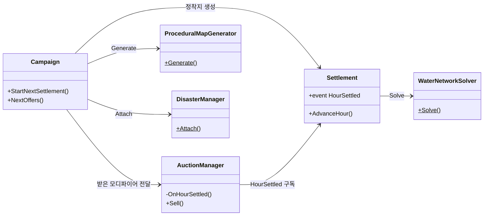

Core 안에서는 `Campaign`이 한 판 전체를 이끕니다. 새 정착지를 만들 때 절차 맵 생성기(`ProceduralMapGenerator`)로 맵을 만들고 재해를 붙이고 지금까지 받은 모디파이어를 경매에 넘깁니다. `Settlement`는 매시간 물 배분(`WaterNetworkSolver`)과 생산·소비를 정산한 뒤 `HourSettled` 이벤트를 냅니다. `AuctionManager`가 그것을 받아 경매를 열지 판단합니다.

이 구조를 고른 이유와, 봇 시뮬레이터가 실제로 어디까지 쓸모 있었는지는 후술할 AI와 협업한 방식에서 다룹니다.

## 4. 절차 맵 생성: 예시 맵을 그려 AI에게 생성 규칙을 전달했다

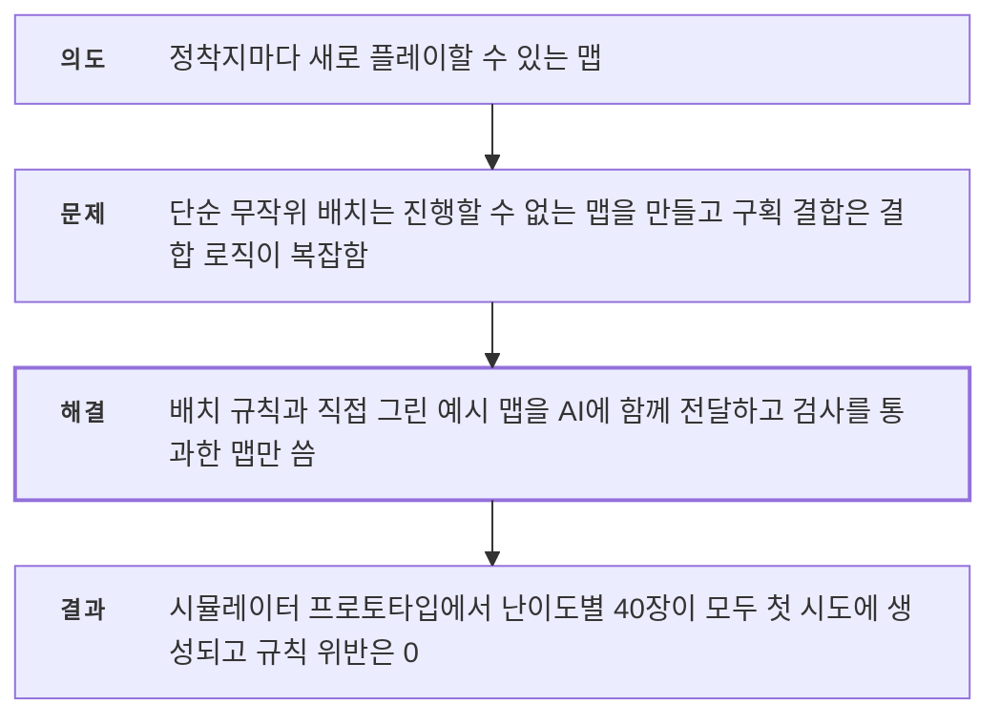

정해진 맵이 아니라, 파산할 때까지 계속해서 어려워지는 다음 정착지를 계속 플레이하는 구조였기에 매 정착지마다 새 맵이 필요했습니다.

### 4.1 규칙과 예시 맵을 함께 전달하기

먼저 검토한 두 방식에는 각각 한계가 있었습니다. 단순 무작위 배치는 길이 막히거나 우물이 없어서 게임을 진행할 수 없는 시드도 만들어 냈습니다. 미리 조립한 구획들을 결합하는 방식은 안정적이지만 어떤 구획이 나와야하는지, 다른 구획과는 어떤 규칙에 따라 결합해야 하는지 등의 로직을 설정하기가 복잡했습니다.

그래서 배치 규칙은 제가 직접 정하고, 그 규칙을 글로만 넘기지 않고 맵 스케치 편집기로 그린 예시 맵과 **함께 AI에 전달**했습니다. 규칙(글)과 예시 맵(그림)을 함께 주는 멀티모달 방식으로 AI가 더 나은 생성 로직을 구성하게 하려는 것이었습니다. 편집기 구현은 AI가 맡았고 이를 이용해 제가 생각하는 규칙이 반영된 예시 맵을 찍어낼 수 있었습니다.


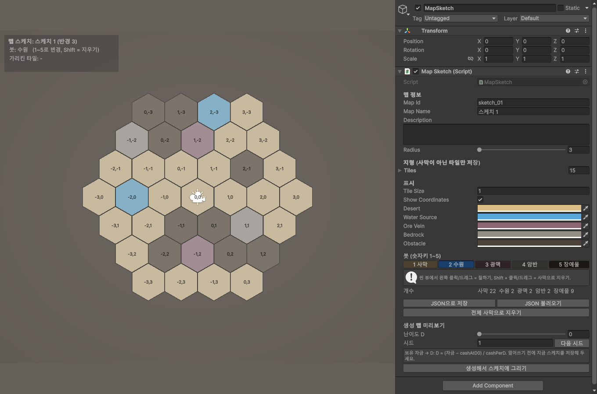

맵 스케치 편집기에서는 Unity 씬 뷰의 헥스 타일을 클릭·드래그로 칠합니다(숫자키 1~5 = 사막·수원·광맥·암반·장애물, Shift = 지우기). 저장 형식이 캠페인 맵과 같은 JSON이라 AI가 예시의 좌표·지형을 그대로 읽어 확인할 수 있습니다. 편집기에는 '생성 맵 미리보기'(난이도 D·시드)도 더해 예시를 그린 화면에서 생성 결과를 바로 비교하게 했습니다.

예시 맵과 함께 전달한 생성 규칙은 다음 네 가지입니다.

1. **장애물** : 분리된 지형마다 **산맥(선)** 또는 **고원(덩어리)** 중 하나를 선택. 다른 장애물 지형과 이어져 맵을 가로막으면 안 되고, 15% 확률로 독립된 한 칸 짜리 장애물이 생성될 수 있다.
2. **광맥** : 난이도 수치에 반비례한 수 만큼 생성되며, 90% 확률로 장애물 근처에 생성되도록 한다.
3. **암반** : 90% 확률로 이미 놓인 장애물 칸을 대신한다.
4. **우물(수원)** : 난이도 수치에 반비례한 수 만큼 생성되며, 사막 위에 한 칸씩 놓고 반경 2 안에는 다른 우물을 두지 않는다.

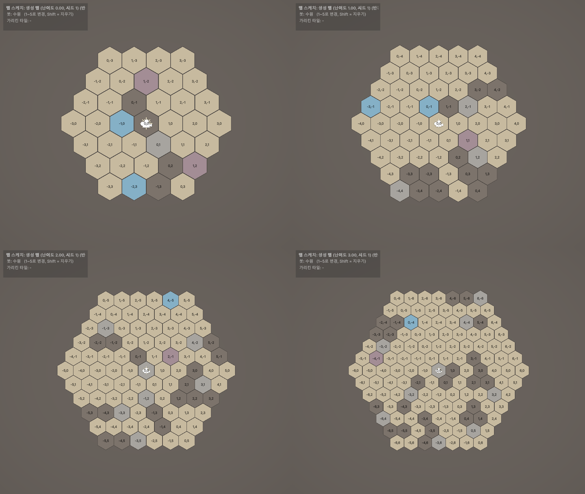

난이도가 오를수록 맵은 커지고 우물·광맥은 줄어듭니다(위 그림). 세부 수치(지형 3~6칸, 산맥/고원 50:50, 산맥 60° 꺾임 25%, 지형끼리 최소 1칸 간격 등)는 AI가 제안한 값을 제가 확인해 확정했습니다.

### 4.2 항상 플레이할 수 있는 맵을 만드는 방법

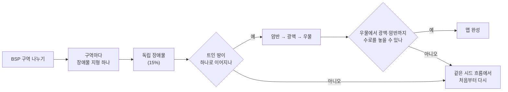

이 규칙을 받아 AI가 구성한 로직은 두 부분으로 나뉩니다. 규칙을 **만드는 동안 지켜야 할 부분**과 **만든 뒤 검사로 걸러 내는 부분**입니다. 예를 들어 장애물 지형끼리 이어져 맵을 가로막지 않도록 맵을 만들기 위해서는 맵을 이진 공간 분할(BSP)로 나누고 **구역마다 장애물 지형을 하나만** 생성하고, 개활지가 서로 연결되어 있는지 한 번 더 검증을 거치는 것입니다. 이 규칙과 검증을 거쳐 내놓는 맵은 항상 플레이할 수 있습니다.

`ProceduralMapGenerator.cs` 98~114행

```csharp
public static GeneratedMap Generate(DifficultyParams p, GeneratorRules rules, int seed)
{
    var rng = new DeterministicRandom(seed);
    for (int attempt = 1; attempt <= rules.MaxAttempts; attempt++)
    {
        GeneratedMap result = TryGenerate(p, rules, rng);
        if (result == null) continue;
        result.Seed = seed;
        result.Attempts = attempt;
        result.Params = p;
        result.Map.Id = string.Format(CultureInfo.InvariantCulture, "gen_d{0:0.00}_s{1}", p.D, seed);
        result.Map.Name = string.Format(CultureInfo.InvariantCulture, "생성 맵 (난이도 {0:0.00}, 시드 {1})", p.D, seed);
        result.Map.Description = p.ToString();
        return result;
    }
    return null;
}
```

`TryGenerate`가 어느 단계에서든 실패하면 `null`을 돌려주고 같은 난수 흐름으로 다음 시도를 합니다(최대 `MaxAttempts`번). 몇 번째 시도에 만들어졌는지(`Attempts`)도 결과에 남깁니다. 난수는 시드로 만들기 때문에 같은 시드면 Unity와 시뮬레이터가 같은 맵을 만듭니다.

`ProceduralMapGenerator.cs` 139~140 · 167~168 · 239~245행

```csharp
bool Allowed(HexCoord c) => leafSet.Contains(c) && !owner.ContainsKey(c) &&
                            Neighbors(c).All(n => !owner.TryGetValue(n, out int o) || o == id);
// (중략)
if (!OpenLandConnected(all, inMap, terrain)) return null;
// (중략)
HexMap hex = map.CreateMap();
var topology = new HexTopology(hex);
int oreDist = CanalPaths.ShortestPathLength(topology, hex, wells, ores);
int rockDist = CanalPaths.ShortestPathLength(topology, hex, wells,
    all.Where(c => terrain[c] == TerrainType.Bedrock).ToList());
if (oreDist < 0 || rockDist < 0) return null;
```

장애물 지형은 자기 구역 안에서 다른 지형과 맞닿지 않는 칸으로만 확장됩니다. 그래서 지형끼리 이어져 맵을 가로막는 장벽이 생기지 않습니다. 그래도 막히는 경우를 위해 장애물이 아닌 땅이 하나로 이어져 있는지 한 번 더 검사합니다. 마지막으로 수로 규칙(양쪽이 장애물인 변에는 수로 불가) 아래에서 우물 → 광맥, 우물 → 암반 경로를 찾고 없으면 그 맵을 버립니다.

그 결과 시뮬레이터 프로토타입에서 난이도별 40장이 모두 첫 시도에 생성되었고 규칙 위반은 0이었습니다.

## 5. 건설 착공: 명령한 시각에 바로 착공한다

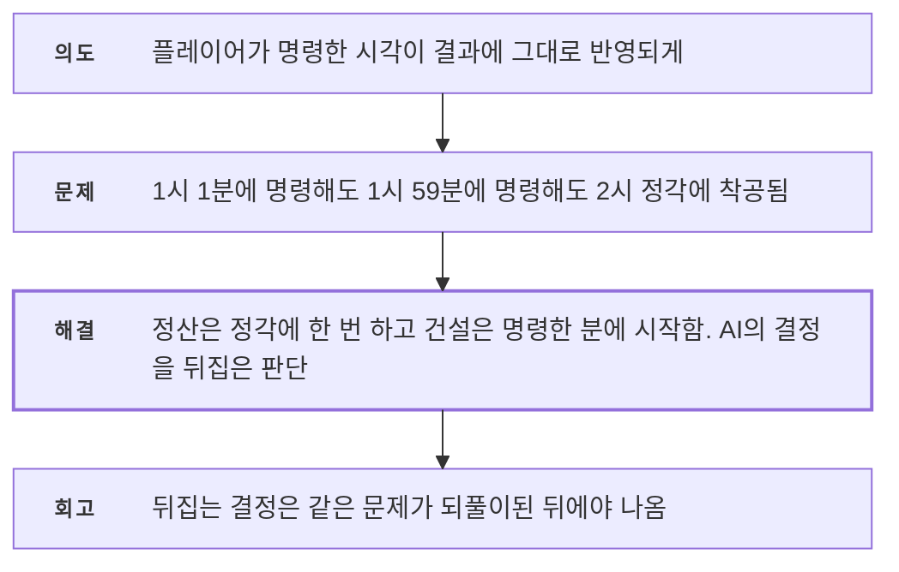

플레이어가 시설을 지을 때 처음에는 건설이 시간 단위로 처리되어 1시 1분에 짓든 1시 59분에 짓든 2시 정각에 착공되었습니다. 플레이어가 언제 명령했는지가 결과에 반영되지 않아 재미·직관성·합리성을 떨어뜨린다고 판단했습니다.

### 5.1 AI의 '비추천'을 따랐다가 뒤집기까지


12:30에 5시간짜리 건설을 명령했을 때 착공·완공 시각은 다음처럼 바뀌어 왔습니다.

| 단계 | 착공 | 완공 | 실제 공사 시간 |
|---|---|---|---|
| 처음(다음 정각 착공) | 13:00 | 18:00 | 5.5시간 |
| 10/26 타협안 | 12:30(지난 30분을 첫 1시간으로 셈) | 17:00 | 4.5시간, 진행률이 처음부터 차 있음 |
| **11/03 최종 채택안** | **12:30** | **17:30** | **5시간** |

10/26 플레이테스트에서 "명령 후 1시간이 아니라 즉시"라는 의견이 나왔습니다. AI는 분 단위 진행은 경제 틱과 저장(명령 기록 재실행)을 바꿔야 해서 비추천한다며 타협안을 냈습니다. 명령한 순간 착공하되 진행 중인 시간을 첫 1시간으로 세는 방식입니다.

10/27 플레이테스트에서는 여전히 정각에만 건설이 시작되는 것처럼 보였는데, 이것은 보이는 것과 실제 규칙이 달라서 생긴 문제였습니다. 이미 명령한 순간 착공이 시작되지만 화면의 진행률 계산은 예전의 정각 착공을 가정하고 있었고 규칙 테스트는 통과한 상태였습니다. AI 개발에서 자주 발생하는 실수인 **테스트는 통과했지만 화면이 의도와 달랐던 경우**였습니다.  AI는 이런 것을 문제라고 판단하지 않기 때문에, 사람이 직접 플레이테스트를 거치고 코드를 읽어야만 찾을 수 있는 문제였습니다.

이어서 11/03 플레이테스트에서는 타협안의 부작용이 드러났습니다. 공사 게이지가 처음부터 10% 이상 차 있었고 대기 공사는 1시간을 그대로 기다렸다 시작했습니다. 이처럼 명령한 시각과 실제 공사 시간이 어긋나 보이는 문제가 플레이테스트마다 모양을 바꿔 계속 나왔습니다. 그래서 저는 이것을 **비용 때문에 타협할 수 없는 핵심 플레이 경험 방해 요소**로 보고 보이는 것과 실제 규칙을 직관적으로 연결한 분 단위 착공 방식으로 바꿨습니다.

### 5.2 정각 정산과 분 단위 진행 나누기

시간은 두 곳이 나눠 맡습니다. `GameClock`은 실제 시간을 게임 시간으로 바꾸고 정각마다 `HourPassed`를 내며, `Settlement.TimeSource`는 그 게임 시계를 읽는 함수입니다. 건설 명령이 들어오면 정착지가 먼저 이 시각까지 따라간 뒤(`AdvanceTo`) 지금 시각(`Now` = 시 + 분 ÷ 60)에 착공합니다.

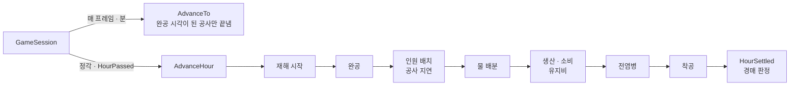

그림처럼 분 단위로 따라가는 길(`AdvanceTo`)은 공사 완공만 처리하고 물·생산·돈은 정각 한 번(`AdvanceHour`)에만 계산됩니다.

`GameSession.cs` 132~146행

```csharp
private void OnHourPassed(GameTimeStamp _)
{
    if (AcceptsWorldInput) Settlement.AdvanceHour();
}

private void SyncSettlementClock()
{
    if (Settlement == null) return;
    Settlement.TimeSource ??= () => Clock.ElapsedHours;
    if (AcceptsWorldInput) Settlement.AdvanceTo(Clock.ElapsedHours);
}
```

정각 정산(`AdvanceHour`)과 분 단위 진행(`AdvanceTo`)을 두 갈래로 나눈 것은 AI이고 저는 '명령 시각 + 공사 시간에 정확히 완공'이라는 기준을 정했습니다. 그래서 경제 계산 단위(1시간)는 그대로 두고 공사 시각만 분으로 정밀해졌습니다. 경매가 열려 있으면(`AcceptsWorldInput`이 false) 둘 다 멈춥니다.

`Settlement.cs` 49~56행

```csharp
public int Minute { get; private set; }
public double Now => CurrentHour + Minute / 60.0;
public Func<double> TimeSource { get; set; }
```

정착지는 시(`CurrentHour`)와 분(`Minute`)을 따로 들고 착공·완공 시각은 둘을 합친 `Now`로 셉니다. 시계를 정착지 안에 두지 않고 읽는 함수(`TimeSource`)만 받기 때문에 시뮬레이터·테스트에서도 같은 Core 규칙이 돕니다. 이것이 Unity 시계 없이도 게임 내 시간의 흐름에 따른 변화를 시뮬레이션할 수 있었던 이유입니다.

`Settlement.Tick.cs` 19~28 · 141~146행

```csharp
public HourRecord AdvanceHour()
{
    long h = CurrentHour;
    Disasters?.BeginHour(h);
    CompleteJobsUntil(h + 1);
    LastLabor = AssignLabor();
    SlowJobs(h);
    if (!Rules.StartJobsOnCommand) StartJobs(h + 1, h);
    LastLabor = AssignLabor();
    WaterAllocation water = SolveWater();
    // (중략)
    Disasters?.EndHour(h);
    CurrentHour = h + 1;
    Minute = 0;
    if (Rules.StartJobsOnCommand) StartJobs(Now, h);
    HourSettled?.Invoke(record);
```

정각 정산은 위 그림의 순서대로 한 시간치를 계산합니다. 인원 배치(`AssignLabor`)가 두 번인 것은 공사 인원을 먼저 뽑고 완공·착공을 반영해 시설 인원을 다시 나누기 때문입니다. 이번 정산에서 생산된 석재로 대기 공사를 그 정각에 바로 착공(`StartJobs(Now, h)`)해 "석재가 다 찬 것이 보이는데 한 시간을 기다리는" 문제도 없앴습니다. `StartJobsOnCommand`를 끄면 원본 v0.8 규칙(기획 단계 경제 계산표의 정각 착공)으로 돌아갑니다. 예전 밸런스와 비교하는 회귀 검사용 스위치입니다.

**단, 생산까지 분 단위로 나누지는 않았습니다.**

경제 정산은 여전히 정각마다 한 시간씩 하고 완공한 시설은 완공 시각이 든 시간의 생산부터 냅니다. 그 시간의 생산을 분 비율로 나누는 안이 더 정확하지만 물·일손 등 모든 시간 참조 변수들까지 바꿔야 해서 채택하지 않았습니다.

>(D=난이도 계수) D0~1 +1370 → +1379, D3~4 +291 → +285

바꾸기 전과 후의 숙련 봇 캠페인에서 정착지 순이익은 거의 같았습니다. 다만 봇은 정각에만 명령하므로 이 측정으로 확인한 것은 정각 명령의 결과가 거의 그대로라는 것뿐입니다. 분 단위 착공 자체의 영향은 확인하지 못했습니다.

## 6. 주민: 추상 수치를 눈에 보이는 원인으로 바꿨다

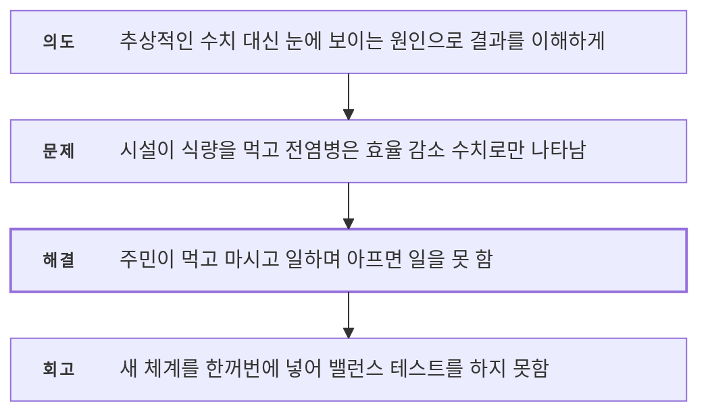

시설을 지었으면 그 시설을 돌릴 사람도 필요합니다. 이 장은 기획에서 구상했다가 초기 구현에서 제외했던 주민 시스템을 다시 채택하게 된 이야기입니다. 같은 기준을 가공 시설과 전염병에도 적용해 세 규칙을 바꿨습니다.

| 규칙 | As-Is | To-Be |
|---|---|---|
| 식량·물 소비 | 시설이 식량을 먹음, 식량이 부족하면 전역 식량 계수 F가 떨어짐 | 주민이 먹고 마심, 물 또는 식량이 부족하면 주택에서 주민이 떠나고 노동력도 줄어듦   |
| 가공 시설 | 수로 없이도 작동 | 물을 사용하게 만들되 가공품 효용을 상향       |
| 전염병 | 심각도만큼 생산 시설 효율 감소 | 주민이 아프면 일을 못 하고 집·병원에서 회복 후 복귀   |

### 6.1 노동력: 기획서의 확정 결정을 뒤집다


처음 기획에서는 인구·노동력을 빼고 시설이 식량과 물을 요구하게 했습니다. 그런데 플레이해 보니 시설이 식량을 먹는다는 규칙이 직관적이지 않았고, 게임 경험도 너무 정적으로 느껴졌습니다. 그래서 **기획서의 "인구/노동력 [확정]: 삭제" 판단을 철회하고** 노동력을 모으고 관리하는 체계로 바꿨습니다.

주민에 대한 규칙은 주택·생활 수준·일터 세 가지로 이루어집니다.

- **주택** : 수로를 통해 물을 공급받고 식량이 충분하면 주민이 정원을 다 채울 때까지 조금씩 이주해옵니다.
- **생활 수준**(−100~100) : 주민이 소비하는 식량의 종류가 다양하고 등급이 높을수록 올라갑니다. 곡물은 기본값이라 아무 영향을 주지 않는 반면, 빵·고기 같은 상위 재화 등은 생활 수준을 올리며, 향신료는 상위 재화가 생활 수준에 미치는 효과를 강화합니다. 생활 수준이 높으면 주민이 더 빨리 이주해 오고 물·식량이 모자랄 때 떠나는 속도는 느려집니다. 물·식량이 모자라면 생활 수준 자체도 떨어집니다.
- **일터**(우물·농장·채석장·광산 등) : 필요 인원 대비 배치된 인원 비율만큼 가동합니다. 즉, 5명이 필요한 시설에 4명만 있다면 80% 효율로 가동합니다.

`Settlement.Tick.cs` 80~88 · 109~113행

```csharp
if (Rules.LaborOn) demand = (Residents + Rules.BaseCrew) * FoodPerResident;
var eaten = new double[GoodsCatalog.All.Length];
double fed = Eat(demand, eaten);
double drinkDemand = Rules.LaborOn ? Residents * Rules.Labor.DrinkPerResidentPerHour : 0;
double drunkTotal = Drink(drinkDemand, eaten);
double deficit = Math.Max(0, demand - fed);
double foodRatio = demand > 0 ? Math.Min(1, fed / demand) : 1;
FoodSatisfaction = foodRatio;
// (중략)
if (Rules.LaborOn)
{
    UpdateLiving(eaten, foodRatio, water);
    UpdateResidents(water, foodRatio);
}
```

`Rules.LaborOn`은 노동력 규칙을 켜고 끄는 스위치입니다. 끄면 노동력이 없던 원본 v0.8 경제와 비교할 수 있습니다. 노동력이 켜지면 식량 수요는 (주민 + 기본 인부) × 1인당 식량이 되어 시설이 아니라 사람이 식량을 먹습니다. 과거 규칙을 조건부로 남겨둔 이유는 두 규칙을 모두 같은 조건에서 테스트하며 밸런스를 잡아야했기 때문입니다.

기본 인부(`BaseCrew`)는 건설 슬롯마다 주어지는 인원입니다. 처음 정착지에 도착했을 때 주민이 0명이므로, 기본적으로 일할 노동력이 필요했기 때문에 예외를 둔 것입니다.

### 6.2 가공 시설도 물을 사용

플레이테스트 중 "포도주 공방은 왜 수로가 없어도 작동하는지"에 대한 의문이 나왔습니다. 어떤 시설은 물을 쓰고 어떤 시설은 안 쓰는 것이 직관적이지도 않고 개연성도 없다고 판단해 가공 시설도 물을 쓰게 했습니다.

단 물이 빠듯한 정착지에서는 물 비용이 그대로 손해가 되어 가공 시설을 지을 이유가 사라집니다. 그래서 가공품의 생활 수준·식량 효율·판매가를 함께 올렸습니다. 밸런스 조정에 필요한 데이터는 시뮬레이터의 '시설 하나 더 짓기'(`-- qa marginal`)로 측정했고, 이 데이터를 밸런스 조정에 활용했습니다. 생성 맵 D0.5~3.5에서 제분소를 하나 더 지었을 때 짓지 않은 같은 맵보다 첫 경매 뒤 최종 자금(매각가 + 남은 재화를 판 현금)이 얼마나 많은지 비교했습니다.

| 제분소 하나를 더 지었을 때 늘어난 최종 자금 | 물이 빠듯할 때 | 물이 넉넉할 때 |
|---|---|---|
| 바꾸기 전 | +116 | +185 |
| 물만 쓰게 함 | −212 | +190 |
| **물 + 효용 상향(채택)** | **−93** | **+464** |

### 6.3 전염병과 병원 회복 배율

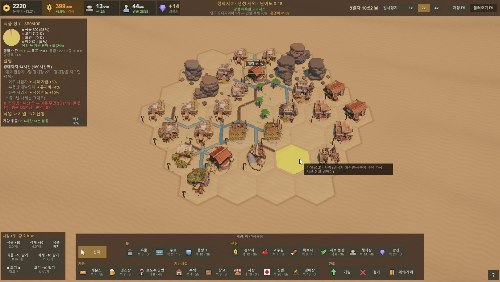

게임 도중 랜덤으로 나타나는 재해 중 하나인 전염병은 처음에 병의 강도와 전염도를 추상화한 수치인 **심각도**만큼 생산 시설의 효율이 떨어지는 규칙이었습니다. 주민 시스템을 다시 채택하면서 효율을 통째로 깎는 것보다 "주민이 아파서 일을 못 하고 있다"가 더 직관적이고 이해하기 쉽다고 판단해 모형을 바꿨습니다.


원본 `Disasters.cs` 315~321행 (`DisasterManager.EndHour` — 전염병 중이면 정각 정산 끝에 한 시간만큼 진행)

```csharp
double inHospital = Math.Min(Epidemic.Sick, beds);
double newCases = n > 1e-9 ? Math.Min(Epidemic.Susceptible, p.TransmissionPerHour * Intensity * _settlement.Rules.Effects.EpidemicTransmissionMultiplier * Epidemic.Susceptible * Epidemic.Sick / n) : 0;
double recovered = Math.Min(Epidemic.Sick,
    inHospital * p.HospitalRecoveryPerHour + (Epidemic.Sick - inHospital) * p.HomeRecoveryPerHour);
Epidemic.Sick = Math.Max(0, Epidemic.Sick + newCases - recovered);
// (중략)
Epidemic.Immune = Math.Min(n - Epidemic.Sick, Epidemic.Immune + recovered);
```

새 환자는 전파율 × 걸릴 수 있는 주민 × 아픈 주민 ÷ 전체 주민이고 회복은 병상에 든 환자 × 병원 회복률 + 나머지 × 집 회복률입니다. 회복한 사람은 면역으로 옮겨 갑니다. 전파율에 곱하는 `EpidemicTransmissionMultiplier`는 입찰자 모디파이어(방역 장비: 전파율 ×0.85)가 들어오는 자리입니다. 11/03 장비 상점을 없앤 뒤 전염병을 줄이는 수단은 이 방역 장비와 병원 두 가지입니다. 전파율·집 회복·병원 회복은 모두 설정 JSON 값이라 아래 후보 비교도 코드 수정 없이 값만 바꿔 이루어졌습니다.

**병원 회복 배율은 왜 2배인가.**

병원은 전염병에서 **빨리 회복하기 위한** 것이지 **바로 끝내기 위한** 것이 아니었습니다. 테스트 결과 3~4배면 병원 몇 곳만으로 전염병 위협이 사실상 사라졌습니다.

전염병 전파 속도 및 병원 회복 속도 후보 (시뮬레이터 `-- epidemic sweep` 발췌)
>모든 비교군은 주민 20명 고정
>칸의 값 = 전염병 지속 시간 / 전염 최대 상태에서의 아픈 주민의 비율
>D1 맵 손해 = 생성 맵 15장에서 재해 없을 때보다 줄어든 순이익 중앙값)
| 후보 (병원 회복 ÷ 집 회복) | 병원 없음 | 병원 2병상 | 병원 4병상 | D1 맵 손해 |
|---|---|---|---|---|
| A 빠름 (약 4배) | 76h 41% | 29h 5% | 29h 5% | −198 |
| **F 센 전파 · 병원 2배(채택)** | **71h 47%** | **51h 31%** | **50h 22%** | **−264** |
| G 중간 · 병원 2배 | 97h 44% | 70h 28% | 70h 20% | −245 |
| H 아주 셈 · 병원 3배 | 67h 52% | 37h 24% | 36h 15% | −309 |

병원 회복 배율만 바꾼 재계산
> 칸의 값 = 최대 피해 / 전염 최대 상태에서의 아픈 주민의 비율 / 회복에 걸리는 시간
| 병원 회복 | 병원 없음 | 1곳 | 2곳 | 4곳 |
|---|---|---|---|---|
| **2배(채택)** | 100% · 47% · 71h | 50% · 25% · 50h | 43% · 22% · 50h | 43% · 22% · 50h |
| 3배 | 100% · 47% · 71h | 20% · 9% · 44h | 20% · 9% · 44h | 20% · 9% · 44h |
| 4배 | 100% · 47% · 71h | 8% · 5% · 31h | 8% · 5% · 31h | 8% · 5% · 31h |

병원의 회복 속도 배율을 3~4배로 늘리면 병원 1곳만으로 주민이 일을 못하는 시간이 20%·8%로 줄어 전염병이 사실상 퍼지지 못합니다. 2배면 병원을 아무리 지어도 피해가 43% 아래로 내려가지 않아 병원이 "회복을 빠르게" 하는 역할에 머물렀습니다. 이것이 의도한 병원의 역할에 맞다고 생각하고, 테스트 결과를 기반으로 수치 밸런스를 잡았습니다.

## 7. 경매와 입찰자 모디파이어: 최고가와 원하는 보상 사이에서 고른다

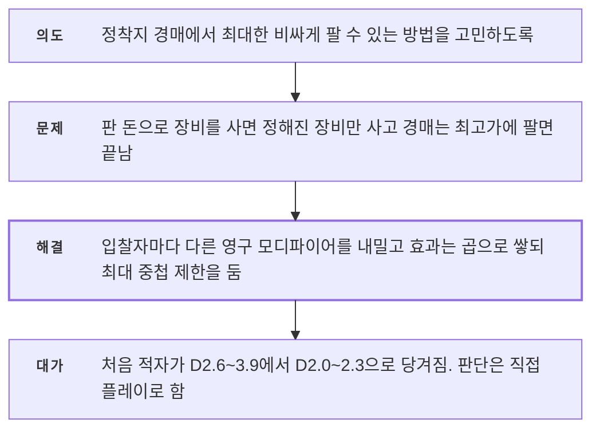

정착지가 어느 정도 성장하면 마지막 단계는 그 정착지를 경매에 파는 것입니다. 경매의 보상 방식은 아래처럼 두 번 바뀌었습니다.

| 보상 방식 | 장점 | 문제 |
|---|---|---|
| 장비 상점(바꾸기 전) | 원하는 장비를 골라 Lv3까지 강화 | 사는 장비가 정해짐, 경매는 최고가에 팔면 끝 |
| 입찰자 모디파이어 + 합연산 | 경매에서 값과 보상 사이 고민이 생김 | 한도 없이 감소형이 겹치면 건설 비용 −100%처럼 비상식적 수치가 나타날 수 있음         |
| **입찰자 모디파이어 + 최대 중첩 적용 곱연산(채택)** | 고민 유지, 0에 수렴하지 않음 | 한 번에 받는 효과가 장비보다 작아 중반에 버티는 힘이 줄어듦 |

### 7.1 상점 대신 입찰자 선택


정착지를 판 돈으로 장비를 사는 방식에서는 건설 슬롯·우물 방출량·광물 생산량 같은 직접적이고 직관적인 효과를 제공하는 장비가 정답처럼 굳었습니다. 경매도 가장 비싼 값을 부르는 입찰자에게 팔면 끝이라 단조로웠습니다. 그래서 로그라이크의 보상 선택 방식을 채택하여 입찰자마다 공용 / 고유 영구 모디파이어 중 하나를 랜덤으로 제시하게 만들었습니다. 그러자 높은 입찰가와 원하는 모디파이어 사이에서 선택을 고민할 지점이 생겼고, 이전에는 하나만 지으면 더 지을 필요 없던 경매장을 더 많이 지으면 경매에 참여하는 입찰자도 늘어나는 방식으로 바꾸어 효용도 살릴 수 있었습니다.

바꾼 직후 숙련 봇 측정에서는 처음 적자 시점이 D2.6~3.9에서 D2.0~2.3으로 당겨졌습니다. 다만 봇은 사람의 플레이를 따라가지 못하므로 "상점보다 낫다"는 판단은 직접 플레이한 감각과 동료 피드백("정착지 완성 → 경매 매각 → 영구 보너스 → 새 정착지" 루프가 재미있다)을 근거로 했습니다.

### 7.2 곱연산과 최대 중첩

모디파이어가 쌓이며 파산 전까지 점점 어려워지는 난이도를 플레이어가 각자의 방식으로 헤쳐 나가게 하고 싶었습니다. 처음에는 쌓이는 한도를 두지 않기로 했습니다(난이도 곡선으로 조절). 그러면 합연산에서는 감소형이 여러 번 겹쳐 비용이 0이 되는 등의 문제가 발생했습니다. 이것이 곱연산으로 계산 방식을 바꾼 이유로, 인접 보너스·생활 수준·지역 특성 같은 다른 배율도 곱으로 합치므로 계산 방식도 하나로 맞았습니다.

곱연산에도 남는 문제는 세기 낮추기와 최대 중첩으로 풀었습니다. 곱연산에서도 감소형은 여러 번 겹치면 0에 가까워집니다(×0.7 세 번 = ×0.34). 그래서 재해 피해형은 ×0.7 → ×0.8로 낮추고(세 번 = ×0.51) 3번까지만 겹치게 했습니다. 한도에 닿은 모디파이어는 더 뜨지 않으므로 고르는 폭도 유지됩니다.

`AuctionManager.cs` 297~313행

```csharp
private BidderModifierDefinition RollModifier(BidderModifierSettings mods, string bidderId)
{
    List<BidderModifierDefinition> available = mods.Definitions
        .Where(d => (_ownedCounts.TryGetValue(d.Id, out int n) ? n : 0) < mods.MaxStacksOf(d)).ToList();
    List<BidderModifierDefinition> own = available.Where(d => d.Pool == bidderId).ToList();
    List<BidderModifierDefinition> general = available.Where(d => d.Pool == BidderModifierSettings.GeneralPool).ToList();
    bool exclusive = _rng.NextDouble() < mods.ExclusiveChance;
    List<BidderModifierDefinition> pool = exclusive && own.Count > 0 || general.Count == 0 ? own : general;
    if (pool.Count == 0) return null;
    double r = _rng.NextDouble() * pool.Sum(d => d.Weight);
    foreach (BidderModifierDefinition d in pool)
    {
        r -= d.Weight;
        if (r < 0) return d;
    }
    return pool[pool.Count - 1];
}
```

캠페인에서 이미 최대 중첩 수만큼 받은 모디파이어는 입찰자가 더이상 들고 오지 않아 플레이어가 억울할 수 있는 부분을 사전에 차단했습니다.

### 7.3 경매에서 다음 정착지로

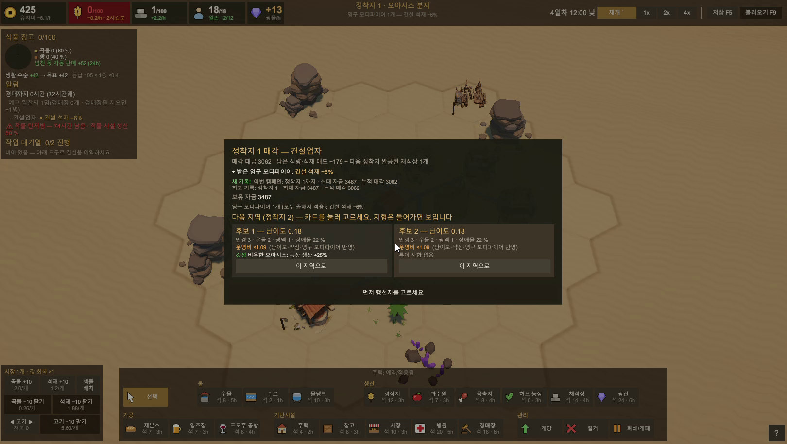

`Campaign.cs` 119~124 · 250~256행

```csharp
SettlementRules rules = SettlementRules.FromConfig(_config);
EconomyEffects owned = ModifierEffects;
rules.StartingCash = Cash * owned.StartingCashMultiplier;
rules.StarterFood += _pendingFoodBonus;
rules.ApplyEffects(owned);
foreach (RegionModifierDefinition m in CurrentModifiers) rules.ApplyEffects(m.Effects);
// (중략)
private void OnSold(SaleResult sale)
{
    Cash = sale.SettlementCash + sale.Bid.Cash;
    _pendingFoodBonus = sale.Bid.NextSettlementFoodBonus;
    _pendingFreeBuilds.Clear();
    foreach (KeyValuePair<string, int> kv in sale.Bid.NextSettlementFreeBuilds) _pendingFreeBuilds[kv.Key] = kv.Value;
    if (sale.Bid.Modifier != null) _modifiers.Add(sale.Bid.Modifier);
```

정착지를 팔면 그 입찰자의 모디파이어를 목록에 더합니다. 다음 정착지를 만들 때는 받은 모디파이어 전체(`ModifierEffects`, 곱으로 합침)와 지역 모디파이어(`CurrentModifiers`, 행선지마다 붙는 특성)를 규칙에 차례로 적용합니다. 입찰에는 영구 모디파이어 말고도 현금(`Bid.Cash`)과 다음 정착지에 한 번만 주는 식량·무료 건설(`_pendingFoodBonus`·`_pendingFreeBuilds`)이 함께 붙습니다.

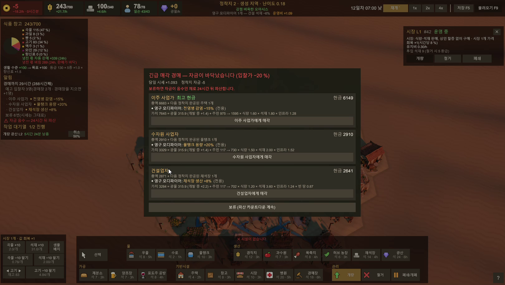

자금이 0 이하가 되면 광산이 있을 때는 입찰가 −20%의 긴급 매각 경매가 열리고 없으면 바로 파산합니다. 광산이 게임 내에서 플레이어가 채굴해야하는 핵심 목표이자, 입찰자들의 가치 평가 기준의 기본 배율 역할을 담당하기 때문입니다. 

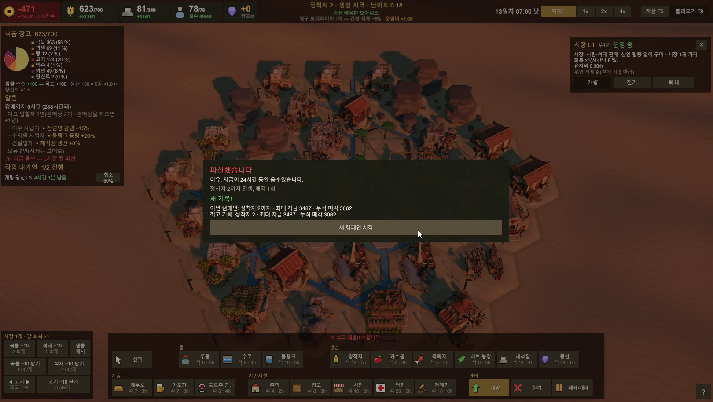

파산 카운트다운은 자금이 음수가 된 순간부터 셉니다. 긴급 매각을 보류해 자금이 음수인 채로 24시간이 지나면 파산합니다(자금이 다시 0 이상이 되면 이 상태에서 벗어납니다).

### 7.4 시뮬레이터로 오류를 찾은 사례 (시작 자금 폭주)

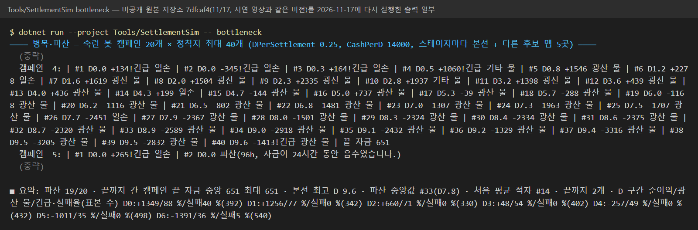

시뮬레이터는 기획 의도에 대한 감각적 검증에는 부적합하지만, 복잡한 수치적 검증에는 몹시 효과적이었습니다. 범용 모디파이어 "시작 자금 ×1.05"가 보유 자금 전체에 곱해져 최대 중첩인 5에서는 정착지를 하나 거칠 때마다 +28%씩 쌓였고, 끝까지 간 캠페인은 정착지마다 손해를 보면서도 자금이 11만~26만까지 불어나기까지 한다는 것을 시뮬레이션을 통해 발견할 수 있었습니다. 코드를 보고 가능성을 상상하지 않으면 실제로 보기도 어려운, **이론상 가능한 허점**을 찾아낸 것입니다.

시작 자금 모디파이어 후보(숙련 봇 캠페인 20개, 시뮬레이터 `-- bottleneck`)

| 후보 | 파산 | 끝까지 간 캠페인 끝 자금(중앙 / 최대) | 비고 |
|---|---|---|---|
| A ×1.05 중첩 5(바꾸기 전) | 13/20 | 118,566 / 264,088 | 복리로 무한히 버팀 |
| **B ×1.05 중첩 1(채택)** | **19/20** | **651 / 651** | 설정 값 하나만 바꿈 |
| C ×1.02 중첩 5 | 19/20 | 771 / 771 | |

B를 고른 이유는 한 번만 받으면 가진 자금의 5%라서 자금이 줄면 보너스도 같이 줄어 무한히 버티게 하지 않기 때문입니다.

## 8. UI: 정보 제공과 정보 전달의 간극

앞에서 다룬 규칙들은 모두 UI를 통해 플레이어에게 전달됩니다. 처음 화면은 정보를 빠짐없이 보여 주었지만, 중요한 정보의 위계는 눈에 띄지 않았습니다.

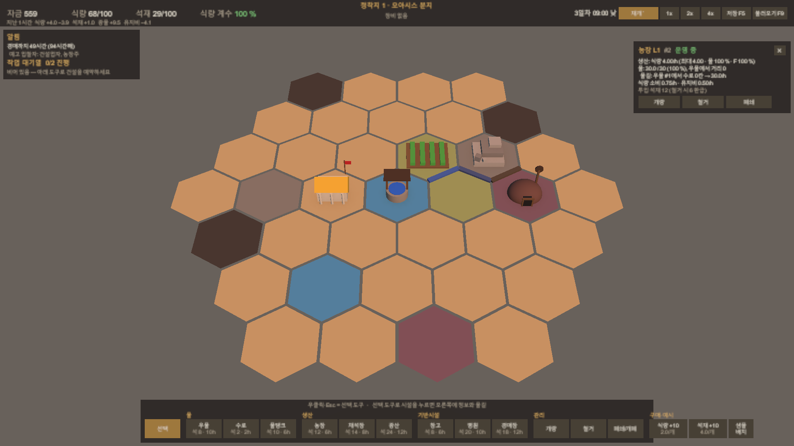

처음 UI는 레퍼런스로 삼았던 Anno·Frostpunk·Cities: Skylines의 익숙한 배치를 참고해 정하도록 AI에게 일임하여 제작된 것입니다. 정보를 빠짐없이 보여 주는 데는 좋았지만 게임에 익숙하지 않은 플레이어에게는 무엇이 중요한지 알아차리기 어렵고, 없으면 당장 문제가 생기는 자원인 자금·식량·석재가 구석에 놓인 작은 글자 한 줄이라 플레이 중에는 거의 보이지 않았습니다.


이런 중요한 정보들을 다른 정보들과 차별화된 위계로 구분해야 한다고 판단하고, 아이콘 조달이 어렵다면 이모지라도 쓰도록 지시하여 개선했습니다.

| 항목 | As-Is | To-Be |
|---|---|---|
| 핵심 자원 | 위쪽 띠의 작은 글자 한 줄 | 아이콘 + 24px 굵은 숫자 카드, 주의는 갈색 · 위험은 붉게 깜빡임 |
| 시설 머리 위 글자 | IMGUI라 결과창 위로 '일손 2/4'가 올라옴 | uGUI 캔버스로 옮겨 결과창 아래에 그려짐 |
| 아이콘 | 없음 | 코드로 그린 64×64 스프라이트(기본 글꼴이 컬러 이모지를 못 그려서) |

처음보다는 나아졌지만, 그와 비슷한 시기에 상위 재화 생산 시설과 재화 판매 패널 등이 추가되면서 UI의 정보량도 함께 대폭 늘어났고 이 때문에 동료 플레이 기록에 "두 번째 경매 때까지 자금이 줄어드는 것을 몰랐다"는 응답을 받는 등, UI는 단순히 디자인을 넘어서 전달할 정보의 구분, 위계 및 방향 설정 등 몹시 중요하면서도 어려운 요소임을 실감했습니다.

## 9. 회고

약 2주 동안 건설·운영 → 경매 → 매각/보류 → 행선지 선택 → 다음 정착지(절차 생성 맵)로 이어지는 MVP 캠페인 루프를 만들었습니다. 그 안에 수로 물 배분, 주택·노동력, 생활 수준, 재해 4종(전염병 포함), 입찰자 영구 모디파이어, 저장·불러오기(명령 기록 재실행)가 들어 있습니다. 당초 계획에는 없던 상위 재화와 병원 등 시뮬레이션 성격이 강한 게임 요소도 더 추가할 수 있었습니다. 동료 플레이테스트 피드백에서는 플레이 루프(완성 → 매각 → 영구 보너스 → 새 정착지)가 재미있다는 점, 짜임새 있는 시뮬레이션, 복잡한 시스템을 알아 가는 재미가 좋은 점으로 꼽히면서 소기의 목적을 달성했다고 볼 근거를 얻었습니다.

다만 같은 동료 플레이테스트 피드백에서 무엇을 해야하는지 모르겠다는 의견도 많이 나오면서, 이런 복잡한 콘텐츠의 추가보다는 튜토리얼이나 UI 등 UX 부분에 더 많은 신경을 써야했다는 반성을 하게 되었습니다. SAIL OR SUNK, Folk Sack 등 다른 프로젝트에서는 게임 규칙과 상호 작용의 피드백을 극대화하여 플레이어의 경험으로 이어지게 만든 것을 저의 강점이라고 생각했는데, AI 구현으로 속도가 붙으면서 더 많은 콘텐츠를 추가하고자 하는 욕심을 냈고 이 과정에서 유저의 경험에 미처 깊이 신경쓰지 못한 것이 주된 원인이라고 생각합니다.

특기할 점으로 정착지를 팔지 않고 오래 감상하고 싶어서 경매 구조가 아쉽다는 피드백도 있었습니다. 후반의 긴장 없는 구간을 잘라 내는 것이 경매 구조의 의도였기에 상충하는 내용이었지만, 만약 이 의견을 받아들여 구조를 보강한다면 자신이 공들여 키운 정착지 감상 카메라 뷰나 엔드리스 모드를 추가함으로써 건설과 운영을 오래 즐기고 싶은 플레이어에게도 맞추는 방향을 생각하고 있습니다.

## 10. AI와 협업한 방식

약 2주 안에 기초적인 경제 및 전염병 등 시뮬레이션 요소가 강한 건설 경영 게임을 만들면서 **기획과 검증만으로 설계의 디테일과 재미를 어디까지 끌어올릴 수 있는지** 확인하고 싶었습니다. AI 에이전트에게 주로 구현을 맡겼고, 저는 기획하고 직접 플레이하며 기획 의도가 제대로 적용되고 있는지 확인하고 수치를 조율하는 일에 집중했습니다.

### 10.1 AI와의 역할 분담

| | 맡은 일 |
|---|---|
| 나 | 기획서 작성 · 규칙 결정 · 플레이테스트 · 문제를 찾아 이슈로 정의 · 결과 검토와 검증 |
| AI (Claude Code 에이전트) | 구현 · 구현하며 정할 세부 사항의 추천 |

작업은 GitHub에 등록된 이슈 단위로 하나씩 "질문 → 구현 → 시뮬레이터·Unity 테스트 → 결정 기록 갱신" 순서로 진행하며, AI가 무엇을 스스로 정했는지 나중에 확인할 수 있도록 결정 기록을 남기게 했습니다. 항목마다 **선택 / 이유 / 대안** 등을 적게 하고, 제가 고른 것은 [사용자 결정], AI가 고른 것은 [자동]으로 구분하여 추후 AI의 실수가 발생해도 그것이 어느 기록을 근거로 도출된 것인지 알 수 있도록 했습니다.

### 10.2 검증 구조: 같은 규칙을 게임·봇·테스트가 함께 확인

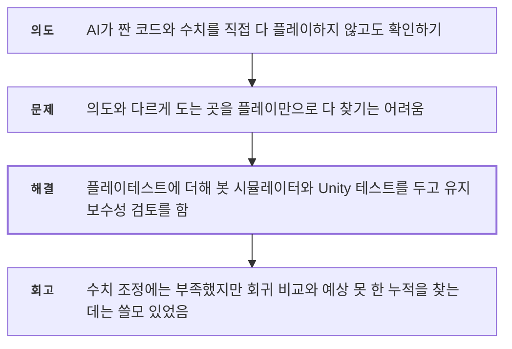

결정 기록으로는 AI가 무엇을 정했는지 알 수 있지만, 그 결과가 의도대로 구현되었는지는 직접 돌려 봐야 알 수 있었습니다. 그래서 게임 규칙을 Unity 밖의 Core에 모으고, Unity 게임·봇 시뮬레이터·자동 테스트가 그 규칙을 함께 쓰게 했습니다. 이 구조 덕분에 AI가 규칙을 만들거나 바꾸면 봇이 게임과 같은 규칙으로 캠페인을 끝까지 여러 번 플레이해 볼 수 있었습니다. 저는 직접 플레이한 감각과 봇의 측정 결과, 테스트 결과를 함께 참조하며 개발에 필요한 판단들을 내렸습니다.

이런 데이터들은 유저의 경험이 어떤지는 평가할 수 없었지만, 사람의 플레이 경향이나 선호가 섞이지 않은 객관적인 수치 데이터를 모으고 QA 부담과 상술한 자금 폭주 사례와 같은 시뮬레이션 오류을 줄이는 데에 큰 도움이 되었습니다.


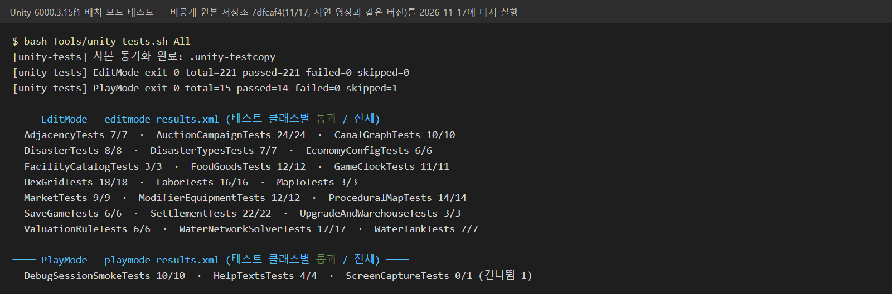

| 수단 | 확인하는 것 |
|---|---|
| 플레이테스트 | 직접 플레이한 감각과 화면이 의도대로인지 |
| Unity 테스트 | EditMode = Core 규칙, PlayMode = 화면 기반 검증   |
| 시뮬레이터 (`Tools/SettlementSim`) | 기준 봇·숙련 봇이 캠페인을 자동으로 돌려 난이도 구간별 순이익·처음 적자·파산을 출력. 고정 검사 두 가지(아래) |

시뮬레이터에는 두 가지 고정 검사를 두었습니다. 원본 v0.8 회귀값은 노동력 등 나중에 추가된 규칙을 끈 상태에서 기획 단계 경제 계산과 같은 값이 나오는지 고정합니다. `-- savecheck`는 저장 파일의 명령 기록을 다시 실행해 같은 결과가 나오는지 확인합니다. 다만 기존 기획 값이 절대적인 기준이 될 수는 없으므로 어디까지나 참고용으로만 활용했습니다.

난수는 시드로 만들어 같은 실행 환경(Unity 또는 시뮬레이터) 안에서는 같은 캠페인·같은 명령이면 같은 결과가 나옵니다(`savecheck`로 확인). 맵 생성은 `DeterministicRandom`과 골든 테스트로 맞췄습니다. 골든 테스트는 시뮬레이터가 만든 맵을 문자열로 저장해 두고 Unity에서 같은 시드로 만든 맵이 똑같은지 비교합니다.

### 10.3 시뮬레이터의 한계

시뮬레이터는 시작 자금 폭주처럼 반복 플레이에서만 드러나는 문제를 찾는 데에는 효율적이었지만, 한계도 명확했습니다. 봇은 사람의 직관적인 플레이를 흉내내지 못했습니다. 숙련 봇조차 물탱크나 시장을 짓지 않았고 사람(플레이테스트에서 난이도 지수 8에서 자산 1만 이상)보다 훨씬 적게 벌었습니다. 봇은 주택·우물도 먼저 챙기지 않아 사람보다 훨씬 비관적인 결과를 냈습니다.(무료 주택을 없앤 뒤 5회 중 2회 두 번째 정착지 파산) 그래서 봇 결과로는 밸런스가 사람에게 맞는지 판단할 수 없습니다. 또 플레이테스트로 규칙이 바뀔 때마다 이전 측정의 전제가 무너져 학습 데이터의 품질도 보장할 수 없었습니다. 10/23 시뮬레이터로 강화 수치를 맞춘 장비 체계는 11/03에 체계 자체가 폐지되었습니다. 결국 시뮬레이터로 맞춘 수치는 나중에 거의 다시 바꿔야 했습니다.

그래서 역할을 다시 나눴습니다. 시뮬레이터는 수치 조정에는 부족했습니다. 하지만 리팩터링 전후 출력이 한 글자까지 같은지 보는 회귀 비교군과 사람이 생각하지 못한 누적(시작 자금 폭주)을 찾는 데는 제 역할을 했습니다. 그래서 사람이 직접 플레이해 수치의 기준을 잡고 시뮬레이터는 그 값을 검증하는 비교군과 예상하지 못한 충돌 지점을 찾는 도구로 쓰는 것이 맞다고 판단했습니다.

### 10.4 유지보수성 정리와 회귀 확인

구현을 AI에 맡겨도 코드는 직접 읽어야 했습니다. 어느 부분이 어떻게 만들어졌는지 알아야 문제에 빠르게 대처할 수 있기 때문입니다. 그래서 AI 작업 지침(`CLAUDE.md`)에 "사용자가 Claude 없이도 코드를 읽고 고칠 수 있는 상태를 유지한다"는 유지보수 원칙을 두었습니다. 그리고 AI에 유지보수성 검토를 요청해 검토 항목 22개를 받고 이슈 12개로 나눠 처리했습니다. 대부분은 게임 동작을 바꾸지 않는 정리였고 그중 하나는 공사 중 인프라 보너스 계산이 운영 중 계산과 어긋나던 버그(물탱크·시장 누락, 우물·경매장 중복)를 고친 것이었습니다.

| 검토 항목 | As-Is | To-Be |
|---|---|---|
| 설정 JSON 키 검증 | 키 이름에 오타가 나면 오류 없이 기본값(0·null)으로 바뀜 | 클래스에 없는 키는 경로와 함께 불러오기 오류, `_`로 시작하는 설명 키만 허용 |
| 생산 공식 | 같은 공식이 네 곳, 생산 시설 목록이 두 곳 → 화면 예상치와 실제가 어긋날 수 있음 | `SettlementRules` 한 곳에 모으고 정산·화면·경매 가치가 함께 씀 |
| 예전 화면 | 새 uGUI와 예전 IMGUI 화면이 함께 있음 | 예전 화면 삭제, 정식 UI 한 벌 |
| 시뮬레이터 측정 모드 | 예전 규칙을 전제한 측정 모드가 남아 있음 | 전제가 바뀐 모드는 삭제, 결정이 끝난 모드는 머리 주석에 '결정 완료' |

정리할 때마다 시뮬레이터 출력 전체가 바꾸기 전과 같은지와 그때의 Unity 테스트가 모두 통과하는지 확인했습니다. 노동력·전염병 같은 새 규칙을 넣기 전에 정돈된 상태를 만들려고 이 정리를 먼저 했고 마친 바로 뒤(같은 10/30)에 두 규칙을 추가했습니다.


11/17 그래픽 개선 뒤에도 같은 방법으로 다시 확인했습니다. 시뮬레이터 출력이 11/04 버전과 한 줄도 다르지 않고 '모든 검증 통과'가 나왔으며 Unity 테스트도 모두 통과했습니다.

### 10.5 AI의 제안과 나의 결정 모아 보기

AI는 구현과 함께 구조·방법·후보를 제안했고 저는 그것을 받아들일지와 무엇을 기준으로 삼을지를 정했습니다. 아래 표는 절마다 나온 그 결정을 모은 것입니다.

| AI가 제안한 것 | 내가 정한 것 | 확인한 방법 |
|---|---|---|
| 게임 규칙을 Unity 밖에 두고 시뮬레이터가 같은 소스를 쓰는 구조 | 받아들임. 봇이 같은 규칙으로 대량 플레이할 수 있어서 | 시뮬레이터·EditMode 테스트가 같은 Core를 검사 |
| 맵을 BSP로 나눠 구역마다 장애물 지형 하나, 세부 수치 | 배치 규칙 네 가지와 예시 맵을 먼저 주고 AI가 제안한 수치를 확인해 확정 | 시뮬레이터 프로토타입에서 40장 모두 첫 시도 생성, 규칙 위반 0 |
| 분 단위 착공은 비추천, 대신 타협안 | 처음엔 따랐다가 4차 플레이테스트 뒤 "명령 시각 + 공사 시간에 정확히 완공"으로 뒤집음 | 플레이테스트, 숙련 봇 순이익 비교 |
| 병원 회복 배율 후보의 계산 | 3~4배면 병원만으로 전염병이 끝난다고 보고 2배(F)를 고름 | 시뮬레이터 후보 비교, 문서 작성 중 재계산 |
| 시작 자금 폭주를 찾은 측정과 후보 비교 | 중첩 1(B)을 고름 | 숙련 봇 캠페인 20개 |
| 유지보수성 검토 항목 22개 | 이슈 12개로 나눠 처리 | 정리마다 시뮬레이터 출력 동일, Unity 테스트 통과 |
| UI 배치(Anno·Frostpunk·Cities: Skylines 참고, [자동]) | 자금·식량·석재에 다른 위계를 주라고 지시 | 플레이테스트, 동료 플레이 |

## 11. 남은 문제

- **튜토리얼과 안내 부족** : 동료들에게 플레이를 부탁해 보니 대부분 무엇을 어떻게 해야 할지 몰랐습니다. 동료 피드백에서도 튜토리얼 부재, 한꺼번에 열리는 시설, 텍스트에 의존하는 정보 전달(마우스 오버 글이 많음, 수로 연결 상태를 알기 어려움)이 공통으로 지적되었습니다.
- **개선 — 단계적 해금** : 우물·주택·수로처럼 기반이 되는 시설을 먼저 열고 곡물을 쓰는 목축지·제분소는 경작지를 지은 뒤에 열리게 하는 방향입니다(아직 구현 전). 시설 사이의 관계를 순서대로 익히고 해금 순서가 튜토리얼 역할도 하게 하는 것이 목표입니다.
- **자금 감소 전달** : 동료 플레이 기록에서 자금이 줄어드는 것을 몰랐다는 응답처럼, UI상 나타나는 정보의 위계를 고친 뒤에도 주요 정보의 시인성은 아직 확보되지 않았습니다.
- **측정 봇의 한계** : 봇 결과로는 지금 밸런스가 사람에게 적합한지 판단할 수 없습니다. 만약 개발이 재개된다면 가장 먼저 부딪힐 문제 중 하나입니다.
- **그래픽** : 11/17에 시설은 텍스처 3D 모델로, 지형·수로는 굴곡과 모양으로 바꿨지만 UI는 여전히 코드로 만든 uGUI입니다.
